# Elemental Arena

A skillshot VFX sandbox — and the game that grew around it — built with **Three.js**, **Vite** and
hand-written **GLSL**. Ten spells, a procedurally generated ruined keep, four kinds of monster
that walk in and try to kill you, and a chat box you can give orders to in plain English — backed by
a local AI model in [LM Studio](https://lmstudio.ai) or any OpenAI-compatible server.

<p>
  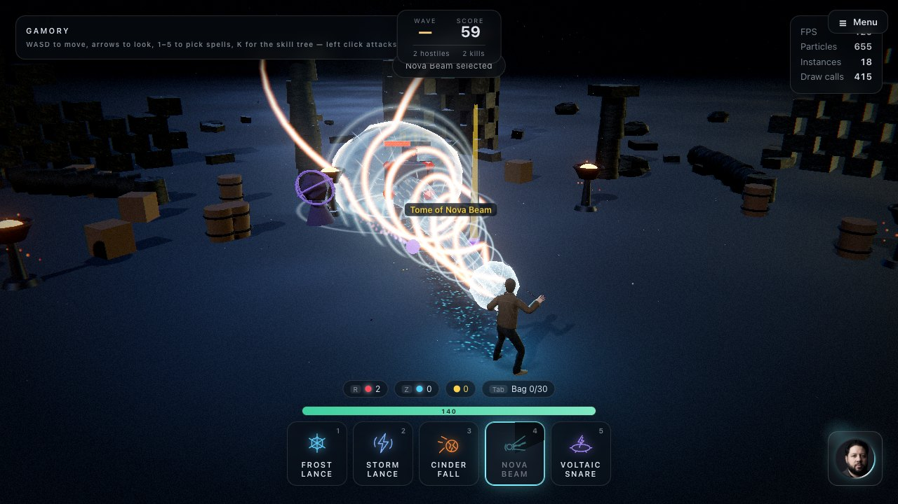
  
</p>

> **On Windows?** Jump to [Running on Windows](#running-on-windows). **Setting up the AI?** See
> [Wiring the model](#wiring-the-model). **AI-built maps?** See
> [AI-built maps and the 3D asset library](#ai-built-maps-and-the-3d-asset-library). **Making your
> own levels and story?** See [Level editor and campaign](#level-editor-and-campaign).

Ten spells on keys **1–0**, and two ways to aim them. Seven are **line casts**: press the key to
arm, a MOBA-style arrow appears on the ground and swings with the mouse, right-click to fire. The
other three are **far casts**: the arrow is replaced by a circle with a deliberately thick boundary
that follows the cursor and answers the only question a ground-targeted AoE has to answer before you
commit — how much space is this going to take.

<p>
  
  
</p>

**1 — Frost Lance.** A fracture front races out along the line while a field of ice crystals
tears up out of the floor behind it — small and dense at your feet, opening into a wall of blades
at the far end, with a cluster thrown up around the impact point.


**2 — Storm Lance.** A bolt leaves the caster's hand and a bundle of lightning filaments is drawn
out behind the strike front, holds while it gutters and re-strikes, then blows out. Sparks come
off it the whole way, the floor underneath takes a branching electric burn and a dark scorch, and
the far end gets a shell of ionised air.


**3 — Cinder Fall.** A burning rock is lobbed downrange on an arc, trailing a raymarched wake of
burning gas and heating up the whole way: the lava seams splitting its surface prise wider and
brighter as it comes in. It detonates on arrival, throws its own shattered chunks across the floor, and tears the
ground open into a network of molten cracks that keep glowing while the crater burns out.


**4 — Nova Beam.** The caster winds a ball of light up in both hands, pulling motes in out of the
air, then lets a column of it out along the line — white-hot core, cyan sheath, gold ribbons
spiralling around it and shock discs racing down it. It *holds* there, burning into the floor and
throwing spray back up the beam, before collapsing to a thread and blinking out. The only cast in
the sandbox that is still happening a second after it landed.


**5 — Voltaic Snare.** The far cast. A leash of current is whipped out across the floor, and where
it lands the ring snaps open past its own radius and pulls back onto it: a violet column tears up
out of the middle, tendrils crawl outward to the boundary, arcs run around the rim and the whole
disc burns. It holds there re-striking and hauling the air up into the pillar, then collapses to a
thread. The circle you measured out before the click is exactly the circle you get.


**6 — Glacial Crown.** The second far cast, and the snare's opposite answer to the same circle. A
cold front races across the floor to the point, the disc freezes out to the boundary, and a ring of
crystal blades tears up out of the ground around it — the blade nearest the caster first, the wave
running round both sides to close behind — with a skirt of wreckage banked against their feet. The
middle stays open: the read is a wall you are looking into. It stands there glinting and breathing
cold off its rim, then shatters plate by plate and sinks back into the floor.


**7 — Arc Chain.** A bolt leaves the hand, finds the first monster in the line and leaps from it
to the nearest one it has not hit yet — up to four leaps, each a little weaker (34 → 29 → 25 → …),
with a short stun on every body it passes through. Strong against a crowd, weak against one target.


**8 — Void Orb.** A slow violet orb drifts down the line. Every third of a second it lashes out
with arcs at the two closest monsters within reach, slowing them, and when it reaches the end it
collapses into a burst that throws everything nearby back. Cast it through a crowd and walk away.


**9 — Hailstorm.** The third far cast. A cloud gathers over the circle and hammers it with hail
for four seconds — every monster inside takes a hit about twice a second and is chilled, the
floor frosts over and big stones shatter now and then. The answer to a choke point.


**0 — Blink Strike.** You vanish and reappear down the line, up to 12 m, and a blade of light
races along the path behind you, hitting everything you passed. A burst where you land throws the
nearest monsters back. It stops short of walls and rocks, so it is an escape as much as an attack.


Spells 7–0 are original takes on classic action-RPG and MOBA spell types (chain lightning, a
roaming orb, a damage-over-time storm, a dash). Unlike the first six they have no bespoke shader:
each is a short file (`src/abilities/ChainAbility.js`, `OrbAbility.js`, `HailAbility.js`,
`BlinkAbility.js`) assembled from the game's shared particles, burst spheres, ground decals and
lights through `src/abilities/SpellFx.js` — the pattern to copy for a new spell. Their damage
rules (`kind: 'chain' | 'orb' | 'storm'`) live in `settings.combat` and `src/game/Combat.js`, and
their main dials are in the **G** editor under each spell's name.

> The clips are recorded in the browser straight from the game canvas (`docs/spells/*.gif`).

Everything you can see in the first six is generated. There are no textures, no sprite sheets and no meshes on
disk except the character: the crystals are procedural geometry, the bolt is a strip of ribbon
placed entirely by a vertex shader, the meteor is an icosphere cratered and sliced by fracture
planes on the CPU, the beam is a parametric tube drawn three times at three radii, the snare's
whole cage is that same ribbon strip threaded along four different parametric paths, the arrow, the
targeting circle, the rime, the burns and the molten cracks are signed-distance and noise shaders,
and the mist, sparks, chips and glitter are GPU particles.

**Every parameter is a live slider** — 938 of them — and they stay live while the simulation is
paused. That is the point of the project: freeze a frame mid-eruption, mid-strike or mid-burn with
**P**, then reshape the silhouette, the palette and the timing against a still image.

References for the look: `icecast.jpg`, `thundercast.jpg`, `superbeam.jpg` and
`electricalboost.jpg`.

---

## Quick start

Requires **Node.js 22.12+** (or 20.19+) and Git. See [requirements.txt](requirements.txt) for the
full list. The JavaScript libraries are installed by npm, not pip.

```bash
npm install
```

```bash
npm run dev
```

Then open the URL Vite prints (default <http://127.0.0.1:5173>).

**The first `npm run dev` also downloads the 3D asset library** (about 7 GB of free CC0 models, see
[AI-built maps](#ai-built-maps-and-the-3d-asset-library)) in the background. The game is playable
straight away and picks up each pack as it lands; later starts skip the download. `npm run build`
downloads it first if it is missing. Set `LIBRARY_AUTO_FETCH=0` in `.env` to turn this off.

```bash
npm run build
```

```bash
npm run preview
```

### Running on Windows

Everything runs natively on Windows 10/11. You don't need WSL. Use **PowerShell** or **Command
Prompt**. The commands below are PowerShell.

**1. Install Node.js and Git** (once). Either download the installers from
[nodejs.org](https://nodejs.org) (pick **22 LTS**) and [git-scm.com](https://git-scm.com), or:

```powershell
winget install OpenJS.NodeJS.LTS
winget install Git.Git
```

Close and reopen the terminal afterwards so `node` and `git` are on the `PATH`, then check:

```powershell
node -v    # must print v22.12 or newer (v20.19+ also works)
npm -v
```

**2. Get the code and install the libraries.** `npm install` reads `package.json` and installs
three, lil-gui and Vite into `node_modules\`. There is nothing to `pip install`.

```powershell
git clone https://github.com/hyper07/LinearAbiltyCastingThreeJS.git
cd LinearAbiltyCastingThreeJS
npm install
```

**3. Run it.**

```powershell
npm run dev
```

Open <http://127.0.0.1:5173> in **Chrome** or **Edge**, pick a loadout and press **Start Game**.
Stop the server with `Ctrl+C`.

The first start also downloads the 3D asset library (~7 GB) in the background; lines starting
with `[library]` in the terminal show its progress. Make sure the drive has about 10 GB free. If
you stop the server midway, the next `npm run dev` resumes where it left off.

The class models ship with the game (see [Classes](#classes)); `npm run fetch-characters`
re-downloads them if they are ever missing. It works the same on Windows.

**Optional: the AI chat commander.** Install [LM Studio](https://lmstudio.ai) for Windows,
download and load a model, and start its server. Then copy the settings template and edit it:

```powershell
Copy-Item .env.example .env
notepad .env
```

The full steps are in [Wiring the model](#wiring-the-model). Restart `npm run dev` after editing
`.env`. Without a `.env` the game still runs. The chat panel just says "reflex only" and falls
back to keyword commands.

**Optional: production build without Docker.**

```powershell
npm run build
node --env-file=.env server/server.js   # or just: node server/server.js  (no .env)
```

Then open <http://localhost:8787>. The server listens on all interfaces, so Windows Firewall may
ask for permission the first time. *Private networks* is enough. With
[Docker Desktop](https://www.docker.com/products/docker-desktop/) installed,
`docker compose up --build` works exactly as described in [Production — Docker](#production--docker).

#### Windows troubleshooting

| Symptom | Fix |
| --- | --- |
| `npm : File ...\npm.ps1 cannot be loaded because running scripts is disabled on this system` | PowerShell's execution policy. Run `Set-ExecutionPolicy -Scope CurrentUser RemoteSigned` once, or use Command Prompt (`cmd`) instead. |
| `'node' is not recognized as an internal or external command` | Node was installed after the terminal was opened. Close every terminal window (and VS Code) and open a new one. |
| `Cannot find module '@rolldown/binding-win32-x64-msvc'` or other native-binding errors | `node_modules` was copied from a Mac/Linux machine. Those binaries are per-OS. Delete it and reinstall: `Remove-Item -Recurse -Force node_modules; npm install`. Never copy `node_modules` between machines. |
| `npm install` or `npm run dev` complains about the Node version | Vite 8 needs Node 20.19+ or 22.12+. Upgrade with `winget upgrade OpenJS.NodeJS.LTS`. |
| Black canvas, or very low FPS on a laptop | The browser is on the integrated GPU or has hardware acceleration off. Turn on *Settings → System → Use graphics acceleration* in Chrome/Edge. Then in *Windows Settings → System → Display → Graphics*, set the browser to **High performance**. `chrome://gpu` should list WebGL as *Hardware accelerated*. |
| `Port 5173 is already in use` | Another dev server is running. Close it, or use `npm run dev -- --port 5174`. |
| Chat panel still says "reflex only" after creating `.env` | Restart `npm run dev`. Then check that LM Studio's server is **running** with a model **loaded**, and that <http://127.0.0.1:1234/v1/models> opens in the browser. `LLM_MODEL1` must match an id listed there, and the URL must end in `/v1`. If LM Studio is on another PC, enable **Serve on Local Network** there and allow LM Studio through that PC's Windows Firewall. |
| `[library] … failed` or `skip …: tar exited` in the terminal | The library downloader unpacks zips with Windows' built-in `tar` (Windows 10 1803 or newer). Update Windows, or install 7-Zip and run `npm run library:fetch` again. Failed packs are skipped; the rest still work. |
| Maps are made of plain grey boxes and cones | The asset library has not finished downloading (World tab shows progress), or was turned off with `LIBRARY_AUTO_FETCH=0`. Run `npm run library:fetch`. |
| Console shows `[AssetLoader] failed: ./models/walk.fbx` / `run.fbx` | Expected if you haven't added the Mixamo walk/run clips. The game falls back to a procedural gait (see below). |

### Assets

Six binary assets are served from `public/` and loaded automatically at boot:

| File | Purpose |
| --- | --- |
| `public/models/Idle.fbx` | Rigged character **and** its idle animation clip |
| `public/models/diffuse.png` | The character's colour map |
| `public/models/cast1.fbx` | Cast animation |
| `public/models/cast2.fbx` | Cast animation |
| `public/models/cast3.fbx` | Cast animation — the default for Frost Lance, Root Snare and Glacier Crown |
| `public/models/walk.fbx` | Walk cycle (Mixamo, **In Place**, same character as Idle) |
| `public/models/run.fbx` | Run cycle (Mixamo, **In Place**, same character as Idle) |
| `public/hdri/spruit_sunrise.hdr` | HDR probe used for image-based lighting and crystal reflections |

All FBX files are Mixamo exports of the same rig, each carrying a skinned mesh plus one
animation stack. The character comes from the idle file; cast and locomotion files are loaded
for their clip alone, and the duplicate rig that arrives with each one is released the moment its
`AnimationClip` has been taken. Clips bind to the skeleton by bone name, which is the whole reason
an animation authored in another file plays here without retargeting.

**Locomotion clips.** Download **Walking** and **Running** from [Mixamo](https://www.mixamo.com/)
for the same character as `Idle.fbx`. Export as FBX, check **In Place**, and save as
`walk.fbx` and `run.fbx` under `public/models/`. Without them the game falls back to the older
procedural gait layered on idle (ankles and arms will not match a proper walk/run). Each character
definition points at a **motion dataset** (`motionDataset` in the platform catalog) that lists
which clip ids to load and how to blend idle ↔ walk ↔ run by ground speed.

**How games handle natural movement.** The idle pose is never reused for walk or run — each gait
is its own authored clip. Runtime code runs a **1D blend tree** (speed → weights) and optionally
**foot IK** on top of the blended result so feet stay planted on slopes. **Cloth and capes** are
simulated on secondary bone chains *after* the skeleton pose (Verlet/spring or engine physics
bones); they are not part of locomotion joint data. See `LocomotionPlayback.js` and
`SecondaryMotion.js`.

**Class bodies.** The nine bodies the classes wear are committed in
`public/models/characters/<look>/model.glb` — Knight, Mage, Barbarian, Rogue, Hooded rogue and four
skeletons from the CC0 [KayKit Adventurers](https://github.com/KayKit-Game-Assets/KayKit-Character-Pack-Adventures-1.0)
and [Skeletons](https://github.com/KayKit-Game-Assets/KayKit-Character-Pack-Skeletons-1.0) packs
(`npm run fetch-characters` downloads them again). They share one rig, so walk, run, idle and cast
clips embedded in each GLB work on every class. See [Classes](#classes).

The rig ships no material, so `diffuse.png` is loaded beside it and assigned as the colour map when
the imported materials are converted to PBR — an FBX that *does* carry an embedded texture keeps its
own, since that map is authored against its own UVs.

Every ability picks the clip it throws — `castAnim` in its settings block, a dropdown under **The
cast** in its editor folder. Out of the box slots 1, 5 and 6 — Frost Lance, Root Snare and Glacier
Crown — throw `cast3`, and the other three throw `cast1`. The clip is a one-shot laid over
the looping idle, with `character.castBlendIn` / `castBlendOut` as the two edges of that overlap.

The HDR is loaded as image-based lighting and as the reflection source for the ice — it is never
shown as a visible sky. The stage keeps its flat dark backdrop.

### Classes

<p>
  
  
</p>
<p>
  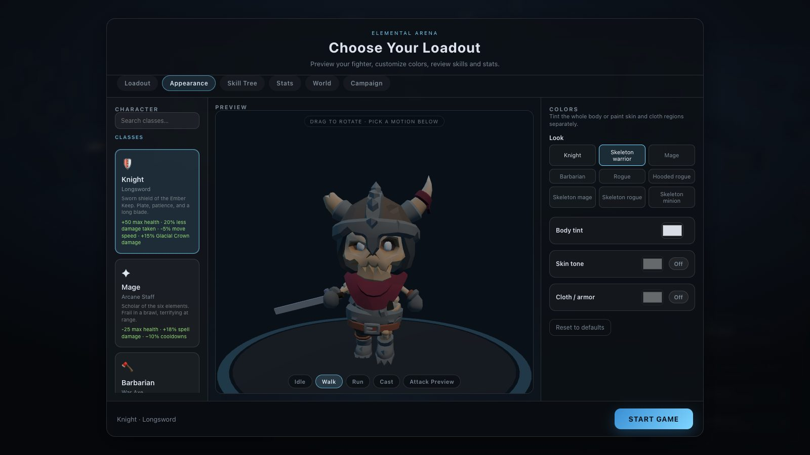
  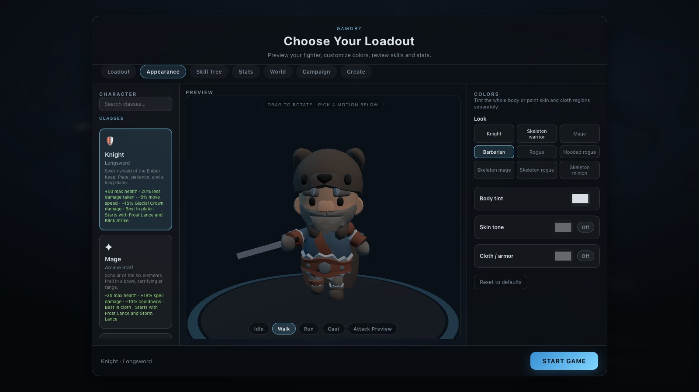
</p>

Pick a class in the main menu. Every class casts the same six spells; the class sets the body, the
starting weapon, the close-range attacks and a set of bonuses that stack with gear and skill books:

| Class | Starts with | Bonuses |
| --- | --- | --- |
| 🛡 **Knight** | Longsword | +50 health, 20% less damage taken, −5% speed, +15% Glacial Crown |
| ✦ **Mage** | Arcane staff | −25 health, +18% spell damage, −10% cooldowns |
| 🪓 **Barbarian** | War axe | +70 health, 10% less damage taken, +8% speed, +20% Cinder Fall |
| 🏹 **Amazon** | Longbow | +10% speed, +12% critical chance, +20% Storm Lance |
| 🗡 **Shadowblade** | Twin daggers | −10 health, +15% speed, +8% critical chance, +15% Voltaic Snare |
| ✚ **Templar** | War hammer | +30 health, 10% less damage taken, +25% Nova Beam |
| 💀 **Bonecaller** | Necromancer staff | −10 health, +10% spell damage, −6% cooldowns, +20% Voltaic Snare |
| 🌿 **Wildwarden** | Druid staff | +20 health, +20% Glacial Crown, +15% Frost Lance |
| ⚡ **Elemental Caster** | Arcane wand | The sandbox original — no bonuses, its own Mixamo body |

**Appearance → Look** dresses any class in any of the nine bodies (Knight, Mage, Barbarian, Rogue,
Hooded rogue, Skeleton warrior/mage/rogue/minion), the class's own picks listed first, and the colour
tints still apply on top. The choice is remembered per class. Classes are defined in
`src/platform/character/classes.js`.

---

## Controls

| Input | Action |
| --- | --- |
| **W A S D** | Run — relative to the camera, so W is always "away from me" |
| **Shift** | Sprint |
| **Alt** | Walk |
| **Space** | Jump |
| **C** | Sit — meditate, and recover health several times faster |
| **← →** or **Q E** | Turn the view |
| **↑ ↓** | Tilt the view |
| **1** | Arm Frost Lance — press again to put it away |
| **2** | Arm Storm Lance |
| **3** | Arm Cinder Fall |
| **4** | Arm Nova Beam |
| **5** | Arm Voltaic Snare — the far cast, aimed with a circle |
| **6** | Arm Glacial Crown — a far cast |
| **7** | Arm Arc Chain |
| **8** | Arm Void Orb |
| **9** | Arm Hailstorm — a far cast |
| **0** | Arm Blink Strike — jump down the line |
| **Move the mouse** | Swing the aim arrow, or move the far-cast circle |
| **Right click** | Cast along the arrow, or drop the circle where it is |
| **Left click** | Your class's close-range attack |
| **Esc** | Cancel an armed cast |
| **Right mouse + drag** | Orbit the camera |
| **Scroll** | Zoom |
| **T** / **Enter** | Focus the commander — type an order in plain English |
| **N** | Send the next wave now |
| **M** | Summon one random monster |
| **B** | Show/hide the run HUD (wave, score, health) |
| **G** | Show/hide the VFX editor — starts hidden |
| **P** | Pause / resume — *the editor keeps applying* |
| **C** | Clear all effects, monsters and broken props |
| **H** | Hide the controls panel |

**Esc** does double duty: it drops an armed cast, and it hands the keyboard back if the commander
has focus. Keys pressed while the chat input is focused never reach the game, so typing an order
cannot cast by accident.

`range` and `minRange` are per ability, so the indicator's reach changes with the slot you have
selected. Aiming closer than the selected ability's `minRange` tints it red and refuses the cast;
set `minRange` to 0 if you would rather cast at your own feet, which is what the Snare ships with —
a trap you cannot drop on yourself is missing half its uses. Cooldowns are per ability too, so
spending one slot never locks the other out.

---

## Moving

The abilities sit on the number row and the letters belong to movement: **WASD**
to run, **Shift** to sprint, **Alt** to drop to a walk, **Space** to jump, **C**
to sit. The **arrow keys**
(or **Q**/**E**) turn and tilt the view, so you can swing the camera around while
running without letting go of the mouse; right-drag still orbits.

Movement is expressed in the camera's frame and rotated into the world, so W is
"away from me" however the view has been turned — the only mapping that survives
a camera the player controls. That also means the camera's azimuth has to be
something *only the player* changes: `OrbitControls` re-derives its angle from
wherever the camera is each frame, so moving the follow-target without moving the
camera tilts the offset between them and the orbit slowly drifts. Left alone,
that quietly rotates what "forward" means and holding W curves you into a circle.
`CameraRig` carries the camera along with its target by the same delta, which
keeps the offset exactly invariant.

Aiming outranks running. With a cast armed the body faces the arrow and you
strafe around your target; with nothing armed it turns to face where it is going.

### The gait

**There is no walk clip.** The character ships with an idle loop and three cast
throws, and that is the entire animation budget. So `animation/Locomotion.js`
does not play animation — it **poses bones on top of** whatever the mixer just
wrote. `CharacterController.update` runs `mixer.update(dt)` and then calls
`applyPose`, which composes a gait over the idle the mixer left behind. The idle
keeps breathing underneath, and blending the walk away is one number going to
zero rather than a clip crossfade.

The thing that makes it read as running rather than sliding is that **the foot's
position is what gets driven, and the joint angles are solved from it.** Through
stance a planted foot has to travel backward relative to the body at exactly the
body's speed, so that is what the leg is given — a linear sweep, which is what an
inverted pendulum does — and the hip angle comes out of a one-line inverse
kinematic solve (a two-segment leg with a knee angle κ behaves as a single strut
of length `L·cos(κ/2)` pointing along `hip + κ/2`, so the hip is one arcsine).

Driving the hip directly instead fails twice over, and both failures were
measured rather than guessed:

- A **sine-shaped hip** matches the body's speed at one instant per step. The
  foot was planted for 21% of the cycle and skating either side of it.
- Even a **linear hip sweep** skates once the knee moves, because a bending knee
  shortens the leg and drags the foot with it. A sprint measured the foot
  dragging backward at 7 m/s.

Three more things fall out of the same principle:

- **The phase advances by distance travelled, never by time.** Feet that cycle
  on a clock skate whenever the body is slowed, shoved or accelerating.
- **Cadence is the parameter and stride falls out of it**, not the other way
  round. People barely vary cadence — roughly two steps a second walking, four
  and a bit flat out — and cover ground by lengthening the step. Fixing the
  stride instead means a faster body just cycles the same short steps quicker;
  an earlier pass ran at 4 m/s on 4.2 steps a second where a real runner uses
  about 2.9, and it read exactly as you would expect: a scurry.
- **The body's vertical is not a bob, it is forced.** A straight leg is a chord:
  standing on a leg swung out to ±A puts the hips `L(1 − cos A)` lower than
  standing on a vertical one. So the height is read straight off whichever leg is
  carrying the weight, shortened by however much that knee has given. The walk's
  vault over a straight stance leg and the run's dip into a bent one both fall
  out of that for free, instead of being two curves to author and blend — and
  the feet can stay on the floor for the whole of stance, which is the other
  half of not skating.
- **A walk and a run are different gaits, not one gait at two speeds.** The
  `stanceWalk` / `stanceRun` duty cycle is what separates them: a walk keeps a
  foot down for 62% of the cycle (there is a moment with both down), a sprint for
  38% and spends the rest airborne, arcing over the gap. The three gears do not
  *set* a gait — they set a speed, and the gait is read off it, so accelerating
  out of a walk blends into a run rather than switching a state.

A run also does not reach symmetrically. `strideBias` lands the foot closer under
the body than it ends up behind, which is both what runners do and what stops the
hips having to sink to meet a far-forward contact; `ankleExtend` lengthens the leg
at push-off, because rising onto the ball of the foot is real reach; and `maxDrop`
caps the sink, because at the extremes of a long stride the chord model asks for
more than any runner gives. It is wrong there for a specific reason — the *contact
point* migrates, from heel to toe — so letting the foot ride a little high beats
pumping the whole body a third of a metre every step.

### The body is not a pogo stick

A rigid leg is a chord, so reaching out to ±A sinks the hips by `L(1 − cos A)` —
which for this rig's step length is **17 cm**. A person's head moves about five
walking. Seventeen centimetres a step is a pogo stick, and it is most of what
made an earlier pass read as a limp.

Nobody has to bounce like that because the leg does not stay one length: the
ankle plantarflexes at push-off, the knee finishes extending, the pelvis lists
and rotates, and the centre of mass is not the hip joint. Modelling each of those
is not worth it; modelling their *sum* is. `legExtend` drops the foot's contact
point below the ankle toward the ends of the stroke, and `dropWalk` / `dropRun`
cap what is left.

That term belongs to the body's **height** and not to the IK solve, which is a
distinction worth stating because getting it wrong looks equivalent and is not.
Adding it to `effective` before solving for the hip puts the *ankle* short of its
target — the thigh and shin cannot actually get any longer — and the foot skates.
Measured, that mistake cut the planted fraction of a walk from 47% to 24%.

### The upper body has to participate

Legs alone are a shuffle. Three things were missing and all three are worth more
than they cost:

- **The arms are placed, not nudged.** Same reason as the legs, but blunter: this
  idle is a *casting* stance with the arms up and forward, so adding a swing to it
  leaves the upper body visibly inert while the legs work. `_aimTo` is the
  two-axis version of `_aim` — it corrects sideways placement as well as swing,
  which matters because correcting only the fore-aft angle leaves the arms splayed
  like a scarecrow's. Elbows close toward a right angle as the pace picks up. The
  whole thing fades out while a cast clip is playing, because that clip is doing
  something deliberate with the arms and it outranks a gait.
- **The phase was wrong.** `u = 0` is the left heel strike, so the left leg is at
  its most *forward* there — everything that swings opposite it peaks at `u = 0`
  and wants a **cosine**. An earlier pass had the arms on `sin`, putting their
  extremes at u ≈ 0.31: a third of a cycle out of step with the legs, which is
  about as wrong as arm swing can be while still moving.
- **The pelvis travels sideways** over whichever foot is carrying the weight — a
  couple of centimetres at a run, twice that at a walk. It is the smallest number
  here and it does the most: without it the body runs on rails, and every other
  cue is arguing with a torso that never commits to a foot.

The two halves of the torso also have to disagree — the pelvis turns *with* the
forward leg, the shoulders turn *against* it and by more, and the chest
counter-pitches against the stride so the torso does not ride along as one block.

Nothing is symmetric, either, because bodies are not. The amplitudes come from
gait references rather than instinct, and they are smaller than instinct says: a
walking arm swings about 22° behind and only 8° in front (an earlier pass swung
±39° at a *walk* — twice what a strolling human does), while a sprinting arm
pumps nearly symmetrically, hand from hip to chin. The elbow *works* through the
stroke — closing toward 60–70° included at the top of the forward swing, opening
past 130° driving back — because an elbow held at one angle is a hinge, not a
joint. The knee folds hard just after toe-off rather than at mid-swing, is
straightening again well before the foot lands — and at a run it *never* fully
straightens: biomechanics puts 20–40° of flexion in it even at contact
(`kneeContact`), and a leg that snaps straight at heel strike is a walking leg
whatever the speed. And a running stance reaches further behind the body than in
front of it (`strideBias`), which is both what runners do and what stops the hips
having to sink to meet a far-forward contact.

### The lean comes from the ankles

Runners lean forward — about 8° at a jog, low twenties flat out, and the
coaching literature is emphatic about *where from*: the ankles, one straight
tilted line, ribs stacked over the pelvis. An earlier pass put the whole lean on
the spine, which is the classic "hunched" form fault — and because the pelvis
stayed vertical, the legs hid it entirely and the run read as an upright
speed-walk. Now half the lean goes on the **Hips** (the whole skeleton pitches,
and the legs — aimed at absolute angles afterwards — stay planted), with the
rest spread up the spine so the chest leads slightly.

The head is *partly* stabilized. A real head counter-rotates to keep the gaze
level, but cancelling the whole lean (an earlier pass took back 80% of it)
leaves the silhouette bolt upright. Half stays in, so the head visibly commits
to the run and the eyes still mostly find the horizon.

Lean also comes from *acceleration*, not just speed — tipped into a start, back
against a stop, banked a little into a turn (`accelLean`, one smoothed rule from
David Rosen's Overgrowth GDC talk: tilt toward the acceleration vector). It is
what makes starting and stopping look like they cost something.

### The hands had to stop casting

This rig has no finger bones — the spread, palm-open casting hand is baked into
the skin — and it was the single loudest tell left: every forward arm swing read
as a push, every neutral frame as presenting. The one joint that exists is the
wrist, so the wrist does all the acting (`handRoll`, `handCurl`): rolled about
the forearm's own axis so the palm turns in toward the body, flexed a little so
the fingers trail rather than present.

### The hands were spinning

The wrist styling above was, for a while, the single worst thing in the file —
and not because the angles were wrong.

Everything here is composed *over* whatever the mixer wrote, which quietly
relies on the mixer having written something. `mixer.update` restores an
animated bone to the clip's value every frame, so last frame's delta is gone
before this frame's is applied. **A bone no clip mentions is never restored**,
and a delta applied to it compounds instead. This rig's idle has 21 tracks and
not one of them is a hand:

```
drivenButNotAnimated: [ "LeftHand", "RightHand", "LeftToe_End", "RightToe_End" ]
```

So a constant wrist roll became a few thousand degrees a second of spin. Measured
across a cycle, the hand's roll had a spread of ~178° with a phase coherence of
0.02–0.48 — that is, no repeatable relationship to the gait at all; it was simply
tumbling. After resetting the hand to its rest pose before posing it, the same
measurement reads 9–26° at coherence **1.00**.

Two lessons worth keeping. Absolute posing — `_aim`, `_aimTo` — is immune,
because it measures where the limb actually is and corrects the difference; only
raw `_rotate` deltas can compound, which is why `setAnimatedBones` exists and
why it is asked once, at load, rather than assumed. And every hand angle tuned
before this was fitted to a tumbling bone: they were noise, and they were
re-derived from scratch afterwards.

### Three things the arms were doing that nobody wrote

- **A kink twice a cycle.** An arm drives further back than it reaches forward,
  and the obvious way to say so — scale the swing only where it is negative —
  puts a first-derivative discontinuity in the target the instant the arm passes
  vertical. The elbow reads the same number and kinks with it; nothing
  downstream smooths it. The same two extremes come out of an affine remap of
  the cosine (`phase·(1+r)/2 + (1−r)/2`), which has no kink anywhere.
- **The shoulder moved after the arm.** It was rotated *after* both arm aims,
  and it is the arm's parent — so it carried the arm off the absolute direction
  it had just been aimed at, every frame. The torso already obeyed this rule;
  the girdle did not.
- **The elbow barely worked.** Modulated by a quarter and bent through the whole
  stroke, it pinned the hand in front of the chest: the arm swung, but the hand
  never went near behind the body. Opening it at the back is what turns a swing
  into a drive — measured, the hand's fore-aft travel went from a
  forward-biased 0.61 m to 0.67 m biased *backward*.

### The phase was derived, not integrated

`_phase()` was `distance / strideLength`. That looks equivalent to integrating
and is not: stride length is a live function of speed, so changing gear silently
rescaled the entire accumulated odometer. The error grows with distance — after
40 m, breaking from a jog into a sprint teleported the legs 0.19 of a cycle in
one frame. The phase is now advanced by the fraction of *this* stride covered
this frame, so a change of stride only affects what happens next; the same
measurement now reads 0.021, which is just the normal per-frame advance.

One thing that is *not* worth its accuracy: the sideways weight shift is a
translation of the whole body, so it drags the planted foot with it. Kept to a
couple of centimetres — which is all a real centre of mass moves anyway.

Rotations are applied about a **world** axis — the body's own right and forward —
never about a bone's local axes. Mixamo bind poses are not axis aligned (the
shoulder in particular is rolled), and posing in local space gives you limbs that
swing diagonally through the torso.

### Absolute, not additive

Everything above composes *over* the idle, which is right for a lean or a spine
twist. The legs are the exception, and they have to be, because **this idle is a
bladed combat stance**: it holds the left foot 27 cm forward and the right 28 cm
back, and turns the pelvis 48° off square so the hip sockets themselves are
staggered by 14 cm.

Lay a symmetric swing over that and each leg oscillates about its own offset
centre. The left foot spends nearly the whole cycle in front of the right — they
barely pass — and the walk comes out as a shuffle where one leg leads and the
other is dragged after it. Measured, the left-minus-right foot offset ran from
−0.44 m to **+1.37 m**: a limp, not a walk.

So the legs are *aimed* rather than nudged. `_aim` measures where a segment
actually points — from its own position to its child's — and applies only the
difference from the target, which cancels whatever stance the idle was holding.
`_squarePelvis` does the same for the hips: it measures the angle of the line
between the sockets and turns the pelvis until it is square to the heading. Only
the sagittal component is corrected, so the rig keeps its own stance width and
toe-out.

That sign was worth checking by measurement rather than by argument. Backwards,
`_squarePelvis` did not merely fail to square the pelvis — `Hips` is the root of
the skeleton, so it swung the entire body 84° off its heading while it ran.

Measured on open floor, after:

| gear | speed | cadence | stride | duty | foot planted | slowest foot |
|---|---|---|---|---|---|---|
| walk (Alt) | 1.8 m/s | 2.35 /s | 1.57 m | 0.62 | 69% | 0.10 m/s |
| run | 4.0 m/s | 3.75 /s | 2.13 m | 0.42 | 41% | 0.20 m/s |
| sprint (Shift) | 7.2 m/s | 4.55 /s | 3.17 m | 0.31 | 34% | 0.22 m/s |

The planted fraction is the thing to read: it now matches each gear's duty cycle
almost exactly, which is what "the feet do not skate" means numerically. It was
not always so — the walk sat at 26% against a 62% duty, because `gait` fades the
overlay in *and* scales the step excursion, and against the jog's speed it only
ever reached 0.84. A walk is a whole gait, not a faint one; anything short of 1
means the feet do not travel as far as the body does, and they skid by exactly
the shortfall.

The legs are genuinely symmetric, too: the left-minus-right foot offset runs
−0.878 m to **+0.887 m** and the hip-socket bias sits at 0.002 m.

Cadence and the duty cycle are both driven by an exponential approach from
walking pace (`gaitDecay`) rather than by the posture blend, because neither is
linear in speed — a body covers extra ground by lengthening its step, not by
taking more of them. Hanging cadence off the posture blend instead put the jog
at 3.9 steps a second, where a real runner at that speed uses about three.

Sitting is a real decision rather than a pose: it heals several times faster and
starts sooner, and it costs you every bit of your mobility while a wave walks
toward you. Any movement key stands you up, and so does casting.

The body collides with the keep — walls, towers, columns, braziers and unbroken
props — by position, not by velocity: it cannot tunnel, it cannot accumulate
energy, and sliding along a wall falls out of it for free because only the
penetrating component is removed.


---

## The commander — chat that casts

Press **T** (or **Enter**) and type an order. Something on the field dies.

```
> meteor the group
Cmd  Cinder Fall — the thickest of them.

> the heavy one is closing on me, lock it down first and keep the little ones off my back
Cmd  Locking down the golem, keeping the grunts at bay.
     → Glacial Crown freezes the golem, Voltaic Snare roots the two imps
```

It is not a scripting console. The commander presses exactly the buttons you press: it resolves an
order to an element and a point on the floor, and `App.castAt` fires it through the same `_fire`
that a mouse click goes through — same cooldowns, same range clamp, same cast animation, same
`Combat.open`. There is no second code path and no way to reach anything a player could not.

**Two tiers, and the fast one goes first.**

1. **The reflex parser** (`src/ai/LocalIntent.js`) gets first refusal. It is a keyword table:
   "meteor the group", "snare whatever is closest", "summon two brutes", "next wave", "slow motion".
   A hit answers in a fraction of a millisecond, marked with a ⚡ in the log. This is the tier you
   actually use mid-fight.
2. **The model** (`src/ai/AIDirector.js`) handles everything the table cannot reach — "save the beam,
   freeze it instead", "deal with the ones on my left first". It gets a compact snapshot of the
   battlefield (ids, kinds, health as a percentage, distance in metres, bearing as a word, live
   statuses, what is off cooldown) and is constrained to a strict JSON schema whose `skill` enum is
   **built from `ELEMENTS`** — so it cannot name an ability that does not exist. Round trip against
   a local `qwen3-4b` is about 3–5 seconds.

The model is treated as an untrusted *planner*, never as an executor. It proposes
`{op, skill, target}`; `AIDirector` decides whether the ability exists, whether it is off cooldown,
whether the target still resolves to a live body, and where the cast actually points. A hallucinated
skill, a monster that died two seconds ago and a request for a hundred golems all fail the same
quiet way — one line in the log.

Fuzzy targets are resolved to real positions in `resolveTarget`: `nearest`, `farthest`, `strongest`,
`weakest`, `cluster`, `all`, `left`/`right`/`ahead`/`behind` (relative to *your* facing), a kind name,
or a literal monster id. `cluster` is the interesting one — it scores every monster as a candidate
centre by how many others fall inside the ability's own footprint, which is a much better answer than
the centroid (in a ring of enemies, the centroid points at empty floor).

### Wiring the model

The commander talks to any OpenAI-compatible server. The simplest is
[LM Studio](https://lmstudio.ai), running on your own computer:

1. **Get a model.** In LM Studio, search for and download a small instruct model. **Qwen3 4B**
   (`qwen/qwen3-4b`) is what this was tuned on; Qwen3 1.7B is lighter if your machine struggles.
2. **Start the server.** Open the **Developer** tab, load the model, and switch the server on
   (default `http://127.0.0.1:1234`). If LM Studio runs on a *different* computer, also enable
   **Serve on Local Network** and use that machine's IP address in step 3.
3. **Create `.env`.** Copy the template in the project root and edit it:

   ```bash
   cp .env.example .env              # macOS / Linux
   ```

   ```powershell
   Copy-Item .env.example .env       # Windows PowerShell
   notepad .env
   ```

   ```bash
   LLM_PLATFORM_BASE_URL=http://127.0.0.1:1234/v1   # keep the /v1
   LLM_API_KEY=                                      # blank unless LM Studio auth is on
   LLM_MODEL1=qwen/qwen3-4b                          # the planner: the id LM Studio shows
   LLM_MODEL2=qwen/qwen3-1.7b                        # spare
   ```

   `LLM_MODEL1` must match the model id exactly as LM Studio lists it. Open
   <http://127.0.0.1:1234/v1/models> in a browser to see it.
4. **Restart `npm run dev`.** Vite only reads `.env` at startup. The dot on the chat panel turns
   green and shows the model name when the game reaches it.

`.env` is git-ignored. Only `.env.example` is committed, so real addresses and keys stay local.

The browser never sees the key. In development, a small Vite plugin (`llmBridge` in
`vite.config.js`) serves `/api/ai/status` and `/api/ai/command` from the dev server and attaches the
credentials server-side — which also sidesteps CORS with a box on the LAN. Qwen3's visible
reasoning is switched off at the bridge (`enable_thinking: false`); the game needs one JSON turn,
not a scratchpad.

**If the bridge is unreachable, nothing breaks.** The status dot goes grey, the panel says
"reflex only", and every keyword order still works. `connect()` is fired in the background during
boot and never blocks it.

### Production — Docker

A static build has nowhere to hide a key, so the bridge ships as a standalone service:
`server/server.js`, ~200 lines of Node built-ins, zero dependencies. It serves `dist/` and proxies
`/api/ai/*` with the same contract as the dev middleware, so the client cannot tell them apart.

```bash
docker compose up --build     # → http://localhost:8787
```

Compose reads the same `.env`. The model is *not* in the container — it lives wherever
`LLM_PLATFORM_BASE_URL` points. For a model on the Docker host rather than the LAN, use
`http://host.docker.internal:1234/v1`; the mapping is already in `docker-compose.yml`.

| Variable | Meaning |
| --- | --- |
| `PORT` | Listen port (default `8787`) |
| `STATIC_ROOT` | Built client to serve (default `./dist`) |
| `LLM_PLATFORM_BASE_URL` | OpenAI-compatible base URL |
| `LLM_API_KEY` | Sent as `Authorization: Bearer`, never to the browser |
| `LLM_MODEL1` | Default planning model |
| `LLM_TIMEOUT_MS` | Upstream timeout for chat orders (default `45000`); map design asks for up to 150 s |
| `LIBRARY_ROOT` | The downloaded asset library, served at `/library/` (default `./library`; in Docker, the `./library` folder mounted read-only by `docker-compose.yml`) |
| `TRIPO_API_KEY` / `MESHY_API_KEY` | Picture-to-3D generation (see [Your own models](#your-own-models--upload-or-make-3d-from-a-picture)); `MODELGEN_PROVIDER` picks one |
| `ALLOWED_ORIGINS` | Comma-separated CORS allowlist. Only needed if the page is served from a different origin; same-origin needs none |

---

## AI-built maps and the 3D asset library

Open the **World** tab in the main menu, describe a battlefield — *"a snowy mountain pass with a
ruined watchtower at dawn"* — and press **Generate map**. Your LM Studio model designs the map;
the game builds it from real, downloaded 3D models (trees, rocks, cliffs, houses, castles, city
blocks, ruins, props, vehicles…) and you fight in it when you press **Start Game**.
**Classic keep** goes back to the hand-built ruins.

Four maps designed by Qwen3-4B in LM Studio from one-line prompts, each mid-wave:

<p>
  
  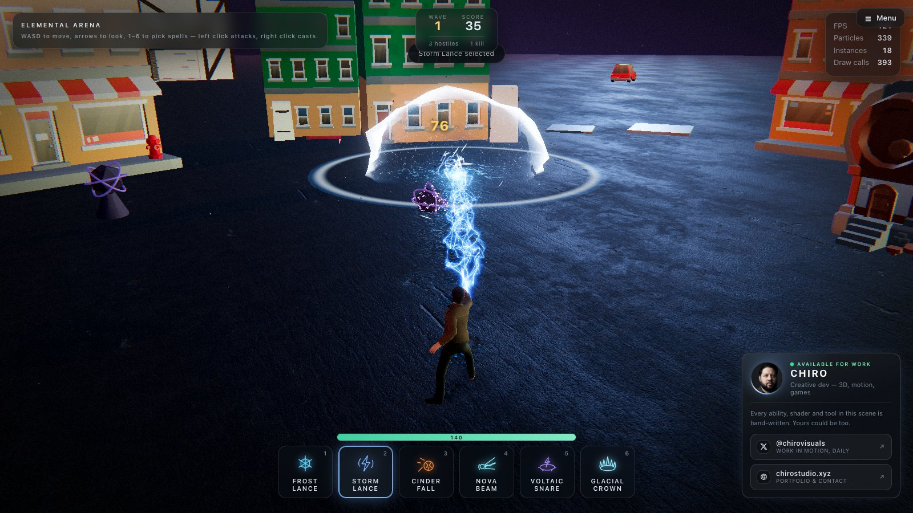
</p>
<p>
  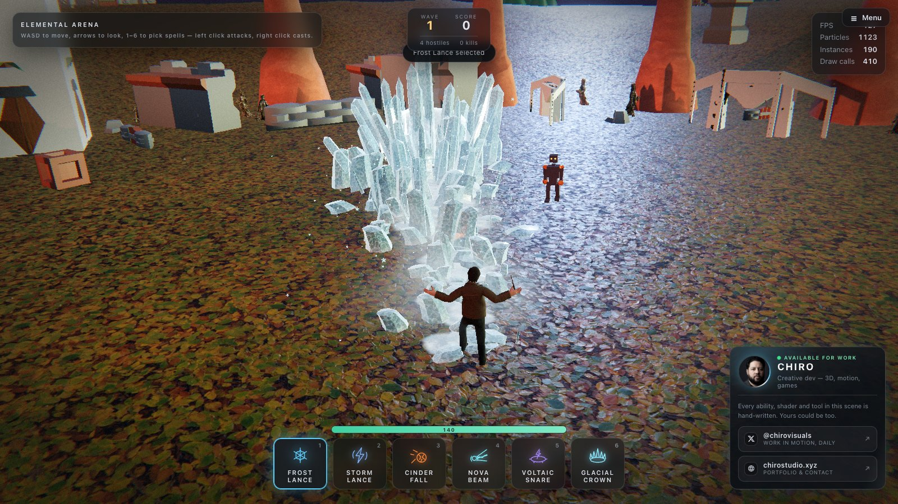
  
</p>

### How a map is made

1. **The library.** `npm run library:fetch` (run for you by `npm run dev` / `npm run build`)
   downloads open 3D packs into `library/` and indexes every model into `library/catalog.json`:
   its real size, triangle count, whether it is rigged, a category (`tree`, `rock`, `cliff`,
   `building`, `wall`, `ruin`, `structure`, `prop`, `light`, `vehicle`, …) and themes (`forest`,
   `snow`, `desert`, `city`, `medieval`, `dungeon`, `halloween`, `coast`, …).
2. **The plan.** `src/ai/MapPlanner.js` tells the model what the library holds and asks for a
   small JSON *map plan* (`src/world/MapPlan.js`): ground, relief, edge, time of day, fog, up to 8
   placement layers (`category` + keywords + zone + density) and up to 4 landmarks. If no model is
   reachable, a keyword planner writes the plan instead, so the button always works.
3. **The build.** `src/world/ComposedWorld.js` shapes terrain outside the arena, picks models for
   each layer from the catalog (preferring the plan's theme and packs already on the map, so a map
   keeps one look), sizes them sensibly per category and zone, places them as GPU instances, and
   gives monsters and the caster colliders to walk around. The 25 m arena itself always stays flat.

Rigged characters and creatures from the library are catalogued too (`character`, `creature`)
but not used as scenery yet.

### Sources

| Source | What | Licence | How it is fetched |
| --- | --- | --- | --- |
| [KayKit](https://github.com/KayKit-Game-Assets) | ~900 stylised models: dungeon, medieval hex, city, furniture, space base, characters, skeletons | CC0 | GitHub |
| [Polygonal Mind](https://opensource3dassets.com) | ~1,000 GLBs in 18 themed collections, incl. 60 rigged creatures | CC0 | GitHub (Open Source 3D Assets registry) |
| [Poly Haven](https://polyhaven.com/models) | ~520 photoscanned models: rocks, cliffs, trees, plants, props, buildings | CC0 | Official API |
| [ambientCG](https://ambientcg.com) | Ground materials (grass, snow, sand, rock, mud…) for terrain | CC0 | Official API |
| **Inbox** | Anything you download yourself — Kenney, Quaternius, itch.io, Sketchfab | Per pack | Drop the `.zip` (or folder) into `library/inbox/` and run `npm run library:index` |

Kenney and Quaternius block automated downloads, so they come in through the inbox: download the
packs from their sites by hand (choose the **glTF/GLB** version) and drop the zips into
`library/inbox/`. Packs whose names start with Kenney, Quaternius or KayKit are recorded as CC0;
any other pack records its own `LICENSE` file, or "unknown — check before sharing".
`library/CREDITS.md` lists every pack, licence and author.

### Commands and settings

```bash
npm run library:fetch                            # everything, resumable, 40 GB cap
npm run library:fetch -- --sources kaykit,polyhaven
npm run library:fetch -- --max-gb 10 --res 2k    # cap and Poly Haven texture size
npm run library:index                            # re-index after adding inbox packs
```

| `.env` variable | Meaning |
| --- | --- |
| `LIBRARY_AUTO_FETCH` | `0` stops `npm run dev` / `npm run build` from downloading the library |
| `LIBRARY_MAX_GB` | Disk cap for the download (default `40`; the full library is about 7 GB) |

The library is **git-ignored** and never committed: it is several gigabytes, and it is cheaper
to fetch than to clone. Docker builds skip the download and mount `./library` instead.

### Known limits

- A 4B model sometimes asks for odd layers; the plan is clamped and repaired, but a map can still
  contain an out-of-place prop. Re-generate, or name what you want ("pine", "tavern", "column").
- Planning takes ~20 s with Qwen3-4B on LM Studio (longer while the model loads).
- The packs mix styles (stylised KayKit next to photoscanned Poly Haven); the composer leans
  toward one pack per map, but does not guarantee it.

---

## Level editor and campaign

Build levels by hand — no AI needed — and string them into a story campaign. Open it from the
main menu: **Campaign → Open level editor**, **Campaign → Edit** on a level, or **World → Edit this
map in the level editor** to hand-finish a map the AI just made.

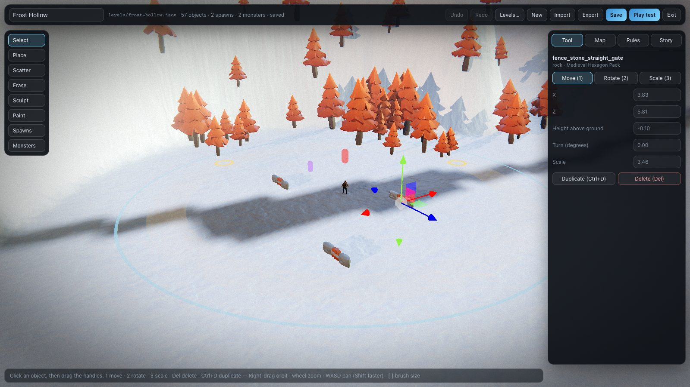

<p>
  
  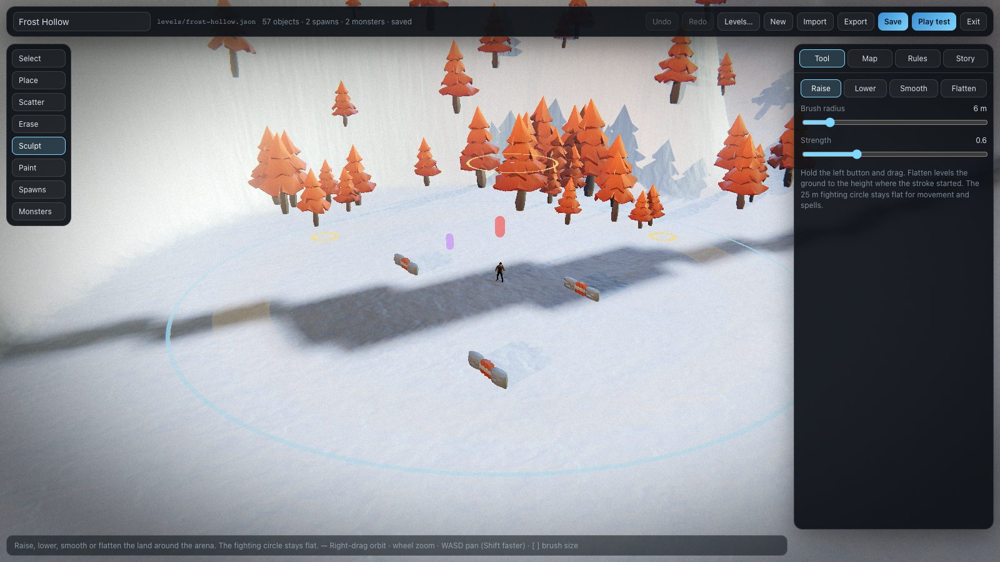
</p>
<p>
  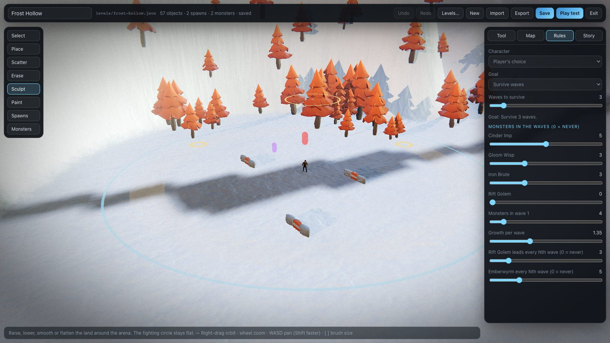
  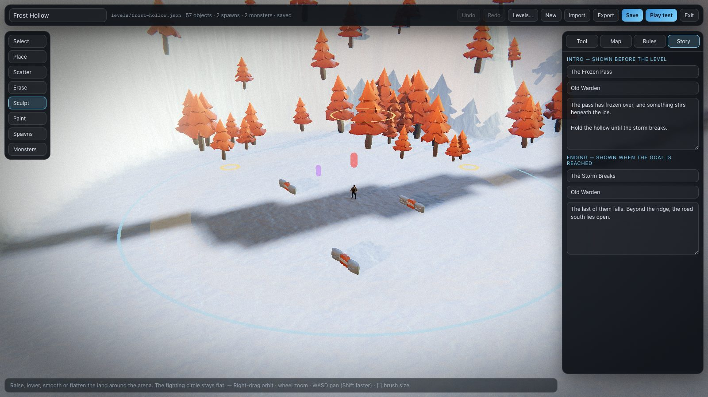
</p>
<p>
  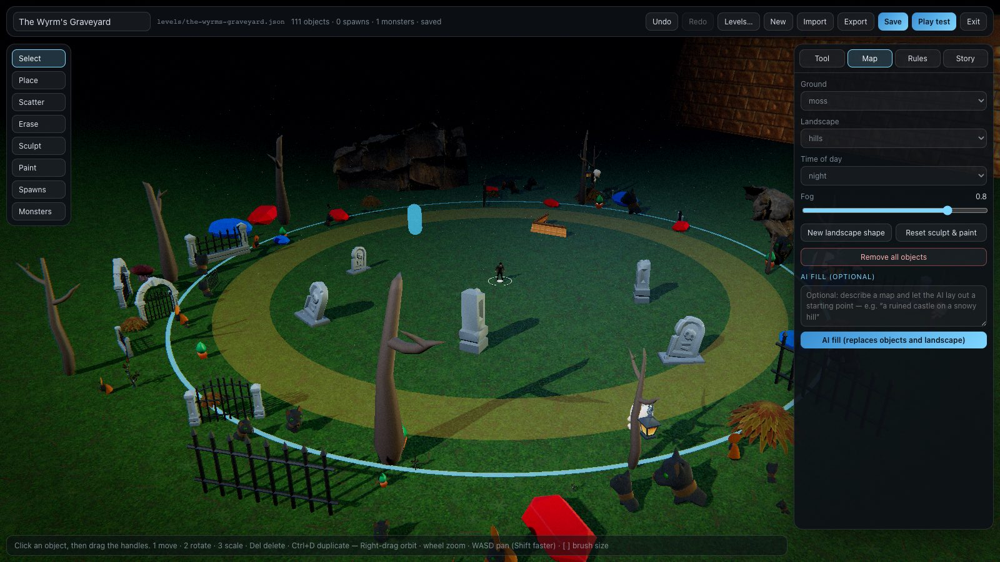
  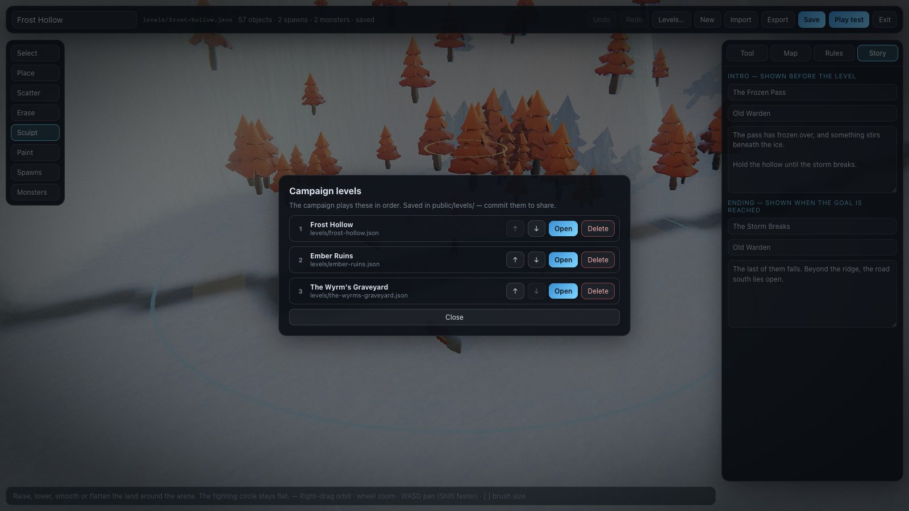
</p>

### Tools

| Tool | What it does |
| --- | --- |
| **Select** | Click an object, then drag the handles — **1** move, **2** rotate, **3** scale — or type exact values in the inspector. **Del** deletes, **Ctrl+D** duplicates. |
| **Place** | Pick any of the library's models in the browser (category + search), click the ground to drop it. **Q / E** turn it first. |
| **Scatter** | Paint many objects at once — a forest, a rock field — from a *scatter set* (add models with **+**), with radius, count, spacing and size variation. |
| **Erase** | Drag over objects to remove them. |
| **Sculpt** | Raise, lower, smooth or flatten the land around the arena. The 25 m fighting circle stays flat, because movement and spells assume flat ground there. |
| **Paint** | Paint ground surfaces (grass, snow, sand, gravel, paving, lava…) anywhere, including roads across the arena. |
| **Spawns** | Mark where waves walk in from. No spawn points = monsters come from all around. |
| **Monsters** | Place monsters that are already waiting when the level starts — e.g. a Rift Golem guarding a gate. |
| **Portals** | Place portals and link them to each other or to another level (see [Portals](#portals)). |
| **NPCs** | Place helpers — guides, merchants, healers, quest givers — with lines, an AI personality, gifts and quests (see [NPCs](#npcs)). |

**Map** sets the ground, landscape shape (flat / hills / mountains / canyon / valley), time of day
and fog, and has an optional **AI fill** that lays out a starting map from a sentence (it keeps your
rules, story and markers; **Undo** takes it back). **Rules** sets the character (or the player's
choice), the goal — *survive N waves*, *defeat N monsters* or *defeat the Emberwyrm* (it arrives on
wave N) — which monsters the waves contain and how fast they grow. **Story** holds the intro and
ending scenes. **Play test** drops you into the level and **Exit** brings you back exactly where you
were, undo history included.

Camera: **right-drag** (or middle-drag) orbits, **wheel** zooms, **WASD / arrows** pan (Shift
faster), **[ ]** resize the brush. **Ctrl+Z / Ctrl+Shift+Z** undo and redo, **Ctrl+S** saves.

### Saving and sharing

**Save** writes `public/levels/<id>.json` and adds the level to the campaign order in
`public/levels/index.json` (**Levels…** reorders, opens and deletes). Because they live in
`public/`, levels are part of the repo and of every build: commit them and anyone who pulls plays
your campaign. Saving works while running `npm run dev`; a built game is read-only, so use
**Export** to download a level file and **Import** to load one.

A level file is plain JSON: the world (ground, landscape, time, fog, seed, plus the sculpt and paint
grids), every object (`model` id, position, height offset, turn, scale), spawn points, waiting
monsters, rules and story. Objects refer to library models by id — anyone playing the level needs
the asset library downloaded (it is, after the first `npm run dev`).

### The campaign

<p>
  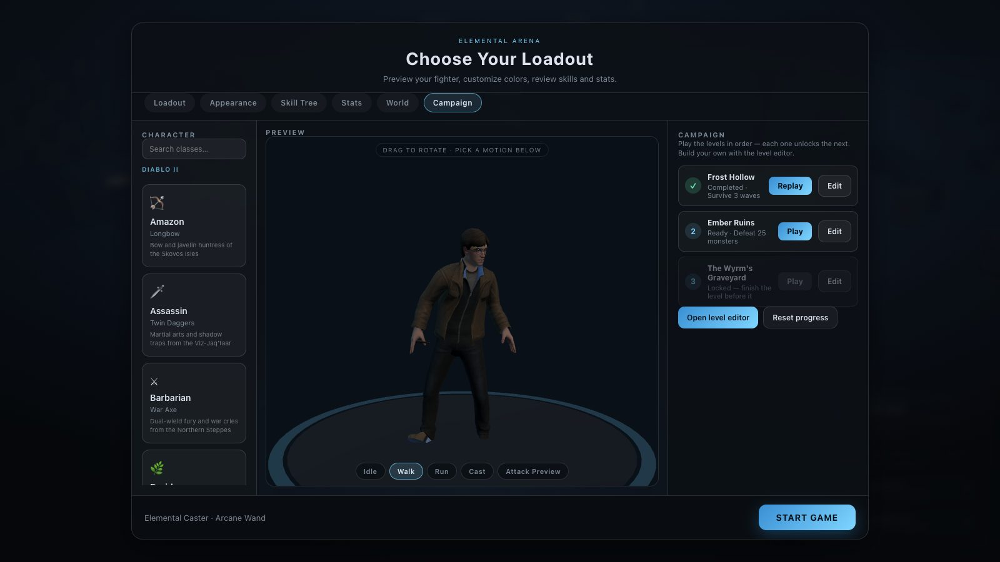
  
</p>
<p>
  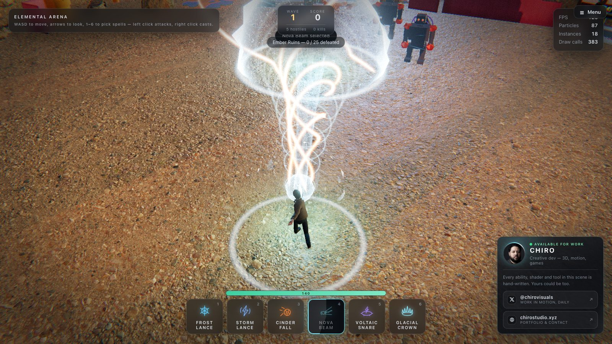
  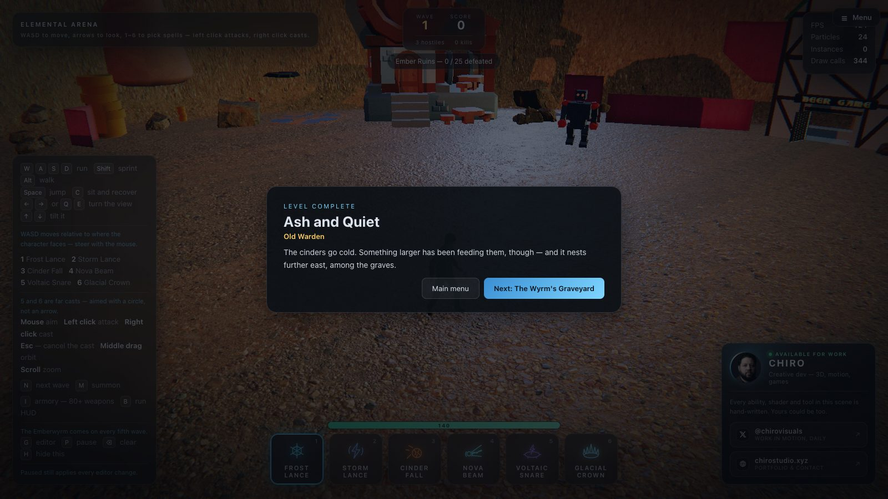
</p>

**Campaign** in the main menu lists the levels in order. Each one unlocks the next; finishing a
level shows its ending and offers the next level straight away. Progress is remembered per browser
(**Reset progress** clears it). Three starter levels ship with the game:

| # | Level | Goal | Built with |
| --- | --- | --- | --- |
| 1 | **Frost Hollow** | Survive 3 waves | By hand: scattered pines, sculpted ridge, painted gravel road, two waiting monsters |
| 2 | **Ember Ruins** | Defeat 25 monsters | AI fill (desert canyon temple) + hand-set rules and three spawn points |
| 3 | **The Wyrm's Graveyard** | Defeat the Emberwyrm (wave 3) | AI fill (foggy graveyard) + a Rift Golem waiting at the gate |

---

## Your own models — upload or make 3D from a picture

<p>
  
  
</p>

**Main menu → Create** brings your own 3D models into the game:

- **Upload a 3D model** — GLB, glTF, FBX or OBJ (converted to GLB in the browser). Choose what it
  is: **My character**, or a **map object** in any category (tree, rock, building, prop…).
- **Make 3D from a picture** — a PNG, JPEG or WebP of a character or object goes to
  [Tripo3D](https://developers.tripo3d.ai) or [Meshy](https://docs.meshy.ai), which build a textured
  3D model in 1–3 minutes. For **My character** the model is also **rigged and animated
  automatically** (idle, walk, run) — Tripo rigs with Mixamo bone names, so the game's own cast
  animations drive it as well. If it isn't a humanoid, it is kept as a static map object instead.

Everything lands in **My models** (`library/my-models/`, git-ignored like the rest of the library)
and is usable straight away:

| As | Where |
| --- | --- |
| Your character | **Appearance → Look** (★ entries) or **Wear** in My models — any class can wear it, keeping the class's bonuses |
| Map objects | The level editor's model browser (search its name) and AI-built maps (theme `custom`) |
| NPCs | The **Look** list of an NPC in the level editor |

Characters need a skeleton. The easy route for any humanoid mesh is to auto-rig it free at
[mixamo.com](https://www.mixamo.com), download as FBX, and upload that: Mixamo-rigged bodies use the
game's own idle and cast animations. Bodies rigged some other way play the clips they bring.

**Setup for picture-to-3D:** put **one** key in `.env` and restart `npm run dev` —
`TRIPO_API_KEY` ([get one](https://developers.tripo3d.ai/en/keys)) or `MESHY_API_KEY`
([get one](https://www.meshy.ai/developers/keys), needs prepaid API credits). The key stays on the
dev server, never in the browser. Rough cost per model: Tripo ~$0.30 for an object, ~$0.85 for a
rigged character with three animations; Meshy ~30 credits for an object, ~45 for a character.
`MODELGEN_PROVIDER=mock` runs the whole flow offline with a bundled model, for testing.

---

## Portals, loot and NPCs

<p>
  
  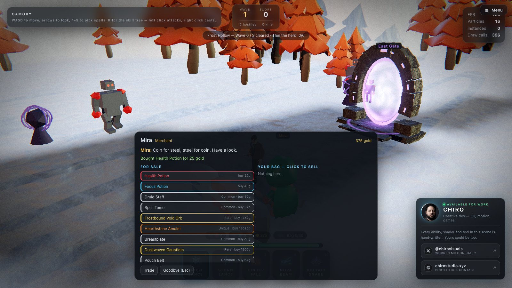
</p>
<p>
  
  
</p>
<p>
  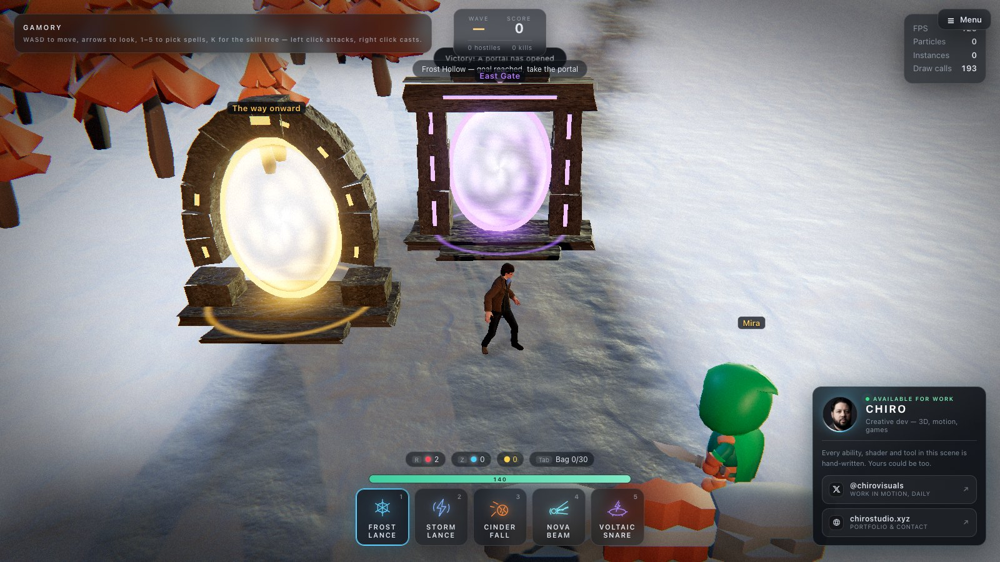
  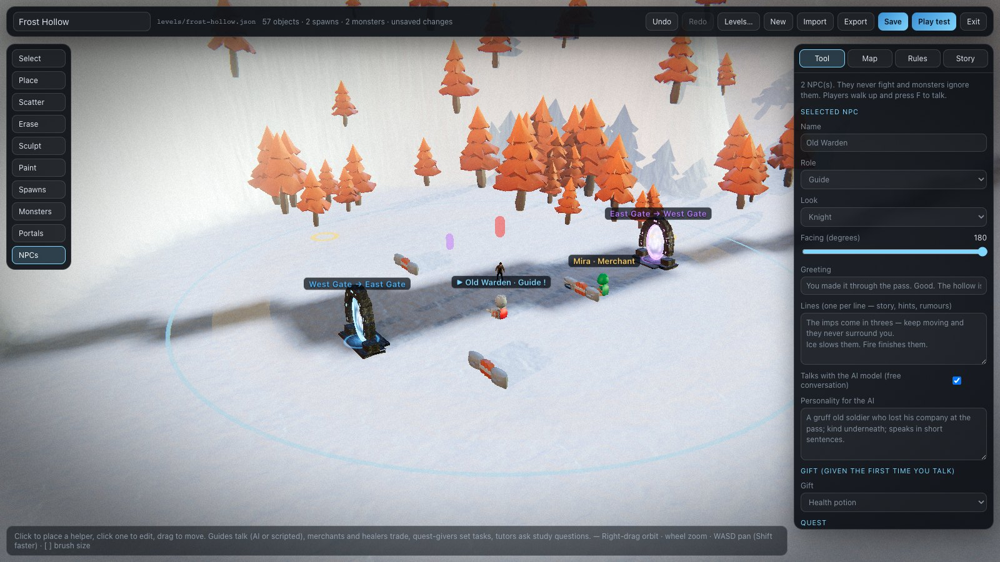
</p>

### Loot

Monsters drop **gold**, **potions**, **weapons** and **skill books**. Items burst out of the body,
land with a light beam in their rarity colour — **Common**, **Magic** (blue), **Rare** (yellow),
**Epic** (purple), **Unique** (orange) — and a floating name; walk over them to pick them up (or click
the name from close by). Bigger monsters drop more and better: a Rift Golem always drops a Rare or
better, the Emberwyrm an Epic or better plus a skill book.

| Item | What it does |
| --- | --- |
| Weapon | Any of the 88 armory weapons, with 1–3 bonus stats by rarity: spell damage, one spell's damage, cooldowns, max health, move speed, critical chance, gold found. Uniques are named (*Glacierheart*, *Ashen Requiem*, *Tempest Sceptre*, *Dawnspire*, *The Hollow Crown*, *Wardenblade*) with fixed, stronger bonuses. |
| Skill book | Raises one spell a rank (max 5): +12% damage and −4% cooldown per rank. |
| Health potion | **R** — heals 45%. |
| Focus potion | **Z** — every spell ready again. |
| Gold | Spent at merchants; weapons sell back for a quarter. |

**Tab** opens the bag: the weapon in hand, what your gear adds up to, spell ranks and 24 slots —
click a weapon to equip it, a book to read it, right-click to drop. The bag, gold, potions and ranks
are saved in the browser and carry between levels.

### NPCs

Place them in the editor with the **NPCs** tool. They never fight and monsters ignore them; walk up
and press **F** to talk (the fight pauses while you do).

| Role | Does |
| --- | --- |
| Guide | Talks: a greeting and scripted lines — story, hints, rumours. |
| Merchant | Sells potions, weapons and a skill book; buys anything from your bag. |
| Healer | Heals you to full and sells potions. |
| Quest giver | Sets a task — *defeat N monsters* (any, or one kind) — tracked under the wave counter; hand it in for gold and an item of a chosen rarity. |

Any NPC can give a **gift** the first time you talk (potion, gold, weapon, skill book) and can carry a
quest. Tick **Talks with the AI model** and give it a personality: the NPC then answers anything you
type, in character, through your LM Studio model — it knows the level's story and goal, your health,
gold, potions, weapon and spell ranks, and what the spells actually do, so its advice fits the moment.
With the model offline it falls back to its scripted lines.

### Portals

<p>
  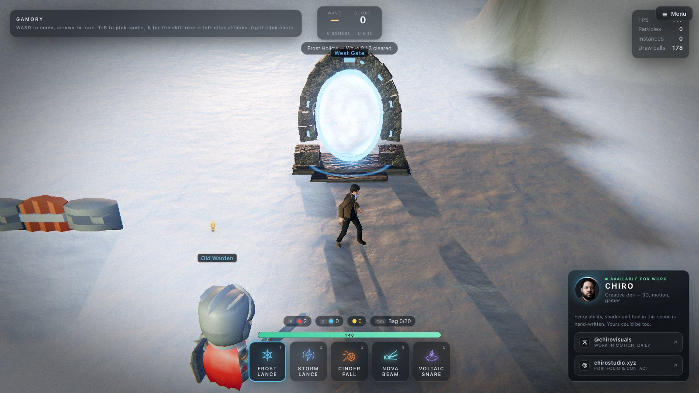
  
</p>

Each portal stands in a **stone arch** (rough-hewn blocks, a keystone, a dais) or a **stone gateway**
(two standing-stone pillars and a lintel) — or a plain **glowing ring** — with runes that glow in the
portal's colour. Place them with the **Portals** tool, pick the frame and colour, and choose what each leads to: **another portal in the level**
(two linked portals make a two-way shortcut), **another level** (a waypoint into the campaign), or
nothing. When a level's goal is met, a **gold exit portal** opens in front of you; stepping in shows
the ending and leads on to the next level.

Keys: **F** talk · **R** health potion · **Z** focus potion · **Tab** bag.

---

## The fight

### The arena

`src/world/Ruins.js` generates a dead keep from `settings.ruins.seed` — a broken curtain wall laid
course by course, four drum towers collapsed to four different heights, an arcade of columns (a
third of them toppled with their drums strewn along the fall line), rubble fields, hanging banners
that sway in a vertex shader, and lit braziers. Same seed, same ruin, every reload: the layout is a
fact about the level, because monsters path around it and abilities break parts of it.

It is laid out as four rings from the caster outward — `innerRadius` (a clear stage, nothing is ever
placed inside it), `arcadeRadius`, `wallRadius`, `outerRadius`. Draw calls are the whole design
constraint: eight hundred stone blocks are **one** `InstancedMesh` with per-instance colour, and the
rocks, columns and merlons are one each. The entire keep costs about eight draws.

Barrels and crates are not instanced, because they break. A barrel cooks off into a second blast
with its own radius and status — which can chain into the next barrel — so shooting one in a crowd
is a real play rather than scenery damage.

### The monsters

| Kind | Reads as | Health | Behaviour |
| --- | --- | --- | --- |
| **Cinder Imp** | small, long-limbed, quick | 46 | Closes and swings |
| **Gloom Wisp** | floating caged core | 58 | Never closes — fires a dodgeable bolt from 11 m |
| **Iron Brute** | a wedge, no neck, long arms | 210 | Heavy melee, 18% armour |
| **Rift Golem** | slab chest, boulder shoulders, stubby legs | 520 | Slams the floor for AoE, 30% armour |
| **Emberwyrm** | the dragon — see below | 2600 | Two-phase boss, every fifth wave |

<p>
  
  
</p>

There is exactly one rigged FBX in this project and it is the player, so the monsters are built from
primitives (`MonsterBuilder.js`) and animated in code (`Monster.js`). That turned out to be an
advantage rather than a compromise: a body made of named joints can be *driven* — a hit jolts one
shoulder, a freeze locks the rig mid-stride and rimes it over, a death dissolves it from the feet up
— and none of that is available on a baked clip.

The walk cycle is a handful of sines driven by one phase, and the phase is advanced by **distance
travelled** rather than by time. That is the whole trick: feet that cycle on a clock slide when the
body is slowed or shoved; feet that cycle on distance plant themselves, and a chilled monster
animates at the speed it is actually walking without a single extra line.

Geometry is shared per kind and the assembled rig is cached as a template — joints are collapsed to
one mesh per material role, then cloned per monster. Materials are *not* shared: every monster needs
its own `uHit`, `uFreeze`, `uBurn` and `uDissolve`, or hitting one would flash the whole horde white.

### The Emberwyrm

The boss. Everything else on the field is a silhouette you read in a tenth of a
second; a boss has to survive being *looked at*, so this one is built the way an
animal is — a spine running from nose to tail tip in twenty-odd links, four
limbs with real joint chains, a jaw that hinges, wings with a finger skeleton
and a membrane stretched between the spars, and scales that come out of a
distance field in the fragment shader rather than a tiling texture.

Two ideas do most of the work in `DragonBuilder.js`:

- **Everything is a chain.** The neck, the tail and the wing fingers are arrays
  of joints, driven with travelling waves rather than individual poses. A wave
  that starts at the shoulder and arrives at the tail tip a beat later is what
  makes a long body look like it has mass.
- **Everything is built forward along +Z.** Each segment's joint sits at its
  start, the geometry runs to +Z, and the next joint hangs off the far end. The
  tail is then the same code as the neck with its root turned around.

As authored it is over two hundred pieces; `RigKit.collapseJoints` bakes
everything rigid within each joint down to one mesh per material, landing the
finished boss at a few dozen draws.

The animation is all lag. The forearm and the hand trail the shoulder by a fixed
fraction of a beat, and *that* is what makes a wingbeat look like it is moving
air — a wing whose joints all reach the top of the stroke together reads as a
cardboard cut-out, and the fix is not more joints, it is a hundred milliseconds
of delay between the ones already there. The folded pose was not authored by
hand either: three chained Euler rotations compose in a way that is genuinely
hard to predict (the first attempt folded both wings forward over the head), so
the angles were found by sweeping the parameters and scoring where the wrist and
the outermost fingertip actually landed in body space.

The fight has two phases, read straight off the health bar:

- **Grounded.** It stalks you on four legs in a diagonal trot — front-left with
  back-right, the gait every heavy quadruped actually uses — bites at close
  range, and sweeps its tail through *everything* around it when you crowd it.
- **Airborne**, under half health. It lifts off with a roar, holds station above
  the arena and does nothing but breathe fire, which the melee half of the kit
  cannot answer. The camera backs off while it is alive.

The breath is a jet, not a hitscan: the cone is re-evaluated every tick from
where the head currently points, so walking out of it works. The wind-up is
visible from anywhere in the keep — the throat lights up *inside the mouth* and
the seams between every scale on its body start glowing, because a boss attack
you cannot see coming is not an attack, it is a tax.

### Damage, and why it is not instant

`src/game/Combat.js`. A cast does not deal damage — it opens a **strike**, and the strike walks
downrange at the same `settings[element].speed` the visual uses. A monster is hit on the frame the
effect reaches it. Retune the ability and the damage retunes itself.

This lives entirely outside the six ability classes. Not one of them knows a monster exists:
`AbilityManager.cast()` and `Combat.open()` are handed the same `(origin, direction, distance)` from
the same aim event and independently produce the picture and the consequences.

Statuses have to be visible on the body, not just in a number — chill slows, shock jitters and stuns,
burn chars and ticks, root holds in place, freeze locks solid. **A frozen monster hit by a meteor
shatters for double damage**, which makes Glacial Crown → Cinder Fall the strongest line in the game
and is the whole reason the status system exists.

`src/game/GameDirector.js` owns pacing rather than mechanics: waves (count grows geometrically,
health linearly), score and the chain multiplier, your health and revive, and **hit-stop** — a beat
of near-frozen time on a heavy impact, bought with one multiplier where the app already scales its
delta. It is the cheapest weight a game can buy.

All of it switches off: `settings.combat.enabled = false` and the sandbox is exactly what it was.


---

## Project layout

```
src/
  abilities/      Ability base class (the travelling front), IceAbility, ThunderAbility,
                  MeteorAbility, BeamAbility, SnareAbility, GlacierAbility, pooling manager
  ai/             AIDirector (the commander: snapshot → constrained plan → casts),
                  LocalIntent (the keyword parser that answers first) and
                  MapPlanner (a sentence → a map plan, via the model or keywords)
  animation/      FBX character loading, AnimationMixer, the per-ability cast clips,
                  the procedural cast lunge, Locomotion (the generated gait)
  assets/         Procedural crystal and asteroid geometry, the bolt ribbon strip,
                  the beam tube and its shock discs
  config/         settings.js — the single source of truth for every parameter
  core/           App, Renderer, CameraRig, Time, Layers, shared frame uniforms
  effects/        Aim arrow, far-cast circle, ground decals, fissures, bursts,
                  light pool, shake, flash
  entities/       Monster (brain + procedural animation), MonsterBuilder (bodies,
                  the damage/dissolve/scale shader, health bars), RigKit (joints,
                  parts, joint collapsing, template instancing), Dragon +
                  DragonBuilder (the boss), MonsterManager (pools, arrivals,
                  attacks, deaths, enemy projectiles)
  game/           Combat (strikes: damage timed to the visual), GameDirector (waves,
                  score, player health, hit-stop), DamageNumbers (floating text)
  input/          InputManager (events) and AimController (both targeting shapes)
  editor/         LevelEditor (tools, brushes, gizmo, undo/redo, play test)
  items/          Items (rarity, stats, uniques, loot tables, prices), Profile (bag,
                  gold, potions, ranks — saved per browser), Loot (drops on the ground)
  npc/            Npcs (rigged helpers, roles, quests), NpcBrain (AI or scripted talk)
  levels/         Level (the file format), LevelStore (load/save/export/import, progress)
  library/        The asset library in the browser: Catalog (queries), ModelLibrary
                  (loading + instancing), categories (shared with the indexer)
  loaders/        AssetLoader with a shared LoadingManager
  materials/      IceMaterial, LightningMaterial, MeteorMaterial,
                  VolumetricFireMaterial, BeamMaterial, SnareMaterial, GlacierMaterial
  particles/      GPU particle system + engine and rate emitters
  postprocessing/ Composer pipeline, grade shader, distortion shader
  shaders/lib/    Shared GLSL: noise library, common helpers
  ui/             HUD, GameHUD (the run), ChatPanel (the commander), MainMenu,
                  EditorPanel + StoryPanel (level editor, story scenes),
                  DialoguePanel, InventoryPanel, WorldLabels (floating names),
                  ModelStudio (the Create tab),
                  lil-gui editor, preset manager, styles
  utils/          Maths, seeded RNG, colour cache, pooling, disposal, shader patching
  world/          Environment (stage lighting), floor, dust, contact shadows,
                  Ruins (the procedural keep), MapPlan (the plan format),
                  Terrain (editable relief + sculpt/paint grids), Portals, and ComposedWorld
                  (a map built from the library to a level or plan)
  archive/        The retired four-element sandbox — see archive/README.md

public/levels/    Campaign levels (<id>.json) and their order (index.json) — written by the editor
scripts/library/  Asset-library downloader (fetch), indexer (index), auto-download hook (ensure)
library/          The downloaded 3D asset library + catalog.json (git-ignored, fetched)
server/           The standalone AI bridge for production (zero dependencies), and
                  modelgen.mjs — uploads and picture-to-3D (Tripo3D / Meshy), shared with dev
Dockerfile        Two stages: build the client, then serve it beside the bridge
docker-compose.yml
```

---

## How it fits together

### Settings are the API

`src/config/settings.js` holds every tweakable value. Nothing else owns that state: shaders,
particle systems, lights and post passes *read* those objects every frame. That is what makes the
editor work with no rebuild — moving a slider changes the ice field that is already standing, the
next cast, the environment and the post stack at once. Preset loading deep-merges *into* the same
objects so every live binding stays valid.

```js
import { settings } from './config/settings.js';
settings.ice.height = 7;          // visible on the next frame, even mid-cast
settings.thunder.jitter = 1.2;    // re-kinks a bolt that is already in the air
settings.global.timeScale = 0.1;  // slow the whole cast to a crawl
```

Ability blocks are keyed by their id in `ELEMENTS`, and the shared systems that need to know
"which ability is the player holding" — the aim controller, the cooldowns, the HUD — look it up as
`settings[element]`. The four fields they rely on being present are `range`, `minRange`, `speed`
and `cooldown`; a far cast adds a fifth, `zoneRadius`. Everything else in a block is that ability's
own business.

### The rule that makes "edit while paused" work

A spike record in `IceAbility` stores **only what the dice decided**: a position *fraction* along
the line, a signed lateral *fraction*, and a handful of unitless jitters. Not one metre, radian or
second is captured when the cast starts. Every dimension is resolved against `settings.ice` inside
the update loop, which runs on a zero-length frame too.

So dragging `height` re-grows a field that is already standing; dragging `lean` re-tilts it;
dragging `clumping` re-packs it toward the centre line. The only values a record *does* capture
are timestamps — the moment its own eruption was triggered. Those are events, not dimensions.

The four *shape* controls (`facets`, `taper`, `roughness`, `bend`) cannot be expressed as a
per-instance transform, so they are baked into the geometry instead — and a six-sided crystal is
just 60 triangles, cheap enough to regenerate outright rather than approximate in a vertex shader.
`IceAbility#_syncGeometry` hashes those four values and rebuilds the three crystal meshes when the
hash changes, which is what keeps them live sliders rather than restart-required constants.

### Aiming

`AimController` raycasts the pointer onto the ground plane **every frame**, not only on mouse
move, so orbiting the camera with a cast armed swings the indicator under a stationary cursor. It
clamps the distance into `[minRange, range]`, tracks a 0..1 reveal envelope, and emits a single
`cast` event carrying an origin, a unit direction and a distance — which is exactly the signature
`Ability#spawn` takes. It decides nothing about what the cast does.

It runs on **real** time rather than the scaled simulation delta, so the indicator keeps animating
while the sandbox is paused.

There are two indicators and one controller. Which one is drawn comes from
`ELEMENT_META[element].cast` — `CastShape.LINE` or `CastShape.ZONE` — and that is the *only* thing
the two shapes disagree about. Arming, clamping, validating, revealing and firing are shared, and
both end in the same three-argument `cast` event, because from the targeting side a far cast is a
line cast you only care about the far end of. That is why zone targeting needed no change in
`Ability`, `AbilityManager` or `App`: `SnareAbility` reads its centre as `pointAt(1)` and works
outward from there.

### The far-cast circle

`ZoneIndicator` is the arrow's opposite number, and it is built out of the same two ideas: metres,
and no textures.

The **footprint** is one quad whose fragment shader remaps UV into metres from the target, so the
boundary stays 0.34 m thick whether the circle is 2 m or 8 m across. The band is deliberately the
heaviest mark on screen — it is the whole message — and it is split about the nominal radius by
`boundaryBias` rather than centred on it, so its *outer* lip stays honest about where the effect
ends. Inside there is a rim-weighted wash, contour rings travelling outward, warped filaments and a
reticle whose downrange arm is longer, because the quad carries the caster's yaw and that arm is
therefore the heading.

The **reach ring** at the caster is the bolt's ribbon strip bent into a circle: `(t, side)` in,
world position out. A quad big enough to hold a 20 m range would be 40 m across and shade a
screenful of discarded fragments for one thin line.

The circle **snaps out past its radius and settles back** when the cast is armed, and the trap does
the same thing when it lands. A circle that grows linearly reads as a UI element; one that
overshoots reads as something the caster did.

### The arrow is one SDF

`AimIndicator` is a single ground quad. Its fragment shader remaps UV into **metres measured from
the caster**, so every control in `settings.aim` is a real measurement — the shaft stays 0.42 m
wide whether the cast is 3 m or 15 m long.

The silhouette is a rounded union of a box (the shaft) and iq's exact triangle SDF (the head);
the cheap half-plane intersection leaves visible corner artefacts on a wedge this shallow. From
that one distance field the shader derives the outline, the rim-weighted interior wash, the
chevrons (a phase skewed by `|x|`, which turns flat bands into arrowheads pointing the way the
cast does), the frost noise and voronoi plates, the ring at the caster's feet, the range cap arc,
a six-fold frost rosette pinned to the impact point, and the sweep-out when the ability is armed.

### The ice

`materials/IceMaterial.js` patches a `MeshStandardMaterial` rather than replacing it, so the
crystals cast and receive the stage's real shadows and pick up the HDR probe. The stylisation is
injected on top:

- **Thickness tint** — a facet seen head-on has the longest path through the crystal, so it
  darkens toward `colorDeep`; grazing edges stay pale. This is the term that makes the field read
  as a solid you can see *into* rather than as blue plastic.
- **Internal fracture** — ridged noise sampled in **world** space, so the crack planes stay a fixed
  physical size whether a spike is ankle-high or three metres tall, and neighbouring crystals look
  quarried from the same block.
- **Feather frost and rime** — fbm sampled in **local** space (0..1 up the crystal), so the milky
  veining and the frost creeping up from the base follow each spike's own axis however it is
  scaled or leaned.
- **Glint** — a hard-thresholded high-frequency field scrolling in world space, biased toward
  grazing angles, which is where real ice catches.
- **Birth flash** — a per-instance attribute the ability drives from 1 to 0 over `birthFade`, so a
  crystal is lit from within for the moment it erupts.

Three `InstancedMesh`es share one material. Three rather than one because the *facets* differ, not
just the proportions — per-instance scaling alone cannot buy that silhouette variety, and three
draw calls is a cheap price.

### The lightning

`ThunderAbility` takes the "no dimensions on the CPU" rule further than the ice does: there is no
path object at all. The bolt is one `InstancedBufferGeometry` — a flat ladder of quads in
*parameter* space, where each vertex carries only `(t, side)`: how far along the bolt it is, and
which edge of the ribbon it is on. One instance is one filament. `materials/LightningMaterial.js`
turns that pair into a world position every frame, so a single strip serves a bolt of any length,
any shape and any width.

Three things stack to make the shape:

- **the axis** — a straight line from the hand to the impact point, bowed by `sag`. The only part
  that knows where the cast is pointing.
- **the fan** — a constant per-filament offset in the plane perpendicular to the axis, opening
  from `spreadNear` at the hand to `spread` at the target and rolling around the axis with
  `twist`. This is what separates one filament from the next.
- **the kinks** — octaves of *linearly* interpolated value noise. Linear on purpose: smoothstep
  would round the corners off, and the corners are the entire reason it reads as lightning rather
  than as a wobbly tube.

The ribbon is turned to face the camera by crossing the local tangent with the view vector, which
is why the bolt keeps its apparent thickness from any angle without ever being a screen-space
line. It is drawn twice — a wide soft halo underneath and the hot core on top — because drawing
the glow as real ribbon rather than leaving it to bloom is what keeps it *attached* to every kink.

Two clocks run the flicker. `restrike` snaps every filament onto a new shape N times a second,
and `crawl` slides the kinks continuously in between; together they stop a held bolt from looking
like a static ribbon. A cast captures exactly one number — a seed, so two casts do not draw the
identical bolt — and resolves every metre, radian and second against `settings.thunder` each
frame. That is why dragging `jitter` re-kinks a bolt that is already in the air.

The ground burns are worth a note as a thing *not* to do. The first version sampled the filament
field on `atan(y, x)`, which hands every radius along a given bearing the same value and draws
dead-straight spokes out of the centre — a firework, not a burn. Sampling the same noise in the
plane and warping the lookup is what lets the filaments meander and fork.

### The beam

The Nova Beam shares the bolt's rule — no dimensions on the CPU — and reaches the opposite look
with it. Where the bolt's whole charm is that its noise is *piecewise-linear* and keeps its
corners, every noise term in the beam is smooth, stretched hard along the flow and crawling
downrange. A beam that kinks is a bolt.

It is a real tube rather than a camera-facing ribbon, because a column this thick has to *have* a
cross-section: the silhouette must bow correctly when you orbit it, the far wall must add through
the near one, and the shock discs have to hug it. `createBeamTubeGeometry` is the ribbon strip one
dimension richer — every vertex carries `(t, a)`, how far along the barrel it is and how far around
— and `materials/BeamMaterial.js` turns that pair into a world position each frame.

That one tube is drawn three times, and the trick is in how the three are weighted:

- **halo** — widest, nothing but a rim term. The atmosphere the beam is shoving out of the way.
- **sheath** — rim-weighted, so it reads as *hollow* and its silhouette edges are its brightest part.
- **core** — narrow, and weighted the **opposite** way: brightest where the view ray runs down the
  barrel and its path through the tube is longest.

Rim-weighted outside, axis-weighted inside, both faces adding: that is a volume integral, cheaply,
and the inversion is the entire reason the middle reads as a solid rod of light instead of as a lit
pipe. Widen `coreWidth` or push `coreFill` up and the three layers collapse into one white tube —
the cyan sheath and the gold coils are only legible because the core leaves them room.

Two more instanced passes put structure on it. The **coils** are the bolt's ribbon strip bent into a
helix, camera-facing and warm on purpose — the colour split is what stops them dissolving into the
sheath. The **shock discs** are an instanced annulus whose phase is `fract(index / count + time ×
speed)`, so the train is a pure function of the clock and there is no queue on the CPU. Both place
themselves against the same `beamRadius()` the tube uses, which is why all five stay welded together
when the profile is dragged.

The beam is also the one ability with a **fourth beat**. The other three run travel → impact →
fade; this one puts a wind-up in front of that, and it needed nothing from the base class:
`advance()` simply refuses to let the front leave the hand until the orb is up to power, so `IMPACT`
becomes the burn and the phase machine is untouched. The far end therefore has an impact that keeps
happening — spray thrown back up the line, pressure shells shed off the burning point, dust and
shockwave rings pushed across the floor, all rate-throttled through the same fractional-rate emitter
the particles use so every rate is a live slider.

### The snare

The Voltaic Snare is the first ability built around a *point* instead of a line, and the thing that
holds it together is that `zoneRadius` is read in exactly one place per consumer and nowhere is it
copied: the indicator measures it out, the tendrils end on it, the rim arcs run along it, the field
burns it and the column's throat and flare are fractions of it. Drag it and all five move together,
mid-cast, with the clock stopped.

The whole cage — the whip that plants it, the pillar, the tendrils and the rim arcs — is **one
instanced ribbon strip**, the same one the bolt and the beam's coils are drawn on. A filament's
*role* is decided in the vertex shader by testing its instance index against four live counts, and
the role picks which parametric path it is threaded along:

- **leash** — a sagging line from the hand to the travelling tip, dropped onto the floor.
- **column** — a twisting climb whose radius opens from `throat` to `columnSpread`.
- **tendril** — a meander running outward, its veer a per-filament constant rather than noise, so
  it curves the way a discharge that has committed to a direction does.
- **rim** — an arc travelling around the boundary, hopping over it at mid-span.

Every offset then lives in a frame taken by finite difference off that path, which is what lets one
kink function serve a vertical pillar and a filament crawling flat across the floor. The two
ground-hugging roles damp the vertical component of that offset and clamp above the floor — a kink
with a free `y` buries half of every tendril and the effect reads as a broken dotted line. Setting
a count to zero retires the role outright, which is how the leash disappears on the frame the ring
takes over. Two draw calls cover all four roles, however many filaments are in the air.

The **field** is a quad rather than a pooled decal for one reason: a decal captures its radius when
it spawns, and this circle has to re-scale under `zoneRadius` while it is standing. Its veins are
sampled in the plane and domain warped — the same lesson the bolt's ground burns taught, and for
the same reason.

The one thing worth stealing for the next far cast is the **snap**: the ring opens on
`Easing.outCubic` multiplied by a bump that peaks late and dies at exactly 1, so it overshoots its
radius and pulls back onto it, and the pillar climbs on the same clock 1.7× slower. The ground goes
first, then the air breaks down over it.

### Adding another ability

1. Add a settings block in `config/settings.js` and an entry in `ELEMENTS` / `ELEMENT_META`.
2. Subclass `Ability` and implement `createShaders`, `createParticles`, `onTravel`, `onImpact`,
   `onFade`.
3. Register the class in `abilities/AbilityManager.js`.
4. Add an editor folder in `ui/Editor.js`, and a sigil in `ui/glyphs.js`.
5. Bind a key in `input/InputManager.js` — it emits `ability` with the 0-based slot index, which
   `App` maps through `ELEMENTS`.

To make it a **far cast** instead of a line cast, add two things and nothing else: `cast:
CastShape.ZONE` in its `ELEMENT_META` entry, and a `zoneRadius` in its settings block. The circle
indicator, the reach ring, the snap-out and the whole targeting loop come for free, and the ability
reads its centre as `pointAt(1)`.

Everything else — pooling, the travelling front, the local frame, lights, phases, per-ability
cooldowns, the aim reach and camera framing — is inherited or driven off `ELEMENTS`. The HUD
builds its slots from that array, so a new ability appears in the bar on its own.

### Particles

`particles/ParticleSystem.js` is a GPU-simulated, instanced-quad system. Motion (velocity, gravity,
analytic drag, curl turbulence, vortex swirl), size-over-lifetime, the colour gradient and alpha
fade are all evaluated in the shader from per-instance attributes; the CPU only ever writes spawn
data, and only the slots that changed are uploaded. Particles live in a ring buffer, so spamming
the ability recycles slots instead of allocating. Silhouettes (soft, smoke, streak, leaf, chip,
ring) are procedural — there are no sprite textures anywhere in the project.

Frost Lance uses three systems: **mist** (non-additive, so the fog genuinely occludes and gives the
field depth), **shards** (lit chips under gravity) and **glitter** (additive, negative gravity — the
rising plume that is the signature of the reference frame).

Storm Lance uses four: **sparks** (velocity-stretched streaks under gravity), **motes** (the slow
ionised drift around the bolt), **smoke** (non-additive haze off the scorched floor) and **debris**
(lit chips). Its sparks are emitted from several points along the bolt each frame rather than one:
a beam sheds along its whole length, and a single origin makes every batch read as a starburst.

Nova Beam uses four as well, and works one of them twice: its **motes** are the intake spiralling
*into* the orb while it charges and the drift shed off the column once it is firing — the same glow,
thrown the other way. Its **sparks** are thrown radially off the barrel and then dragged downrange
by `sparkForward`, which is the read that says "pressure"; the bolt's fall instead, and that one
difference does a lot of the work of keeping the two abilities apart.

### Render pipeline

Per frame:

1. **Depth prepass** — the opaque world into a half-res packed-depth buffer. Every VFX shader
   samples it for soft intersections, so nothing cuts a hard line into the ground. The crystals sit
   on `LAYER.WORLD`, so mist and glitter fade softly against them.
2. **Distortion pass** — meshes on the distortion layer write screen-space UV offsets into a second
   half-res buffer. Nothing writes to it in the current build; the pass is kept because it is the
   hook a refraction effect would use.
3. **Composer** — scene → refraction warp → bloom → tone map (ACES) → grade.

The grade pass folds chromatic aberration, lift/gain/contrast/saturation/temperature, vignette,
film grain and the impact flash into one resample.

Shadows come from a single directional light whose orthographic shadow camera is re-centred on the
character each frame and fitted to a 52 m box at 4096² (~1.3 cm/texel). The `three/addons` CSM
module was tried first and removed: it replaces three's `lights_fragment_begin` chunk *globally*,
so any material not explicitly registered with it silently loses all directional lighting.

Contact shadows are a real render: the character's depth is captured from below into a 256²
target, blurred twice and projected onto the ground.

---

## Editor and presets

Press **G** for the panel. Folders: Presets, Global, Aim indicator, Far-cast circle, Frost Lance,
Storm Lance, Cinder Fall, Nova Beam, Voltaic Snare, Environment, Post processing, Camera,
Character. Every folder starts collapsed — there are enough controls here that one open section
pushes the rest off the screen.

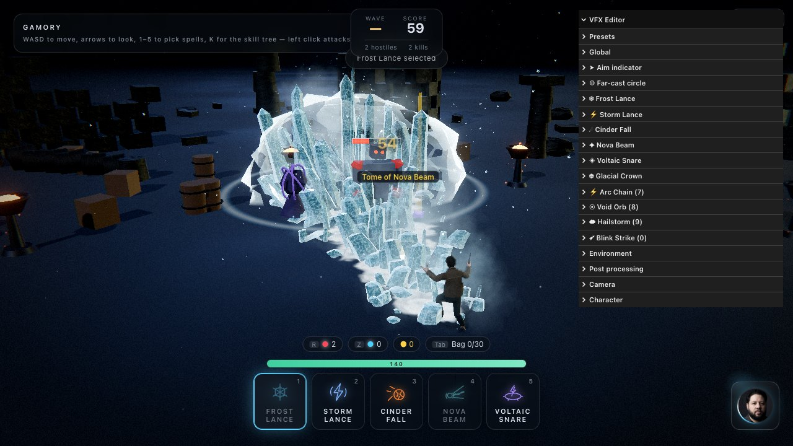

- **Global** multipliers scale everything at once (speed, glow, noise, particles, lights, impact
  intensity, camera shake, time scale…).
- **Aim indicator** — the arrow's silhouette in metres, its outline and fill, the chevrons and
  frost, and the rings and rosette.
- **Far-cast circle** (40 controls) — the boundary band, the interior, the ticks, sweep and
  reticle, the reach ring, and the snap-out. Shared by every far cast, so it is filed with the
  targeting rather than with any one ability.
- **Frost Lance** (113 controls, 25 of them colours) — the cast, the footprint, the silhouette,
  the crystal itself, the eruption timing, the ice material, the frost on the ground,
  mist/chips/glitter, the impact and the dynamic light.
- **Storm Lance** (123 controls, 34 of them colours) — the cast, where the bolt leaves the hand,
  the bundle, one filament, the ribbon, flicker and restrike, the bolt's colour, the burns on the
  ground, sparks/motes/smoke/debris, the muzzle and impact, and the dynamic light.
- **Nova Beam** (176 controls) — the cast, where it leaves the hands, the column, the core/sheath/
  halo stack, the surface and its flow, the beam's colour, the coils, the shock discs, the charge
  and its intake, what the floor does, sparks/motes/steam/debris, release/impact/burn, and the two
  dynamic lights.
- **Voltaic Snare** (174 controls, 33 of them colours) — the cast and its footprint, the leash, the
  column, the tendrils, the rim arcs, the shared filament shape and flicker, the ribbon and its
  colour, the field on the floor, the burns, sparks/updraft/smoke/debris, throw/snap/hold, and the
  dynamic light.
- **Presets** save to `localStorage`, and can be duplicated, deleted, exported to JSON, imported
  from JSON, or reset to the shipped defaults.

Every ability exposes **every** colour it draws with, and none is derived from another: the crystal
palette, the bolt palette, the beam's four layers and its coils and discs, the ground marks, the
impact shells, the shockwave rings, the screen flashes, and a four-stop lifetime gradient
(`birth → early → late → death`) for each particle system. Tinting the fog without touching the ice,
or cooling the sparks to orange while the filaments stay blue, is a picker away.

Presets are plain snapshots of the settings tree, so an exported file is readable and editable by
hand.

Knobs worth knowing about, because they reshape their ability the most:

- `ice.heightCurve` — how late the ramp climbs; raise it and the field stays low until it explodes
  at the target. `ice.frontBias` below 1 crowds the crystals toward the impact point.
- `thunder.jitter` and `thunder.jitterScale` — how violently the bolt kinks, and how often.
  `thunder.strands` and `thunder.spread` set how wide the bundle reads, and `thunder.restrike`
  how hard it strobes. Those five carry the character of the effect.
- `beam.radius` and `beam.flare` — how heavy the column reads and how hard it opens out where it
  lands. `beam.charge` and `beam.lifetime` are the wind-up and the hold, which are what make this
  ability feel unlike the other three, and `beam.coreWidth` / `beam.coreFill` decide whether the
  layers stay separable or blow out to white.
- `snare.zoneRadius` — the one number the whole far cast is built on. It resizes the targeting
  circle, the tendrils, the rim arcs, the burnt field and the pillar's throat together, live.
  After that, `snare.snapTime` and `snare.height` carry the moment it opens, and `snare.tendrils` /
  `snare.rimArcs` / `snare.strands` decide how much of that footprint is actually lit.
- `zone.boundary` and `zone.snap` — how thick the far-cast circle's edge reads, and how hard it
  overshoots on the way out. Between them they decide whether the indicator feels like a UI overlay
  or like something the caster is doing.

---

## Performance notes

- Abilities, decals, bursts and particles are pooled, per type. Twelve casts in a row build at most
  **four** instances of an ability and then stop allocating.
- The whole crystal field is three draw calls regardless of crystal count; the cap is 288.
- A whole bolt is **two** draw calls regardless of filament count; the cap is 24 filaments at 72
  samples each. Nothing about the path touches the CPU, so `strands` is nearly free.
- A whole snare — leash, pillar, tendrils and rim arcs — is **two** draw calls plus one for the
  field, regardless of how many filaments are in it; the cap is 56 across the four roles. As with
  the bolt, none of the shape touches the CPU, so raising `tendrils` or `rimArcs` is nearly free.
  Its targeting circle is two more: one quad and one ring strip.
- A whole beam is **six** draw calls regardless of how many coils and discs are on it — three tube
  passes over one shared geometry, plus one instanced draw each for the coils, the discs and the
  charge orb. As with the bolt, none of the shape touches the CPU, so `coils` and `rings` are
  nearly free. It takes two of the six dynamic lights (the column and the caster's hands), so four
  concurrent beams would exhaust the pool; `LightPool.acquire()` returns null and every use of the
  handle is guarded.
- The six dynamic point lights are created at boot and parked at zero intensity rather than added
  and removed — changing the light count forces three to recompile every material.
- Shadow maps update exactly once per frame even though the scene is rendered several times.
- `renderer.compileAsync()` runs during boot so the first cast never stutters on shader compile.
- Pixel ratio is capped at 1.75; the depth and distortion buffers are half resolution.
- The whole ruined keep is about **eight** draw calls: ~800 stone blocks are one `InstancedMesh`
  with per-instance colour, and the rocks, columns and merlons are one each.
- Monsters are assembled per *kind* into a template whose joints are collapsed to one mesh per
  material role, then cloned per instance. That takes a body from ~26 draws to ~13, and it is why a
  full horde is affordable at all. Geometry is shared across every instance of a kind; materials
  are not, because each body needs its own `uHit` / `uFreeze` / `uBurn` / `uDissolve`.
- One of every monster kind is built and immediately retired during the loading screen
  (`MonsterManager.warmUp`), so the first arrival of a wave costs no geometry, material or shader
  compile at the moment the player is being asked to react.
- Combat text is DOM, not sprites: one `Vector3.project` and one transform write per live number,
  and the pool is capped at 28.

Measured on a default cast: 32 draw calls idle, ~69 with a full ice field standing and ~49 with a
bolt in the air, ~1150 live particles. A snare standing with its cage, field and rim burns is ~45
draw calls and ~480 live particles, and arming its circle costs two. Four concurrent casts —
the pool's ceiling, whichever slots they came from — peaks at ~186 draw calls and five of the six
dynamic lights.

The fight is a much heavier scene than a cast. Frame times measured unthrottled at 1280×800 on an
M-series Mac: **2.0 ms** for an empty arena (181 draws), **2.0 ms** with twenty monsters (1244
draws), **3.1 ms** with the Emberwyrm on top of them (1489 draws) and **3.3 ms** median / 5.1 ms
p95 once the boss is airborne and breathing (1554 draws). Draw calls are the number to watch rather
than the frame time — the horde is bounded by `settings.monsters.maxAlive`, and lowering it is the
first dial to reach for on weaker hardware.

Live counters (FPS, live particles, instances, draw calls) are in the top-right of the HUD.

---

## The archive

`src/archive/` holds the previous incarnation of this project: a four-element bending sandbox
(fire, water, earth, air) cast along a freehand-drawn spline, plus a walk mode that let the avatar
ride the same stroke. None of it is imported by the live app, so Vite never bundles it.

It was retired because this build replaced path drawing with a linear skillshot, which removed the
input every one of those systems was built on. The raymarched flame and water surfaces in
particular are worth mining. See `src/archive/README.md` for what is in there and how to restore a
piece of it.

---

## Known rough edges

- Crystals are drawn with `transparent: true` and `depthWrite: true`. That is the right trade for
  near-opaque ice and it keeps the field from sorting through itself, but at low `ice.opacity` the
  sorting artefacts between overlapping spikes become visible.
- The eruption front is a straight line on a flat floor. Both assumptions are baked in — the ground
  is a single plane at y = 0, and the aim raycast targets that plane.
- The distortion pass runs with nothing writing to it. It costs a half-res clear per frame.
- The impact cluster is placed radially around the end point, so at very short cast distances it
  can overlap the band behind it more than it should.
- The far cast inherits the flat-floor assumption twice over: the circle is drawn on a single quad
  at `y = 0`, and the snare's tendrils and rim arcs are placed against that same plane. Neither
  would drape over a step.
- Both the targeting circle and the snare's field are additive, so the footprint brightens the
  floor rather than shading it. On a pale floor the boundary would need a non-additive pass under
  it to stay readable.

---

## Licence

Code is provided as-is for the purposes of this project. The bundled HDR probe and the character
FBX retain their original licences.
