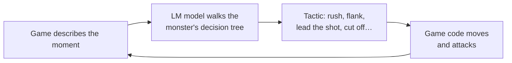

# Elemental Arena

A skillshot VFX sandbox — and the game that grew around it — built with **Three.js**, **Vite** and
hand-written **GLSL**. Ten spells, eight classes with their own skill trees, a procedurally generated
ruined keep, monsters that walk in and try to kill you, loot, NPCs, a level editor, and a chat box
you can give orders to in plain English — backed by a local AI model in [LM Studio](https://lmstudio.ai)
or any OpenAI-compatible server.

<p>
  
  
</p>

## Quick start

Requires **Node.js 22.12+** (or 20.19+) and Git.

```bash
npm install
npm run dev
```

Open <http://127.0.0.1:5173>. The first `npm run dev` also downloads the free 3D asset library
(about 7 GB) in the background; the game is playable straight away. Windows, building, assets and
the AI setup are in **[Setup](docs/setup.md)**.

Nothing paid is needed. Optional paid services — picture-to-3D with Tripo3D or Meshy, hosted AI
models — and more free and paid sources for 3D models, animation and effects are listed in
**[Third-party services](docs/third-party.md)**.

## Playing

Pick a class in the main menu and press **Start Game**. Move with **W A S D**, press **1–5** to arm
a spell, aim with the mouse and **right-click** to cast; **left-click** is your class's close-range
attack. **K** opens your skill tree, **Tab** the bag. Full list: **[Controls](docs/controls.md)**.

## Spells

<p>
  
  
</p>
<p><b>Frost Lance</b> &nbsp;·&nbsp; <b>Storm Lance</b></p>

<p>
  
  
</p>
<p><b>Cinder Fall</b> &nbsp;·&nbsp; <b>Nova Beam</b></p>

<p>
  
  
</p>
<p><b>Voltaic Snare</b> &nbsp;·&nbsp; <b>Glacial Crown</b></p>

<p>
  
  
</p>
<p><b>Arc Chain</b> &nbsp;·&nbsp; <b>Void Orb</b></p>

<p>
  
  
</p>
<p><b>Hailstorm</b> &nbsp;·&nbsp; <b>Blink Strike</b></p>

| Spell | Kind | In one line |
| --- | --- | --- |
| Frost Lance | Line | A field of ice crystals tears up along the line and chills what it hits |
| Storm Lance | Line | A bundle of lightning strikes down the line and stuns |
| Cinder Fall | Line | A burning rock arcs in, detonates and cracks the floor open |
| Nova Beam | Line | A charged column of light that holds and burns |
| Voltaic Snare | Far cast | A violet ring that roots everything inside it |
| Glacial Crown | Far cast | A ring of ice blades that freezes the circle |
| Arc Chain | Line | Lightning that leaps from monster to monster |
| Void Orb | Line | A slow orb that zaps what it passes, then bursts |
| Hailstorm | Far cast | Four seconds of hail over the circle |
| Blink Strike | Line | Teleport down the line, cutting through everything on the way |

Every spell has a clip and a full description in **[Spells](docs/spells.md)**.

Each class starts with two spells. **Skill books** teach the rest and raise their ranks (up to 10),
following the class's tree of three branches and three tiers; you choose which five learned spells
sit on keys 1–5. See **[Classes and skill trees](docs/classes-and-skills.md)**.

## A look around

**Aiming** — line casts aim with an arrow, far casts with a circle.

<p>
  
  
</p>

**Classes and skill trees** — eight classes, nine bodies, a tree per class.
[More →](docs/classes-and-skills.md)

<p>
  
  
</p>
<p>
  
  
</p>

**Monsters** — four kinds that walk in, and the Emberwyrm every fifth wave.
[More →](docs/combat.md)

<p>
  
  
</p>

**Loot, NPCs and portals** — drops by rarity, merchants, quests, stone portals.
[More →](docs/items-npcs-portals.md)

<p>
  
  
</p>
<p>
  
  
</p>

**AI-built maps** — type a sentence, get a map from the free asset library.
[More →](docs/ai-maps.md)

<p>
  
  
</p>

**Level editor and campaign** — sculpt, scatter, set the rules, write the story.
[More →](docs/level-editor.md)

<p>
  
  
</p>

**Your own models** — upload a 3D file, or make one from a picture, and wear it.
[More →](docs/custom-models.md)

<p>
  
  
</p>

## Coming next: AI LM mode

A hard mode where the monsters learn how you play — your dodges, your cooldowns, how you aim — and
pick the attack most likely to land. A small **LM model**, trained on games played in this arena,
walks a decision tree for each monster and for the Emberwyrm boss; the game turns its answers into
movement. Planned, not built yet: the decision trees are in **[Adaptive monster AI](docs/adaptive-ai.md)**.



## Documentation

| Page | What is in it |
| --- | --- |
| [Setup](docs/setup.md) | Install, Windows, build, Docker, assets and character models |
| [Controls](docs/controls.md) | Every key and mouse action |
| [Spells](docs/spells.md) | The ten spells, with clips, and how the newer ones are built |
| [Classes and skill trees](docs/classes-and-skills.md) | The eight classes, their bonuses and bodies, skill trees and books |
| [Loot, NPCs and portals](docs/items-npcs-portals.md) | Drops, rarities, the bag, merchants, quests, portals |
| [The fight](docs/combat.md) | The arena, the monsters, the Emberwyrm, how damage is timed |
| [The AI commander](docs/ai-commander.md) | Chat that casts, wiring LM Studio or another model, Docker |
| [AI-built maps](docs/ai-maps.md) | Maps from a sentence and the 3D asset library |
| [Level editor and campaign](docs/level-editor.md) | Building levels, saving and sharing, the campaign |
| [Your own models](docs/custom-models.md) | Uploading 3D models or making one from a picture |
| [Movement](docs/movement.md) | How the character's gait, lean and arms are animated |
| [Tuning editor and presets](docs/tuning-editor.md) | The **G** editor: 900+ live sliders, presets |
| [Third-party services](docs/third-party.md) | What is free, what is paid, and options for 3D models, animation, AI and effects |
| [Adaptive monster AI](docs/adaptive-ai.md) | The planned AI LM mode: decision trees for each monster and the boss, and training |
| [Architecture](docs/architecture.md) | Project layout, how the systems fit together, performance, known rough edges |

## Licence

Code is provided as-is for the purposes of this project. The bundled HDR probe and the character
FBX retain their original licences.
