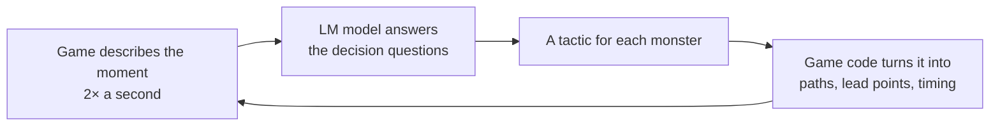
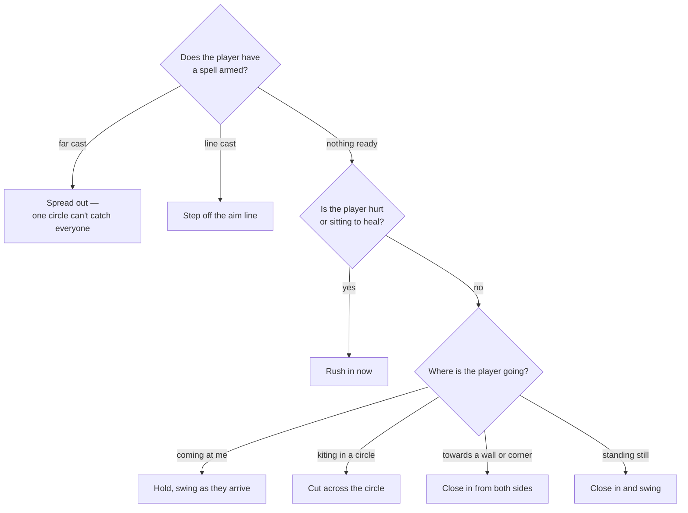
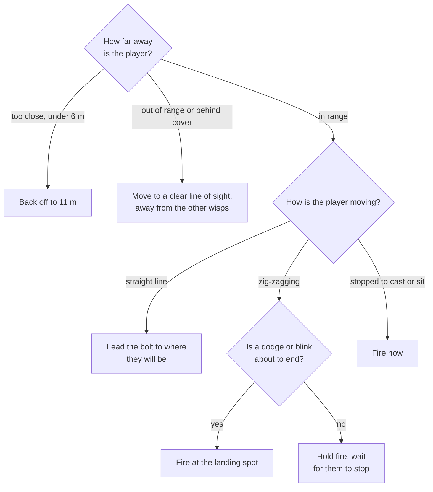
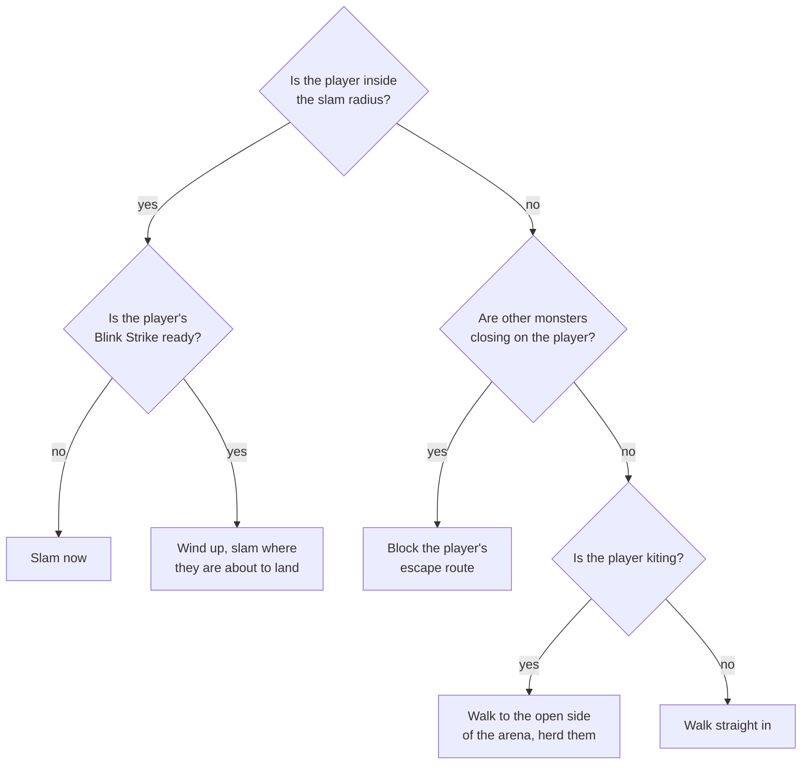
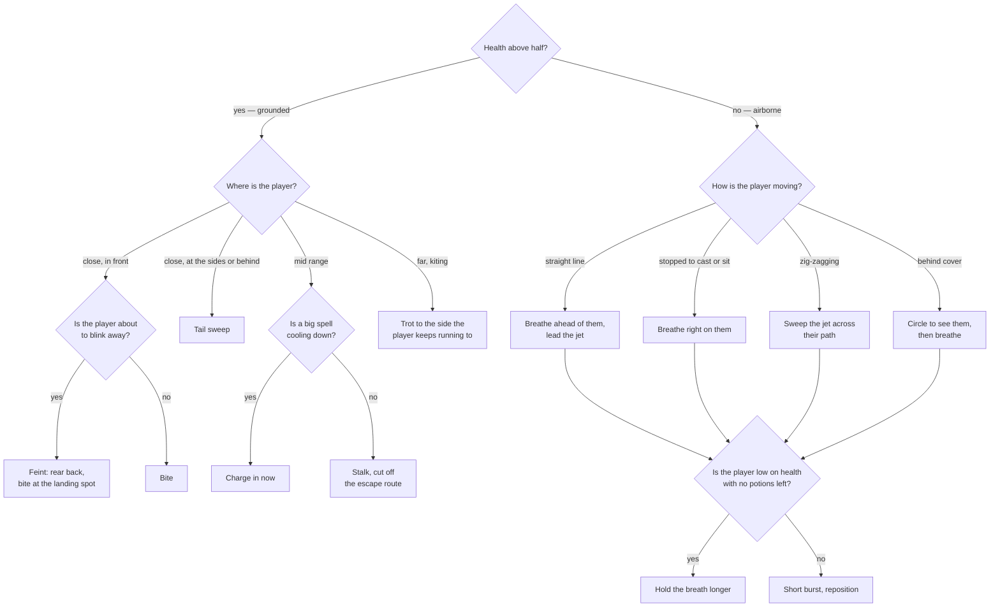

# Adaptive monster AI (AI LM mode)

[← Back to the README](../README.md)

> **Status: planned, not built yet.** We are collecting more training situations first. Today's
> monsters run hand-written behaviour (see [The fight](combat.md)).

## The idea

Today each monster follows hand-written rules: it comes at you and attacks once you are in range.
In **AI LM mode** the monsters read *how you play*. They watch where you are running, which spells
are on your keys and which are cooling down, whether you blink away when cornered, and how you aim
far casts. Then they choose the attack most likely to land. A player who repeats the same pattern
finds the horde has learned it. The goal is a hard mode that is difficult to clear.

## How it works

The brain is a small **LM model** (a language model fine-tuned for decisions). It does not steer a
monster frame by frame. Instead it answers short **multiple-choice questions** about the moment,
with a probability for each answer. The game splits the work:

1. **The game describes the moment:** the player's position and speed, recent dodges, armed spell
   and cooldowns, health, and where each monster is.
2. **The LM model walks the decision tree** for each monster (below) and picks a tactic.
3. **The game turns the tactic into movement.** Lead points, timing and paths are computed by code,
   because geometry is something code does exactly and a language model does not.

## Decision trees

Each diamond is a question the LM model answers from the description of the moment. Each box is the
tactic the monster then carries out. The questions stay the same; training changes *how well* the
model answers them for each player.

### Melee monsters — Skeleton Minion and Skeleton Warrior

They close in and swing. The Brute's 18% armour makes it the shield: when both are on the field,
the Brute walks in front and the Imps follow in its shadow.

### Ranged monster — Skeleton Mage

It never closes; it fires a dodgeable bolt from 11 m. Its job is to make standing still costly.

### Heavy monster — Bone Colossus

Slow, 30% armour, slams the floor for area damage. It controls space rather than chasing.

### Boss — the Emberwyrm

Two phases, read off its health bar: grounded (bite and tail sweep) above half health, airborne
(fire breath) below.

## Training

The LM model learns from games played in this arena:

1. **Play and record.** Each moment becomes a record: the situation, the answer chosen at each
   question, and what happened over the next 0.5–2 seconds.
2. **Label by hindsight.** Once we know where the player actually went, we can mark which answer
   *would have* landed the attack. Those become the right answers.
3. **Fine-tune** the LM model on the records.
4. **Measure by playing.** Win rates of trained monsters against the hand-written ones, over the
   same waves.

### Situations to train on

The model is only as good as the situations it has seen. Examples (this list is still growing):

| Situation | What a smart horde should learn |
| --- | --- |
| Player kites in a circle | Cut across the circle instead of following |
| Player blinks away when cornered | Hold a monster back to cover the landing spot |
| Big spell is cooling down | Commit to the attack now |
| Far cast is armed | Spread out so one circle cannot catch everyone |
| Player sits to heal | Rush before health comes back |
| Player hides behind a wall or prop | Split up and come round both sides |
| One monster left, low health | Retreat and pull the player into the others |

## For game studios

The trained LM model is separate from this game's code. A game only has to describe its own
situations and map the tactics onto its own movement, so the same approach can be offered to
studios for their own products.
