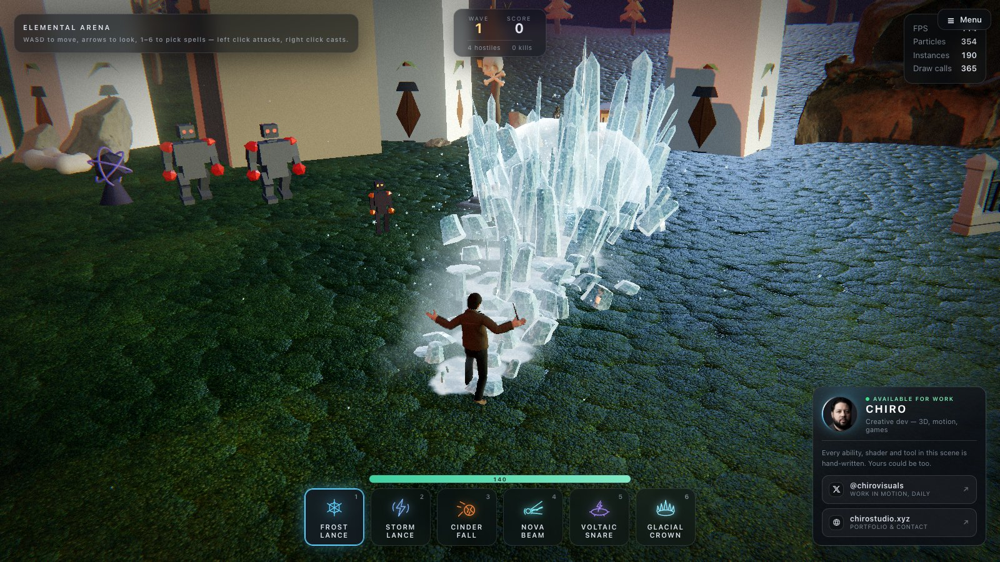
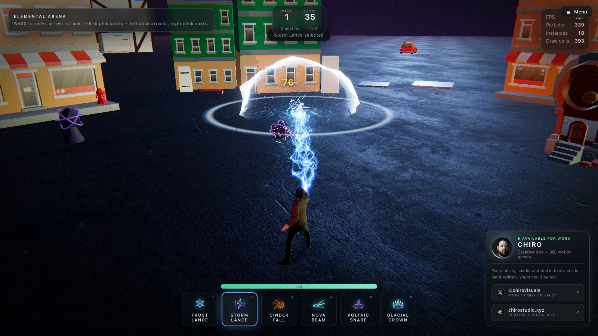
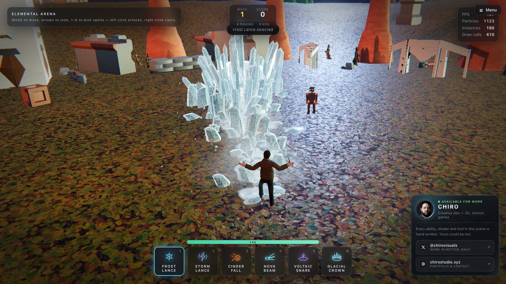
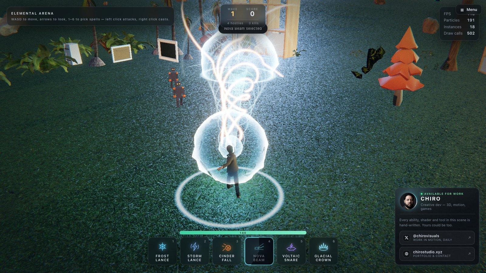

# AI-built maps and the asset library

[← Back to the README](../README.md)

## AI-built maps and the 3D asset library

Open the **World** tab in the main menu, describe a battlefield — *"a snowy mountain pass with a
ruined watchtower at dawn"* — and press **Generate map**. Your LM Studio model designs the map;
the game builds it from real, downloaded 3D models (trees, rocks, cliffs, houses, castles, city
blocks, ruins, props, vehicles…) and you fight in it when you press **Start Game**.
**Classic keep** goes back to the hand-built ruins.

Four maps designed by Qwen3-4B in LM Studio from one-line prompts, each mid-wave:

<p>
  
  
</p>
<p>
  
  
</p>

### How a map is made

1. **The library.** `npm run library:fetch` (run for you by `npm run dev` / `npm run build`)
   downloads open 3D packs into `library/` and indexes every model into `library/catalog.json`:
   its real size, triangle count, whether it is rigged, a category (`tree`, `rock`, `cliff`,
   `building`, `wall`, `ruin`, `structure`, `prop`, `light`, `vehicle`, …) and themes (`forest`,
   `snow`, `desert`, `city`, `medieval`, `dungeon`, `halloween`, `coast`, …).
2. **The plan.** `src/ai/MapPlanner.js` tells the model what the library holds and asks for a
   small JSON *map plan* (`src/world/MapPlan.js`): ground, relief, edge, time of day, fog, up to 8
   placement layers (`category` + keywords + zone + density) and up to 4 landmarks. If no model is
   reachable, a keyword planner writes the plan instead, so the button always works.
3. **The build.** `src/world/ComposedWorld.js` shapes terrain outside the arena, picks models for
   each layer from the catalog (preferring the plan's theme and packs already on the map, so a map
   keeps one look), sizes them sensibly per category and zone, places them as GPU instances, and
   gives monsters and the caster colliders to walk around. The 25 m arena itself always stays flat.

Rigged characters and creatures from the library are catalogued too (`character`, `creature`)
but not used as scenery yet.

### Sources

| Source | What | Licence | How it is fetched |
| --- | --- | --- | --- |
| [KayKit](https://github.com/KayKit-Game-Assets) | ~900 stylised models: dungeon, medieval hex, city, furniture, space base, characters, skeletons | CC0 | GitHub |
| [Polygonal Mind](https://opensource3dassets.com) | ~1,000 GLBs in 18 themed collections, incl. 60 rigged creatures | CC0 | GitHub (Open Source 3D Assets registry) |
| [Poly Haven](https://polyhaven.com/models) | ~520 photoscanned models: rocks, cliffs, trees, plants, props, buildings | CC0 | Official API |
| [ambientCG](https://ambientcg.com) | Ground materials (grass, snow, sand, rock, mud…) for terrain | CC0 | Official API |
| **Inbox** | Anything you download yourself — Kenney, Quaternius, itch.io, Sketchfab | Per pack | Drop the `.zip` (or folder) into `library/inbox/` and run `npm run library:index` |

Kenney and Quaternius block automated downloads, so they come in through the inbox: download the
packs from their sites by hand (choose the **glTF/GLB** version) and drop the zips into
`library/inbox/`. Packs whose names start with Kenney, Quaternius or KayKit are recorded as CC0;
any other pack records its own `LICENSE` file, or "unknown — check before sharing".
`library/CREDITS.md` lists every pack, licence and author.

### Commands and settings

```bash
npm run library:fetch                            # everything, resumable, 40 GB cap
npm run library:fetch -- --sources kaykit,polyhaven
npm run library:fetch -- --max-gb 10 --res 2k    # cap and Poly Haven texture size
npm run library:index                            # re-index after adding inbox packs
```

| `.env` variable | Meaning |
| --- | --- |
| `LIBRARY_AUTO_FETCH` | `0` stops `npm run dev` / `npm run build` from downloading the library |
| `LIBRARY_MAX_GB` | Disk cap for the download (default `40`; the full library is about 7 GB) |

The library is **git-ignored** and never committed: it is several gigabytes, and it is cheaper
to fetch than to clone. Docker builds skip the download and mount `./library` instead.

### Known limits

- A 4B model sometimes asks for odd layers; the plan is clamped and repaired, but a map can still
  contain an out-of-place prop. Re-generate, or name what you want ("pine", "tavern", "column").
- Planning takes ~20 s with Qwen3-4B on LM Studio (longer while the model loads).
- The packs mix styles (stylised KayKit next to photoscanned Poly Haven); the composer leans
  toward one pack per map, but does not guarantee it.
