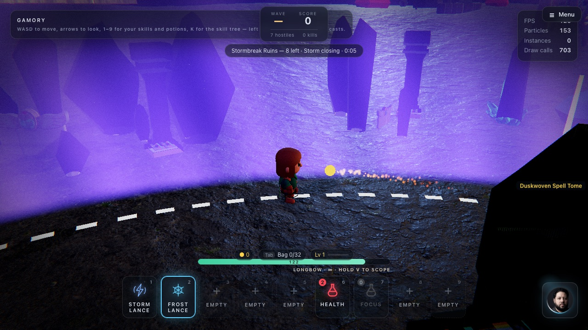

# Battle royale

[← Back to the README](../README.md)

  

A mini battle royale on the arena: everyone drops in at once, loot lies around, a storm closes in
from the edge, and the last one standing wins. Play it alone against AI rivals, or with up to four
players in a party. Find it on the home page (**Stormbreak Ruins** and **Saltwind Squads**), or make
your own in the [Game builder](game-builder.md) with the **Battle royale** or **Squad royale** genre.

## How a match goes

1. **Drop in.** Everyone starts spread around a ring, so nobody starts next to anybody. Rivals fill
   the field: 7 by default, fewer for each extra player in the party (a party of two leaves room
   for six). Weapons, gear and potions lie on the ground.
2. **The storm.** The safe circle shrinks in four phases, from the whole arena down to a circle
   1.5 m across. A dashed white ring shows where the next circle will be, and the goal bar counts
   down to the next move. Outside the circle you lose health every half second, and more in each
   phase; the edges of the screen turn violet. Rivals avoid it and head for the circle.
3. **Down is out.** There are no revives in a battle royale. When you go down you see your place
   ("You placed #3 of 8") and who knocked you out, and you can keep watching.
4. **The last one standing** wins: "Last one standing!" In squads, your squad wins when no rival is left.

| Mode | Who fights whom | Genre |
| --- | --- | --- |
| **Solo** | Everyone against everyone: players, and rivals, who also fight each other | Battle royale |
| **Squad** | Your party is one team against the rivals; teammates can't hurt each other | Squad royale |

A player's hit on another player does about a third of what it does to a monster
(`settings.royale.pvpScale`), so a fight between players lasts long enough to answer.

## Rivals

Rivals are original fighters with a human build and a blaster. They shoot from range, go after
whoever is nearest (players or other rivals), and keep inside the safe circle. In a party the host
runs them, like every monster, and the other players see the same rivals. One that falls to the
storm or to another rival counts for nobody. One you defeat drops what it carried, and counts as a
knock-out on your result card.

## Making one

In the Game builder, pick **Battle royale** (everyone against everyone) or **Squad royale** (your
party against the rivals), any world, and a difficulty: easy has 4 rivals, normal 7 and hard 11. The
map gets extra cover to hide behind. In the level editor, set the goal to **Battle royale (last one
standing)**. A level's `rules.royale` is `{ rivals, mode: 'solo'|'squad', storm }`, where `storm`
scales every phase (0.5 = twice as fast).

## How it works

- `src/game/royale/RoyaleMode.js` runs a match: the drop, the rivals, the storm damage, players
  hitting players, the score and the result.
- `src/game/royale/storm.js` is the storm's schedule: where the circle is at any second, from the
  level's seed and `settings.royale.phases`. Every player computes the same circle; the host sends
  its match clock every two seconds so they agree.
- `src/game/royale/PlayerTarget.js` makes another player something your attacks can hit. Spells,
  swings and guns hit the monsters and these targets alike (`MonsterManager#targets`). A hit is not
  applied by you: it goes to that player's game, which takes the damage and announces when it's out.
- Rivals are a monster kind (`settings.monsters.kinds.rival`). They pick targets from the same list
  of players monsters use, with every rival on it too, and a hit on a rival is applied by the host.

## Limits

- The match is on the arena's 50 m disc, which suits up to about 12 fighters.
- A player's hits on another player are reported by their own browser, as hits on monsters are in
  co-op, and the server does not check PvP damage. It suits friends and family, not tournaments.
- Signed in, the starting loot is left out, because the server makes every item a signed-in player
  can hold. Your loot then comes from the rivals you defeat.
- There is no matchmaking with strangers yet: you play in a party made with a code.
