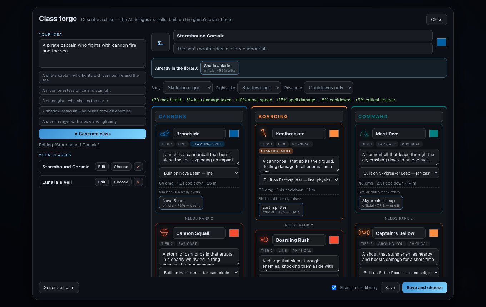
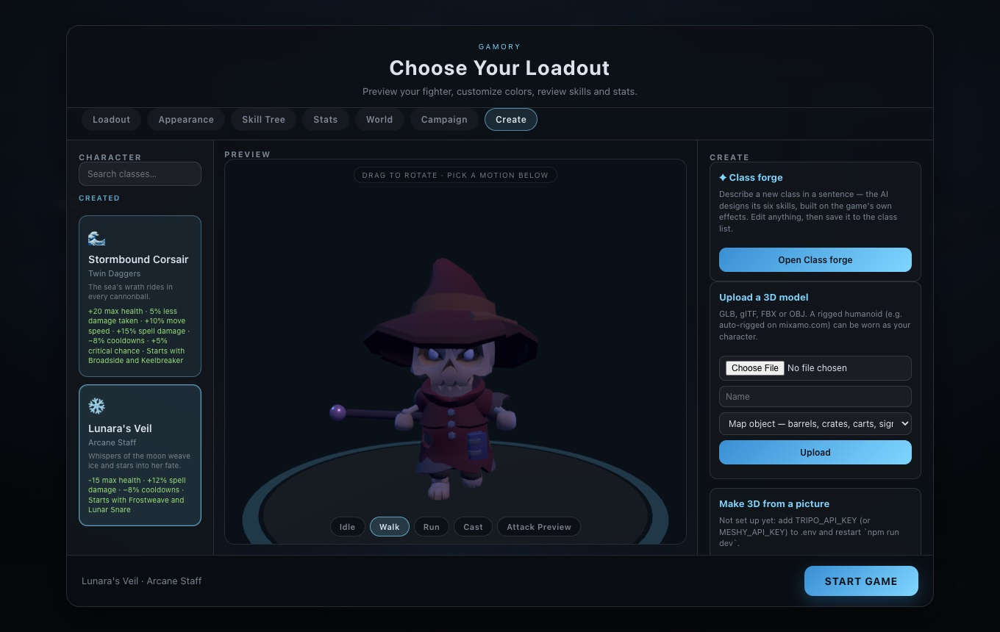
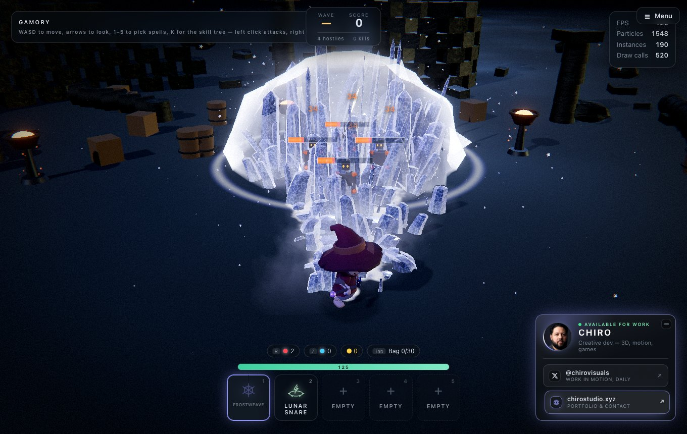
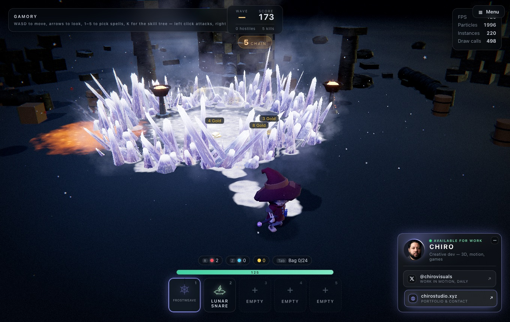

# Class forge — AI-designed classes

[← Back to the README](../README.md)

  
  

  
  

**Main menu → Create → Open Class forge.** Describe a class in a sentence — *"a pirate captain who
fights with cannon fire and the sea"* — and press **Generate class**. The AI designs it: a name, an
icon, a story line, a body to wear, bonuses, and a skill tree of six skills in three branches. Edit
anything, press **Save**, and it is in the class list under **Created**, playable like any other
class, with its own skill tree, skill books and keys.

## How a class is built

The AI never invents new code, so a generated class is always playable and balanced. Every skill is
**built on one of the game's sixteen hand-made effects** (its *base*) and keeps that effect's shape,
timing and damage rules; the design only gives it a name, a description and a **colour**, and the
forge re-tints the whole effect — shaders, particles, light — to that colour.

| Bases a skill can be built on | |
| --- | --- |
| Lines | Frost Lance, Storm Lance, Cinder Fall, Nova Beam, Arc Chain, Void Orb, Earthsplitter |
| Far-cast circles | Voltaic Snare, Glacial Crown, Hailstorm, Skybreaker Leap, Worldbreaker |
| Around you | Battle Roar, Iron Tempest |
| Movement | Blink Strike, Rampage, Skybreaker Leap |

A skill behaves like its base: one built on Rampage charges, one built on Battle Roar buffs your
damage, one built on Iron Tempest spins with you. The class borrows its body motion, melee attacks and
weapon from the built-in class it *fights like*.

The kit follows the structure MOBA and action-RPG characters share — three branches, each a quick
tier-1 skill leading to a stronger tier-2 one, with a mix of lines, circles, a movement skill and a
self cast so the class has answers for different fights. Names are asked to be original: the forge
does not reproduce characters or abilities from other games.

## Editing

Everything in the preview is editable before saving:

- **Names** — the class, its story line, each branch and each skill.
- **Colours** — the class tint and every skill's colour.
- **Body** (any of the nine), **Fights like** (whose weapon and moves), **Resource** (cooldowns only,
  or Rage for a mostly physical class — see [the Barbarian](classes-and-skills.md#the-barbarian-physical-skills-and-rage)).
- **Built on** — swap the base effect of any skill; its numbers update.

**Generate again** asks for a new design from the same idea. The **Your classes** list on the left
re-opens a saved class for editing, chooses it, or deletes it.

## Reusing what already exists

As it designs, the forge asks the [shared library](library.md) what is already there. Under each new
skill it lists the most similar existing skills (official or shared) and how alike they are; **Use
it** makes this class reuse that skill instead of a near-copy (**Make my own instead** undoes it).
Above the class it lists classes already close to this one. **Share in the library** (on by default)
publishes the class and its new skills when you save; untick it to keep them as drafts.

## The AI, and without it

Generation uses the AI model set up for the game (LM Studio — see
[The AI commander](ai-commander.md#wiring-the-model)); the model is held to a strict JSON format, and
everything it returns is checked: six different bases, valid colours and bodies, and **bonuses
held to a budget** so a class cannot be strong at everything. A small local model (Qwen3 4B) designs
a class in about 15–20 seconds; its names are sometimes plain, which is what the editing is for.

Without the AI, a **keyword designer** builds the class instead from the words in the description
(fire, ice, storm, sea, shadow, holy, nature, warrior…), and says so.

## Where classes are kept

Each class is a JSON file in `public/classes/` (plus `index.json`), so — like levels — they live in
the repo and ship with every build. That is under `npm run dev`; on a [production](production.md)
server the built-in classes are read-only and what players save goes to `DATA_DIR/classes`. Two
classes made in the forge ship with the game: **Stormbound Corsair** (cannons, boarding and command)
and **Lunara's Veil** (moonlit ice and starlight).

The code: `src/ai/ClassDesigner.js` (the prompt, schema, keyword designer and checks),
`src/forge/ClassForge.js` (bases, re-tinting, registering a class), `src/ui/ClassForgePanel.js`
(the window).
