# Classes and skill trees

[← Back to the README](../README.md)

## Classes

  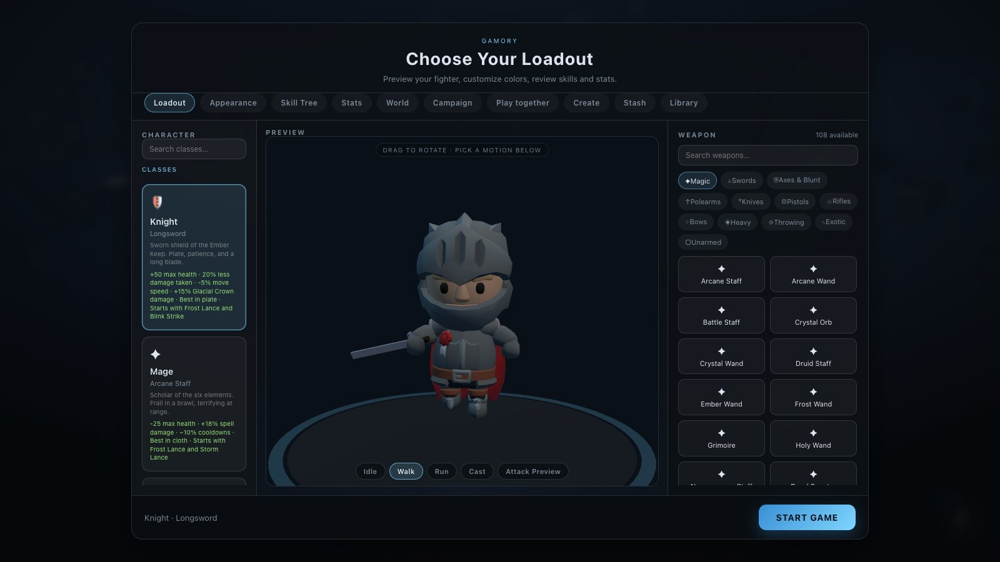
  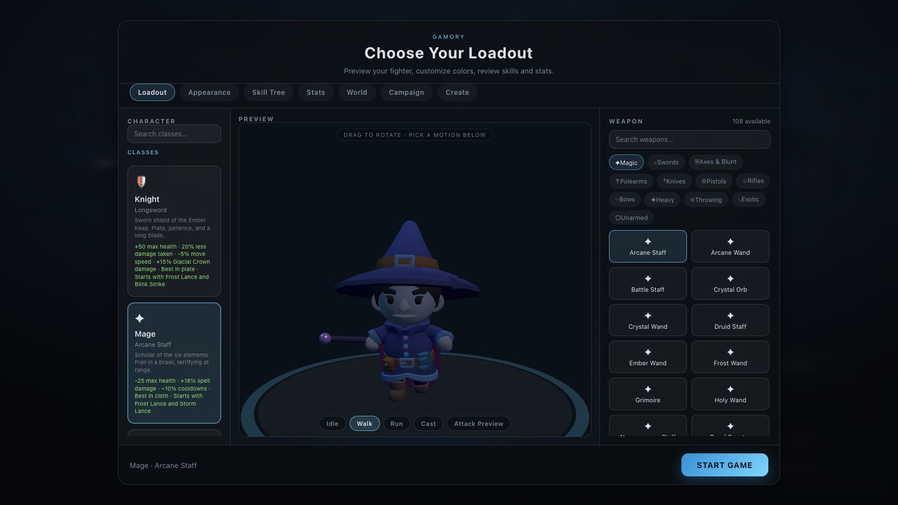

  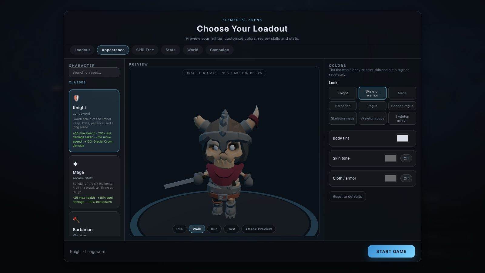
  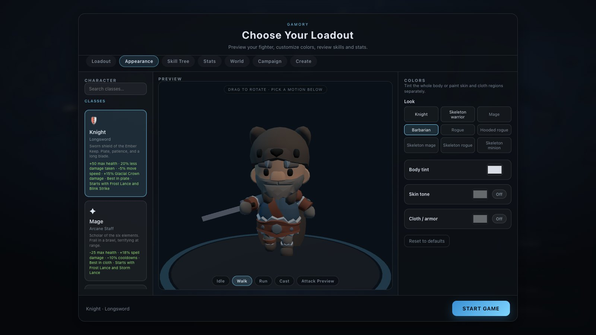

Pick a class in the main menu. Each class has its own skill tree of spells (next section); the class
also sets the body, the starting weapon, the close-range attacks and a set of bonuses that stack with
gear and skill books:

| Class | Starts with | Armor | Bonuses |
| --- | --- | --- | --- |
| 🛡 **Knight** | Longsword | Plate | +50 health, 20% less damage taken, −5% speed, +15% Glacial Crown |
| ✦ **Mage** | Arcane staff | Cloth | −25 health, +18% spell damage, −10% cooldowns |
| 🪓 **Barbarian** | War axe | Mail | +70 health, 10% less damage taken, +8% speed, +20% Earthsplitter — fights with physical skills and Rage, not spells |
| 🏹 **Amazon** | Longbow | Leather | +10% speed, +12% critical chance, +20% Storm Lance |
| 🗡 **Shadowblade** | Twin daggers | Leather | −10 health, +15% speed, +8% critical chance, +15% Voltaic Snare |
| ✚ **Templar** | War hammer | Plate | +30 health, 10% less damage taken, +25% Nova Beam |
| 💀 **Bonecaller** | Necromancer staff | Cloth | −10 health, +10% spell damage, −6% cooldowns, +20% Voltaic Snare |
| 🌿 **Wildwarden** | Druid staff | Leather | +20 health, +20% Glacial Crown, +15% Frost Lance |
| ⚡ **Elemental Caster** | Arcane wand | Cloth | The sandbox original — no bonuses, its own Mixamo body |

**Armor** is the armor class each class is proficient in: it gets +25% from those pieces' base
properties. See [Armor and gear](gear.md#proficiency-each-class-has-its-armor).

**Appearance → Look** dresses any class in any of the nine bodies (Knight, Mage, Barbarian, Rogue,
Hooded rogue, Skeleton warrior/mage/rogue/minion), the class's own picks listed first, and the colour
tints still apply on top. The choice is remembered per class. Classes are defined in
`src/platform/character/classes.js`.

## Skill trees and skill books

  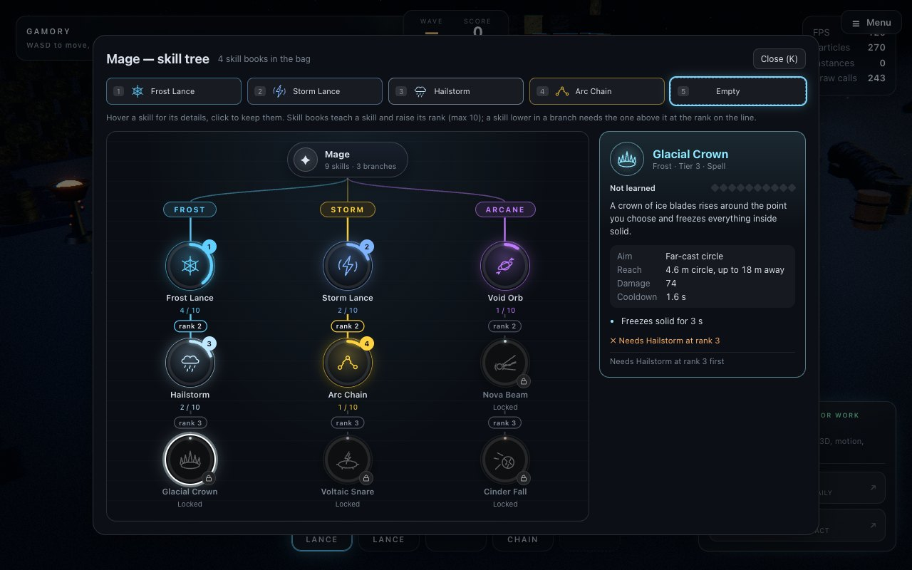
  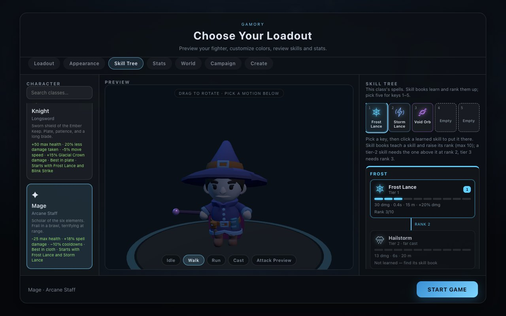

Every class has a **skill tree**: three branches, each a line of spells from tier 1 to tier 3. The
tree is drawn as one: the class crest at the root, a line to each branch, and each skill as a
medallion with its symbol. The ring around a medallion fills with the skill's rank. A small badge
shows the key it is on, a lock while it is locked, or a book when you have one ready to read (the
ring pulses gold). The lines between skills light up once the rank they need is reached; the rank is
written on the line.

**Hover over a skill** (or tab to it) to see everything about it in the detail panel: what it does,
how it is aimed and how far it reaches, its damage and cooldown now and at the next rank, its effects
(slow, stun, root, freeze, burn, Rage), what it needs and what it unlocks. **Click a skill** to keep
its details there. From the panel you read a book to learn it or rank it up, and put it on a key.

A class starts knowing two tier-1 spells. The rest come from **skill books**:

- **Reading a book teaches its spell** (rank 1), and the spell goes onto a free key.
- **More copies of the same book raise its rank**, up to 10. Each rank after the first adds +10%
  damage and −3% cooldown to that spell.
- **Tiers gate the tree.** A tier-2 spell's book can only be read once the tier-1 spell above it is
  at rank 2; tier 3 needs its tier-2 parent at rank 3.
- **A book for a spell outside your class's tree can't be read** — sell it. Three dropped books in
  four are for your own class's tree; merchants always stock two.
- **Nine keys.** Of everything learned, you choose what sits on keys 1–9, beside your potions. On the
  bar itself: drag a key onto another to swap them, or right-click a key (click an empty one) and pick
  a skill or potion. Or press **K**, click a learned skill, then a key number under "Put on key";
  right-click a key at the top to empty it. Saves from the five-key bar get keys 6–9, with the potions
  on 6 and 7.

  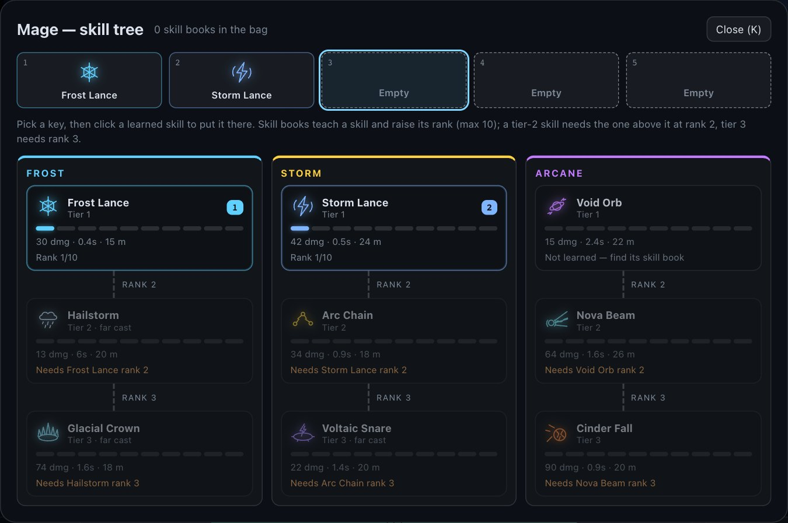
  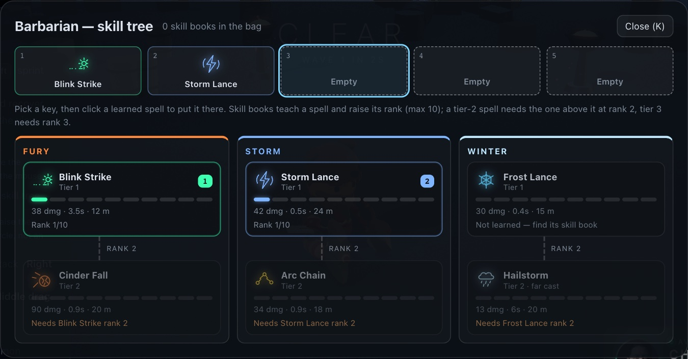

| Class | Starts with | Branches (tier 1 → 2 → 3) |
| --- | --- | --- |
| 🛡 Knight | Frost Lance, Blink Strike | Bulwark: Frost Lance → Glacial Crown · Charge: Blink Strike → Nova Beam · Thunder: Storm Lance → Arc Chain |
| ✦ Mage | Frost Lance, Storm Lance | Frost: Frost Lance → Hailstorm → Glacial Crown · Storm: Storm Lance → Arc Chain → Voltaic Snare · Arcane: Void Orb → Nova Beam → Cinder Fall |
| 🪓 Barbarian | Earthsplitter, Rampage | *Physical skills* — Might: Earthsplitter → Worldbreaker · Rampage: Rampage → Skybreaker Leap · Warlord: Battle Roar → Iron Tempest |
| 🏹 Amazon | Storm Lance, Frost Lance | Storm: Storm Lance → Arc Chain → Hailstorm · Hunt: Frost Lance → Voltaic Snare · Swift: Blink Strike → Nova Beam |
| 🗡 Shadowblade | Blink Strike, Void Orb | Shadow: Blink Strike → Voltaic Snare · Void: Void Orb → Arc Chain · Frost: Frost Lance → Hailstorm |
| ✚ Templar | Void Orb, Storm Lance | Light: Void Orb → Nova Beam → Cinder Fall · Storm: Storm Lance → Arc Chain · Oath: Frost Lance → Glacial Crown |
| 💀 Bonecaller | Void Orb, Frost Lance | Soul: Void Orb → Voltaic Snare · Grave: Frost Lance → Glacial Crown → Hailstorm · Storm: Storm Lance → Arc Chain |
| 🌿 Wildwarden | Frost Lance, Blink Strike | Winter: Frost Lance → Hailstorm → Glacial Crown · Thorn: Storm Lance → Voltaic Snare · Spirit: Blink Strike → Void Orb |
| ⚡ Elemental Caster | Every spell | The spell tester — all ten known from the start |

Spells, ranks and keys are saved **per class** in the browser; gold, potions and the bag are shared.

New classes can be made in the **[Class forge](class-forge.md)**: describe one in a sentence and
the AI designs its tree.

## Mana, cooldowns and levels

Every class but the Barbarian spends **mana**. The blue bar under your health shows it, and it
refills over time. A key whose skill you can't afford dims.

| | Level 1 | Grows with |
| --- | --- | --- |
| Mana | 100 | +6 a character level |
| Mana back per second | 5 | +0.25 a level |
| Skill cost | 10 (Frost Lance) to 34 (Hailstorm) | +4% a skill rank |
| Cooldowns | 2.2 × the skill's own | −1.5% a level (never below 1.2 ×), −3% a skill rank, gear |
| Pause after any cast | 0.9 s | −1.5% a level, never under 0.45 s |

The pause after a cast shows as a sweep on every key, so casts can't be chained instantly. The
**Mana Potion** (key 7 or **Z**) gives back half your mana. It replaces the Focus Potion, which
reset every cooldown; old saves keep their potions, now as mana potions. The skill tree's card shows
each skill's real cost and cooldown for your level. The numbers are in `src/game/progression.js`.

## The Barbarian: physical skills and Rage

  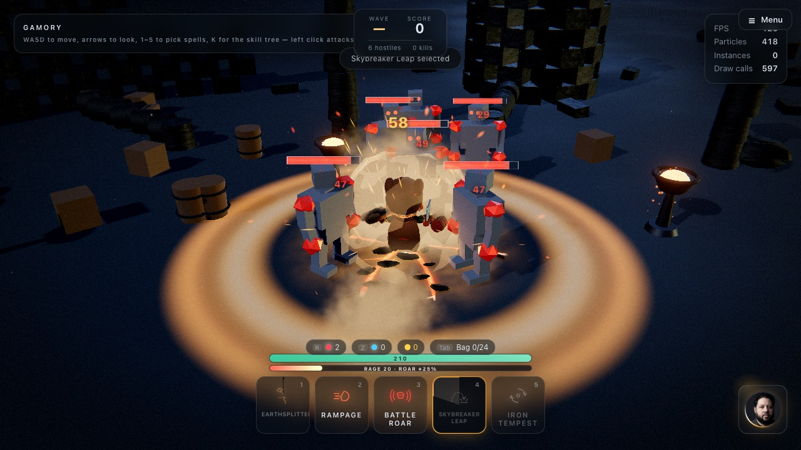
  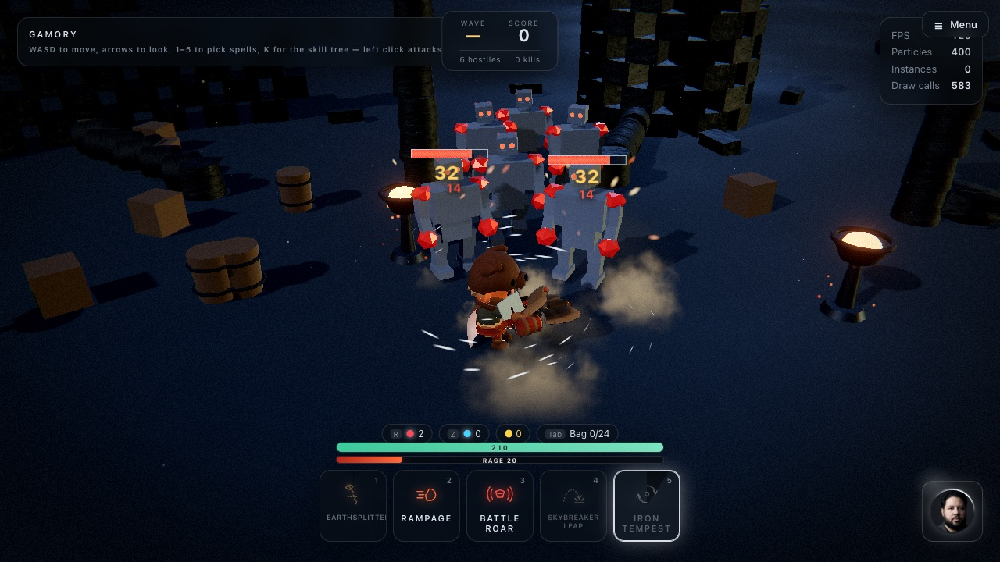

  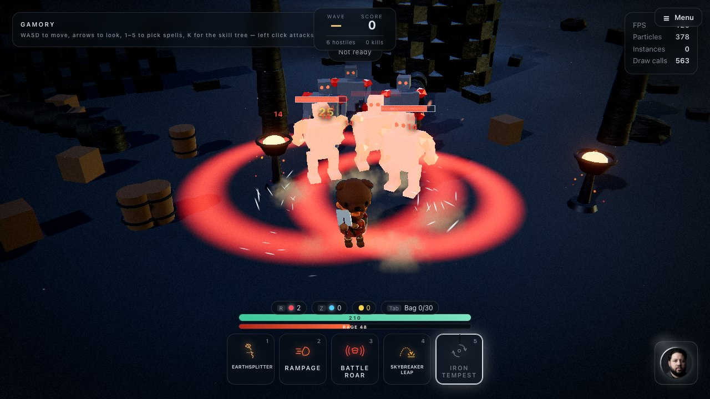
  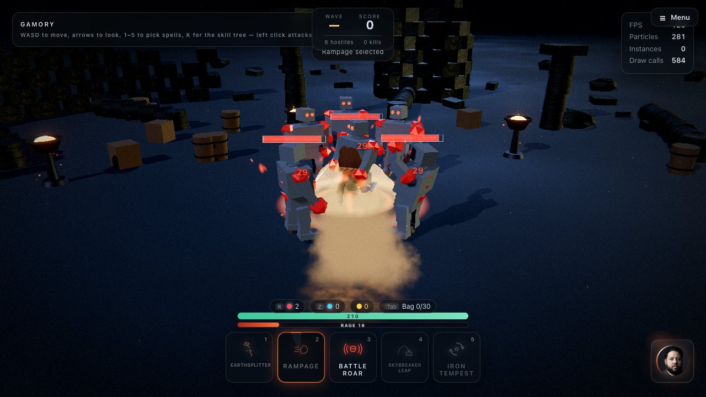

The Barbarian casts no spells. Its tree is six **physical skills**, and it fights with **Rage**
as well as cooldowns:

- **Rage builds** when you land hits — left-click melee (6 per monster hit), the tier-1 skills
  (shown as *+N Rage/hit*), Battle Roar (+30 on cast) — and when you are hit (+4).
- **Rage is spent** by the tier-2 skills. A card you cannot afford is dimmed on the bar.
- **Rage drains** after about four seconds out of combat. The bar sits under your health.

So the rhythm is different from a caster's: build with swings and quick skills, then spend on a big
one.

| Branch | Tier 1 — builds Rage | Tier 2 — spends Rage |
| --- | --- | --- |
| **Might** | **Earthsplitter** — the axe hits the floor and the ground splits along the line (+8 Rage per hit) | **Worldbreaker** — a far cast: the ground at the point cracks open and keeps heaving for a couple of seconds, slowing everything in it (60 Rage) |
| **Rampage** | **Rampage** — charge down the line; the body really travels and knocks everything in the way aside (+6 per hit) | **Skybreaker Leap** — leap to a point and crash down in a ring of cracks (30 Rage) |
| **Warlord** | **Battle Roar** — a shout around you: stuns, knocks back, +25% damage for 6 s for you and every teammate in the circle, +30 Rage | **Iron Tempest** — spin with the axe out for 2.6 s, hitting everything around you as you move (40 Rage) |

Battle Roar and Iron Tempest are **self casts**: press the key and they go off around you — no aiming.

**Battle Roar lifts the team.** Playing together, every teammate within its circle (6.5 m) gets the
+25% damage too. Everyone it reached glows with a red aura (a ring on the ground and a column of
light) that every player in the party can see, and the ring drains as the 6 seconds run out. Each
buffed player also sees a **Battle Roar +25% damage · 5 s** countdown under their health, and a
note saying who roared. Any skill forged on Battle Roar does the same, in its own colour.

  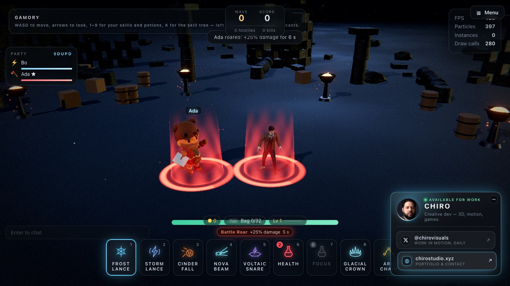

Physical skills come in **skill manuals** instead of tomes; only the Barbarian can read them.

The skill types follow the structure classic action-RPG warriors use — builders and spenders, a
mobility pair, a shout and a finisher — with the game's own skills and effects. Each one lives in
`src/abilities/PhysicalAbilities.js`; damage and Rage numbers are in `settings.combat` and
`ELEMENT_META` (`src/config/settings.js`).
The trees live in `src/platform/skill/tree.js` — a new spell joins the game by being added to the
branches of the classes that should have it.
