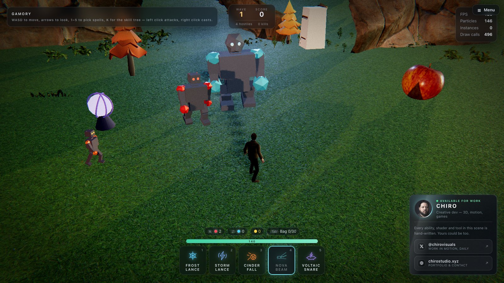
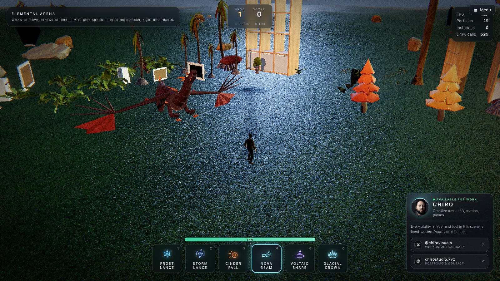

# The fight

[← Back to the README](../README.md)

## The fight

### The arena

`src/world/Ruins.js` generates a dead keep from `settings.ruins.seed` — a broken curtain wall laid
course by course, four drum towers collapsed to four different heights, an arcade of columns (a
third of them toppled with their drums strewn along the fall line), rubble fields, hanging banners
that sway in a vertex shader, and lit braziers. Same seed, same ruin, every reload: the layout is a
fact about the level, because monsters path around it and abilities break parts of it.

It is laid out as four rings from the caster outward — `innerRadius` (a clear stage, nothing is ever
placed inside it), `arcadeRadius`, `wallRadius`, `outerRadius`. Draw calls are the whole design
constraint: eight hundred stone blocks are **one** `InstancedMesh` with per-instance colour, and the
rocks, columns and merlons are one each. The entire keep costs about eight draws.

Barrels and crates are not instanced, because they break. A barrel cooks off into a second blast
with its own radius and status — which can chain into the next barrel — so shooting one in a crowd
is a real play rather than scenery damage.

### The monsters

| Kind | Reads as | Health | Behaviour |
| --- | --- | --- | --- |
| **Skeleton Minion** | a small skeleton with an axe, quick | 46 | Closes and swings |
| **Skeleton Mage** | a skeleton in a hat with a staff | 58 | Never closes — fires a dodgeable bolt from 11 m |
| **Skeleton Warrior** | helmet, blade and shield | 210 | Heavy melee, 18% armour |
| **Bone Colossus** | a giant skeleton warrior with an axe | 520 | Slams the floor for AoE, 30% armour |
| **Rival** (battle royale only) | an adventurer with a crossbow, staff or axe | 130 | Shoots from range, fights everyone |
| **Emberwyrm** | the dragon — see below | 2600 | Two-phase boss, every fifth wave |

  
  

There is exactly one rigged FBX in this project and it is the player, so the monsters are built from
primitives (`MonsterBuilder.js`) and animated in code (`Monster.js`). That turned out to be an
advantage rather than a compromise: a body made of named joints can be *driven* — a hit jolts one
shoulder, a freeze locks the rig mid-stride and rimes it over, a death dissolves it from the feet up
— and none of that is available on a baked clip.

The walk cycle is a handful of sines driven by one phase, and the phase is advanced by **distance
travelled** rather than by time. That is the whole trick: feet that cycle on a clock slide when the
body is slowed or shoved; feet that cycle on distance plant themselves, and a chilled monster
animates at the speed it is actually walking without a single extra line.

Geometry is shared per kind and the assembled rig is cached as a template — joints are collapsed to
one mesh per material role, then cloned per monster. Materials are *not* shared: every monster needs
its own `uHit`, `uFreeze`, `uBurn` and `uDissolve`, or hitting one would flash the whole horde white.

The monsters are **animated models**: the KayKit skeletons (and, for rivals, the KayKit
adventurers) that ship in `public/models/characters`, each with its own authored clips. A skeleton
claws its way out of the ground when it arrives, walks or runs to match its speed, swings or casts
with the blow timed to land as its windup ends, flinches when hit, and plays its death before it
fades. Hits glow white, frost glows blue and burning glows orange; frozen solid stops the clip.
Weapons and shields come from the KayKit skeleton pack in the 3D library when it is downloaded.
The behaviour is unchanged: `entities/Monster.js` decides and `entities/MonsterModels.js` plays
the clip. The Emberwyrm keeps its built body, as does any kind whose model fails to load.

### The Emberwyrm

The boss. Everything else on the field is a silhouette you read in a tenth of a
second; a boss has to survive being *looked at*, so this one is built the way an
animal is — a spine running from nose to tail tip in twenty-odd links, four
limbs with real joint chains, a jaw that hinges, wings with a finger skeleton
and a membrane stretched between the spars, and scales that come out of a
distance field in the fragment shader rather than a tiling texture.

Two ideas do most of the work in `DragonBuilder.js`:

- **Everything is a chain.** The neck, the tail and the wing fingers are arrays
  of joints, driven with travelling waves rather than individual poses. A wave
  that starts at the shoulder and arrives at the tail tip a beat later is what
  makes a long body look like it has mass.
- **Everything is built forward along +Z.** Each segment's joint sits at its
  start, the geometry runs to +Z, and the next joint hangs off the far end. The
  tail is then the same code as the neck with its root turned around.

As authored it is over two hundred pieces; `RigKit.collapseJoints` bakes
everything rigid within each joint down to one mesh per material, landing the
finished boss at a few dozen draws.

The animation is all lag. The forearm and the hand trail the shoulder by a fixed
fraction of a beat, and *that* is what makes a wingbeat look like it is moving
air — a wing whose joints all reach the top of the stroke together reads as a
cardboard cut-out, and the fix is not more joints, it is a hundred milliseconds
of delay between the ones already there. The folded pose was not authored by
hand either: three chained Euler rotations compose in a way that is genuinely
hard to predict (the first attempt folded both wings forward over the head), so
the angles were found by sweeping the parameters and scoring where the wrist and
the outermost fingertip actually landed in body space.

The fight has two phases, read straight off the health bar:

- **Grounded.** It stalks you on four legs in a diagonal trot — front-left with
  back-right, the gait every heavy quadruped actually uses — bites at close
  range, and sweeps its tail through *everything* around it when you crowd it.
- **Airborne**, under half health. It lifts off with a roar, holds station above
  the arena and does nothing but breathe fire, which the melee half of the kit
  cannot answer. The camera backs off while it is alive.

The breath is a jet, not a hitscan: the cone is re-evaluated every tick from
where the head currently points, so walking out of it works. The wind-up is
visible from anywhere in the keep — the throat lights up *inside the mouth* and
the seams between every scale on its body start glowing, because a boss attack
you cannot see coming is not an attack, it is a tax.

### Damage, and why it is not instant

`src/game/Combat.js`. A cast does not deal damage — it opens a **strike**, and the strike walks
downrange at the same `settings[element].speed` the visual uses. A monster is hit on the frame the
effect reaches it. Retune the ability and the damage retunes itself.

This lives entirely outside the six ability classes. Not one of them knows a monster exists:
`AbilityManager.cast()` and `Combat.open()` are handed the same `(origin, direction, distance)` from
the same aim event and independently produce the picture and the consequences.

Statuses have to be visible on the body, not just in a number — chill slows, shock jitters and stuns,
burn chars and ticks, root holds in place, freeze locks solid. **A frozen monster hit by a meteor
shatters for double damage**, which makes Glacial Crown → Cinder Fall the strongest line in the game
and is the whole reason the status system exists.

`src/game/GameDirector.js` owns pacing rather than mechanics: waves (count grows geometrically,
health linearly), score and the chain multiplier, your health and revive, and **hit-stop** — a beat
of near-frozen time on a heavy impact, bought with one multiplier where the app already scales its
delta. It is the cheapest weight a game can buy.

All of it switches off: `settings.combat.enabled = false` and the sandbox is exactly what it was.
