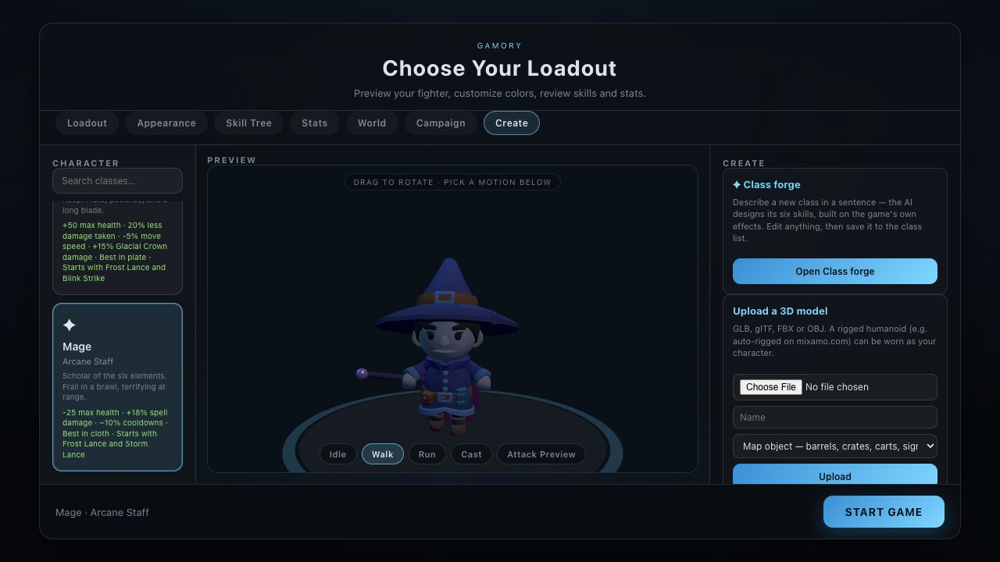
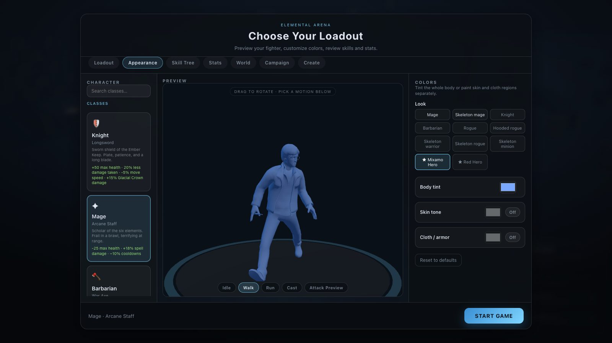

# Your own models

[← Back to the README](../README.md)

## Your own models — upload or make 3D from a picture

  
  

**Main menu → Create** brings your own 3D models into the game:

- **Upload a 3D model** — GLB, glTF, FBX or OBJ (converted to GLB in the browser). Choose what it
  is: **My character**, or a **map object** in any category (tree, rock, building, prop…).
- **Make 3D from a picture** — a PNG, JPEG or WebP of a character or object goes to
  [Tripo3D](https://developers.tripo3d.ai) or [Meshy](https://docs.meshy.ai), which build a textured
  3D model in 1–3 minutes. For **My character** the model is also **rigged and animated
  automatically** (idle, walk, run) — Tripo rigs with Mixamo bone names, so the game's own cast
  animations drive it as well. If it isn't a humanoid, it is kept as a static map object instead.

Everything lands in **My models** (`library/my-models/`, git-ignored like the rest of the library)
and is usable straight away:

| As | Where |
| --- | --- |
| Your character | **Appearance → Look** (★ entries) or **Wear** in My models — any class can wear it, keeping the class's bonuses |
| Map objects | The level editor's model browser (search its name) and AI-built maps (theme `custom`) |
| NPCs | The **Look** list of an NPC in the level editor |

Characters need a skeleton. The easy route for any humanoid mesh is to auto-rig it free at
[mixamo.com](https://www.mixamo.com), download as FBX, and upload that: Mixamo-rigged bodies use the
game's own idle and cast animations. Bodies rigged some other way play the clips they bring.

**Setup for picture-to-3D:** put **one** key in `.env` and restart `npm run dev` —
`TRIPO_API_KEY` ([get one](https://developers.tripo3d.ai/en/keys)) or `MESHY_API_KEY`
([get one](https://www.meshy.ai/developers/keys), needs prepaid API credits). The key stays on the
dev server, never in the browser. Rough cost per model: Tripo ~$0.30 for an object, ~$0.85 for a
rigged character with three animations; Meshy ~30 credits for an object, ~45 for a character.
`MODELGEN_PROVIDER=mock` runs the whole flow offline with a bundled model, for testing.
