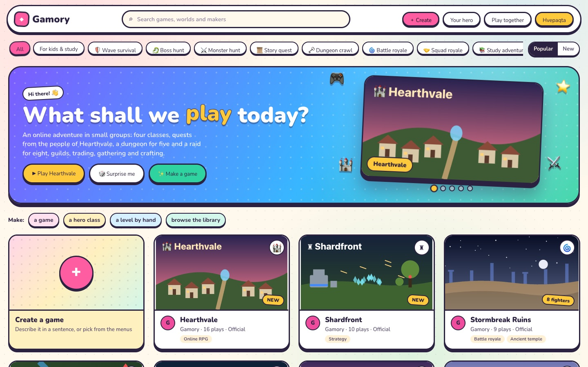
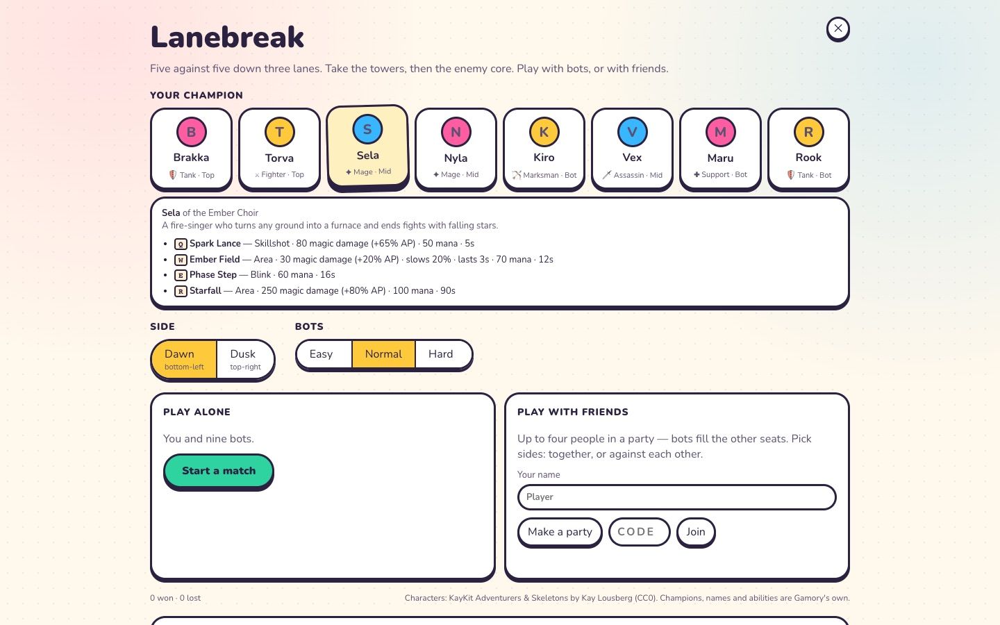

# Gamory Pop — the design system

[← Back to the README](../README.md)

One look for the whole platform: bright and playful. Cream paper, plum ink, six candy colours,
chunky "sticker" shapes (a thick ink outline and a hard shadow you can press), the rounded Nunito
typeface, and springy motion.

  

  

## Where it lives

- **`src/ui/pop.css`** — the tokens, the shared button, the home page, and each game's mapping.
- **`src/ui/pop.js`** — the motions: `tilt(node)` (a card leans toward the pointer and gets a
  shine), `confetti(from)` (a burst from a button), `popColor(i)` (the candy colours in order).
- **Nunito** (SIL Open Font License) is bundled through `@fontsource-variable/nunito`, so the look
  is the same on every machine and works offline.

## Tokens

| | |
|---|---|
| Paper and ink | `--pop-paper` `--pop-paper-2` `--pop-card` · `--pop-ink` `--pop-ink-2` `--pop-ink-3` |
| Candy | `--pop-pink` `--pop-sun` `--pop-sky` `--pop-mint` `--pop-grape` `--pop-coral` |
| Night (over 3D) | `--pop-night` `--pop-night-2` `--pop-night-line` `--pop-night-text` `--pop-night-dim` |
| Shape | `--pop-r` (22px) `--pop-r-sm` · `--pop-border` (3px ink) · `--pop-shadow` (a hard 6px drop) |
| Motion | `--pop-spring` (an overshooting ease) · `--pop-font` |

## Two surfaces

- **Paper** — screens you read and choose on: the home page, a game's page, the set-ups of
  Shardfront, Lanebreak and Hearthvale, the Stock Market Challenge and Work Life. White stickers on
  cream, ink outlines, candy fills for what is chosen or primary.
- **Night** — panels over a 3D world (the HUDs in a match): deep plum glass with the same candy
  accents and rounder corners, so the world stays the star and text stays readable over any scene.

A game keeps its own stylesheet and variables (`--rts-*`, `--lb-*`, `--hv-*`, `--mk-*`); `pop.css`
maps them onto the tokens — paper while its set-up is showing, night once the match is on. A new
game gets the look by adding its variables to those two blocks.

The stock charts keep their dark board: their two series colours were checked for contrast and
colour-blind safety on that surface.

## Motion, and less of it

Cards pop in one after another, tilt toward the pointer and lift on hover; buttons press down into
their shadow; the banner's featured game changes every five seconds (it waits while the pointer is
on it); Play, Surprise me and Make a game throw confetti. All of it stops under
`prefers-reduced-motion: reduce`.

## Not yet in the new look

The action RPG's own screens — its main menu (class, weapon, skills), the in-fight HUD, the game
builder, the level editor and the "Play together" panel — still wear the earlier dark look, apart
from the typeface. They are next.

A game's **lobby** (where you choose your character) is in the new look: paper and ink, an accent
by the kind of game (mint for study games, coral for hunts, sky for royales, violet otherwise), the
character on a lit stage, a card for each class with its description, the body as buttons, and
colours as swatches with a picker at the end of the row for any other.
