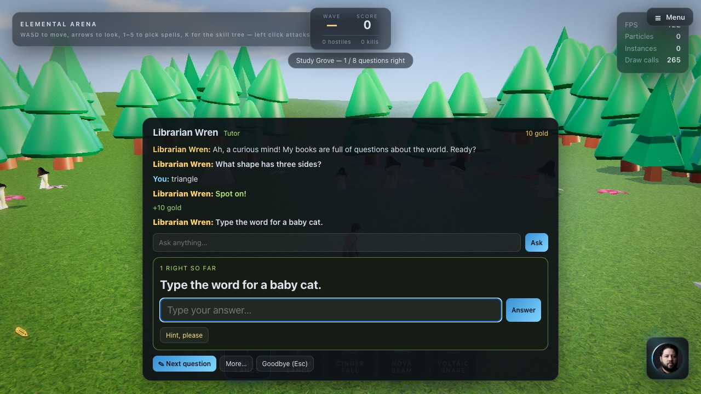
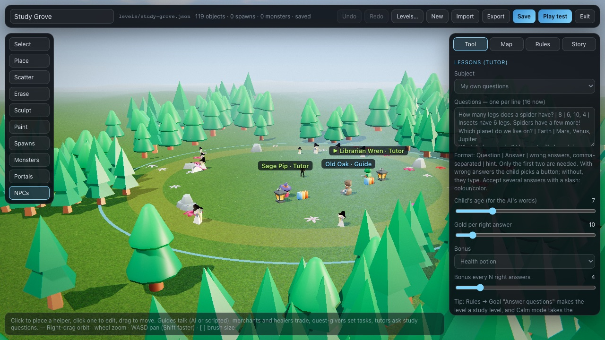
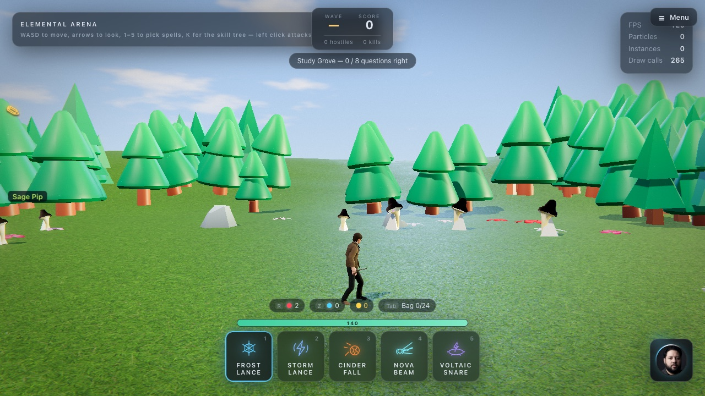

# Study games for kids

[← Back to the README](../README.md)

<p>
  
  
</p>

A parent can turn the game into a study game. **Tutor** NPCs stand in a level and ask study
questions. Every right answer earns gold, and every few right answers a bonus (a skill book or a
potion), so studying makes the child's caster stronger. With the AI turned on, the tutor also gives
hints and explains answers in simple words.

## Try the sample: Study Grove

**Main menu → Campaign → Study Grove.** Study levels are always open; they never need the battle
levels finished first.



A sunny clearing with **no monsters** (Calm mode). Old Oak the guide explains what to do. Two
tutors wait under their lanterns:

- **Sage Pip** asks number questions — adding, taking away and easy times tables.
- **Librarian Wren** asks about the world — animals, planets, colours, shapes, words.

Walk up to a tutor, press **F**, then **✎ Study with me**. Eight right answers open the golden gate.

## Make your own

1. **Main menu → Campaign → Open level editor**, then **New**.
2. **Rules** tab: set **Goal** to *Answer questions* and choose how many right answers are needed.
   Tick **Calm mode** for no monsters — or leave it off, so the child fights *and* studies.
3. **Map** tab: set **Time of day** to *Day* for a bright, sunny sky.
4. **NPCs** tool: click the ground to place a helper, and set its **Role** to *Tutor*. Then fill in
   the lessons:

   | Setting | What it does |
   | --- | --- |
   | **Subject** | *Addition*, *Subtraction*, *Times tables* or *Mixed math* — made up fresh every time, so they never run out — or *My own questions* |
   | **Difficulty** | Easy (within 10, tables to 5), Medium (within 20, tables to 10), Hard (within 100, tables to 12) |
   | **Questions** | Your own questions, one per line (format below) |
   | **Child's age** | How simply the AI tutor talks |
   | **Gold per right answer** | The reward for each right answer |
   | **Bonus / every N** | A skill book, health or focus potion every N right answers |
   | **Talks with the AI model** | Hints and explanations from the AI (needs LM Studio — see below) |
   | **About the child and their lessons** | Notes for the AI: what they are learning, what they like |

5. **Story** tab: write the intro and the ending — the reason the child is studying ("the gate only
   opens for a clever caster…").
6. **Save**. The level appears in the Campaign, always open.

Several tutors can share one level — for example one for math and one for spelling — and every
right answer counts toward the level's goal.

### Writing your own questions

One question per line:

```
Question | Answer | wrong answers, comma-separated | hint
```

Only the question and the answer are needed.

```
How many legs does a spider have? | 8 | 6, 10, 4 | Insects have 6. Spiders have a few more!
What is the capital of France? | Paris | London, Rome, Madrid
Type the word for a baby cat. | kitten | | It rhymes with mitten.
How do you spell the colour of the sky? | blue
What is 7 × 8? | 56 | 54, 48, 63
Which is correct? | colour/color
```

- **With wrong answers**, the child picks from big buttons — easiest for young children.
- **Without**, the child types the answer. Capitals and extra spaces don't matter, and numbers
  compare as numbers ("8" and "8.0").
- **Several right answers**: separate them with a slash, `colour/color`.
- **Hints** show after a wrong try, or when the child presses *Hint, please*.

The questions are shuffled, and each is asked once before any repeats.

## How a lesson goes

1. The tutor asks a question.
2. **Right:** praise, the gold, and every few answers the bonus.
3. **Wrong:** "Have another try!" and the hint. The wrong choice is crossed out.
4. **Wrong twice:** the tutor shows the answer — and, with the AI on, explains it in two short
   sentences.

The goal counter at the top of the screen shows the progress (*3 / 8 questions right*).

## The AI tutor

With **Talks with the AI model** on, the tutor uses the AI set up for the game (LM Studio on your
own computer — see [The AI commander](ai-commander.md#wiring-the-model)). It then:

- gives a **hint** without giving away the answer,
- **explains** an answer after two wrong tries,
- answers the child's own questions in the *Ask anything* box.

The tutor is instructed to talk like a kind teacher to a child of the age you set: short simple
words, encouragement, step-by-step examples. It stays on schoolwork and the game, turns anything
grown-up, scary or private back to "ask a parent", and never asks for personal details.

Without the AI, everything still works: hints come from your question list, and the tutor shows the
answer without the explanation.

> **A note for parents.** AI models can still make mistakes or say something unexpected. Check the
> tutor's answers on your child's subjects first, and stay nearby for young children. With LM
> Studio, the conversation stays on your own computer.
