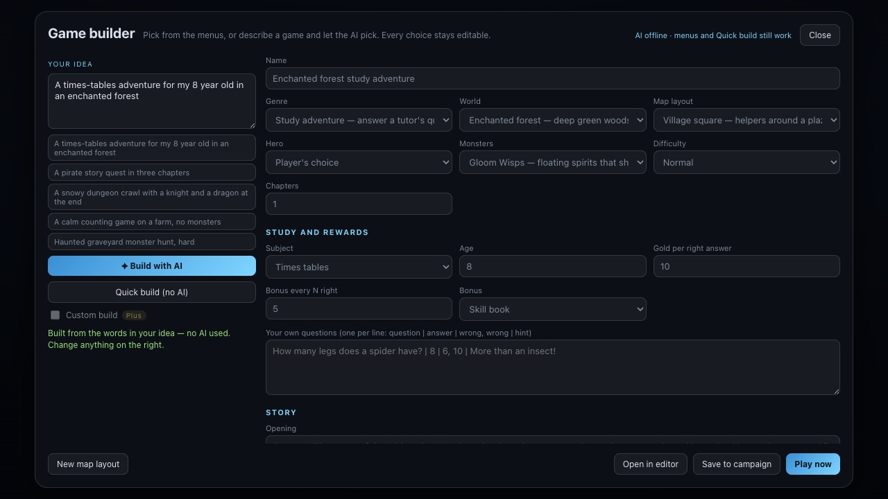

# Game builder — whole games from a sentence or a few picks

[← Back to the README](../README.md)

<p>
  
</p>

**Main menu → Create → Open Game builder.** Type an idea — *"a times-tables adventure for my 8 year
old in an enchanted forest"* — and press **Quick build** (no AI) or **Build with AI**. Every part of
the game is then a menu you can change: genre, world, map layout, hero, monsters, difficulty, how
many chapters, and for study games the subject, the child's age, the gold per right answer and the
bonus. **Play now** plays it at once without saving, **Publish** puts it on the [home page](platform-architecture.md#games-on-the-home-page) for
everyone on the server, **Open in
editor** lets you place things by hand.

## Why it is fast and cheap

A game is not generated from scratch. The platform already defines the parts, and a game is a short
list of choices from them. The AI only picks ids and writes a name and two sentences.

| Way | What it costs | What it does |
| --- | --- | --- |
| **Quick build** | Nothing: no AI | Reads the words in your idea ("snowy", "dungeon", "three rooms", "knight", "8 year old", "times tables") |
| **Build with AI** | About 650 prompt tokens and 120 output tokens | The AI picks from the menus. The prompt is the same text every time, so a hosted model can cache it |
| **Custom build** (Plus) | About 3,000 output tokens, premium model | The AI also writes its own map, a story per chapter, the helpers' lines and study questions |

For comparison, designing a map alone used to ask for up to 800 output tokens, and a class 1,400.
The game then builds everything else with no AI at all: the map is scattered from the 3D asset
library, and monsters, helpers, portals, rules and story come from the blueprints. If the AI is
off, busy or out of builds for the day, Build with AI falls back to Quick build and says so.

## The blueprints

Everything a game can be made of lives in [`src/blueprints/`](../src/blueprints/). It is plain data,
with no three.js, so the browser, the server, the command line and the tests all share it.

| Menu | File | What one entry gives |
| --- | --- | --- |
| **Genres** (9) | `genres.js` | Win rule and its size, chapters, a boss finale, the helpers it needs, wave pace, story text, its **engine** and **modules** |
| **Worlds** (12) | `worlds.js` | A ready map plan (ground, relief, edge, time of day, fog, scenery layers), the monsters that fit, a place name, helper names |
| **Layouts** (6) | `layouts.js` | Where monsters walk in, helper slots, teleport portals, monsters already standing guard |
| **Heroes** (9 + yours) | `cast.js` | The player's class, the player's own choice, or **any class players made** in the Class forge |
| **Monsters** (6) | `cast.js` | Weights for each monster kind |
| **Helpers** (6) | `cast.js` | NPC archetypes: guide, merchant, healer, quest-giver, tutor, stash keeper, with their lines |
| **Modules** | `modules.js` | The features a genre is built from, and what each saves for a player. See [Platform architecture](platform-architecture.md) |

Genres today: wave survival, boss hunt, monster hunt, story quest (chapters), dungeon crawl
(chapters, boss at the end), [battle royale and squad royale](battle-royale.md) (a closing storm, AI
rivals, the last one standing), study adventure, and calm learning (questions only, no monsters).
Worlds: storybook village, enchanted forest, frozen north, desert ruins, haunted graveyard, dragon
dungeon, pirate coast, sci-fi outpost, city streets, farm fields, ancient temple, lava wastes.

### The spec

What the AI writes, what the menus edit, and what the compiler reads
([`spec.js`](../src/blueprints/spec.js)):

```json
{
  "name": "Ice Crown", "genre": "dungeon-crawl", "world": "frozen-north", "layout": "gauntlet",
  "hero": "knight", "foes": "brutes", "chapters": 3, "difficulty": "normal",
  "subject": "none", "age": 8, "intro": "", "outro": ""
}
```

Plus `reward` (a parent's gold per right answer, bonus every N), `questions` (a parent's own),
`helpers` (extra NPCs) and, on a custom build, `custom` (its own map plan, chapter stories and
helper lines). `normalizeSpec` repairs anything: unknown ids fall back to defaults, study genres
always get a subject, and calm learning never gets monsters.

### Compiling a spec

`compileGame(spec)` ([`compile.js`](../src/blueprints/compile.js)) turns a spec into levels with no
AI and no randomness beyond the seed:

- **Chapters.** Chapter 1 uses the chosen layout and later ones rotate through the others. Numbers
  grow by a quarter per chapter, and a genre with a finale ends in the boss lair with the
  Emberwyrm. "Next" walks through the chapters like a campaign.
- **Helpers** stand in the layout's slots, face the middle and speak in the world's voice. A tutor
  gets the subject, age, questions and rewards, and a quest-giver gets a quest sized to the goal.
- **The map is a plan, not objects.** A compiled level is about 2 KB instead of 25–120 KB. When it is
  played or opened in the editor, the game scatters the scenery from the library with the level's
  seed, so the same file always builds the same map. A party gets the finished level from the host.

## Characters players can choose

Under the menus, tick which classes players may choose in this game. All the built-in classes are
ticked to start with. Classes you made in the Class forge are listed but not ticked: a game only gets
them if you choose them, and then it keeps its own copy. A game with a set hero offers only that one.
In the game's lobby each player picks from this list, and each class is a separate character in this
game for each player ([Platform architecture](platform-architecture.md#saving-progress-per-player-per-game)).

## Characters players made

Every class made in the [Class forge](class-forge.md) is a hero here too, marked ✦ in the Hero menu.
Name it in your idea (*"a pirate story quest with the Stormbound Corsair"*) and Quick build picks it
with no AI. The AI is shown each one in a line (name, story line and skills), after the fixed
menus, and may only pick one that exists. The game references the class by id, so it plays with the
class as it is now. See [Content players make](platform-architecture.md#content-players-make-characters-skills-and-more).

## "A game like…": the inspiration catalog

`src/catalog/inspiration/` maps 75 well-known games and RPG / fantasy stories (Diablo, StarCraft,
League of Legends, Fortnite, Genshin Impact, Pokémon, Solo Leveling, Tower of God, Frieren, …) onto the
builder's own ids: the nearest genre, world, layout, hero and foes, the class archetypes and skill
effects, and the systems that make each one (see [the catalog](inspiration.md)).

When an idea names one — *"a dungeon game like Solo Leveling"*, *"a fortnite game"*, *"inspired by
Hades"* — `GameBuilder` (src/ai/GameBuilder.js):

- **Quick build (no AI):** starts from that work's picks; anything the words say themselves
  (`keywordPicks`: *"in the frozen north"*, *"with a knight"*) wins over them.
- **AI build:** adds a ~150-token note after the idea (the picks, its systems, an original take), so the
  model chooses better without a longer fixed prompt — the cached prefix is unchanged.

A one-word title counts only after "like", "inspired by"… or before "game" / "style", so *"a berserk
warrior"* is not the manga. The game never takes the work's title or names: the spec has no name from
it, and the note tells the model to use none. The catalog loads only when a build needs it (its own
~100 KB file).

`node scripts/check-inspiration.mjs` checks the catalog against the vocabulary
(`src/catalog/inspiration/vocabulary.js`); `node scripts/inspiration-report.mjs` rewrites
[inspiration.md](inspiration.md), including the features we lack, ranked by how many works use them.

## Free and Plus

What each plan gets is one table, [`src/platform/plans.js`](../src/platform/plans.js), which the
server enforces and the builder shows:

| | Free | Plus |
| --- | --- | --- |
| Quick build and every menu | ✓ | ✓ |
| AI builds per day (games, maps, classes) | 20 | 300 |
| Model for AI builds | Standard (`LLM_MODEL1`) | Premium (`LLM_PREMIUM_MODEL`) |
| Custom build | — | ✓ |
| Output token cap per game build | 400 | 600 (3,500 custom) |

- **The server chooses the model, never the page.** The browser only says what a request is for
  (`task`: game, game-custom, map, class, npc, command). A paid model cannot be reached by editing
  the page.
- Fights and helper talk stay on the fast standard model on every plan. Only creations use the
  premium one.
- Signed out, you are on Free, counted per address. Signed in, your account's plan counts. Set a
  plan with `npm run admin -- plan <name> plus`. Taking payments is not built: whatever handles
  them calls `accounts.setPlan`.
- The day's count is kept in memory, so a server restart forgives it.

Server settings are in [Production](production.md#settings).

## From the command line

For developers and AI coding tools: no browser, no model, no tokens.

```bash
npm run game:new -- --menus                                   # every id you can use
npm run game:new -- --idea "a pirate story quest in three chapters"
npm run game:new -- --genre boss-hunt --world frozen-north --hero knight --name "Ice Crown"
npm run game:new -- --spec my-game.json --dry-run             # print instead of writing
```

It writes each chapter to `public/levels/` and adds it to the campaign, like saving under
`npm run dev`.

## Adding to the menus

Each addition is one entry in one file. The prompt, the AI's schema, the builder's menus and the
command line pick it up with no other change. `npm test` compiles every genre × world × layout,
keeps every helper inside the arena, and checks the prompt stays small.

- **A world:** add it to `WORLDS` with a `theme` from the map planner's presets
  (`world/MapPlan.js`) and any overrides, the monsters that fit, a place name and four helper names.
- **A genre:** add it to `GENRES` with a goal the game already plays (`waves`, `boss`, `kills`,
  `study`), the helpers it needs, a pace, story text, and its engine and modules. Modules must be
  `ready` ones.
- **A layout:** spawn points about 20 m out, at least two helper slots, all within 25 m of the middle.
- **A hero:** any class id in `platform/character/classes.js`.

## Limits

- One engine today, the 3D action RPG, so every genre is a kind of action game, including study
  games. Puzzle and story engines are planned: see [Platform architecture](platform-architecture.md).
- A builder draft played while signed in runs on the server's open rules, like an editor play test.
  Save it first if tutor gold should be checked by the server.
- On a phone the builder works, stacked in one column. The game itself still needs a keyboard and mouse.
