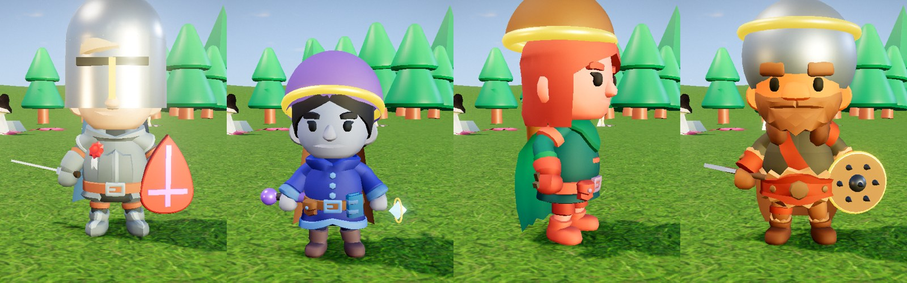
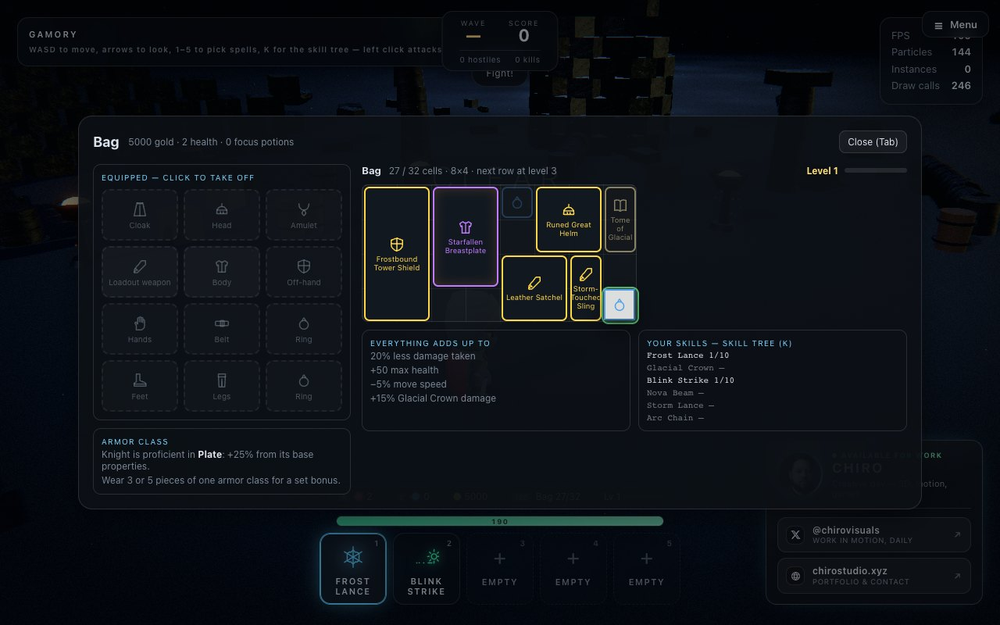

# Armor and gear

[← Back to the README](../README.md)

  

  

Besides the weapon in your hand you wear up to **eleven pieces**: a helmet, body armor, gloves, a
belt, leg armor, boots, a cloak, an off-hand (shield, focus or quiver), an amulet and two rings.
Gear drops from monsters and sells at merchants like weapons do, in the same five rarities.

Helmets, shields, foci, quivers and cloaks show on your character. A helmet replaces your body's own
hat, and a cloak replaces its cape. The other pieces only show when they lie on the ground.

## Item classes

Every piece belongs to an **item class**, and the class decides what it is good at. That is its
**base properties**, which every piece of that class has whatever its rarity. On top of those, rarity
adds random **bonuses** (1 for Magic, 2 for Rare, 3 for Epic), like on weapons, and Uniques have
fixed, stronger ones. In the bag, base properties are listed first and bonuses are marked ★.

### Armor: cloth, leather, mail, plate

Helmets, body armor, gloves, leg armor and boots come in four armor classes:

- **Cloth** is for spellcasters: faster cooldowns and stronger spells, but little armor.
- **Leather** is for skirmishers: move speed and critical chance.
- **Mail** is the middle way: solid armor, more health, and health that comes back by itself.
- **Plate** is for the front line: the most armor and health, but every plate piece slows you
  (except boots).

Body armor carries the full base properties; leg armor 80%, a helmet 70%, gloves and boots 50%.
Every pair of gloves also adds weapon damage, and every pair of boots adds move speed, whatever
they are made of.

| Piece | Cloth | Leather | Mail | Plate |
|---|---|---|---|---|
| Helmet | **Silk Hood** +1% armor, +2% faster cooldowns, +4% spell dmg | **Leather Cap** +2% armor, +1% speed, +1% crit | **Chain Coif** +4% armor, +6 health, +0.4 health/s | **Great Helm** +5% armor, +10 health, −2% speed |
| Body armor | **Spellweave Robe** +2% armor, +3% faster cooldowns, +5% spell dmg | **Hide Jerkin** +3% armor, +2% speed, +2% crit | **Hauberk** +5% armor, +9 health, +0.5 health/s | **Breastplate** +7% armor, +14 health, −2% speed |
| Gloves | **Silk Gloves** +1% armor, +2% faster cooldowns, +3% spell dmg, +4% weapon dmg | **Leather Bracers** +2% armor, +1% speed, +1% crit, +4% weapon dmg | **Chain Mitts** +3% armor, +5 health, +0.3 health/s, +4% weapon dmg | **Gauntlets** +4% armor, +7 health, −1% speed, +4% weapon dmg |
| Leg armor | **Wrapped Leggings** +1% armor, +2% faster cooldowns, +4% spell dmg | **Leather Breeches** +2% armor, +2% speed, +2% crit | **Chain Leggings** +4% armor, +7 health, +0.4 health/s | **Greaves** +6% armor, +11 health, −2% speed |
| Boots | **Soft Slippers** +1% armor, +2% faster cooldowns, +3% spell dmg, +3% speed | **Ranger Boots** +2% armor, +4% speed, +1% crit | **Chain Boots** +3% armor, +5 health, +0.3 health/s, +3% speed | **Sabatons** +4% armor, +7 health, +2% speed |

### Set bonuses

Wear **3** or **5** armor pieces of the same class for a set bonus. The bag shows how many you wear
and which bonuses are on.

| Armor class | 3 pieces | 5 pieces |
|---|---|---|
| Cloth | +6% faster cooldowns | +12% spell damage, +1 health/s |
| Leather | +5% speed | +6% crit, +12% weapon damage |
| Mail | +1.5 health/s | +30 health, +6% block |
| Plate | +4% armor | +20 thorns, +25 health |

### Proficiency: each class has its armor

Every class is **proficient** in one armor class and gets **+25%** from those pieces' base
properties (gains only; plate's slowness stays the same). Anyone can wear anything. Proficiency only
makes the matching armor better.

| Proficient in | Classes |
|---|---|
| Plate | Knight, Templar |
| Mail | Barbarian |
| Leather | Amazon, Shadowblade, Wildwarden |
| Cloth | Mage, Bonecaller, Elemental Caster |

A class made in the [Class forge](class-forge.md) is proficient in whatever its fighting style's
class is.

### Off-hands, belts, cloaks and jewelry

**Shields** block: each hit has a chance to be stopped outright (a "BLOCK" pops up and you take
nothing). **Foci** steady your spells. Shields and foci are held in the off hand, so they **need a
free hand**: with a two-handed weapon they are greyed out and do nothing. **Quivers** are worn on the
back and work with any weapon, bows included.

Two-handed weapons are rifles, heavy weapons, polearms, staves, the heavy swords and axes
(greatsword, claymore, war axe…), bows (except the hand crossbow and the sling) and anything held in
pairs (twin daggers, dual pistols…). Wands, one-handed swords and axes, maces, knives and pistols
leave the off hand free.

| Item | Class | Base properties |
|---|---|---|
| Buckler | Shield | +10% block, +3% armor |
| Kite Shield | Shield | +17% block, +6% armor, +10 health |
| Tower Shield | Shield | +26% block, +10% armor, −4% speed |
| Spiked Shield | Shield | +13% block, +4% armor, +12 thorns |
| Crystal Focus | Focus | +8% spell damage, +4% faster cooldowns |
| Spirit Totem | Focus | +1.2 health/s, +12 health |
| Rune Tablet | Focus | +7% faster cooldowns, +2% crit |
| Hunter’s Quiver | Quiver | +10% weapon damage, +3% crit |
| Bandolier | Quiver | +14% weapon damage, +2% speed |
| Silk Sash | Belt | +3% faster cooldowns, +6 health |
| War Belt | Belt | +18 health, +2% armor |
| Pouch Belt | Belt | +15% gold, +0.5 health/s |
| Traveler’s Cloak | Cloak | +4% speed |
| Warded Mantle | Cloak | +4% armor, +2% faster cooldowns |
| Shadow Cloak | Cloak | +4% crit, +2% speed |
| Amulet | Amulet | +6% spell damage |
| Talisman | Amulet | +4% faster cooldowns |
| War Torc | Amulet | +8% weapon damage |
| Heart Pendant | Amulet | +15 health |
| Band | Ring | +3% crit |
| Signet | Ring | +12% gold |
| Mending Loop | Ring | +0.6 health/s |
| Iron Seal | Ring | +2% armor, +3% weapon damage |

### Uniques

| Unique | Base | Fixed bonuses (on top of the base) |
|---|---|---|
| Crown of the Ember Keep | Great Helm | +6% armor, +40 health, +25% Cinder Fall damage |
| Stormstride Boots | Ranger Boots | +10% speed, +30% Storm Lance damage, +5% crit |
| The Last Bastion | Tower Shield | +10% block, +8% armor, +25 thorns |
| Veil of Quiet Stars | Spellweave Robe | −10% cooldowns, +18% spell damage, +30% Void Orb damage |
| Wyrmscale Hauberk | Hauberk | +6% armor, +50 health, +2 health/s |
| Ring of Second Dawn | Mending Loop | +2 health/s, +25 health, +5% crit |
| Gravewind Cloak | Shadow Cloak | +8% speed, +6% crit, +30% Blink Strike damage |
| Hearthstone Amulet | Heart Pendant | +14% spell damage, −8% cooldowns, +40% gold |
| Fists of the Mountain | Gauntlets | +22% weapon damage, +30% Earthsplitter damage, +10 thorns |
| Moonhunter’s Quiver | Hunter’s Quiver | +15% weapon damage, +8% crit, +5% speed |

## What the numbers do

| Stat | Effect |
|---|---|
| Armor | A share of every hit is ignored. Adds up with your class's armor, up to **75%**. |
| Block | The chance that a hit does nothing at all, up to **60%**. |
| Health | Maximum health. |
| Health per second | Comes back all the time, in a fight too (on top of the normal out-of-combat regeneration). |
| Thorns | Damage dealt back to a monster that hits you in melee. |
| Weapon damage | Weapon hits: swings, bullets, arrows, thrown weapons, blasts. |
| Spell damage | Spells and skills. A skill's own bonus (+25% Cinder Fall damage) adds to it. |
| Faster cooldowns | Shorter cooldowns on every spell and skill (never below 40% of the base). |
| Move speed, crit, gold | As on weapons. |

## The bag

**Tab** opens the bag. On the left is a paper doll with what you wear. Click a piece to take it off.
Below it are your armor proficiency and set bonuses. On the right are the bag grid (every item takes its own size in cells; see [the bag grid](items-npcs-portals.md#the-bag-grid-levels-and-the-stash)) and the totals.
Click gear in the bag to wear it; whatever was in that slot goes back to the bag. A ring goes on a
free finger first. Hovering over a piece in the bag compares it with what you wear in that slot,
proficiency included.

Gear is part of the stash: every class shares it, but each class gets its own proficiency from it.
Worn gear is saved in the browser with the rest of the character.

## For developers

- `src/items/Gear.js`: the slots, item classes, base items, set bonuses, uniques, proficiency and
  the two-handed rule. Add a base item to `GEAR_BASES` and it starts dropping.
- `src/items/Items.js`: `makeGear`, rarity bonuses (`STATS`), loot tables and merchant stock.
- `src/items/Profile.js`: worn gear (`gear`), `equip` / `unequipGear`, and how everything adds up
  (`stats`).
- `src/entities/GearVisual.js`: the procedural helmets, shields, foci, quivers and cloaks, and how
  they sit on the KayKit and Mixamo rigs (`FIT`).
- `src/ui/InventoryPanel.js`: the paper doll and bag.
- A class's proficiency is `armorClass` in `src/platform/character/classes.js`.
