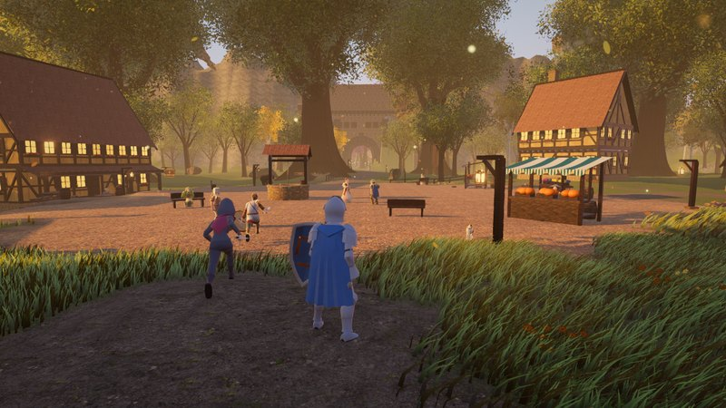

# Gloamreach

[← Back to the README](../README.md)

The opening map of a fantasy RPG, drawn as finely as we can in a browser. There is no story
yet and no quests: choose a hero and wander. It is the first of a series; later games add to
this world.

- **Brindlewick**, a village held at the golden hour: a cobbled square with a well and market
  stalls, timber-framed houses with jettied upper floors and lit windows, the Gilded Acorn inn
  with its swinging sign, the smithy's open forge, fences, lanterns, flower beds, and oaks a
  hundred and fifty feet tall all round. Long shadows, light shafts, dust in the sunbeams,
  leaves falling, chimney smoke, birdsong.
- **The Warden's Gate**, a carved stone gatehouse filling the cut through the ridge north of
  the village: a ribbed, vaulted tunnel with carved panels, stepped archivolts of wedge stones,
  a rune on the keystone, lanterns.
- **The Gloamwood** beyond, at a dusk that never ends: twisted violet giants, houses grown round
  their roots (curved roofs, carved pillars, round amber windows), blue lamp posts along a wet
  cobbled path, glowing mushrooms and flowers, fireflies, wandering wisps, violet fog, and a
  moonwell in a ring of standing stones at the path's end.
- **The Cinder Rift**, seen from a ruined overlook east of the village: rivers and a lake of lava
  seventy metres down, basalt spires, fire fountains, smoke, and Vaelthrax the Ember Drake
  circling — sometimes roaring, sometimes breathing fire at the lava.

The map is bounded by nature, not invisible walls: the ridge, steep wooded hills and the cliff.

## Playing

| Key | |
| --- | --- |
| **W A S D** / arrows | Run (the way the camera looks) |
| **Shift** · **Ctrl** (or **C**) | Sprint · walk |
| **Space** | Jump |
| **Mouse** | Click the picture to steer the camera with the mouse; drag also works. Wheel zooms |
| **H** · **Esc** | Show the controls again · menu (sound, credits, leave) |

Heroes: **Knight** (plate, kite shield, arming sword, a cape), **Ranger** (green hood, longbow),
**Mage** (dusk-violet robes, staff). Walk up to people and they turn to you and say something;
their name shows above them. The minimap in the corner turns with the camera.

The game picks a quality level from the graphics card and then adjusts it to keep frames
quick (low, medium, high, ultra: render scale, shadow size, grass, ambient occlusion, light
shafts, lights). `?quality=low|medium|high|ultra` fixes it; `?debug` shows frame time, draw
calls and triangles.

## How it looks the way it does

| | |
| --- | --- |
| Light | A strong low sun with soft shadows that follow the hero (texel-snapped), hemisphere and sky-baked environment light; the Gloamwood's moonlight, fog and exposure blend in as you walk through the tunnel |
| After the render | Ambient occlusion from depth (so cut-out leaves occlude too), light shafts toward the sun, height fog lit by the sun it faces (red down in the rift), bloom on only the brightest, ACES tone mapping with a warm/cool split, vignette, SMAA (or MSAA) |
| Ground | One height function; seven photographed materials blended by a splat map with height-aware edges, cobbles with relief-mapped depth, rock projected three ways on cliffs, wet stone and puddles in the Gloamwood, anti-tiling |
| Trees | Grown from a seed: buttressed, flaring trunks with surface roots, forking limbs, painted bark that tiles round the trunk, crowns of leaf-cluster cards with rounded normals, light through the leaves, wind |
| Grass and flowers | Placed on the GPU round the camera (thinned by the splat map, sat on a height texture), travelling gusts, pushed aside by the hero; photographed ferns, shrubs and nettles near trees |
| Buildings | A construction kit: timber frames, braces, jetties, sagging tiled roofs with curled eaves, shuttered lit windows, flower boxes, chimneys — merged per material |
| People | polyfork's rigged fantasy characters with physically based materials derived from their colours (metal, gold, skin with light-wrap, a rim of the key light), and Mesh2Motion clips retargeted onto them (talking, sitting, greeting, hammering, jumps, sprint); gaits blend with locked phase at the speed that keeps feet planted |

## For developers

| Part | File |
| --- | --- |
| The map as data · the land's height, slope and surface · collision and camera rays · quality tiers · the cast · credits (all pure, tested) | `map.js` · `heights.js` · `collide.js` · `quality.js` · `cast.js` · `credits.js` |
| The screen, loop, input, tiers | `GloamreachGame.js` |
| Scene assembly · terrain · sky and light · post-processing | `world.js` · `terrain.js` · `sky.js` · `post.js` |
| Trees · grass and plants · buildings · props · the gate · the Gloamwood · the rift and drake | `trees.js` · `foliage.js` · `buildings.js`, `kit.js` · `props.js` · `gate.js` · `gloamwood.js` · `vista.js` |
| Characters (materials, merging, retargeting, locomotion) · the hero · the camera · people and animals | `actors.js` · `hero.js` · `camera.js` · `life.js` |
| Lights · particles · sound · screens and HUD · minimap · shader patches · textures | `lights.js` · `fx.js` · `audio.js` · `ui.js`, `gloamreach.css` · `minimap.js` · `materials.js` · `textures.js` |
| Tests | `tests/unit/gloamreach.test.mjs` |

All in `src/gloamreach/`. The models and materials come from the asset library (fetched on
`npm run dev` / `npm run build`; the polyfork models and the ambientCG sets it needs are in the
library's extras list). Without the library the land, sky, trees, buildings and effects still
draw (painted stand-ins for the materials); people and props appear once it has downloaded.

Credits for everything third-party, with links and licences, are in the game's Credits panel
(start screen and Esc menu).
