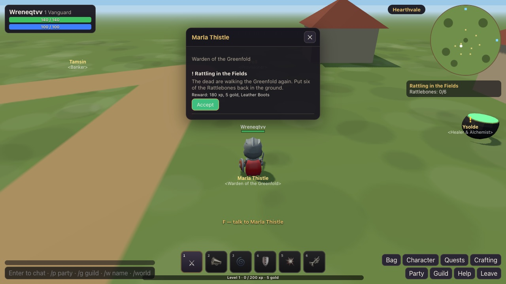
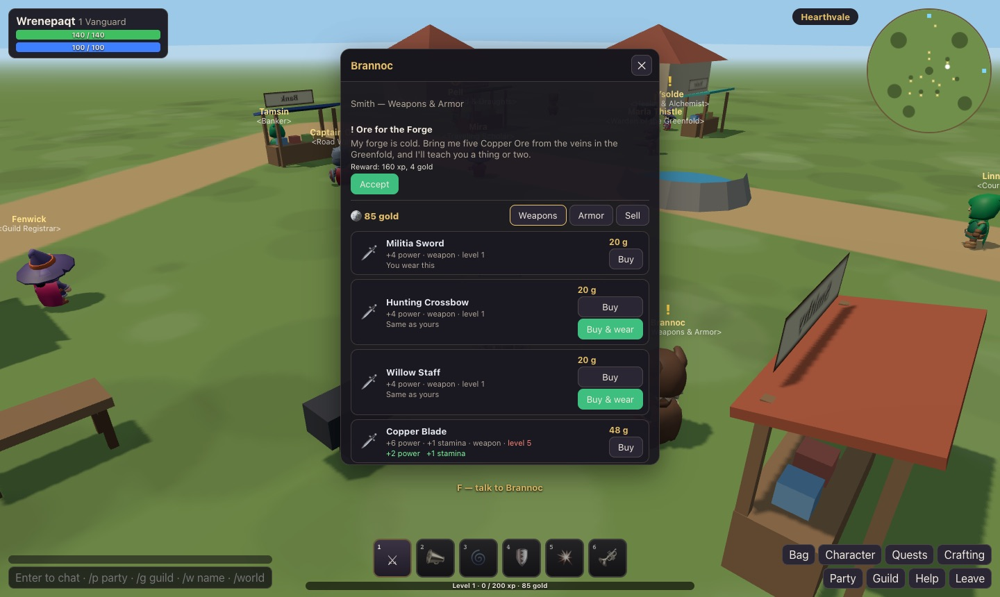
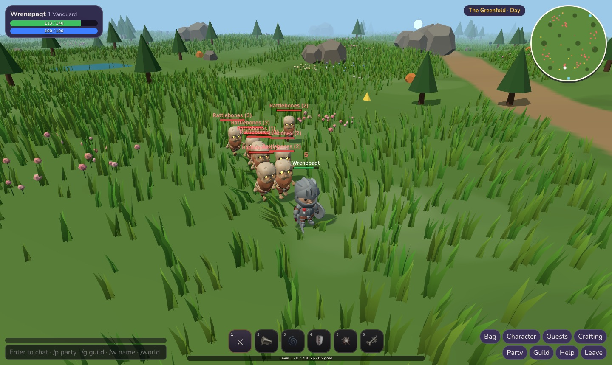
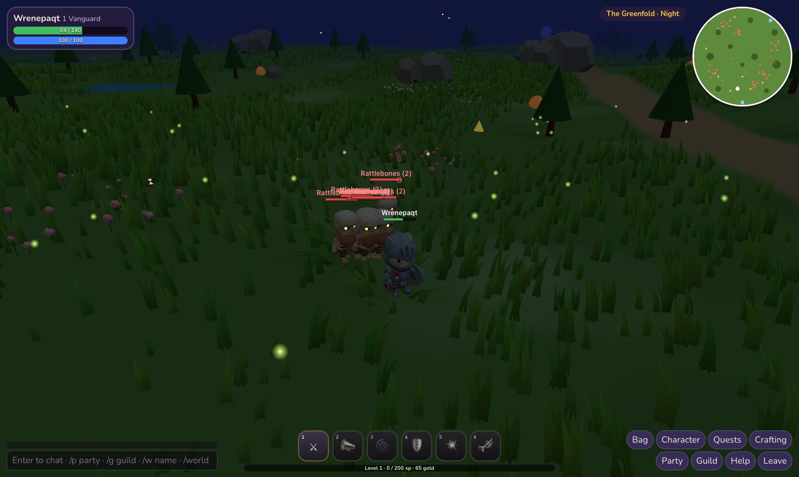

# Hearthvale

[← Back to the README](../README.md)

An online role-playing game in small groups. Make a character in one of four classes, take quests
from the people of Hearthvale, fight your way through the Greenfold and the Ashfen, clear the Sunken
Crypt with up to five friends and the Ember Spire with up to eight. Gather ore, herbs and wood, craft
gear and draughts, found a guild, chat, and trade with other players. Your characters are kept on
your account, so **sign in to play**. The world, classes, quests and names are our own; the bodies
are the KayKit Adventurers and Skeletons (CC0, Kay Lousberg) from the asset library.

  

  

  
  

## How it plays

- **Classes.** **Vanguard** (a tank: holds the monsters' attention), **Ranger** (crossbow, slows),
  **Arcanist** (fire and frost from range) and **Mender** (heals, shields, revives). Six skills each,
  opening from level 1 to 12. Levels run to 20.
- **Combat** is tab-target: pick a target (click it, or **Tab** for the nearest enemy), and your
  character swings or shoots at it on its own. Skills (**1–6**) share a one-second cooldown (the
  GCD), and some take time to cast — moving stops them. Monsters go after whoever they hate most:
  damage makes them angry (the Vanguard's twice as much), healing does too, and **Challenge** forces
  them back onto the Vanguard.
- **The world.** **Hearthvale** (the town: quest givers, two stores, the bank, the guild
  registrar, three crafting stations, and villagers going about their day), **the Greenfold** (levels 1–10: Rattlebones, Grave Archers,
  bandits, the barrow and the Old Gravelord), **the Ashfen** (levels 10–18), **the Sunken Crypt**
  (a dungeon for up to 5 from level 8: Warden Kessa and the Drowned King) and **the Ember Spire**
  (a raid for up to 8 from level 16: Cinderwing, the Ash Colossus). Walk into a portal and press **F**.
- **A living landscape.** The ground rolls in gentle hills. Grass sways in the wind and bends away
  from whoever walks through it; flowers grow in patches with butterflies over them; ponds can be
  waded through, and your steps leave rings on the water; flocks of birds take off when you come
  close and land again somewhere quiet. The sun crosses the sky in eight minutes: at dusk the light
  turns gold, at night come stars, fireflies and lit lanterns by the stalls and gates (the hour is
  shown beside the zone's name). The Ashfen is misty; in the crypt dust drifts and torches flicker,
  and embers rise in the Ember Spire. A tree between you and the camera steps out of the way.
  All of it is drawn by the browser (`src/mmo/landscape.js`); the server's world stays flat and fair.
- **Bosses** warn before they hit: a red circle grows on the ground where a slam or a burst will land
  — get out of it. Some call adds; some grow enraged when they're nearly down.
- **Money and stores.** Every character starts with **100 gold** (characters made before then got it
  once). Hearthvale's stalls have signs, and a 💰 marks each shopkeeper: **Pell** (Provisioner) sells
  bread and draughts; **Brannoc** (Smithy) sells weapons and armor in three tiers (levels 1, 5 and
  9–10). His store has Weapons, Armor and Sell tabs, compares each piece with what you wear (+2
  power…), shows the level it needs, and has **Buy & wear**. Stores sell at four times an item's
  value and buy at its value.
- **Loot** is rolled for everyone who fought, straight into their bags; gold too. Kills count for
  everyone's quests in the party.
- **Quests** come from the people with a **!** over them; a **?** means one is ready to hand in. Kill
  quests count as you go; gathering quests take the items when you hand them in. Some open others.
- **Gathering and crafting.** Copper and Iron veins (Mining), Sunleaf and Ghostcap (Herbalism), Ash
  trees (Logging) in the wild — click them or press **F**. Smithing at the anvil, Alchemy at the
  cauldron, Woodcraft at the workbench, all in Hearthvale (**K**). Skills grow as you use them.
- **Together.** Invite anyone online by name (**P**, or `/invite name`): a party of up to eight
  shares one copy of each zone. **Go to the leader** takes you to them. Chat: say, `/p` party,
  `/g` guild, `/world`, `/w name` whisper. **Guilds**: found one at Fenwick (10 gold), invite by name,
  guild chat and roster (**G**). **Trading**: ask someone beside you, offer items and gold; both agree,
  and the server swaps everything at once (any change undoes both agreements).
- **Dying**: return to the zone's graveyard at half health, or wait for a Mender's **Revive**.

## Controls

| | |
|---|---|
| Walk · look | **W A S D** (or hold both mouse buttons) · drag the mouse to turn the camera, the wheel zooms |
| Target · fight | Click, or **Tab** for the nearest enemy · right-click an enemy to attack · **1–6** skills |
| Use | **F**: talk, gather, step through a portal, use a crafting station |
| Windows | **I** bag · **C** character · **L** quests · **K** crafting · **P** party · **G** guild · **H** help · **Enter** chat · **Esc** close |

## How it works

The server runs the worlds; browsers only show them and send what their player does. This keeps
trading, loot, guilds and progress fair.

- **Characters** live in PostgreSQL (`mmo_characters`, one JSON document each; `mmo_guilds`),
  saved every few seconds and when you leave. Up to six per account; names are unique.
- **World copies** (`server/mmo/instance.js`): one per zone per party (or per player alone), ten
  steps a second — monsters, threat, every hit, heal and cast, bosses' circles, loot, experience,
  gathering, respawns. Your character moves where your browser says, as long as it's no faster than
  running and not through a wall; anything else is put back.
- **The server** (`server/mmo/index.js`): `GET/POST /api/mmo/characters` and the socket `/mmo?char=<id>`
  (signed in, your own character). Parties, chat, guilds, trades, NPCs, shops, the bank and crafting
  are handled there, each checking that you're standing where you'd have to be. Ten snapshots a
  second go to everyone in a copy. One login per character: signing in elsewhere replaces the first.
- **Shared data** (`src/mmo/data.js`, `world.js`, `rules.js`): classes, skills, monsters, items,
  quests, nodes, recipes, zones and the formulas, read by both the server and the browser.
- **The browser** (`src/mmo/MmoGame.js`, `view.js`): character select, the world in 3D with the
  KayKit characters, and the HUD.
- **Tests**: `tests/unit/mmo.test.mjs` (the rules; characters over HTTP; a day of questing and a
  kill; a party with chat, a heal, a trade, a guild and crafting, saved on leaving; the crypt boss's
  warned slam) and `tests/e2e/hearthvale.mjs` (two signed-in players in the browser: make
  characters, walk, take a quest, party up, see each other, party chat).

## Next

- More zones, quests and dungeons; mail and an auction house.
- Talents, and rare items with effects of their own.
- Mounts and flight paths between zones.
