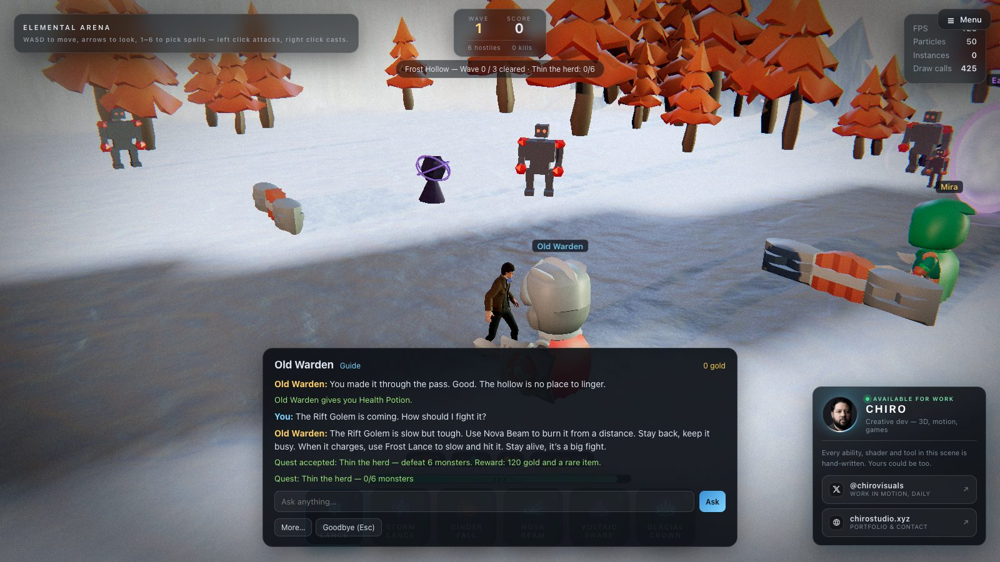
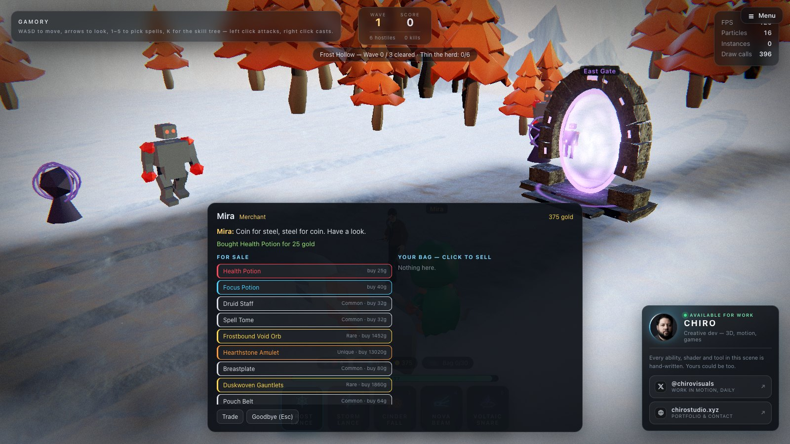
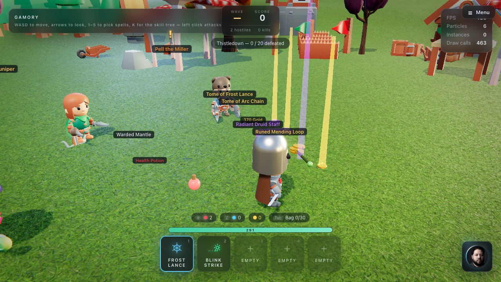
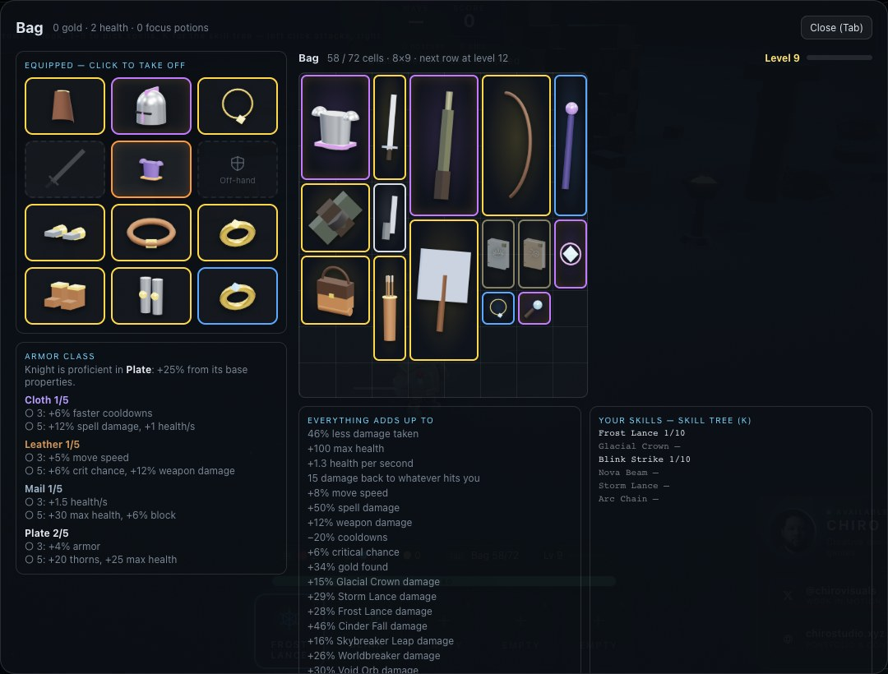
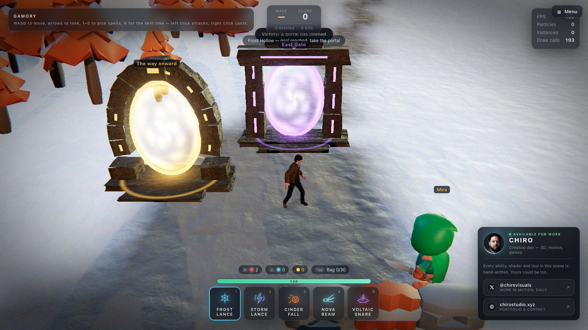
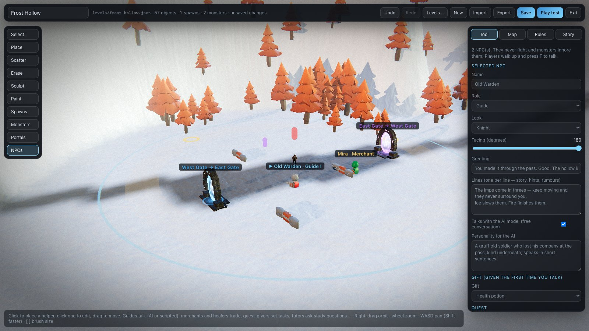
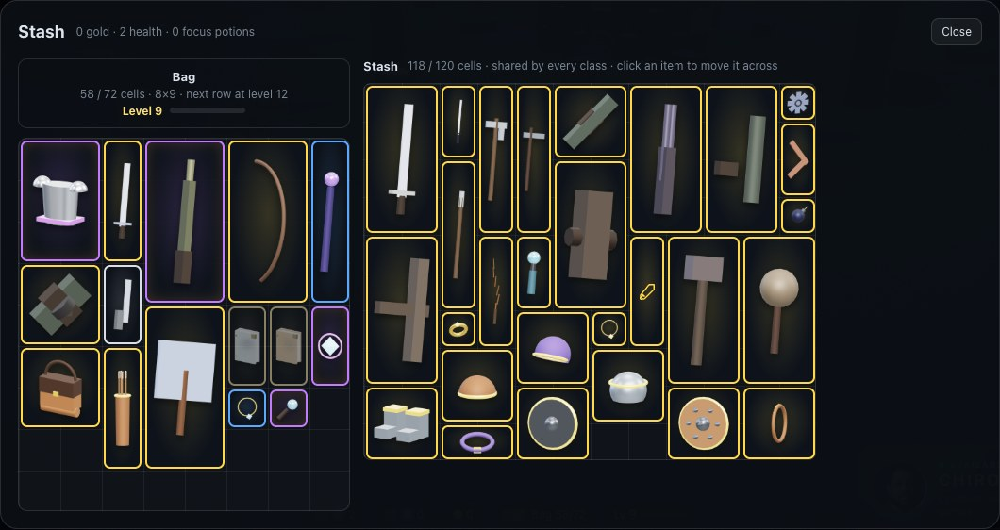
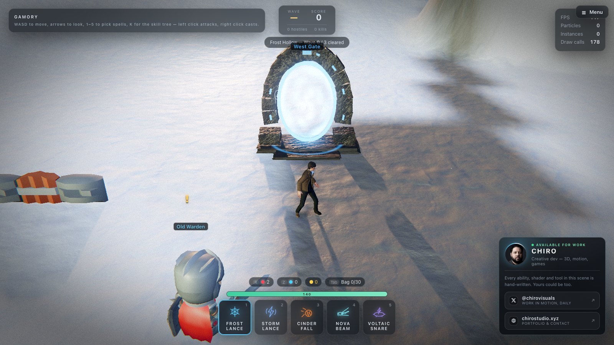
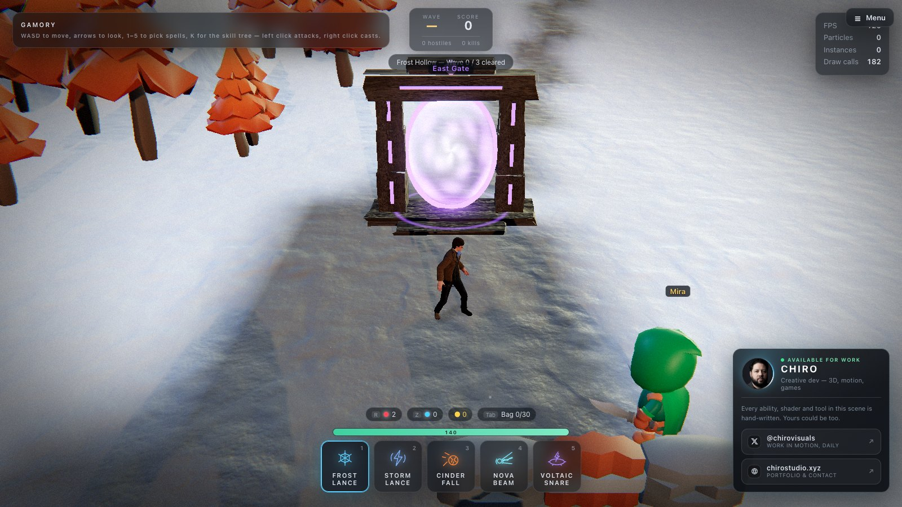

# Loot, NPCs and portals

[← Back to the README](../README.md)

## Portals, loot and NPCs

  
  

  
  

  
  

### Loot

Monsters drop **gold**, **potions**, **weapons**, **gear** and **skill books**. Items burst out of the body,
land with a light beam in their rarity colour — **Common**, **Magic** (blue), **Rare** (yellow),
**Epic** (purple), **Unique** (orange) — and a floating name; walk over them to pick them up (or click
the name from close by). Bigger monsters drop more and better: a Rift Golem always drops a Rare or
better (a weapon or a piece of gear, and half the time a skill book), the Emberwyrm an Epic or
better plus two skill books.

| Item | What it does |
| --- | --- |
| Weapon | Any of the armory's weapons, with 1–3 bonus stats by rarity: spell damage, weapon damage, one spell's damage, cooldowns, max health, move speed, critical chance, gold found. Uniques are named (*Glacierheart*, *Ashen Requiem*, *Tempest Sceptre*, *Dawnspire*, *The Hollow Crown*, *Wardenblade*) with fixed, stronger bonuses. |
| Gear | Helmets, body armor, gloves, belts, leg armor, boots, cloaks, shields, foci, quivers, amulets and rings. Each has its item class's base properties (cloth, leather, mail, plate, shield…) plus bonuses by rarity, and ten named Uniques. See **[Armor and gear](gear.md)**. |
| Skill book | Teaches one spell, or raises it a rank (max 10): +10% damage and −3% cooldown per rank after the first. Only classes with that spell in their [skill tree](classes-and-skills.md#skill-trees-and-skill-books) can read it. Barbarian skills come in *skill manuals*. |
| Health potion | **R** — heals 45%. |
| Focus potion | **Z** — every spell ready again. |
| Gold | Spent at merchants; weapons sell back for a quarter. |

**Tab** opens the bag: a paper doll of everything you wear (click a piece to take it off), your
armor proficiency and set bonuses, the bag grid, what everything adds up to, and your class's skill
ranks. Click a weapon or piece of gear to wear it, a book to read it, a bag upgrade to use it,
right-click to drop; or drag anything where it should go (see below). Hovering over gear compares it with what you wear. Books your class can't read
are greyed out. The bag, stash, worn gear, gold, potions, level and ranks are saved in the browser
and carry between levels.

### The bag grid, levels and the stash

  
  

The bag is a grid, 8 cells across. Every item shows as a picture of itself: its own 3D model (the
same one your character holds or wears, or that lies on the ground) rendered into the cells it fills,
with a glow in its rarity colour. Books show their skill's symbol on the cover. Hover over an item for
its name and everything about it. The paper doll and the merchant's lists use the same pictures.
Every item takes its own size:

| Size | Items |
| --- | --- |
| 1×1 (1 cell) | Rings, amulets, orbs, shuriken, bombs |
| 1×2 (2) | Books, wands, knives, short swords, throwing weapons, foci |
| 2×2 (4) | Helmets, gloves, boots, pistols, bucklers, tomes, bag upgrades |
| 1×3 or 2×3 (3–6) | Swords, axes, cloaks, body and leg armor, kite shields, quivers |
| 1×4 or 2×4 (4–8) | Staves, polearms, rifles, bows, heavy weapons, greatswords, tower shields |

**Everything moves by drag and drop.** While you carry an item, the cells under it light up green if
it fits, amber if it will swap with the one item in the way, red if it cannot go there.

| Drag | What happens |
| --- | --- |
| Within the bag | Arranges it: it goes in that spot, or swaps with the one item in the way |
| From the bag onto the paper doll | Wears it. The slots it can go in light up; a ring goes on the finger you drop it on |
| From the paper doll into the bag | Takes it off into that spot; dropped on a piece for the same slot, the two swap |
| Out of the bag, in a fight | Drops it on the ground at your feet, worn things too (right-click drops as well) |

**A full bag takes nothing more.** Walk over loot that has no room and it stays on the ground with a
message. Open the bag, arrange things to free a space the right shape, or drag something out to drop
it, then pick the new item up. Signed in, every one of these moves is replayed and checked by the
server ([Accounts and fair play](security.md)), and an item you drop lies on that fight's floor for
anyone in the party to take.

**The bag grows** from 4 rows to as many as 12, three ways:

- **Levels.** Monsters and quests give XP (bigger monsters more, later waves a little more). Every
  3 levels the bag gets a row, up to 6 rows. Your level and XP bar show on the belt and in the bag.
- **Bag upgrades.** A *Leather Satchel* (+1 row) or an *Explorer's Pack* (+2) sometimes drops (a
  Rift Golem or the Emberwyrm drops them far more often) and merchants sometimes stock one. Click it
  in the bag to use it.
- **Merchants** sell a bag row for gold; each row costs more than the last.

**The stash** is a 12×10 grid every class shares. Open it from the main menu (**Stash**) or from a
**Stashkeeper** in a village (Old Bramble in Thistledown). The bag sits beside it: click an item to
move it across, or drag it to an exact spot. When an old save's bag no longer fits the grid, what
does not fit goes to the stash, so nothing is lost.

### NPCs

Place them in the editor with the **NPCs** tool. They never fight and monsters ignore them; walk up
and press **F** to talk (the fight pauses while you do).

| Role | Does |
| --- | --- |
| Guide | Talks: a greeting and scripted lines — story, hints, rumours. |
| Merchant | Sells potions, weapons, gear, two skill books (mostly for your class), sometimes a bag upgrade, and bag rows; buys anything from your bag. |
| Stashkeeper | Opens your stash. |
| Healer | Heals you to full and sells potions. |
| Quest giver | Sets a task — *defeat N monsters* (any, or one kind) — tracked under the wave counter; hand it in for gold and an item of a chosen rarity. |
| Tutor | Asks study questions — generated math, or the parent's own — and pays gold for right answers, with a bonus every few. Marked ✎. See [Study games for kids](for-parents.md). |

Any NPC can give a **gift** the first time you talk (potion, gold, weapon, skill book) and can carry a
quest. Tick **Talks with the AI model** and give it a personality: the NPC then answers anything you
type, in character, through your LM Studio model — it knows the level's story and goal, your health,
gold, potions, weapon and spell ranks, and what the spells actually do, so its advice fits the moment.
With the model offline it falls back to its scripted lines.

### Portals

  
  

Each portal stands in a **stone arch** (rough-hewn blocks, a keystone, a dais) or a **stone gateway**
(two standing-stone pillars and a lintel) — or a plain **glowing ring** — with runes that glow in the
portal's colour. Place them with the **Portals** tool, pick the frame and colour, and choose what each leads to: **another portal in the level**
(two linked portals make a two-way shortcut), **another level** (a waypoint into the campaign), or
nothing. When a level's goal is met, a **gold exit portal** opens in front of you; stepping in shows
the ending and leads on to the next level.

Keys: **F** talk · **R** health potion · **Z** focus potion · **Tab** bag · **K** skill tree.
