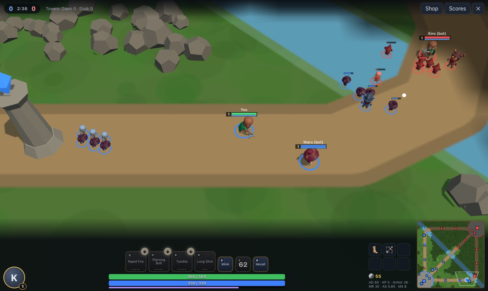
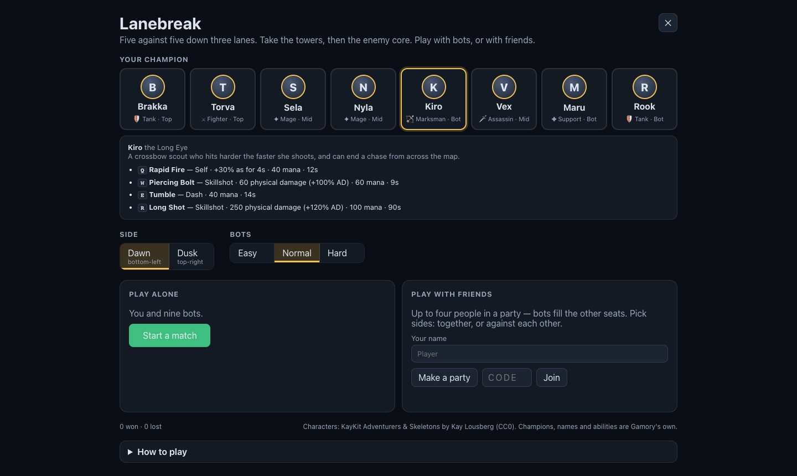

# Lanebreak

[← Back to the README](../README.md)

A three-lane battle arena: five against five. Pick a champion, farm minions for gold, level up your
four abilities, take the towers down a lane and break the enemy core. Play alone with nine bots, or
with up to three friends in a party — on the same side or against each other — with bots in every
empty seat. The champions, their abilities, the map and every name are our own; the characters'
bodies are the KayKit Adventurers and Skeletons (CC0, Kay Lousberg) from the asset library.

  

  

## How it plays

- **The map.** Dawn's base is in the bottom-left corner, Dusk's in the top-right. Three lanes join
  them — top, mid (the diagonal) and bot — with a river crossing the middle and jungle between,
  walled with rocks and trees. Each side has two towers in every lane, two guarding its core, and the
  core. A tower can only be hurt once the one before it in its lane has fallen, the base towers once
  an inner tower is down, and the core once both base towers are.
- **Minions.** Every 25 seconds (from 0:15) each side sends six minions down every lane — three
  melee, three casters, and a siege minion every third wave; they grow a little each minute.
- **Gold and experience.** The last hit on a minion (21 / 15 / 50), a kill (300, and assists share
  150), towers (150 to the whole side), jungle monsters, and 2 a second. Experience comes from what
  dies near you; levels run to 18, and each gives a point for an ability (R at 6, 11 and 16).
- **The jungle.** Thornbacks and Moss Golems on each side; the **Riverwarden** in the river gives the
  side that kills it +20 attack damage and +30 ability power for two minutes.
- **Towers** shoot minions first — but a champion who hurts an enemy champion under a tower becomes
  its target, and each shot in a row hurts more.
- **Home.** The fountain heals you fast and burns intruders. The shop is open there, and while
  you're waiting to come back.

### The champions

| | Role | Q | W | E | R |
|---|---|---|---|---|---|
| **Brakka**, the Unbroken Gate | Tank · top | Shield Bash (stun) | Iron Hide (shield, armor) | Ground Slam (slow) | Earthbreaker (area stun) |
| **Torva**, the Red Axe | Fighter · top | Cleave (heals) | Battle Cry | Charge (stun) | Last Stand (heal, lifesteal) |
| **Sela** of the Ember Choir | Mage · mid | Spark Lance | Ember Field (burns) | Phase Step (blink) | Starfall |
| **Nyla**, the Winter Lantern | Mage · mid | Frost Orb (slow) | Glacial Ring (root) | Chill | Blizzard |
| **Kiro**, the Long Eye | Marksman · bot | Rapid Fire | Piercing Bolt | Tumble | Long Shot (across the map) |
| **Vex**, the Quiet Knife | Assassin · mid/jungle | Shadow Dagger | Smoke Step | Lunge | Execution (more on the wounded) |
| **Maru**, the Bone Oracle | Support · bot | Soul Bind (root) | Mend Wave (heals friends) | Ward of Bone (shield) | Sanctuary |
| **Rook**, the Chain Warden | Tank · bot/jungle | Grapple (pulls) | Overcharge | Shockwave (stun) | Iron Rain |

Every number is in `src/moba/rules.js` — champions, abilities by rank, items, minions, towers, camps.

## Controls

| | |
|---|---|
| Move · attack | Right-click the ground (hold to keep walking) · right-click an enemy · **A** then click: attack-move · **S** stop |
| Abilities | **Q W E R** cast at the cursor (a targeted one at the unit under it); **Ctrl+Q/W/E/R** or the **+** spends a point |
| Spells | **D** Blink (a short jump) · **F** Mend (heal and a burst of speed) · **B** recall home (6 s, any hit stops it) |
| Panels | **P** shop · hold **Tab** for the scores |
| Camera | Follows you; **Y** unlocks it (the screen's edge and arrows move it), hold **Space** to look at yourself, the wheel zooms, the minimap moves it (right-click there to walk) |

## Playing with friends

On the set-up, under **Play with friends**: one person presses **Make a party** and reads out the
five-letter code; the others type it and press **Join**. Everyone picks a champion and a side (the
same side to play together, opposite sides to play against each other) and presses **Ready**; the
host presses **Start for everyone**. Bots take the seats nobody does. Up to four people (the
party server's limit).

The host's browser runs the match (`MobaSim`), exactly as it does alone. The others send it their
commands (`lb-cmd`) and draw what it sends back ten times a second (`lb-snap`: every unit's place
and state, every champion's details, missiles, areas, the score, and what happened), drawn a tenth
of a second behind and blended so it moves smoothly. If a guest leaves, a bot plays on in their seat;
if the host leaves, the match ends. Rooms are the platform's party rooms (`server/realtime.js`) —
the server only relays.

## How it's made

- `src/moba/sim.js` — the match: champions, abilities (missiles, areas, dashes, blinks, targeted,
  self), auto-attacks, minions, towers, camps, gold, experience, levels, items, the fountain,
  vision; commands in, `snapshot()` out. 20 steps a second.
- `src/moba/bots.js` — a bot plays a seat with the same commands a person sends: buys its role's
  build, ranks abilities, lasts-hits, pokes, fights when it's worth it (counting allies, health and
  towers), aims ahead of a moving target, runs and recalls when hurt, clears the jungle and ganks
  the weak, and after 14 minutes groups mid. Easy, Normal and Hard differ in how fast they think,
  how well they aim and last-hit, and how brave they are.
- `src/moba/map.js` — the map, the walls (seeded, mirrored), A* paths around them; `seats.js` —
  who sits where; `net.js` — the party link, packing and blending snapshots.
- `src/moba/view.js` — the 3D view: the painted field, towers and cores (our own shapes), the KayKit
  characters with their run, attack, cast and death animations, missiles, area warnings, the fog of
  war; `MobaGame.js` — the set-up, the party lobby, the HUD, the shop, the scores and the controls.
- Tests: `tests/unit/moba.test.mjs` (rules, map, seats, waves, abilities, the shop, towers, a whole
  bot match, snapshots) and `tests/e2e/lanebreak.mjs` (a solo match by mouse and keys, and a
  two-browser party where the guest's clicks move the guest's champion in the host's match).

## Next

- More champions and items with effects of their own; wards and bushes.
- A ranked queue and match history for signed-in players.
- More than four people in a party (the party server's limit is a setting).
