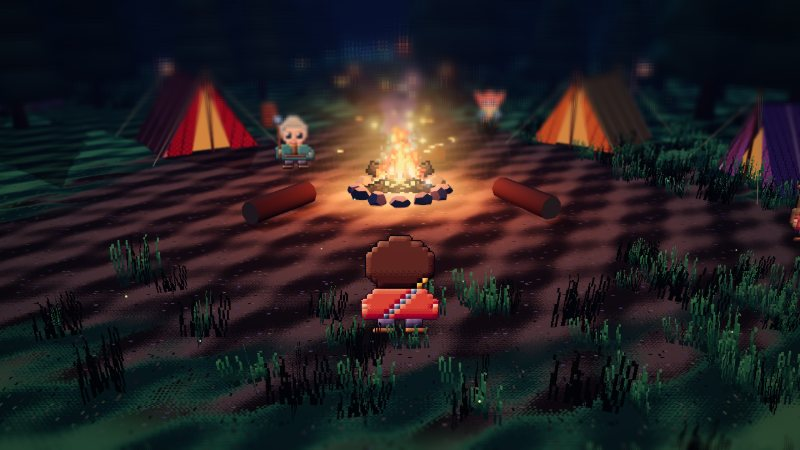

# Lanternwood

[← Back to the README](../README.md)

An adventure RPG in the "HD-2D" style: chibi pixel-art characters standing in a lit 3D world, the
camera behind and above the hero. The characters are solid — every pixel of their drawing a little
block, the body rounded in depth — so they turn, catch the firelight and cast shadows. They move on joints: arms and legs swing as
they walk, they breathe standing, the camp's people gesture as they talk, the hero swings a real
sword (with a glowing trail), somersaults in a roll, spins in a whirl, thrusts both hands to cast,
and flinches when hit; monsters reel back when struck. A hit counter climbs as hits chain. A round
minimap in the corner turns with the camera, shows the paths, the people's quest marks, foes near
by and points to the quest's target (**M** opens the whole map). A night camp in the woods is losing its lanterns one by one —
the Lampwight in the old Greyvault ruins is eating the light.

## Playing

| Key | |
| --- | --- |
| **W A S D** / arrows | Move (relative to the camera, which swings round behind you) |
| Mouse drag, **Q E** | Turn the camera; the wheel zooms |
| **Space** / left click | Sword — press again in time for a 3-strike combo: a sweep, a backhand, an overhead smash with a lunge |
| **1** · **2** | Fireball · Whirl (mana) |
| **3** · **4** | Health · mana potion — no cooldown: every press drinks one |
| **Shift** | Dodge roll (nothing hits you mid-roll) |
| **F** | Talk, gather, light a brazier |
| **I** · **M** · **Esc** | Journal (stats, quests, bag) · Map · Pause |

## The story

1. **Embers for the Hearth** — Sister Wren: gather six ember-herbs along the north path and in Glowmoss Glade.
2. **Gloom in the Glade** — Warden Odile: defeat six gloomslimes.
3. **The Howling Hollow** — Tamsin the scout: drive off five ashwolves.
4. **Old Fires of Greyvault** — Odile: light three braziers in the ruins, guarded by lampwisps.
5. **The Lampwight** — the boss: ground slams, volleys of orbs, and wisps it calls to its side.

Every finished quest lights another lantern in the camp and builds up the bonfire. Pell the
peddler sells potions for gold and charms for crystals. Fall, and you wake by the campfire a
little poorer. The journey is saved on this device.

## For developers

| Part | File |
| --- | --- |
| The screen: input, camera, combat, enemies, quests, loop | `src/hd2d/LanternwoodGame.js` |
| Rules (no three.js, no DOM): stats, damage, XP, potions, shop, enemies, quests, dialogue, save, world layout | `src/hd2d/rules.js` |
| Pixel sprites (letter maps, shaded by `src/pixel/art.js`), made solid | `src/hd2d/sprites.js`, `src/hd2d/voxel.js` |
| The jointed figures, their poses, the sword trail | `src/hd2d/rig.js` |
| The 3D world, billboards and effects, post-processing, HUD | `src/hd2d/world.js`, `gfx.js`, `post.js`, `ui.js`, `hd2d.css` |
| Tests | `tests/unit/hd2d.test.mjs` |

Pixel effects (campfire, hits, fireball, level-up) are from the vendored pixelfx collection; the
3D props from the vendored kits (see [The knowledge base](knowledge-base.md)).
