# Level editor and campaign

[← Back to the README](../README.md)

## Level editor and campaign

Build levels by hand — no AI needed — and string them into a story campaign. Open it from the
main menu: **Campaign → Open level editor**, **Campaign → Edit** on a level, or **World → Edit this
map in the level editor** to hand-finish a map the AI just made.

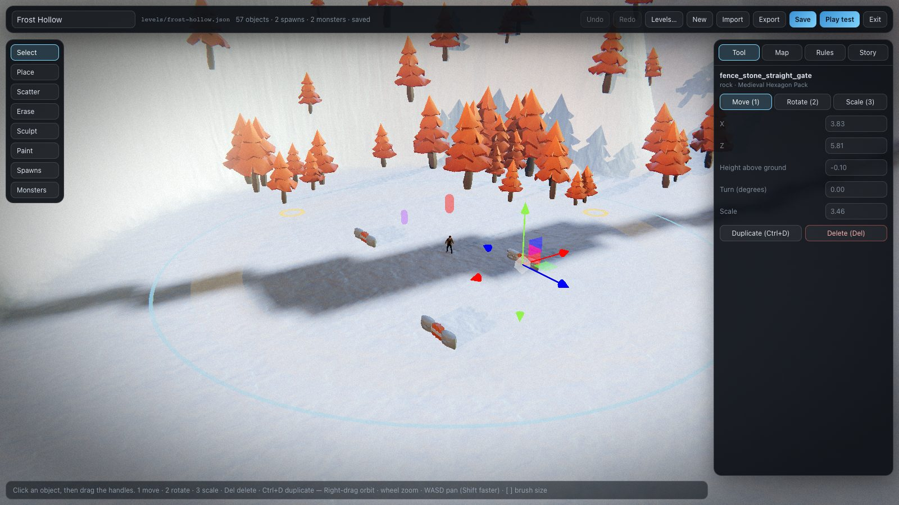

  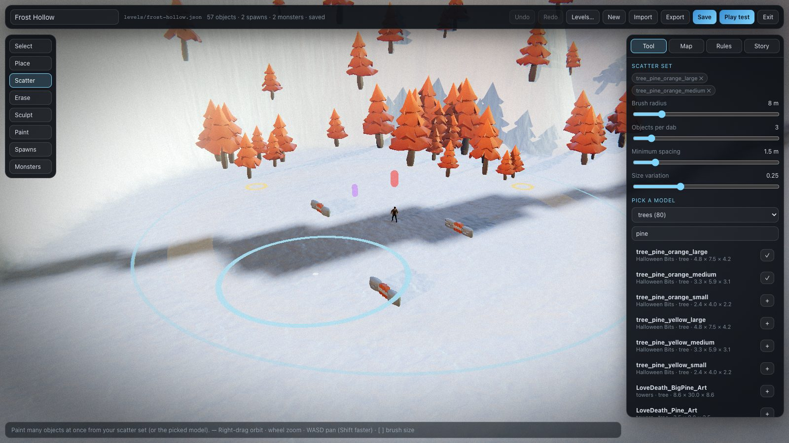
  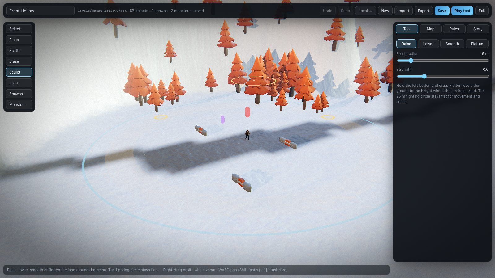

  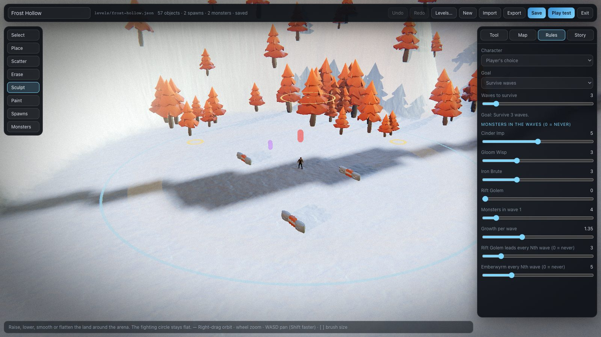
  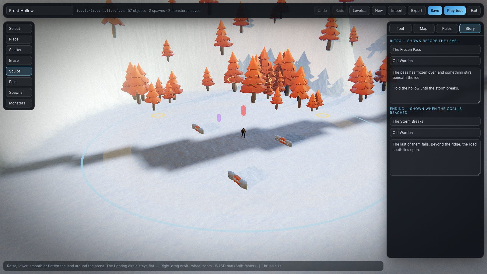

  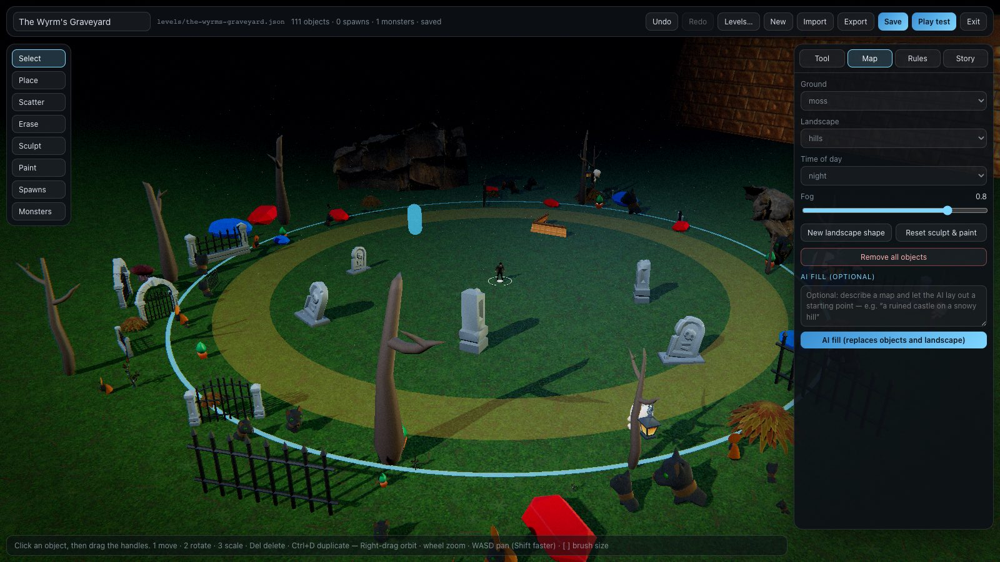
  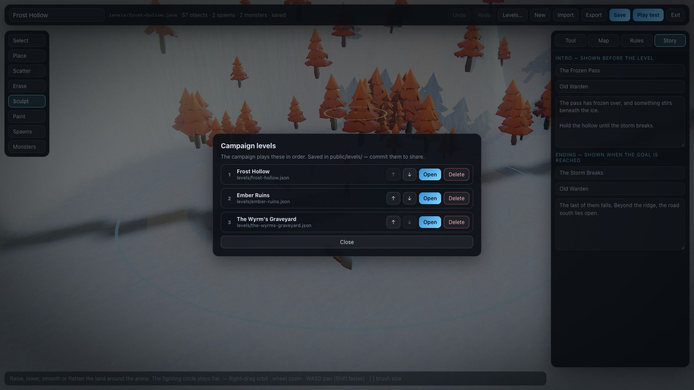

### Tools

| Tool | What it does |
| --- | --- |
| **Select** | Click an object, then drag the handles — **1** move, **2** rotate, **3** scale — or type exact values in the inspector. **Del** deletes, **Ctrl+D** duplicates. |
| **Place** | Pick any of the library's models in the browser (category + search), click the ground to drop it. **Q / E** turn it first. |
| **Scatter** | Paint many objects at once — a forest, a rock field — from a *scatter set* (add models with **+**), with radius, count, spacing and size variation. |
| **Erase** | Drag over objects to remove them. |
| **Sculpt** | Raise, lower, smooth or flatten the land around the arena. The 25 m fighting circle stays flat, because movement and spells assume flat ground there. |
| **Paint** | Paint ground surfaces (grass, snow, sand, gravel, paving, lava…) anywhere, including roads across the arena. |
| **Spawns** | Mark where waves walk in from. No spawn points = monsters come from all around. |
| **Monsters** | Place monsters that are already waiting when the level starts — e.g. a Rift Golem guarding a gate. |
| **Portals** | Place portals and link them to each other or to another level (see [Portals](items-npcs-portals.md#portals)). |
| **NPCs** | Place helpers — guides, merchants, healers, quest givers, tutors — with lines, an AI personality, gifts, quests and study questions (see [NPCs](items-npcs-portals.md#npcs) and [Study games for kids](for-parents.md)). |

  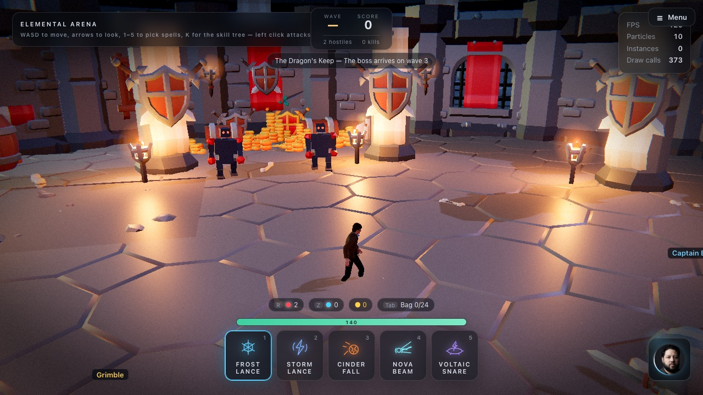
  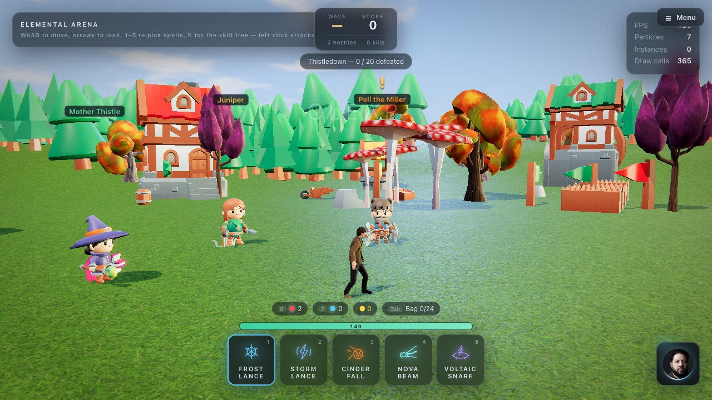

**Torches light up.** Any torch, candle, lantern or lamp placed on a map glows and flickers, and the
eight nearest the fighting circle cast real light on the walls and floor around them — so a night
map lit by torches reads as a dungeon, not a dark field.

**Map** sets the ground, landscape shape (flat / hills / mountains / canyon / valley), time of day
(**Day** is bright and sunny, with an open blue sky and clouds; dawn and dusk get a coloured sky;
night stays dark) and fog, and has an optional **AI fill** that lays out a starting map from a sentence (it keeps your
rules, story and markers; **Undo** takes it back). **Rules** sets the character (or the player's
choice), the goal — *survive N waves*, *defeat N monsters*, *defeat the Emberwyrm* (it arrives on
wave N) or *answer N questions* (tutors) — **Calm mode** (no monsters at all), which monsters the
waves contain and how fast they grow. **Story** holds the intro and
ending scenes. **Play test** drops you into the level and **Exit** brings you back exactly where you
were, undo history included.

Camera: **right-drag** (or middle-drag) orbits, **wheel** zooms, **WASD / arrows** pan (Shift
faster), **[ ]** resize the brush. **Ctrl+Z / Ctrl+Shift+Z** undo and redo, **Ctrl+S** saves.

### Saving and sharing

**Save** writes `public/levels/<id>.json` and adds the level to the campaign order in
`public/levels/index.json` (**Levels…** reorders, opens and deletes). Because they live in
`public/`, levels are part of the repo and of every build: commit them and anyone who pulls plays
your campaign. Saving works while running `npm run dev`; a built game is read-only, so use
**Export** to download a level file and **Import** to load one.

A level file is plain JSON: the world (ground, landscape, time, fog, seed, plus the sculpt and paint
grids), every object (`model` id, position, height offset, turn, scale), spawn points, waiting
monsters, rules and story. Objects refer to library models by id — anyone playing the level needs
the asset library downloaded (it is, after the first `npm run dev`).

### The campaign

  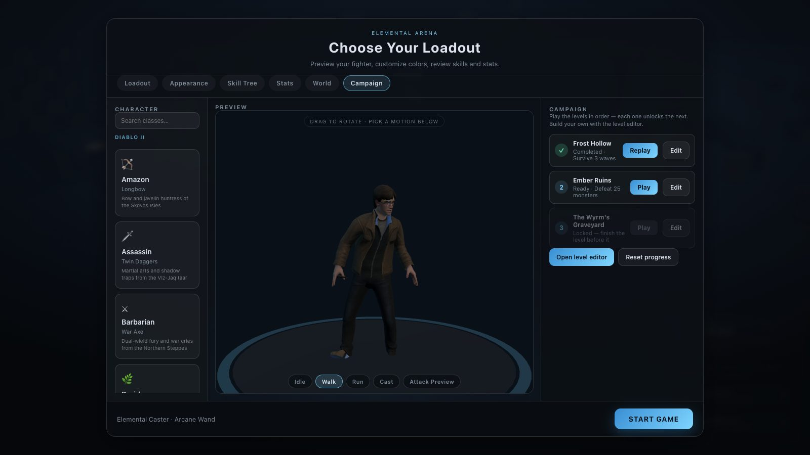
  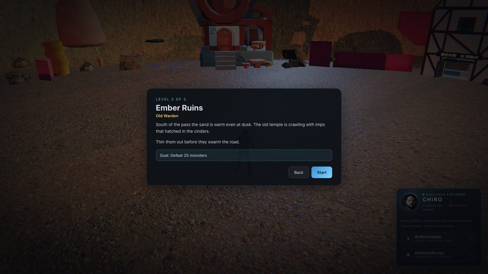

  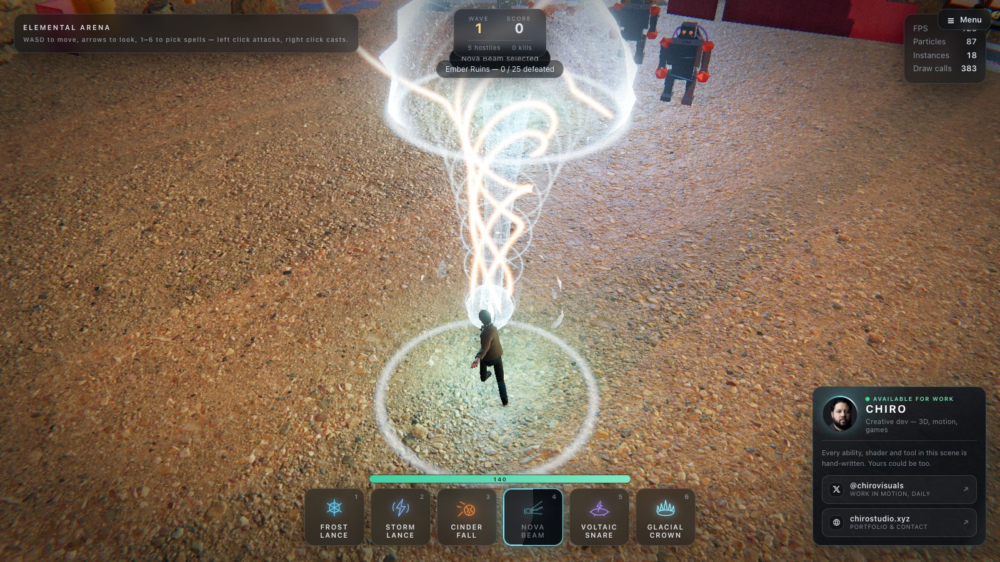
  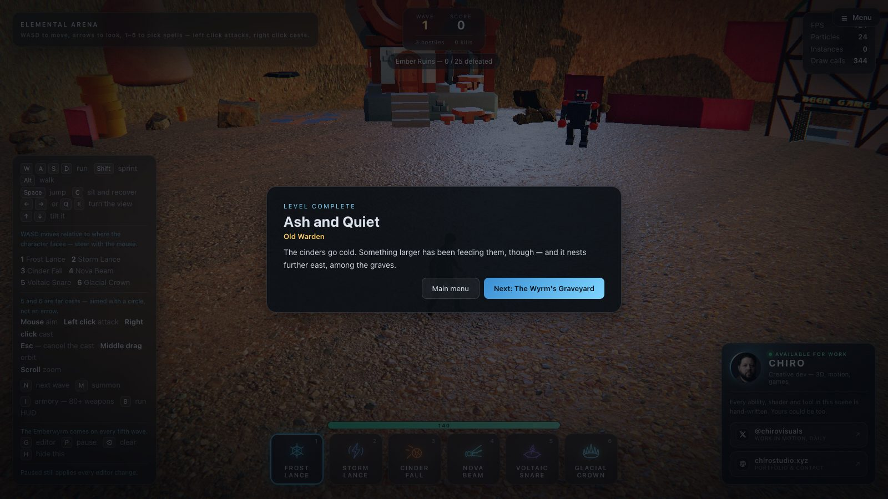

**Campaign** in the main menu lists the levels in order. Each one unlocks the next; finishing a
level shows its ending and offers the next level straight away. Progress is remembered per browser
(**Reset progress** clears it). Study levels (goal *answer N questions*) are always open. Six
levels ship with the game:

| # | Level | Goal | Built with |
| --- | --- | --- | --- |
| 1 | **Frost Hollow** | Survive 3 waves | By hand: scattered pines, sculpted ridge, painted gravel road, two waiting monsters |
| 2 | **Thistledown** | Defeat 20 monsters | A storybook village on a sunny day: cottages, a windmill, red-spotted toadstools, a castle on the horizon; a healer, a merchant and the miller's quest |
| 3 | **Ember Ruins** | Defeat 25 monsters | AI fill (desert canyon temple) + hand-set rules and three spawn points |
| 4 | **The Wyrm's Graveyard** | Defeat the Emberwyrm (wave 3) | AI fill (foggy graveyard) + a Rift Golem waiting at the gate |
| 5 | **The Dragon's Keep** | Defeat the Emberwyrm (wave 3) | A torch-lit dungeon hall: stone walls and flagstones, carved pillars, banners, and the wyrm's hoard of gold guarded by two Iron Brutes |
| ✎ | **Study Grove** | Answer 8 questions (calm, no monsters) | A sunny clearing with two tutors — see [Study games for kids](for-parents.md) |
