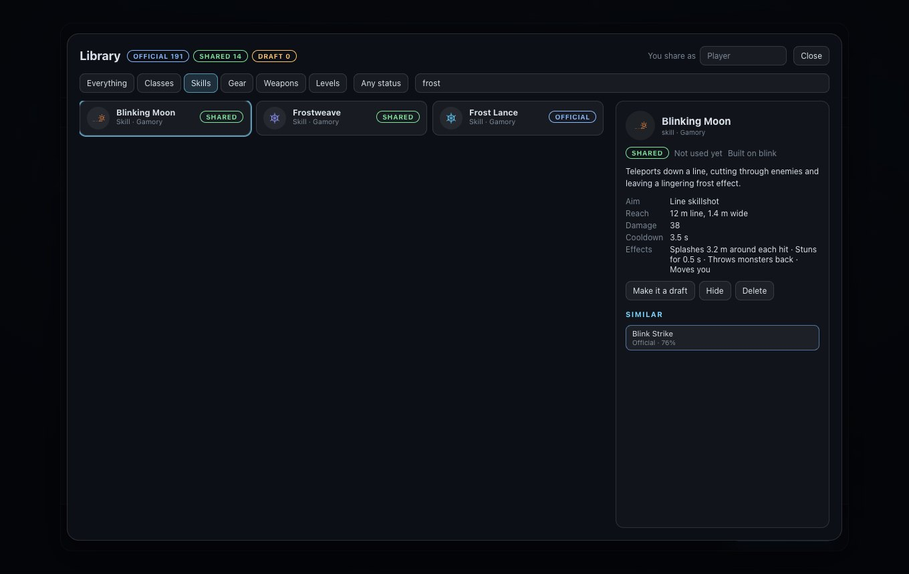
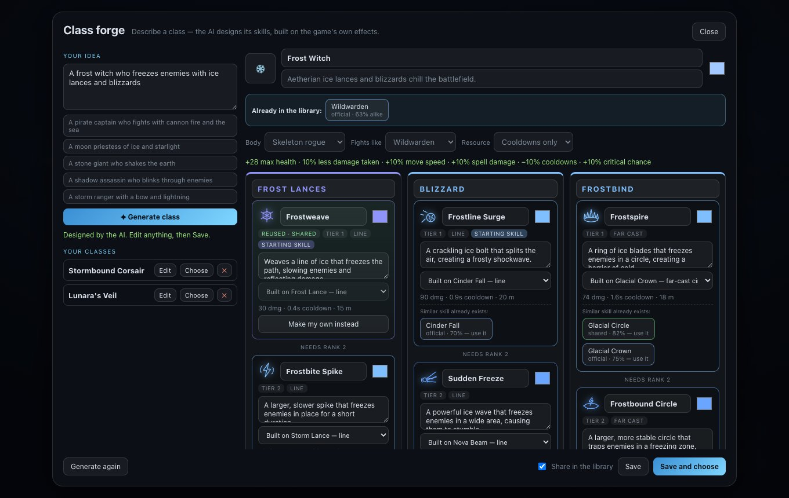

# The shared library

[← Back to the README](../README.md)

  
  

Everything in Gamory — the classes, skills, gear, weapons and levels the game ships with, and
everything players make — lives in one **library**. Before you make something new you can see what
already exists and use it, so the game grows by reusing good parts instead of piling up near-copies.

## Status

Every asset has a status, shown as a coloured badge:

| Status | Meaning |
| --- | --- |
| **Official** | Comes with the game. Can't be changed or deleted from the library. |
| **Shared** | Made by a player and shared, so everyone can find it and use it. |
| **Draft** | Made by you and not shared yet. Only you see it. |
| **Hidden** | Taken out of the library (kept, but not listed or suggested). |

Each card also shows who made it and **how often it has been used**: chosen as a class, played as a
level, equipped as a weapon, or reused as a skill by another class.

## The Library window

Open it from the main menu (**Library**). Filter by kind (classes, skills, gear, weapons, levels)
and status, or search names and descriptions. Pick something to see its details: a skill's aim,
reach, damage, cooldown and effects, or a class's branches, plus the most similar assets. From there
you can **play** a class or level, **equip** a weapon, and for your own things **share** them, turn
them back into a **draft**, **hide** them or **delete** them. Set the name you share under at the top.

## Reuse in the Class forge

When the [Class forge](class-forge.md) designs a class, it asks the library what already exists:

- **Under each new skill**, the most similar existing skills (official or shared) with how alike
  they are. **Use it** swaps the new skill for that one. The class then *references* it rather than
  copying it: the skill is the same everywhere, its use count goes up, and anything that improves it
  improves it for every class that uses it. **Make my own instead** undoes that.
- **Above the class**, classes already in the library that are close to this one, in case one of
  them is what you wanted. Click one to choose it.
- **Share in the library** (on by default) publishes the class and the skills it made when you save.
  Untick it to keep them as drafts. Saving also says which existing class it is closest to.

Levels saved in the [level editor](level-editor.md) are published to the library too.

## How "similar" is measured

Every asset carries a fingerprint with three parts, and two assets are compared on each:

| Part | What | Weight |
| --- | --- | --- |
| Categories | What kind of thing it is. For a skill: the effect it is built on, how it is aimed, its status effect, physical or spell, whether it builds or spends Rage. For a class: its fighting style, resource and armor class. For gear: slot and item class. For a weapon: kind and how it fires. | 45% |
| Numbers | How strong it is: damage, cooldown, reach, area, bonuses, fire rate, magazine… each compared on its own scale. | 25% |
| Words | Shared words in the name and description. | 30% |

So two skills built on the same effect, aimed the same way and with the same status are close
whatever they are called, which is what matters for reuse. The forge suggests matches from 55% up;
the library's "Similar" list from 50%.

## Where it is stored

**Local first.** The library is a SQLite database (Node's built-in `node:sqlite`) at
`data/library.sqlite`, served by the dev server under `/api/library`. It is your data, so it is
git-ignored. At start-up the game sends its own content as the official set; classes already in
`public/classes` are added as shared the first time.

The game only talks to the HTTP API (`src/library/Library.js`), never to the database, so moving the
library to a hosted database for real public sharing means re-implementing `LibraryStore`
(`server/libraryStore.js`) with the same methods and routes. The game does not change.

| Route | Does |
| --- | --- |
| `GET /api/library?kind=&status=&q=&limit=` | List assets (and counts by status and kind) |
| `GET /api/library/<id>` | One asset, with its data and fingerprint |
| `POST /api/library` | Create or update an asset (never an official one); returns similar assets too |
| `POST /api/library/similar` | `{ kind, fingerprint, exclude, limit, min }` → similar assets, best first |
| `POST /api/library/seed` | The game's official set |
| `POST /api/library/<id>/use` | Count a use |
| `PATCH /api/library/<id>` | `{ status }`: shared, draft or hidden |
| `DELETE /api/library/<id>` | Delete (not official assets) |

Asset ids are `<kind>:<id>`: `skill:ice`, `class:forge-lunaras-veil`, `item:tower-shield`,
`weapon:sniper-rifle`, `level:thistledown`.

## For developers

- `server/libraryStore.js`: the store (schema, list, upsert, seed, similar, status, use) and the
  dev-server routes.
- `src/library/similarity.js`: the scoring, shared by the server and the game.
- `src/library/fingerprints.js`: fingerprints for skills, classes, gear, weapons and levels.
- `src/library/Library.js`: the game's client, the official seed, and publishing classes and levels.
- `src/ui/LibraryPanel.js`: the Library window. `src/ui/ClassForgePanel.js`: the forge's suggestions.
- A reused skill in a forged class is `{ ref: '<skill id>', … }` in its design; `skillIds` and
  `registerForgedClass` (`src/forge/ClassForge.js`) use the referenced skill instead of making one.
