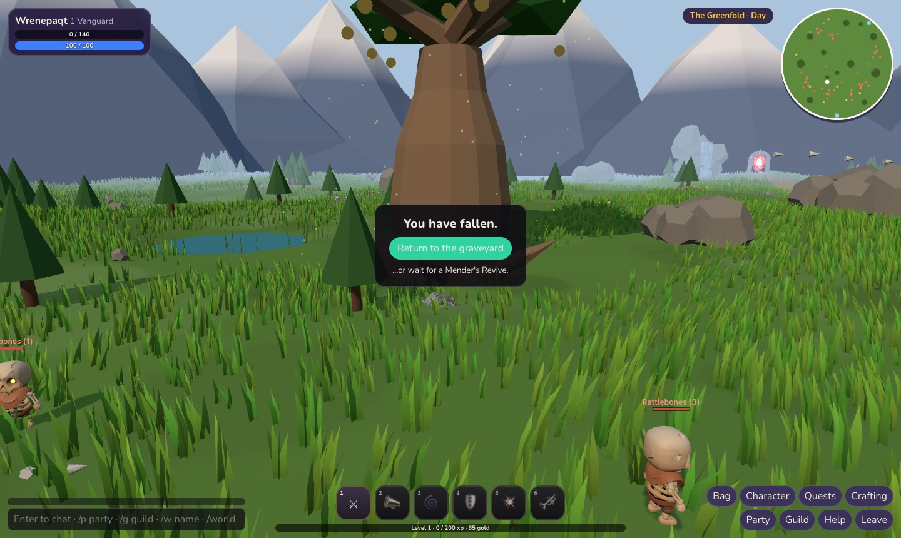
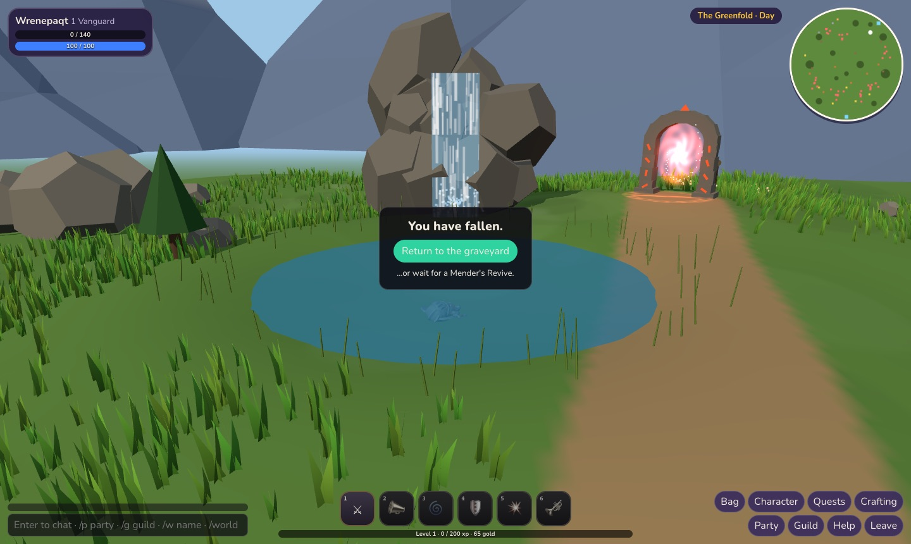
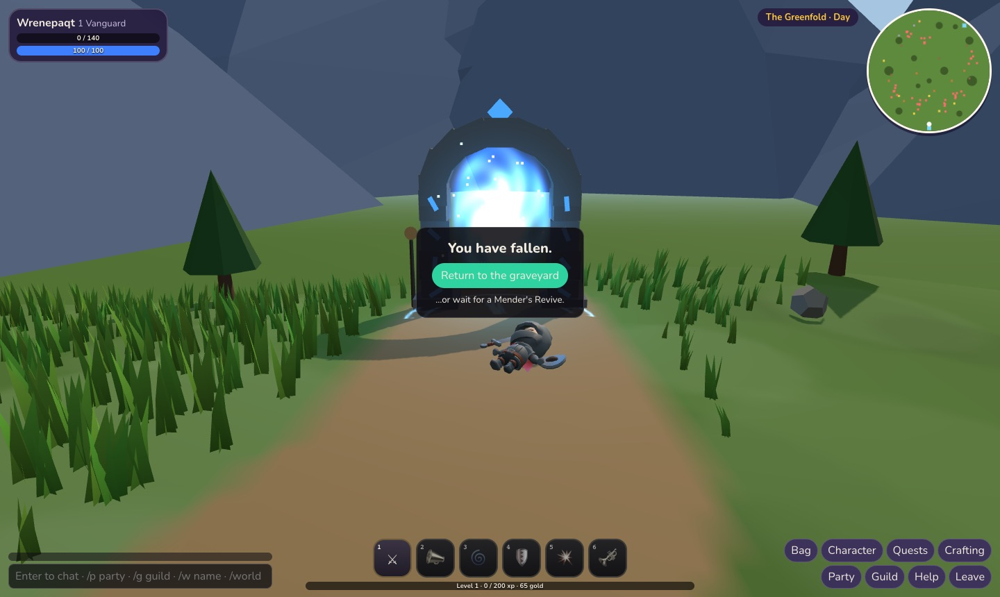
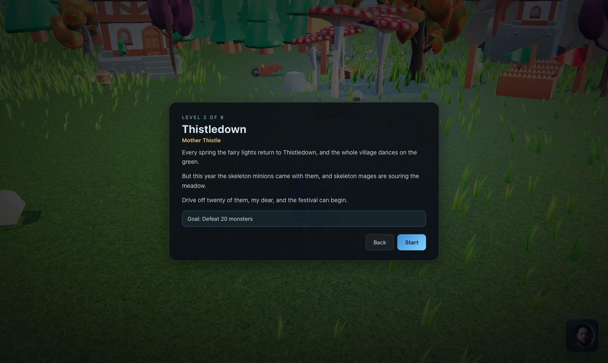

# The living landscape

[← Back to the README](../README.md)

One module, `src/world/LivingLand.js`, grows a landscape that answers whoever walks through it. It is
for the eyes only: it never blocks the way or changes a fight. Hearthvale's zones use it, and so does
**every game on the action engine — the built-in ones and every game people make** — with no extra
work from the maker or the AI.

<p>
  
  
</p>
<p>
  
  
</p>

## What it grows

| | |
|---|---|
| Grass | Thousands of tufts in one draw. They sway in the wind and bend away from up to eight bodies near you. |
| Flowers, butterflies | Patches of flowers; butterflies wander over them and drift off when you come close. |
| Ponds | Water to wade through; your steps leave rings. Reeds round the edge. |
| Birds | Small flocks that take off when you come near, circle, and land somewhere quiet. |
| Logs and boulders | Walk into one and it rolls; pushed off-centre, a log turns. A log in a pond floats. |
| Waterfalls | A cliff of boulders, a running sheet of water, spray — more of it when you stand under. |
| Giant trees | A huge bottle-trunked tree: leaves drift down, the crown shakes when someone passes, the fruit glows at night. |
| Mountains | Snow-capped peaks all round the map, too far to ever reach. |
| Sky | A day that passes in eight minutes (dusk, stars, fireflies, lanterns) — or a fixed hour. |
| Indoors | Dust in a crypt, embers in a spire, pools on the floor, flickering torches. |

## In games people make

When a level is built (`ComposedWorld.buildLevel`), `ComposedWorld.lifeFor(world, …)` reads what the
level already says and grows what fits — so "a forest adventure" from the game builder gets all of
this without the AI having to ask for it:

| The level has | It gets |
|---|---|
| Grass ground | Grass (short and thin inside the fight, thick outside), flowers, butterflies, birds |
| Dirt, moss or mud | Thin grass, birds |
| Any open ground (also sand, snow, gravel, rock) | Logs and boulders to walk into |
| A forest edge | A giant tree in the outskirts |
| Hills, a valley, mountains or a canyon, on grass | A waterfall in the outskirts, facing the fight |
| Dusk or night | Fireflies; the giant tree's fruit glows |

Indoor grounds (paving, asphalt…) get none. A level can turn it off with `world.life: false`.
Nothing is added to a level's file: the same seed grows the same land every time, for every player.

## Using it elsewhere

```js
import { LivingLand } from '../world/LivingLand.js';

const land = new LivingLand({
  seed: 'my-place', bounds: [0, 0, 200, 200], height: (x, z) => 0,
  free: (x, z, pad) => true,            // false on paths, walls, doorsteps
  grass: { density: 0.6 }, flowers: true, birds: true, kickables: 12,
  ponds: [{ x: 60, z: 80, r: 10, level: -0.5 }],
  waterfalls: [{ x: 60, z: 66, face: 0 }], giants: [{ x: 120, z: 120 }],
  mountains: true, sky: { cycle: true }
});
scene.add(land.group);
// every frame: the player first, then whoever is near
land.update(dt, { x, z, moving }, others, { scene, sun, hemi });
```

Where logs have rolled is each player's own (it isn't sent to anyone): it is scenery.
