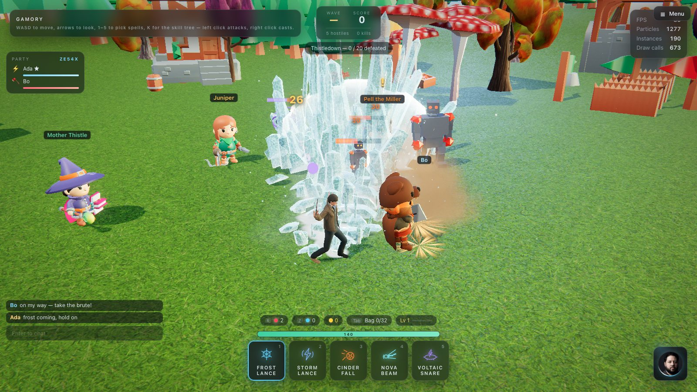
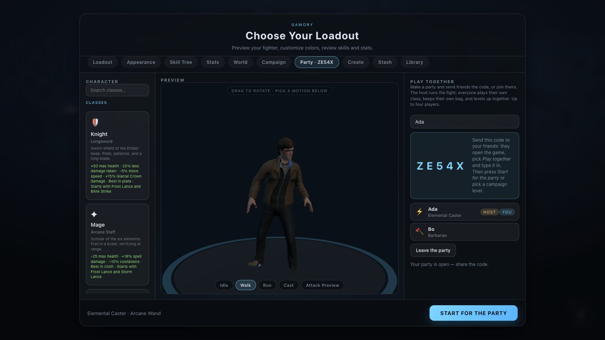
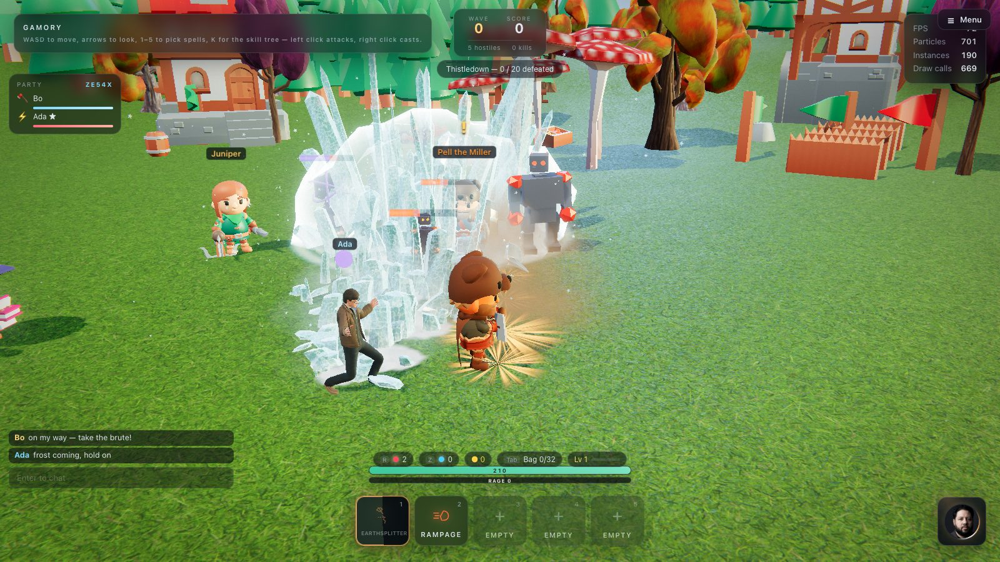
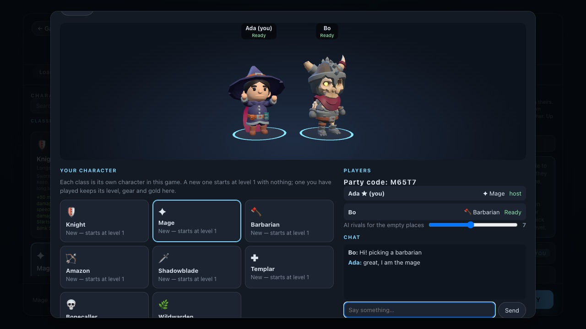

# Playing together

[← Back to the README](../README.md)

  

Up to four people play in one world, each from their own browser: their own class, their own
weapon and gear, their own bag, their own experience — and the same monsters, the same waves, the
same loot on the same floor. The game is co-operative: everyone is on the same side.

## How to play together

1. Open the game and go to **Play together** in the main menu.
2. One of you presses **Make a party** and gets a five-letter code.
3. The others type the code and press **Join**. The party's members appear on both sides, with
   their classes.
4. The party's **host** (whoever made it) presses **Start for the party**, or picks a level in
   **Campaign**. The others press **Join the host's fight** — they can do it straight away, or
   later: dropping in mid-fight works.
5. In the fight, **Enter** opens the party chat. The party list at the top-left shows everyone's
   health; a **★** marks the host.

  
  

The host leads: the level, going through a portal to another level, and the way onward at the
end are the host's calls (a guest walking into a portal asks the host to take the party through).
When the host leaves, the party ends. A guest can leave and come back to the same party any time.

Waves grow with the party: each extra player adds about 60% more monsters, a little more health on
each, and room for more of them at once.

## Starting a game together

Open a game's page on the home page and press **Play**: its lobby opens. **Invite friends** makes a
party and shows its code; friends join with the code (**Play together**) and see the same lobby. Each
picks their own character from the game's classes — their own character *in this game*, one per class
— customizes it and presses **Ready**. The host's **Start** opens once everyone is ready. In a battle
royale the host also sets how many AI rivals fill the empty places.

While they wait, the lobby shows **everyone's character on a stage**: each member's chosen class in
the body and colours they picked, their name over them, idling while they choose and cheering when
they press Ready (drag the stage to turn them). Each pick travels in the `lobby-pick` message with the
look and colours, so everyone sees the same line-up. Beside it is the **party chat** — the same chat
the party uses in game — so friends can agree on classes before the start.

  

## What is shared and what is yours

| Shared | Yours |
| --- | --- |
| The monsters, their health and their deaths | Your health, potions and revive timer |
| The waves, the score and the kill count | Your class, spells, weapon, gear and bag |
| Loot on the floor — first to pick it up gets it | Experience: every kill pays everyone |
| Quest kills (every tutor and quest-giver counts the party's kills) | Campaign progress (a finished level counts for all who played it) |
| Chat | The pause key — a party's fight cannot be paused |
| Team buffs: a Barbarian's Battle Roar buffs every teammate in its circle, with an aura everyone sees | |

## Signed in

When the host is [signed in](security.md), the fight is also opened on the server: guests who are
signed in join it there, the loot is made by the server, an item goes to whoever reaches it first
(one database update decides, so two players can never both get it), and every kill's experience is
checked against what the host reported. Everyone appears under their account name. If the host
isn't signed in, a signed-in guest still plays, but that party's loot isn't recorded for them.

## How it works

The server does not run the game. It keeps **rooms** — a code, a host, up to four members — and
relays messages between them (`server/realtime.js`, one WebSocket at `/ws`). Everything else
happens in the players' browsers:

- The **host's** browser runs the fight exactly as it does alone: the monsters' brains, their
  attacks, the waves, the loot rolls. Twelve times a second it sends a **snapshot** of every
  monster — position, heading, velocity, health, state, status effects — to the guests.
- A **guest's** monsters are **puppets** of the host's: they glide to the snapshot positions and
  play the matching animations, but decide nothing. Everything a guest does to a monster — every
  spell, swing and shot — resolves on the guest's own screen against the puppet (so it feels
  instant), and is then sent to the host, who applies it for real. The host decides deaths, and
  tells everyone.
- Monsters pick whoever is nearest and still standing. A hit on a guest is decided on the host
  and sent to that guest, whose own game takes the damage, so a guest's armour, block and thorns
  work as they do alone.
- Players see each other as real bodies: the same rig, clips, weapon and gear visuals, steered by
  fifteen states a second (position, heading, velocity, jump, sit, sprint) and gliding in between.
  Casts, swings and shots are replayed on the other players' screens as pure visuals.
- Loot: the host rolls the drops and where they land, and everyone sees the same items in the same
  places. A guest picking something up asks the host, who hands it over (or says someone else got
  there first). Experience is paid to everyone on every kill, with the books in the drop pool
  drawn from every party member's skill tree.

This is a co-op design: the host's browser runs the fight, and a guest's report of a hit is
trusted. Signed in, what can be kept — items, gold, experience — goes through the server's checks
([Accounts and fair play](security.md)); what happens in the fight itself is trusted to the host. What it buys is a server that
is a few hundred lines, keeps no game state, and can hold hundreds of parties.

## Playing over the internet

The party server is part of the game server (`server/server.js`, see
[Production](production.md)). Anyone who can open the game's address can make or join a party.
On a LAN, `npm run dev` already includes it: friends open `http://<your address>:5173` (start Vite
with `--host` to listen on the network).

## For developers

- `src/net/Session.js` — the socket and the room protocol.
- `src/net/Party.js` — the coordinator: lobby, messages, snapshots, hits, loot, run events, chat.
- `src/ui/GameLobby.js` and `src/ui/LobbyStage.js` — a game's lobby: class choice, customizing, players, chat, Ready/Start, and the stage of everyone's characters.
- `src/net/RemotePlayer.js` — another player's body.
- `src/entities/MonsterManager.js` — `players` (host targeting), `snapshot()`, `applySnapshot()`,
  `applyRemoteHits()`, puppet mode; `Monster#netEntry`, `#applyNet`, `#updatePuppet`.
- `src/game/GameDirector.js` — `authority` (only the host's director runs waves) and
  `localPlayerId` (whose hits to take).
- `server/realtime.js` — the rooms. `tests/unit/realtime.test.mjs` and `tests/e2e/coop.mjs` cover
  the protocol and a full two-browser co-op run.
