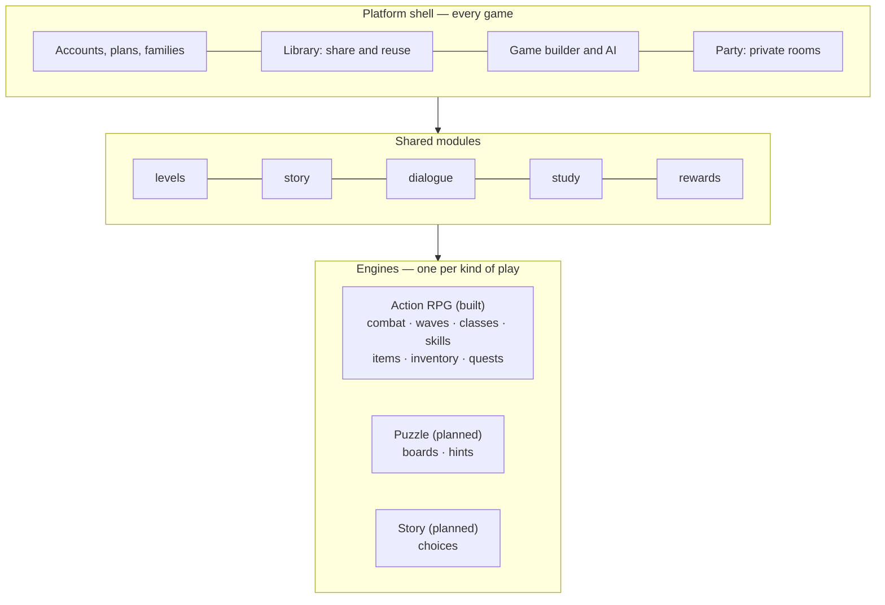

# Platform architecture — many genres, one platform

[← Back to the README](../README.md)

Gamory is heading from one game to a platform of many. An action RPG needs classes, skill trees,
items and an inventory. A puzzle game needs boards, moves and stars. A story game needs chapters,
choices and endings. This page describes how the platform holds all of them, how each player's
progress is saved per game, and which database fits. Part of it is built (the blueprints and
modules); the rest is the plan.

## Status

| Piece | Status |
| --- | --- |
| Genres, worlds, layouts, casts as data, and the Game builder | **Built**: [Game builder](game-builder.md) |
| Modules: the feature list each genre declares, and what each saves | **Built** as data ([`modules.js`](../src/blueprints/modules.js)), checked by the tests |
| Plans (Free, Plus) enforced by the server | **Built** |
| Engines other than the action RPG | **Built**: the stock market game (engine `market`, a 2D screen — see [Stock Market Challenge](stock-market.md)). Puzzle and story: planned |
| Classes and skills players make, offered to the builder and the AI as heroes | **Built** |
| Battle royale on the action RPG engine: storm, AI rivals, players against players, solo and squads | **Built**: see [Battle royale](battle-royale.md) |
| Games as records, on a home page | **Built**: published games are rows in PostgreSQL with their levels; the home page lists them with the official ones. See [Games on the home page](#games-on-the-home-page) |
| Characters per player, per game, per class | **Built**: a character for each class in each game, in the browser and on the server (sealed to account, game and class); a game's lobby to choose and customize, and to start together |
| NPCs, worlds, monsters and question sets players make, offered by the builder | Planned |
| PostgreSQL | **Built** (chosen 2026-11-10): accounts, characters, items, ledger, history and the library. See [The database](production.md#the-database) |

## The layers



1. **The shell** is the same for every game: accounts and plans, the shared library, the builder and
   its AI, private party rooms, a parent's controls.
2. **Shared modules** work in any engine: levels and campaigns, story scenes, helpers who talk,
   study questions, a parent's rewards.
3. **Engines** play a kind of game. Each engine owns its modules. The 3D action RPG in `src/core`
   is the first. A puzzle engine could be a 2D canvas, and a story engine could be mostly text and
   pictures. They plug in beside it rather than inside it.

A **genre** is a recipe: one engine plus the list of modules it switches on
([`genres.js`](../src/blueprints/genres.js)). A study adventure is the action RPG with `study` and
`rewards` added. Calm learning is the same engine without `combat` or `waves`. A future "picture
puzzle" genre would be the puzzle engine with `boards`, `hints`, `study` and `rewards`. The builder
only offers what the genre's modules use, so a puzzle game never shows a skill tree.

### A module's contract

Each module declares, in one place:

- **its engine**: `shared`, or the engine that provides it;
- **what it saves** for a player in one game, for example `skills` → `ranks`, `slots`, `points` and
  `boards` → `solved`, `stars`, `moves`;
- *(planned)* **its rules on the server**: what a client may change, checked the way the action RPG's
  loot and gold already are;
- *(planned)* **its editor panel and its part of the spec**, so the builder and the AI learn it with
  no other change.

Adding a genre is then data. Adding a module is code in one place. Adding an engine is the only big job.

## Content players make: characters, skills and more

The Barbarian is one example. Players and parents make their own characters and skills, and new
games must be able to use them. The rule is **make once, store once, reference everywhere**.

**Today (built):**

- A class made in the [Class forge](class-forge.md) is saved as one design file in the class store
  (`DATA_DIR/classes` on a server, so every player on it can use it). It is also published to the
  [shared library](library.md) as `class:<id>`, and each of its skills as `skill:<id>`, with a
  fingerprint for finding similar ones and a count of how often it is used.
- A skill is a *design*, not code: a name, a colour, numbers, and the hand-made effect it is built on
  (its `base`). So any skill a player makes inherits that base's behaviour. One built on Battle Roar
  is a team buff with an aura, in its own colour, with no extra work.
- **The Game builder uses them.** The Hero menu lists every class players made beside the built-in
  ones. Naming one in an idea (*"a pirate quest with the Stormbound Corsair"*) picks it with no AI.
  The AI is shown each one in a single line (name, story line, skills: about 40 tokens), and its
  id joins the hero list the AI must choose from, so it can pick them but never invent one. Those
  lines come **after** the fixed menus, so the part of the prompt a hosted model caches stays the same.
- A game **references** the class by id (`level.character`); it never copies it. Improve the class
  and every game that uses it gets the improvement.

**Next (planned):** every kind of thing a player makes becomes a library asset the builder can
offer the same way:

| Kind | Engine | Offered by the builder as |
| --- | --- | --- |
| `class`, `skill` (built) | action RPG | Hero menu; skills inside a class |
| `item`, `weapon` (in the library, not in the builder yet) | action RPG | A merchant's stock, quest rewards, starting gear |
| `npc` (a helper with a name, body, personality and lines) | shared | Helpers in a game, instead of the archetypes |
| `world` (a saved map plan or a hand-made level map) | shared | The World menu |
| `monster` (a monster kind's look and numbers, built on a base) | action RPG | The Monsters menu |
| `question-set` (a parent's questions for a subject and age) | shared | A tutor's lessons |
| `game` (a whole built game) | any | Remix: start from someone's game |
| `puzzle-set`, `story` | puzzle, story | When those engines exist |

Every asset has the same envelope: `id`, `kind`, `engine`, `owner`, `status` (official, shared,
draft, hidden), `version`, `data` (the design), `fingerprint` and `uses`. A game's spec lists the ids
it uses, which pins a version. Deleting an asset that games still use hides it instead.

For the AI, the builder sends only what fits the idea: the player's own assets first, then the most
used shared ones of the kinds the genre needs, capped (30 heroes today). The prompt then stays small
however large the library grows.

## Games on the home page

The platform opens on its games, not on one game's menu
([`ui/PlatformHome.js`](../src/ui/PlatformHome.js)). Each card is a game:

- **Official games** are the levels that ship with the game, read from the level files. Only their
  play counts are stored (`game_plays`).
- **Published games** are rows in `games`, each level in `game_levels` with its id renumbered to
  `<game id>-<n>`, so no game can overwrite another's level or a built-in one. The server's rules
  load these levels by id, so tutor and quest rewards in a published game are checked like any other.
- A game's **card** (genre, world, chapters, goal, study, cover look) is worked out once, when it is
  published ([`platform/gameCards.js`](../src/platform/gameCards.js)), so listing hundreds of games
  never opens a level. The **cover** is drawn from the card: sky by time of day, ground, and a
  skyline for the world ([`ui/gameCover.js`](../src/ui/gameCover.js)).
- Search covers title, summary and maker. Filters are by genre, or kids and study. Sorting is by
  plays or by newest. Only the account that published a game can remove it.

| Route | Does |
| --- | --- |
| `GET /api/games?q=&genre=&sort=popular\|new&limit=` | Cards, official and published |
| `GET /api/games/<id>` | One game, with its levels |
| `POST /api/games` | Publish `{ title, summary, levels[], spec?, author? }` (signed in: the account is the maker) |
| `POST /api/games/<id>/play` | Count a play |
| `DELETE /api/games/<id>` | Remove (its maker only) |

Not yet: private games for a family, a maker's own page, likes, and comments.

## Saving progress per player, per game

**Built:** a character lives in a *scope*, `<game>#<class>` (`official:thistledown#mage`,
`g-moon-garden-1a2b3c4d#knight`), or `arena` for the open arena (and every save from before games).
Each is its own character: level, experience, gold, bag, stash, gear and skill ranks. In the browser
it is its own saved copy. On the server, characters, items and the gold ledger carry the scope, the
rules work on the request's scope (a fight's is its run's, which the browser cannot change), a saved
character is sealed to its account and scope, so one copied into another game does not open, and the
audit checks each scope's gold against its own ledger. A game's lobby shows your characters there
(`GET /api/game/characters?game=`). Customization (body, colours) is kept per scope too.

The rest of this section is the original plan; the parts not done yet are marked.

- A **game** becomes a record of its own: owner, title, engine, genre, modules, the spec, its levels,
  its **roster** (the characters players may choose, chosen when it is made; a class from the forge
  is copied in), and whether it is private, shared with family or public. *(Built, except private and
  family visibility.)*
- A player's progress lives in **one save per player, per game, per module**. Each save is a small
  document in the shape its module declares, with a schema version so it can be migrated.
- **Progress scope** is the game's choice. `game` keeps everything inside that game, which suits a
  parent's study game or a puzzle pack. `engine` shares a character across every game on the same
  engine, so an RPG hero keeps their gear from one RPG to the next, like seasons in action RPGs.
  Today's single character becomes the `engine` scope of the action RPG.
- **Money and items stay strict.** Gold, items and anything a player could duplicate or trade stay
  in ledger-style tables with server-side rules. That is what the anti-cheat
  ([Accounts and fair play](security.md)) is built on.

## Which database

**Chosen: PostgreSQL, using JSONB columns for the parts that differ by genre.** It is in place: a
PostgreSQL server in production (`DATABASE_URL`), and the same PostgreSQL in-process (PGlite) for
`npm run dev` and the tests, so there is one SQL dialect and nothing to install. Redis and object
storage come when traffic needs them. The comparison that decided it:

The data is two kinds at once, and the choice depends on handling both well:

| Data | Shape | Needs |
| --- | --- | --- |
| Accounts, plans, payments, families | Fixed, relational | Constraints, joins, never wrong |
| Gold ledger, item registry (anti-duplication) | Fixed, relational | Transactions across rows, unique rules, sums that must add up |
| Game specs, levels, saves per module | Different per genre, nested | Flexible documents, versioned |
| Rooms, presence, leaderboards | Short-lived, hot | Speed, not durability |
| 3D models, pictures, big level files | Files | A CDN |

| | PostgreSQL + JSONB | MongoDB |
| --- | --- | --- |
| Accounts, payments, ledger, items | Its strength: transactions, foreign keys, unique and check constraints | Possible (multi-document transactions exist), but you hand-build what constraints give for free |
| Saves that differ per genre | JSONB documents, indexed (GIN), queried with SQL | Its strength |
| Both in one database | Yes | Documents yes; the money side needs more care |
| What the code already did | The SQLite schema (ledger, item registry, hash-chained history) moved over almost as-is | A rewrite of the anti-cheat storage |
| Hosting | Managed almost everywhere (Neon, Supabase, AWS RDS/Aurora, Google Cloud SQL, Azure) | MongoDB Atlas, or self-hosted |
| In game backends | Common. The open-source Nakama game server runs on PostgreSQL or CockroachDB | Common for content and saves, often next to a SQL database |

MongoDB would work well for game content and saves. The reason not to choose it is the other half:
this platform has real money (Plus), items that must not be duplicated, and parents' rewards.
Those need the guarantees a relational database gives by default. PostgreSQL with JSONB covers
the document side well enough that one database serves both. With MongoDB you would likely end up
running a SQL database next to it anyway.

The choice is also reversible. The game only talks to stores through a small interface
(`GameDB`, `LibraryStore`, the level and class file stores). Moving means re-implementing those,
not touching the game.

### Sketch of the tables

```sql
accounts   (id, name, plan, family_id, …)             -- as today, plus families for private play
assets     (id, kind, engine, owner_id, status, version, data jsonb, fingerprint jsonb,
            uses, created, updated)                    -- classes, skills, items, NPCs, worlds… players made
games      (id, owner_id, title, engine, genre, modules text[], spec jsonb,
            visibility, version, created, updated)     -- a built game
game_assets(game_id, asset_id, asset_version)          -- what a game uses, by reference
game_levels(game_id, level_id, ord, data jsonb)        -- its chapters (a plan, a few KB each)
saves      (account_id, game_id, module, data jsonb, schema_version, updated,
            PRIMARY KEY (account_id, game_id, module)) -- progress, per player, per game, per module
items      (uid, owner, game_id, state, data jsonb, …) -- as today, scoped to a game or an engine
ledger     (id, account_id, game_id, delta, balance, reason, ref, at)
reward_rules (game_id, rule jsonb)                     -- a parent's "30 gold per right answer"
events     (id, account_id, type, data jsonb, prev_hash, hash)  -- the history chain, as today
```

## How to get there

1. **PostgreSQL** — *done.* The stores run on PostgreSQL (a server, or PGlite in-process), with
   migrations and a one-time import of the old SQLite data that keeps every id and checks the history chain.
2. **Games as records** — *done.* `games` and `game_levels` with `/api/games`; the builder publishes
   a game; the home page lists them. Still to move: the campaign's own levels and classes, from files into the database.
3. **Saves per module**: split today's character into `saves` rows (`classes`, `skills`,
   `inventory`, `rewards` …) under the action RPG's `engine` scope. Every existing character is
   migrated once, and nothing changes for players.
4. **A second engine**: a small puzzle or story engine, to prove modules plug in. The builder then
   offers its genres.
5. **Scale-out** when needed: Redis for rooms, presence and leaderboards across servers, and object
   storage with a CDN for the asset library.

Step 3 is next: it brings the most value, and needs nothing beyond the database now in place.
