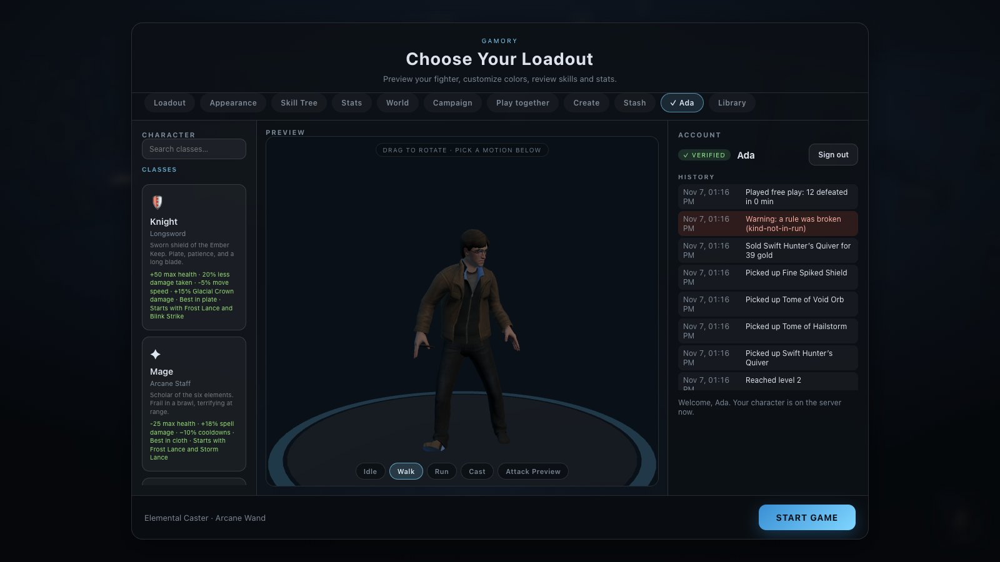

# Accounts and fair play

[← Back to the README](../README.md)

<p>
  
</p>

Players can play without an account, on their browser's own save, exactly as before. With an
account, the character — level, gold, bag, stash, gear, spells — lives **on the game server**: on any
computer, out of reach of anyone editing the game in their browser, and with a history of everything
that happens to it.

## For players

- **Account** in the main menu: pick a name and a password (8+ characters, not containing the
  name), and **Create account**. A new account starts a new character; the browser's own save stays
  where it was and comes back when you sign out.
- The **History** under your name lists what happened to your character: items picked up, sold,
  bought and given, quests and lessons rewarded, levels reached, games played, sign-ins, wrong
  passwords — and any warning for a broken rule.
- Signed in, your party knows you by your account name (no one else can use it), and loot in a game
  hosted by a signed-in player is shared through the server: whoever reaches an item first gets it.

## What the server protects

### Nobody can make or copy items

**The browser never sends an item.** It can only refer to things the server made: a drop on the
floor by its id, a merchant's offer, a monster it reports dead. Every item that exists is one row in
the item registry with its id as the primary key, and it is in exactly one place: held by one
character, lying on the floor of one game, sold, used up, or destroyed.

| Trying to… | What happens |
| --- | --- |
| Pick up the same item twice, or two players at once | One database update decides: `UPDATE … WHERE state = 'floor'`. Only one succeeds, on one server or many. |
| Take an item from someone else's game | Refused, and a strike (`foreign-take`) |
| Invent an item or edit gold in the browser's console | Nothing reaches the server; the next action sends a fingerprint of the character, the server's differs, and the browser takes the server's copy |
| Sell an item you don't have, or one already sold | Refused: the registry says who holds it |
| Report kills that couldn't have happened | Checked against the game's clock and level (see the rules below) |
| Claim a quest reward early | The server counts the kills *it* saw in that game |
| Edit the database file directly | Characters are sealed (see below): an edited one fails to open, and the account is locked for review |

After every change the server checks the result, not just the request: an action may only change the
set of items a character holds in the way that action allows (a pickup adds exactly the item picked
up; a sale removes exactly the item sold and pays exactly its value; moving things around changes
nothing but places), and gold, potions and experience likewise. Anything else rolls the whole
transaction back. Gold is recorded in a **ledger**: every change, its reason and the balance after.

### Rules, strikes and blocks

A request that breaks a rule is refused and gives the account a **strike**. Honest mistakes — a
retried request, a full bag, someone else getting the item first — are refused without one.

| Rule | Strike | What it catches |
| --- | --- | --- |
| `wave-too-fast` | 1 | A wave reported before the clock allows (5 s per wave) |
| `kind-not-in-run` | 1 | A monster the level doesn't have (a dragon in a village) |
| `kill-rate` | 1 | More than 150 kills in a minute |
| `boss-rate` | 1 | Two bosses within 45 s |
| `foreign-take` | 1 | Taking from another game's floor |
| `not-owner`, `state-mismatch` | 1 | An action on an item not held, or a result the rules don't allow |
| `not-in-party`, `unknown-kill` | ½ | Joining or claiming kills in a party you're not in |
| `study-rate` | ½ | Study answers faster than 1.5 s apart |
| `bad-request` | ¼ | A request no game client sends |

Strikes count for 24 hours. **Three in a day block the account**: 1 day the first time, 7 days the
second, permanently the third. A block signs the account out everywhere, and it cannot join parties.

### Accounts can't be taken over

| | How |
| --- | --- |
| Passwords | Only a **scrypt** hash with a random salt per account is stored, checked in constant time. An unknown name takes as long as a wrong password, so neither reveals which names exist. |
| Guessing | Five wrong passwords lock the account for 15 minutes (logged in the history), on top of 10 attempts per minute per address. Five new accounts per address per day. |
| Sessions | 256 random bits in an **HttpOnly, SameSite=Strict** cookie (Secure over HTTPS) the page's scripts can't read. The database keeps only its **SHA-256**, so a copy of the database signs nobody in. 30 days, ten at most per account. |
| Other sites | Every change must be same-origin JSON: another site's page can't act for a signed-in player (no CSRF). |
| Impersonation | The party server identifies each connection by its session; a signed-in player's name is their account's. |
| Other players | Every request acts only on the signed-in account's own character. |

### Keys, encryption and the history chain

One server secret (`SERVER_SECRET`, or a random key the server creates in `DATA_DIR/server.key`) is
split with HKDF into a separate key per job:

| Key | Used for |
| --- | --- |
| Seal key — **AES-256-GCM** | Each character is stored **encrypted and sealed** to its account. A row edited outside the server, or copied from another account, fails to open. |
| Chain key — **HMAC-SHA-256** | Each history event's hash covers the event and the previous event's hash. Editing, deleting or inserting one breaks the chain from there on, and recomputing it needs the key. |
| Address keys — **HMAC** and **AES-256-GCM** | Client addresses are never stored in the clear: a keyed hash (to match a blocked address) and an encrypted copy (to read one deliberately during an investigation). |

**Keep the key.** Without it the characters can't be opened. Back it up with the data, and never
change it on a server with players: there is no key rotation yet.

## For the people running the server

```bash
npm run admin -- audit                          # the whole database: exit 1 on any problem
npm run admin -- strikes 24                     # who broke rules in the last 24 h
npm run admin -- history <name>                 # one account's history
npm run admin -- block <name> <hours> <reason>  # and sign them out
npm run admin -- unblock <name> <note>          # lift a block, clear the strikes
npm run admin -- block-address <ip> <hours> <reason>
```

In Docker: `docker compose exec game node scripts/admin.mjs audit`.

The **audit** checks the four things that would show cheating or tampering: the history chain is
unbroken, every character opens with the server's key, every held item is registered to the
character holding it and to no one else, and every character's gold equals its ledger.

Settings: `SERVER_SECRET` (base64, 32+ bytes: `openssl rand -base64 48`) and
`ACCOUNTS_PER_ADDRESS_PER_DAY` (default 5 — raise it for a LAN party behind one address); see
[Production](production.md#settings). Behind a proxy, set `TRUST_PROXY=1` so limits and blocks see
real addresses.

## Limits — what this does not stop yet

The fight itself still runs in the players' browsers (the host's, in a party). So the server checks
that what is reported is *possible* — the right monsters, at a pace the game allows, in a game the
player is really in — but it cannot see whether each kill was earned. A modified client could still
report plausible kills a little faster than a person would play. Likewise, study answers are
checked in the browser (the server only limits their pace), and positions are not checked (picking
something up from across the map). Closing these needs the fight to run on the server; that is the
next step in the plan for many players, see [Production — scaling](production.md#scaling).

There is no email or password reset, no two-factor sign-in, and no key rotation yet.

## For developers

- `server/game/keys.js` — the secret, HKDF, sealing (AES-GCM), the chain HMAC, scrypt, tokens.
- `server/game/db.js` — the schema (accounts, sessions, characters, items, ledger, events, strikes,
  address blocks) and the history chain.
- `server/game/accounts.js` — sign-up, sign-in, lockout, sessions, blocks.
- `server/game/authority.js` — the only place a character changes: runs, kills, loot, the floor,
  the inventory rules, NPC rewards, shops — each inside one transaction, checked afterwards.
- `server/game/rules.js` — the limits, the strike weights, what a level allows.
- `server/game/index.js` — the HTTP routes. `scripts/admin.mjs` — the audit and moderation.
- `src/net/Account.js`, `src/net/ProfileSync.js` — the browser side: the same inventory code runs at
  once in the browser and again on the server; their fingerprints (`profileDigest`) are compared after
  every action.
- Tests: `tests/unit/game.test.mjs` attacks each rule directly (double pickups, races, foreign
  loot, fake waves and bosses, kill floods, edited rows, an edited history). `tests/e2e/accounts.mjs`
  plays in real browsers and cheats from the console.
