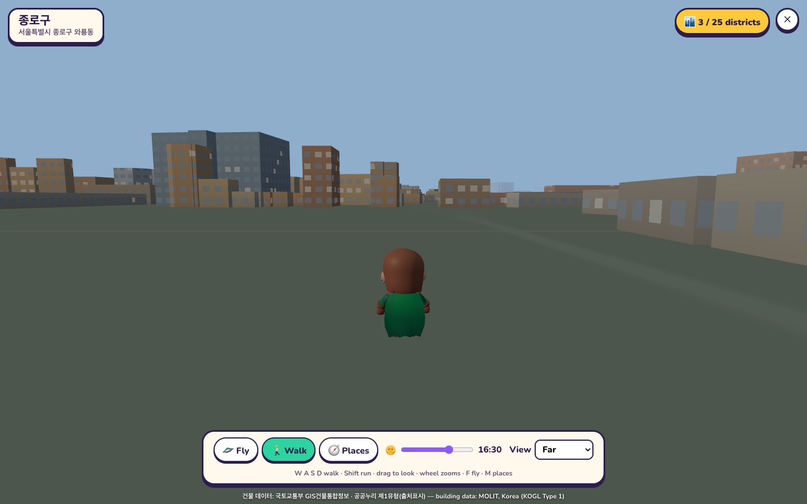

# Kickrani (Seoul, for real)

[← Back to the README](../README.md)

Fly over the real Seoul, or walk its streets: every building in the city — 684,317 of them — at its
true place and height, on the real land: **Namsan with its tower, Bukhansan, the Han and its
bridges**, and the main roads. Visit all 25 districts, jump to the tallest towers, and slide the
clock to see the windows light up at night.

  
  

  
  

  
  

## The data, and what you may do with it

The buildings come from **국토교통부 GIS건물통합정보** (the Ministry of Land, Infrastructure and
Transport's national building register, [data.go.kr 15083092](https://www.data.go.kr/data/15083092/fileData.do)),
the file for 서울특별시 (`AL_D010_11_<date>`). Its licence is **공공누리 제1유형 (KOGL type 1)**: free to use,
including commercially, **with attribution** — the game credits it in its Credits panel (the small
**ⓒ Credits** button in the corner of the city and the race menu, and on the pause screen).

- **Nothing from the register is in this repository.** You download the file yourself and convert
  it; the tiles live in `data/geo/seoul/tiles/` (git-ignored).
- The register says its values are "for reference". Heights are missing for about half the
  buildings (then the number of floors is used, at 3.3 m each; with neither, 4 m), and a height far
  too tall for its floor count is treated as a typing slip.
- **The land** is from the **Copernicus DEM GLO-30** (© DLR e.V. 2010–2014 and © Airbus Defence and
  Space GmbH 2014–2018, provided under COPERNICUS by the European Union and ESA; free to use with
  that credit). It is a model of the surface, so bumps narrower than a city block (buildings) are
  smoothed away and the hills kept. **Water is found from it**: where the model is low and
  perfectly level, it is the Han, a stream or a lake.
- **The main roads** (motorways down to tertiary roads; tunnels left out) are from **OpenStreetMap**
  (© OpenStreetMap contributors, [ODbL](https://www.openstreetmap.org/copyright)). Roads over water
  are lifted onto a deck: the bridges. Roads are as wide as their lanes (OpenStreetMap's lane count, 3.25 m a lane), with
  Korean markings — a double yellow in the middle of a two-way road, on the median side of a one-way carriageway —
  worn wheel tracks, zebra crossings and stop lines at junctions, granite kerbs, the slab's edge, and on bridges a
  deep girder and a concrete parapet. Each bridge ramps down to the roads it meets on the banks, and
  where a bridge comes in several pieces (as Yanghwa and Dongjak do) they meet level, so every Han
  crossing drives straight through. Smaller streets are simply the gaps between buildings.
- **N Seoul Tower** is in the register as a single point, so the game draws its own plain tower
  there, to the real height. No other building is modelled by hand.
- Heights only shape the ground: **no elevation figure and no coordinate is ever shown.** Parks,
  subway lines and small streets are not in the map yet.
- All three credits, with every model, texture and the music, are in the Credits panel (kept off
  the screen during a live race), and the map's sources in full in the Places panel too.

## Setting it up

1. Download the 서울특별시 file from the page above (it is about 1.4 GB unzipped) and put its
   `.shp`, `.dbf` and `.prj` in `library/Seoul_Map.zip/`, `library/` or `data/geo/seoul/`.
2. `npm run geo:seoul` — under a minute the first time. It downloads the land (two elevation tiles,
   about 80 MB) and the roads (about 20 MB) into `data/geo/seoul/src/` once, then writes 2,285
   building tiles (23 MB), `terrain.bin` (7 MB), `roads.bin` (1 MB) and an index. `--offline` skips
   the downloads; without them the ground is flat and there are no roads.
3. Open **Kickrani** from the home page (it opens on the race menu; close it to explore the city). Without the tiles, the game says how to install them.

For a newer register file, repeat both steps. On a deployed server the tiles go in
`DATA_DIR/geo/seoul/tiles/`; they are served at `/geo/seoul/*`.

## How it plays

- **Fly** (the start): **W A S D** to move, **Space / C** up and down, **Shift** fast, drag to look,
  the wheel changes height. The higher you are, the farther you see and the faster you go. You
  stay above the ground, hills included.
- **Walk** (**F**, or the button): you on the street as a real person — **Mina** or **Jun**
  (**V** or the 🧍 button switches) — walking, or running with **Shift**; the wheel zooms.
  Buildings are solid, you climb the hills you walk up, and you stand on the roads — walk onto a
  bridge from its end and you cross the river on it; from the bank you pass underneath. Cars are
  parked at the roadside near you; **E** beside one gets in.
- **Drive** (the button, or **E** by a car): **W** to go, **S** to brake and then reverse, **A D**
  to steer, **Shift** (or **Space**) for the handbrake (it slides the back round), **H** for the horn, **E** to
  get out. The camera swings round behind the car unless you look about with the mouse; the speed
  is shown in km/h. Buildings and other cars stop you — nothing is damaged and nobody is hurt.
- **The street around you**: traffic on the real roads (OpenStreetMap), keeping to the right,
  at each road's own pace, slowing for what is ahead and sounding its horn if held up long;
  people walking the pavements, stepping aside from a car. A map in the corner turns with you:
  roads, cars, people, and north.
- **Places** (**M**): the 25 districts and the 400 tallest named buildings, with a search; a click
  takes you there. Names and heights float over the tall buildings in view.
- **Districts visited** are counted (out of 25) and kept on your device.
- **Time of day**: a slider from midnight to midnight moves the sun, colours the sky, and lights a
  share of every building's windows after dark.
- **View**: near, far or farthest — how many tiles are kept around you (800 m to 2 km, more when
  flying high).

## Kickrani: the scooter race

**🚲 Race** (the button; the game opens on it) is an electric-scooter race for four riders through
Seoul's real streets — and the streets stay open.

- **Before the race** (`src/city/lobby.js` over `src/city/stage.js`, the way Snowpuff Peaks' menus
  work — its files only read): a little 3D stage, a round plaza on a rooftop with the city behind
  it, and four steps, with **Back** at every one. **Rider**: the seven riders on their scooters on a
  turntable that turns the one you choose to the front, where it waves, wiggles its ears or hops;
  its name, Korean name, nickname and a big **READY**. **Scooter**: the six scooters on plinths behind
  your rider, the chosen one lifted and turning and your rider hopping onto it, with five animated
  bars. **Course**: a real map of Seoul (`src/city/coursemap.js`), drawn from the game's own data
  with nothing downloaded for it — the Han, streams and lakes and the wooded hills from the land
  (`terrain.bin`, with a hill shade), every road from `roads.bin` (motorways and trunk roads bold,
  tertiary roads thin, bridges dark-edged over the river), and close up the small streets
  (`alleys.bin`) and the buildings' footprints (the map tiles); the 25 districts, the hills, and
  landmarks (N Seoul Tower, Gyeongbokgung, Lotte World Tower, the 63 Building, City Hall, COEX…).
  Every course is drawn at its true size on its real streets in its own colour (Easy greens and
  blues, Medium ambers, Hard reds), with a pin at its start. Over the map, three **level tabs** —
  Easy, Medium, Hard, with one to three chillies (↑ ↓ too): picking one lists its courses below,
  leaves only its courses bright on the map (the others faint, their pins gone) and flies to fit
  them. Medium opens once an Easy race has been finished, Hard once a Medium one has (kept in this
  browser, `src/city/progress.js`); a course still shut says so on its card, and its **Try anyway**
  races it all the same. Each course's card and chip show its best time here and a medal (gold,
  silver, bronze) for its best place. A course picked or pointed at draws itself in along its streets
  and flows the way it is raced; pointing at a landmark says what it is. Drag to pan, the wheel or a pinch (or + −) to zoom, ⌂ for all of Seoul; pointing at a pin
  or a course's line previews it (the card: its shape and a dot riding round it, its length, lap
  time, sharp turns, share of wide roads, short cuts and the run to the first corner); a click
  picks it, and pointing at one in the list below flies there too. The map flies smoothly to the
  course picked and shows its route: a chequered start and finish, arrows the way it runs, its short
  cuts dotted, its sharp turns ringed, a rider running round it, and its length and turns beside it.
  What stands still is drawn once into 256-pixel tiles per zoom level and kept (the land per pixel,
  then buildings and roads); only the courses, pins and names are drawn each frame. Laps 1–3. **Time and weather**: cards for day, golden hour,
  dusk, night and Random × clear, rain, storm, snow, fog and Random, each a little animated sky —
  and the stage behind changes with them, live (the sky, the light, the lamps and windows, rain,
  snow, fog, a wet floor). Then **Race three bots**, or make or join a room. Keys: **← →** to choose
  (on the last step ← → the time, ↑ ↓ the weather), **Enter** for the next step, **Esc** or
  **Backspace** to go back; click (or tap) a rider or a scooter on the stage, swipe it to browse.
  The results' **Race again** starts the same race at once; **Courses** goes back to the map.
- **The finish and the podium** (`_finishCheck`, `_ceremony` in `src/city/race.js`, `src/city/podium.js`):
  once the first rider is over the line the race stays open **30 seconds** for the others
  (`FINISH_WINDOW`) — it ends when everyone is home or the window closes, never early because the
  people are done; whoever is still out is DNF, placed by how far they got. Home, your scooter cools
  down — steered along the course, braking to a stop (the downhill's run-out at once) — while the
  seconds left show small under your time ("⏱ 0:24"), with a small **Skip ⏎** (Enter too; in a room
  only the host's, sent to everyone). Then the **podium**: the first three home in time — nobody who
  didn't finish — stand on blocks a little short of the finish line, facing back down the course
  under the finish banner, in the city as it is (the time of day and the weather carry on; the
  traffic and the riders who aren't up there out of sight): 1st in the middle and highest, 2nd on its
  left, 3rd on its right as you look at it, a big 1, 2, 3 on the blocks in gold, silver and bronze,
  their scooters parked beside on their kickstands. They celebrate, procedurally
  (`PlushRider.celebrate`, no clips): the winner jumps every other beat with its arms up and pumps its
  fists between, 2nd bounces and sways with a disco point, 3rd bounces and claps — squash on every
  landing, stretch in the air, ears and tails flopping, each in its own animal and colours. Confetti
  bursts from both ends and flutters down (one instanced draw), the victory fanfare plays and the
  podium's own track comes in; the camera swings slowly round and pushes in. Your own rider, up there,
  has a pulsing gold ring on its block and a soft beam of light on it (after dark a fill light over
  the podium). After 6.5 s — or on any key or click — the results come up, smaller and low, the
  podium still dancing above them; **Race again**, **Courses**, **Back to Seoul** and **Credits** as
  before, and each takes the podium down.
- **Courses, by level** (`LEVELS` in `src/city/course.js`; chillies on the map and the cards — one,
  two or three):
  - **Easy** — eight loops of 2–3 km (two to three minutes a lap) on Seoul's boulevards and avenues:
    Gwanghwamun Avenues, Dongdaemun Market, Namsan Hill Road, Hongdae Boulevards, Yeouido Riverside,
    Cheongnyangni Market, Teheran-ro Towers, Jamsil Tower Loop.
  - **Medium** — narrower avenues and a little of the residential lanes, 6–10 corners over 60°, a
    climb, a short cut or two, more traffic: Seochon Palace Lanes (under Inwangsan, two golmok short
    cuts), Seongsu Brick Works (the red-brick factory grid), and the **Jamsil Fairground** — round
    Seokchon Lake under Lotte World Tower, past the "Starlight Fun Fair · 별빛 놀이공원", a fair of our
    own (`src/city/fairground.js`, every ride our own design, no real park's castle, mascot or name):
    a wooden roller coaster on timber bents with a train of four cars (slow up the chain, fast down
    the drops), a 52 m drop tower whose ring of seats climbs, hangs and drops, a big wheel with sixteen
    gondolas kept level, a carousel with horses rising and falling, a pirate ship swinging higher and
    higher, bunting and strings of bulbs; the rides move when you are near, light up after dark, and
    you hear the fair as you pass (a band organ's waltz, the coaster's chain, screams on the drops).
    A fence along the course (solid) with an arch at the gate.
  - **Hard** — tight two-lane streets and residential lanes, square corners to drift, hills, golmok
    short cuts, parked cars, the busiest oncoming traffic, the sharpest bots: Euljiro Print Alleys,
    Mullae Ironworks, Haebangchon Hill Lanes (90 m up and down), and the **Namsan Tower Downhill** — a
    point-to-point run: a race gantry with start lights on the plaza under N Seoul Tower, then down
    Namsan's park road (two lanes, a double yellow line, steel guard rails either side — solid — and a
    wood of pines and November-coloured broadleaf trees, `src/city/hillwood.js`) and Sowol-ro to a
    finish gantry in the city below, about 145 m lower; speed builds downhill, so the braking points
    matter. One run, no laps; past the finish line a run-out to stop in.

  The level sets more than the streets: the bots' skill, how many cars are about and coming the other
  way, how many cars are parked at the kerb, and the item odds (a little more of the back-markers'
  branches, marbles and tailwinds on the harder ones). Each course is planned on the spot from the
  real road network and between the real buildings (`src/city/course.js`, `src/city/walls.js`):
  three or four points round the place, each on the nearest road with two or more lanes each way,
  joined by the best way for a racer — a search over the streets' directed edges where wide roads
  are cheap, every turn at a junction costs (a straight run through a crossroads nothing, a 90°
  corner a long way round), never a motorway, never a residential lane or an alley (they are for
  the short cuts), one-way roads only with their traffic, never out along one carriageway and back
  down the other; of all the loops tried, the one that best keeps to the wide roads with the
  fewest sharp corners, the longest straights and a long run from the start. That is the Easy
  planner; Medium and Hard plan with costs of their own (`PROFILE`): the wide roads no longer
  cheaper, the turns cheaper (so the loop takes more of them), the residential lanes open (a little
  for Medium, freely for Hard), and loops scored on the corners and the narrow streets they want. A
  course with its own points (`via`: the fairground's lake loop, the downhill) is joined through them
  in order; `open` makes it point to point — its start line a grid's length in (`OPEN_LEAD`), its
  finish a run-out short of its end (`OPEN_RUNOUT`), its `length` the race from line to line.
  `node scripts/geo/jarani-courses.mjs` measures them (level, length, share on roads two lanes or
  more each way, on small streets, turns sharper than 60° and 80°, the longest straight, the first
  corner, short cuts, metres climbed and dropped and the steepest 30 m; `--level hard` for one level);
  `tests/unit/course.test.mjs` keeps each level so. Measured (Nov 2026):

  | level | course | km | wide | turns >60° / >80° | first corner | short cuts | climb | crashes a lap (you on the autopilot / a bot) |
  |---|---|---|---|---|---|---|---|---|
  | Easy | the eight boulevard loops | 1.95–2.58 | 76–100% (Namsan 14%) | 1–4 / 1–3 | 286–883 m | 0–1 | 7–73 m | 0–2 / 0–1.7 |
  | Medium | Seochon Palace Lanes | 2.74 | 64% | 7 / 5 | 210 m | 2 | 17 m | 1–5 / 1.7–3.3 |
  | Medium | Seongsu Brick Works | 2.74 | 36% | 9 / 7 | 215 m | 0 | 9 m | 1–3 / 1.6–2 |
  | Medium | Jamsil Fairground | 2.58 | 73% | 7 / 5 | 684 m | 1 | 15 m | 2–3 / 1.4–1.7 |
  | Hard | Euljiro Print Alleys | 1.78 | 10% | 17 / 10 | 191 m | 0 | 9 m | 1.3 / 0.9 |
  | Hard | Mullae Ironworks | 2.49 | 8% | 11 / 9 | 161 m | 1 | 8 m | 1.4 / 1.4 |
  | Hard | Haebangchon Hill Lanes | 2.78 | 17% | 9 / 7 | 512 m | 0 | 90 m | 0 / 1.7 |
  | Hard | Namsan Tower Downhill (A→B) | 2.12 | 37% | 1 / 1 (and the park road's bends) | 486 m | 0 | 145 m down | 2.2 / 0.7 |

  (Crashes counted without the items' — branches, marbles. On the Hard loops the bots are often
  put back on the course after getting nowhere in a tight corner: they are slow there, not unfair.)
  **Short cuts**: the narrowest golmok that leave the
  loop and join it again further on, shorter than the road round (15–230 m saved) — tight walls and
  a tight turn in, so a bold rider gains and a careless one bounces. Each has a "SHORTCUT · 지름길"
  sign at its mouth, a cyan hint at the top of the screen as you come up to it, a dotted line on
  the map and cyan arrows down it; its metres count as the course's it cuts out, so the order stays
  fair; bots take them now and then (the better ones more); no one walks or drives down them.
  Dongdaemun, Hongdae, Teheran-ro and Jamsil have one; round the other boulevards no golmok rejoins
  the loop going its way, so none. The
  small streets (residential lanes, alleys, market lanes) come from OpenStreetMap round the courses
  (and the first courses' golmok neighbourhoods) only: `scripts/geo/seoul-alleys.mjs` writes
  `alleys.bin` beside `roads.bin` (`npm run geo:alleys`; `npm run geo:seoul` runs it too), a box at
  a time. Without it there are no short cuts.
- **Riders**: Snowpuff Peaks' plush animals on electric hire scooters — Mallow the bunny, Pip the
  fox, Mochi the cat, Toffee the bear, Peaches the pig, Pickle the frog and Pebble the penguin
  (girls and boys both; the bots always mix them). The same sculpted toys as Snowpuff's
  (`src/city/plushRider.js`: the recipes copied, Snowpuff's files never edited), dressed for
  WebGL2 (`src/city/plush.js`): sheen, fibre noise, a fresnel rim that dims at night, shell fur in
  one instanced draw with fewer shells further off. Knees bent on the deck, leaning into turns,
  crouching for a boost, ears and tails on springs, arms up at the finish, a tumble with dizzy stars
  and back up. Each has a nickname ("The Bounce", "Corner Queen"…) and a feel of their own that
  rides on any scooter. **Scooters**: six models of our own brand, "SSAENG 쌩쌩" (`src/city/scooter.js`,
  each its own shape, in the rider's colours; handling in `scoot.js` SCOOTERS): the **S1 Commuter**
  (the hire scooter: balanced), the **R7 Comet** (low and long, small hard wheels, a raked stem, a
  tail fin: the fastest, a handful in the corners and on rough ground), the **X4 Mudlark** (fat
  knobbly air tyres and coil springs: soaks up everything, slower), the **K2 Sparrow** (skinny and
  light: first off the line and the quickest to flick through traffic, short of top speed), the
  **G9 Grand** (wide, long, twin stem, chrome, a big lamp: fast on the boulevards, poor in corners)
  and the **Mini Bubblegum** (pastel retro with a leg shield, whitewall tyres and a basket: nimble,
  kind on bumps, the longest battery). Bars for top speed, acceleration, cornering, shock absorption
  and battery; more top speed always costs cornering and shock absorption. All of them: grip tape,
  folding stem, throttle and brake levers, a live speed and battery display, LED head and brake
  lights, a kickstand. Bots ride a mix of them; in a room everyone's pick goes to the others. Riders bump and wobble off each other and never
  pass through (`src/city/pack.js`); bots keep their own lines on the road side of the street,
  overtake round the middle, and start from a staggered grid.
- **Riding** (`src/city/scoot.js`, pure and tested): **W** throttle — a racing motor, 70 km/h in
  about four and a half seconds — **S** brake (about 20 m from 70 on a dry road, longer in the wet,
  and braking hard in a lean on a wet road, or leaning hard fast, slides the back out), **A D** lean
  (quick to lean in — a left-right flick weaves through traffic — and steady at 70; turn radius at
  full lean about 4 m at 30 km/h, 11 m at 50, 25 m at 70, so most corners take no brakes and no
  drift), **Shift** drift (held while leaning: the back steps out, the
  scooter swings round faster than a lean turns it, an assist holds the slide, a little speed is
  scrubbed off — round a 90° junction at speed in about 12 m instead of 35; let go to straighten;
  tyre squeal, rubber scuffs on the road, the rider hanging out; bots drift the tight corners too),
  **F** boost to ~85 km/h while the battery gauge lasts (it
  charges as you ride, faster in a slipstream and with every close call), **Space** the bell (a
  synthesised two-strike "ring-ring", `src/city/bell.js`; **B** too: people ahead step aside, slower
  riders and scooters give you room, and you hear the bots' bells where they are), **R** back on the
  course (and after a few seconds lost well off it, you are put back). Small wheels feel every
  paving joint, and the roads have steel road plates, manhole covers and, on the narrower ones,
  speed bumps in the racing line; a kerb met at an angle is a hop up, met glancing it scrapes and
  wobbles you. How much of it reaches you is the scooter's suspension: on the stiff R7 a plate
  shakes the camera and the rider, costs speed and knocks your line; on the X4 you hardly notice. Speed
  shows: the FOV opens (58° → ~71°, more on a boost), a fine buzz in the camera, wind lines in the air
  and at the screen's edge, the wind's roar (`src/city/speedfx.js`).
- **Traffic** (`src/city/traffic.js`, `src/city/fleet.js`): real models (Sketchfab, CC BY 4.0, from
  the Objaverse mirror) — everyday saloons, hatchbacks, people carriers, small SUVs, compacts and
  estates in Seoul's whites, silvers, greys and blacks, taxis with our own roof sign, one-tonne box
  trucks, city buses in route blue and green — with glass, turning wheels, headlights at night and in
  the rain, brake lights and blinking indicators; delivery scooters too, also down the small streets.
  They keep their own side, cross at the junctions, blink before turning, brake (late, for a
  scooter), honk when held up. The course's own roads are kept busy the other way: cars, taxis,
  buses and delivery scooters sent up the road ahead of you on the far side of a two-way road, or
  down the other carriageway of a divided one — nine of them on an Easy course, twelve on Medium,
  fifteen on Hard — in their own lane (and on a two-way residential lane the riders keep to their own
  side of it too, out over the middle only to pass). On Medium and Hard, cars stand parked at the
  kerb (four and eight a kilometre), never in the 60 m before a corner nor just after it. At night
  every headlight and tail light glows, near and far (one draw for all of them). Everyone on the street is real (`src/city/folk.js`: Microsoft
  Rocketbox avatars, MIT) — walking, waiting in groups at the crossings, at shop doors, texting,
  looking about, cheering at the start — and nobody faceless is drawn: further off the pavement is
  simply quieter (`src/city/life.js`). In a race people gather ahead of the riders, and in the small
  streets they keep to the edges. A delivery scooter near you has a real rider sat on it; far off,
  none is drawn. In the rain (`src/city/wetfx.js`) every light is smeared
  down the wet road, puddles mirror the sky, the rain glints where it crosses a light and wheels
  throw spray.
  Buildings and the alleys' garden walls are solid (`src/city/walls.js`): each rider is a circle
  swept against every wall near the course, in 1/120 s steps, so nothing is ridden through at any
  speed or frame rate; a rider somehow found inside one (a spawn, a friend's position over the
  network) is put out the nearest way, and the chase camera is swept out from the rider against the
  same walls (in close and up instead of through them). At junctions cars waiting to cross the
  course give way to riders coming through, waiting clear of the course's carriageway (half its width and
  a car's length back from the middle of the junction, not in the racing line).
  Roll gently into a car (one stopped at the lights, one you drew level with) and it's a bump and a
  shove; hit any of it square and fast — a car, a wall head-on above ~38 km/h, a planter, a bin, a parked scooter —
  and you're off: a hit-stop, "BONK!", a tumble, dizzy stars, back on 1.5 s later. Met at a slant
  (a wall, a car's flank, the edge of a bin, a pole) it is only a scrape: turned along it, slowed,
  still riding. Pass close at speed for a "WHOOSH!" and a top-up of boost.
- **Items** (`src/city/items.js`): ride through the bouncing "?" boxes (rows across the street every
  ~220 m) to fill three slots; use them with **1 2 3**. **Energy drink**: a can crack and two gulps,
  your rider drinks, and three seconds of boost at once without pressing F (70 → 86 km/h, the FOV
  kicking out, speed lines, a green glow trail behind the scooter — about ten metres gained, worth
  having, not a win), the gauge visibly filling up again, "GULP! +BOOST". (Before, it only set the
  gauge full, silently: holding W, 70 km/h before and after.) **Call the police · 경찰 호출** (`src/city/police.js`,
  the air horn's place): a patrol officer of our own design — a white police scooter with a blue
  stripe and "POLICE 경찰" on its side, a red-and-blue light bar, a hi-vis vest and a peaked cap, no
  real force's crest — rides up beside the nearest rider ahead of you (if you lead, the one behind),
  lights flashing, a short synthesised siren whoop, a "PULL OVER!" pop, and pulls them over: hauled to
  a stop and held for 1.5 s with a wobble, then let go as the patrol rides off ahead. The gold helmet
  doesn't help (it takes crashes, and this isn't one), and a rider down a short cut can still be
  caught. Bots call it on whoever is ahead — at a person only half the time, as with the branch.
  Commoner further back (6 % of boxes leading, 18 % last). **Gold helmet** (`src/city/helmet.js`): a shiny gold helmet on your rider's
  head, fitted to each species' head (the ears poke out) — a rounded cycling helmet,
  longer to the back, with vent slots, a darker band and rim, a foam liner, a short peak and a chin
  strap (just the helmet: no glow round the rider) — and a badge on the HUD; the next crash (a car, a
  wall, a branch, a fall on marbles)
  bounces off — "BLOCKED!" and "PING!", a ding, and the helmet flies off, spinning. Everyone's
  helmets show, bots' and friends' too. **Tailwind** (five seconds of free, faster sprinting).
  **Marbles** (`src/city/marbles.js`): poured out behind you, 48 glass marbles with coloured swirls
  bounce, scatter and roll, then lie in a patch for about 13 s — always inside the street they were
  poured in (never onto a pavement or through a wall; in a golmok narrower than 5.5 m only across
  the half you were riding, so a short cut is never shut). A rider whose wheels cross them slips:
  the grip goes, the scooter wobbles and slides and loses speed; faster than about 50 km/h, or
  steering hard above about 30, they fall (the tumble with dizzy stars, "WHOA!" "SLIP!", a glassy
  rattle). Slow down and ride straight and you get through with a wobble. The golden helmet takes
  the fall, not the slip; ridden through, marbles scatter. Bots pour them when someone is right
  behind, and steer round the patches they see (the sharper ones see more) or brake to a crawl
  across them. In a room the pourer's browser sends the pour's seed and everyone rolls the same
  patch. And the branch (`src/city/branch.js`: a leafy
  plane-tree branch grown in code — with a rival ahead in reach it is thrown after a wind-up, in an
  arc, aimed where their front wheel will be; with nobody ahead it is dropped behind you as a trap
  for 22 s. A front wheel that catches it stops dead: "CRACK!", over the bars, dizzy stars, back up
  1.5 s later, and three seconds no branch can catch you. The gold helmet takes it.) The further
  back you are, the better the odds (more tailwinds, branches and marbles). Bots use them too; in a room
  throws and pours are sent to everyone and whoever's browser rides the rider caught decides the catch.
- **The alleys** (`src/city/golmok.js`): along the course and down its short cuts, built as you come
  near: the small streets' concrete and asphalt at road level, joined to the road where they meet
  one — the road's pavement is a dropped kerb across the alley's mouth (flush with the road, ramping
  up either side), the alley's surface starts at the pavement's edge at its height, round a bend the
  corner is filled, and the ground the riders stand on (`surfaceAt`) knows the pavements (the race's
  `junctionReport()` samples every mouth for holes, steps and doubled surfaces);
  a narrow raised pavement down a residential lane,
  garden walls and gates, air-conditioner units and gas meters, concrete poles with wires
  overhead, convex mirrors at blind corners, vertical shop signs lit at night, awnings, styrofoam
  planters, pots, bins, parked scooters, steps, alley lamps with pools of light. What stands in the
  street is fair at 70 km/h: only in lanes 5 m or wider, tight to the wall, never in the 40 m before a
  corner or just after it, each with a reflective yellow-and-black band. Every sharp corner has a
  chevron board across the end of its approach, and anything in your line ahead gets a warning at
  the top of the screen ("⚠ BINS · ⬅ KEEP LEFT 60 m").
- **Buildings beside the course** (`src/city/facades.js` and the city shader): window frames and
  sills on the shader's own grid, balconies and rails on flats and villas, shopfronts and striped
  awnings, downpipes, roof tanks and units; close up the walls are brick, tile or render, glass has
  rooms behind it (interior mapping: ceilings, lights, partitions — lit or dark at night), and
  half the glass towers have white aluminium fins.
- **Fog** (`src/city/weather.js` `FOG_BANK`, `src/city/mist.js`): a real fog bank — the street, the
  buildings, the traffic and the people mostly gone by 10–20 m (the scene's fog from 2 m to 24 m,
  whatever the view distance; before, the haze factor only scaled the far plane, and 0.22 of 2.4 km
  left 500 m of clear air, so Fog looked like Clear), grey-white by day, a deep blue-grey after dark;
  the sky dome and the background fade into it. Headlights and tail lights glow through it as wide
  soft halos, on by day in fog too, so a car's lights show before its body does; after dark every
  street lamp near you is a halo in it (one draw each). Low mist sheets drift over the road round the
  camera (three thin discs, patchy noise, thinning by the camera). Fog is the street's weather, not
  the characters': the riders, their scooters and helmets opt out of it (`noFog` in
  `plushRider.js`), and the mist is cut out round them, so a rival 20–40 m ahead stays a crisp plush
  toy (in the rival panel too, and on the podium); the corners ahead are on the turn arrows and the
  map. Rain, snow and the storm are as they were.
- **Time and weather**: every race has its own — day, golden hour, dusk or night; clear, rain,
  storm, fog, or snow in the cold months — random by default, or picked (and previewed) in the menu. The city
  clock stops for the race. Rain darkens and shines the roads and makes braking longer; snow is
  slipperier still.
- **Alone**: you against three bots. **Together**: one player makes a room and gives the
  five-letter code; up to three others join and pick their riders and scooters (everyone sees the picks); the
  host picks the course, laps, time and weather and starts. Bots take any empty seats (the host's
  browser rides them). Each browser sends where its riders are fifteen times a second, and when
  an item is used.
- **On screen**: the map at the top left (`src/city/minimap.js`) — the real streets round you, every
  small street, the buildings faintly, the river where it is near, the course ahead bright, short
  cuts dotted, item boxes, marble patches and branches in the road, the traffic, and every rider as
  a dot in their colour (ringed gold in a helmet) — turns smoothly with you, or keeps north up: click
  it (remembered). It is drawn once per race and laid out about twelve times a second. When a rival
  comes up behind you or draws level to pass, a small manga-style square slides in on the left
  (`src/city/rivalPanel.js`, Snowpuff's rival panel, `src/snowpuff/sideMirror.js`, only read): one
  still picture of them, snapped from just in front looking back at their face, in a tilted ink frame
  with speed lines and a halftone edge — no name, no distance, no text. One small render when the
  rider changes, at most once a second, read back to a 2D canvas; all its motion is CSS; it is
  rendered once while the lights count down so nothing hitches. Your place beside the map; the lap top right with the order under it; the time and the
  three item slots bottom centre; speed and the sprint gauge bottom right; the next turn named at
  the top ("SHARP RIGHT · ALLEY 30 m"), a warning under it for anything in your line; the keys while
  the lights count down; speed lines from about 55 km/h. Left-drag looks round.
- **The blinking box** (a square flicking in and out at the left of the middle of the screen): the
  rival panel's still was taken from wherever 3 m in front of the rival happened to be — often inside
  a bus, a wall or a tree — so it slid in as a flat green or grey square, in and out as the pack
  jostled (caught by recording a careless race frame by frame and measuring every still). Now the
  still is taken from a spot clear of walls, cars and street props (`_panelSpot`), with only the rider
  and the street drawn (`_panelIsolate`), a flat still is never shown (`stillIsGood`), and the panel
  only slides in with a good picture, stays at least 1.8 s, rests 2.5 s before coming back, and not
  in the first 4 s of a race. WRONG WAY, a box at the same place, is judged by the way you are going
  against the course a few points ahead, held 1.5 s, never while drifting, tumbling or just put back
  (`wrongWay` in `src/city/ride.js`), and shown steadily, not flashed frame by frame. A rival put back
  on the course right by the camera is faded from where the camera is that frame, so it never pops in
  whole for one frame. The end-to-end run watches the middle of the screen while riding.
- **The dark slab** (a black rectangle behind a slipping rider's dust, round a "WHOA!"): the race's
  comic sprites now never draw their clear texels at all (`alphaTest`), and the ambient occlusion
  pass (`src/city/aopass.js`) leaves sprites and see-through, depth-less meshes (puffs, glows, painted
  arrows) out of the normals it shades by, so none can shade the road as a solid card; the end-to-end
  run reads a frame back round a cloud of dust and a word burst with AO on and finds no dark card.
- `src/city/race.js` runs the race; `src/city/course.js` plans the courses (tested in
  `tests/unit/course.test.mjs`); `src/city/lobby.js` and `src/city/stage.js` are the menus and their
  stage (drawn instead of the city while they are up, so they stay smooth); the room goes over the
  party server (`/ws`).

## On the street: how it is built

- `src/city/street.js` — walking, getting in and out, driving, traffic, people walking, the map
  in the corner and the engine's sound; `SeoulGame` hands over walking and driving and asks it for
  the camera.
- `src/city/drive.js` — the car's handling (engine, brakes, steering that tightens at low speed,
  skids) and going along a road, as plain numbers; tested in `tests/unit/drive.test.mjs`.
- `src/city/cars.js` — the Car Concept model in many paints, its glass made plain, its logos left
  out, our own number plates, wheels that steer and roll, lights at night, a light stand-in far away.
- `SeoulGame.js` — the city itself: asphalt roads with lane lines (dashed between lanes, double
  yellow down the middle), raised pavements of grey block paving with street trees (`trees.js`:
  ginkgos and plane trees grown in code — real branches, leaf cards, bark, cast-iron grates;
  gold and tan in autumn, green in summer) and street lamps that light the street after dark
  (`nightlights.js`); a light from each lit shop window across the pavement; buildings drawn by what they are — glass towers
  (each its own tint) for offices, white blocks with window bands and balcony rails for apartments,
  shopfronts at street level with a row of shop signs above (pharmacy, convenience store, café,
  hair salon…) that glow at night.
- `src/city/people.js` — Mina and Jun. Neither file has a walk, so they borrow the soldier's
  (idle, walk, run): each bone's turn from rest is copied across, in each skeleton's own frame.

The models come from the asset library (`extras`, fetched by `npm run dev` and `npm run build`);
see [third-party](third-party.md) for their licences.

## How it works

- **The converter** (`scripts/geo/seoul-build.mjs`) reads the shapefile and its table side by side,
  keeps each building's largest ring, thins its points (to within 0.4 m), works out a height and a
  broad use, and files it under the 500 m tile its centre is in. It also writes the districts'
  centres and the tallest named buildings.
- **A tile** (`src/city/tiles.js`) is a small binary file: per building a footprint in decimetres
  from the tile's corner, a height and a use, then the names. The same code writes and reads it.
- **The game** (`src/city/SeoulGame.js`) loads the tiles around you nearest first, builds one mesh
  per tile (walls, flat roofs, a colour by use), and drops tiles you leave behind. Windows are drawn
  by the shader from each wall's length and height, so no textures are downloaded.
- **The land** (`scripts/geo/seoul-extras.mjs`): the elevation tiles are read with a small reader of
  our own (`tiff.mjs`), sampled onto a 25 m grid in the register's projection (`tm.mjs`), cleaned
  of buildings and written with a water mask. The game draws the ground of every tile in view —
  town, wooded hillside, bare rock, water — stands each building on it, and lays the roads over it
  as ribbons.
- The world is the register's own grid in metres (EPSG:5186), moved so that City Hall is the origin.
- **Tests**: `tests/unit/city.test.mjs` (the tile format, point thinning, heights and uses, and the
  projection there and back).

## Next

- Parks, small streets and subway lines; water that looks like water; trees on the hills.
- Subway lines to ride between districts; quests ("find the three tallest towers in Gangnam").
- Other players in the same city.
