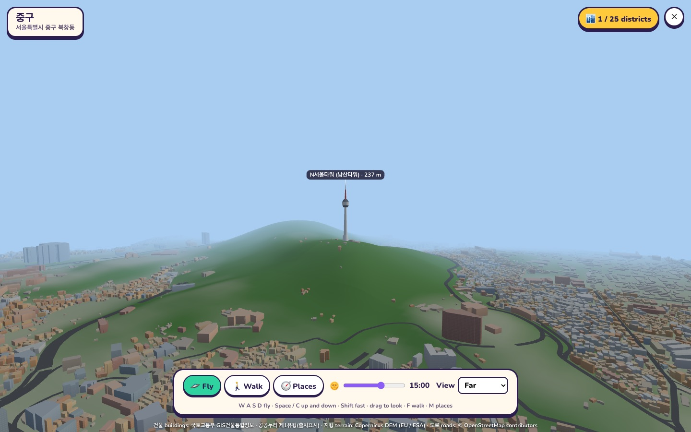

# Kickrani (Seoul, for real)

[← Back to the README](../README.md)

Fly over the real Seoul, or walk its streets: every building in the city — 684,317 of them — at its
true place and height, on the real land: **Namsan with its tower, Bukhansan, the Han and its
bridges**, and the main roads. Visit all 25 districts, jump to the tallest towers, and slide the
clock to see the windows light up at night.

  
  

  
  

  
  

## The data, and what you may do with it

The buildings come from **국토교통부 GIS건물통합정보** (the Ministry of Land, Infrastructure and
Transport's national building register, [data.go.kr 15083092](https://www.data.go.kr/data/15083092/fileData.do)),
the file for 서울특별시 (`AL_D010_11_<date>`). Its licence is **공공누리 제1유형 (KOGL type 1)**: free to use,
including commercially, **with attribution** — the game credits it in its Credits panel (the small
**ⓒ Credits** button in the corner of the city and the race menu, and on the pause screen).

- **Nothing from the register is in this repository.** You download the file yourself and convert
  it; the tiles live in `data/geo/seoul/tiles/` (git-ignored).
- The register says its values are "for reference". Heights are missing for about half the
  buildings (then the number of floors is used, at 3.3 m each; with neither, 4 m), and a height far
  too tall for its floor count is treated as a typing slip.
- **The land** is from the **Copernicus DEM GLO-30** (© DLR e.V. 2010–2014 and © Airbus Defence and
  Space GmbH 2014–2018, provided under COPERNICUS by the European Union and ESA; free to use with
  that credit). It is a model of the surface, so bumps narrower than a city block (buildings) are
  smoothed away and the hills kept. **Water is found from it**: where the model is low and
  perfectly level, it is the Han, a stream or a lake.
- **The main roads** (motorways down to tertiary roads; tunnels left out) are from **OpenStreetMap**
  (© OpenStreetMap contributors, [ODbL](https://www.openstreetmap.org/copyright)). Roads over water
  are lifted onto a deck: the bridges. Roads are as wide as their lanes (OpenStreetMap's lane count, 3.25 m a lane), with
  Korean markings — a double yellow in the middle of a two-way road, on the median side of a one-way carriageway —
  worn wheel tracks, zebra crossings and stop lines at junctions, granite kerbs, the slab's edge, and on bridges a
  deep girder and a concrete parapet. **The lines stop where roads cross** (`src/city/markings.js`): along each
  road, where its middle and each edge line lie inside another road (one going on through there — not the far
  side of a T, where the road running on keeps its centre line and far edge) or under a wider road lying along
  it (a slip road, a street mapped twice), its paint is left out; a junction's middle is one plain asphalt
  whichever road draws it (a hair behind, so the road keeping its lines shows — no two roads' lines fighting
  into yellow dashes), and the zebras and stop lines sit back from its edge, not its middle. A two-way street
  under 5.5 m has no line down its middle, one under 4 m none (around Haebangchon: 268 m of centre line and
  584 m of edge line that lay inside other roads → 0; `tests/unit/city-markings.test.mjs`). Each bridge ramps down to the roads it meets on the banks (level
  across the road it meets and its pavements, then climbing), and
  where a bridge comes in several pieces (as Yanghwa and Dongjak do) they meet level, so every Han
  crossing drives straight through. Smaller streets are simply the gaps between buildings.
  Off the decks a road lies on the ground edge by edge (a point every 10 m, each edge and the middle
  line at the ground's height there), not level across at its middle's height: where roads cross on a
  hill they are one surface, not a ledge as tall as the crossing road's width times the slope (up to
  1.8 m on Haebangchon's). A pavement is cut where it meets another road, so it never lies across a
  crossing and a junction's corners aren't left as holes. The surface the riders stand on is
  `src/city/surface.js` (`surfaceOf`, tested in `tests/unit/city-surface.test.mjs`).
- **The landmarks** (`src/city/skyline.js`, `SKYLINE`), drawn by hand, low-poly, at their real place and
  height (world metres from the register's own points and blocks, or converted from their longitude and
  latitude), so riders know where they are. No company name, logo or lighting on any of them.
  - **Namsan Tower** (남산타워) on Namsan's summit, 236.7 m — the register has it only as a point: a
    white shaft from its round plaza building, the glass observation drum (lit after dark), its roof,
    the mast banded red and white with a red light at the tip.
  - The **Jamsil Sky Tower** (our name for the 555 m tower by Seokchon Lake, which the register leaves
    out — a square tapering and curving in to a split crown, silver-white glass) and the **63 Building**
    (in the register as one 250 m slab over its whole plot: drawn instead as its gold glass tower stepping
    in at both ends, on a low podium; the slab left out of its tile, `SKYLINE_SKIP`).
  - **Gyeongbokgung** (경복궁): the Gwanghwamun gate (its granite base with three arches, the
    two-storey pavilion on top) and Geunjeongjeon, the throne hall, on its two-tier stone terrace, up the
    palace's axis — hanok roofs of grey tiles (a texture of round-backed tile rows) on a concave slope,
    their corners swept up (`hanokRoof`), the eaves' undersides painted green, red, blue and gold
    (dancheong: the same surface's back faces), white mortar under a dark ridge with upturned ends; round
    red columns, lattice doors, painted beams; the gate's coursed granite base with three arched gateways
    in lighter frames and a parapet; the hall's two-tier terrace with stone balustrades and steps; where
    the register has only their 4–20 m blocks (left out of their tiles by place, `skipAt`). **Cheong Wa
    Dae** (청와대), not in the register: its main hall — two storeys of white walls and tall windows behind
    pale pillars on a granite terrace — under the great roof of blue tiles, half its height, a lower wing
    either side joined by a short corridor, at the foot of Bugaksan. The palace, Cheong Wa Dae and the
    statues cast and take the sun's shadows, and are lit warm after dark.
  - **Admiral Yi Sun-sin** (이순신 장군 동상) on Gwanghwamun Square, west of Sejong-daero's
    carriageways: the sculpture the project's owner supplied (`Yi_Sun-sin_fixed.stl`, 83,842 triangles,
    packed by `scripts/models/statue-pack.mjs` into `public/models/landmarks/yi-sun-sin.bin`, 1.3 MB,
    loaded by `src/city/yiStatue.js`), gilded — polished gold (physical material, metalness 0.92,
    roughness 0.3), glowing softly from below after dark. (Before it, `src/city/admiral.js`'s hand-built
    figure, described here:) feet together on a dark bronze
    slab, his right hand holding the long sheathed sword upright at his side (tip on the slab, the round
    guard and hilt at his shoulder, a cord hanging), the left hand on his hip, a rounded helmet with a
    small trident finial and a long neck guard to the shoulders, moustache and beard, layered shoulder
    guards, a breastplate with a round emblem, a wide belt and buckle plate, the long coat and its apron
    panels in fish-scale lamellar (a texture and its bump) with banded edges; dark greenish-brown bronze
    (physical material, metalness 0.6, roughness 0.45, a soft sheen), lit softly from below after dark;
    6.5 m on his pale granite plinth (17 m in all) with the inscription down its face (忠武公李舜臣將軍像)
    and a bronze turtle ship on a low base before it; King Sejong seated, gilded, behind him. In front,
    down the square's middle, **the fountain** (`src/city/fountain.js`, our own take): a 42 m shallow
    pool, a field of thin jets and a taller row along each edge rising and falling in waves; after dark
    lit from below in slowly shifting cyan, blue and teal (one edge row pink), the wet stone glowing, a
    strip of small green, red and white lights set in the paving along both sides (bloomed); by day
    plain water. Cheap: every jet an instance of a thin open cone drawn additively by a small shader,
    heights and colours set 20 times a second and only within 900 m. (An image-to-3D generation of the
    statue with TRELLIS.2 was tried on the Mac Studio: its decoder gave an empty mesh there twice, so the
    sculpt stands.)
  - **The hills under them**: Namsan, and Bugaksan behind the palace, drawn from the land's own heights
    (every 40 m, sunk 4 m under the real land, which wins wherever its tiles are loaded) — so from
    beyond the draw distance the tower stands on its hill, not in the air, and Bugaksan rises behind
    the gate from Gwanghwamun Square.

  The tall three (and their hills) are always on the skyline, from 12–16 km: past the camera's far plane
  each is drawn as a smaller copy on the same line of sight; ordinary haze greys them to a pale
  silhouette (never gone), a fog bank hides them like everything else, after dark their windows light
  and the tips glow. The palace, Cheong Wa Dae and the statues are seen from the streets round them
  (within 1.6–2.6 km), in the scene's own fog like their neighbours, warm-lit after dark.
  **From the race camera**: the chase view's top edge is only 10–15° over the horizon, so a tall
  landmark a kilometre off was over the top of the picture, and the buildings along a street hide
  anything not near its line. So on a straight (the course turning less than 0.3 rad in the next 50 m,
  not on a short cut) the view **tilts up** toward a tall landmark ahead — up to 0.2 rad, just enough to
  bring its upper part inside the top of the frame (`landmarkLookUp`), eased in over a second or two and
  back down before a corner; the camera itself doesn't move (no zoom, the same wall handling) — and the
  new **landmark runs** below are laid out down the streets that point at one.
  `node scripts/geo/jarani-views.mjs` measures it per course (the course ridden every 8 m with the chase
  camera and its tilt, eight points up each landmark, the register's buildings at their heights and the
  land within the draw distance in the way): measured Nov 2026, the share of a lap a landmark is in
  view — Gyeongbokgung Figure Eight: the palace 28 %, Cheong Wa Dae 23 %, Namsan Tower 18 %, the admiral 10 %;
  Noryangjin 63 View: the 63 Building 32 %; Songpa Sky Lanes: the Sky Tower 13 % (3 % from the Sky
  Tower's own lanes, 11 % round the Fairground); Gwanghwamun Heritage Run: the admiral 26 %, the palace
  20 %; Inwangsan and Samcheong: Namsan Tower 58–59 %; Haebangchon: Namsan Tower 17 % (3 % before the tilt).
  **On the race map** (`minimap.js`): a small sign for each — a tower, the gold 63, a hanok roof (blue for
  Cheong Wa Dae), a statue — where it stands, or on the map's rim the way it lies (the tall ones from
  9 km, the rest from 1.6–2.6 km). No words, no pop-ups.
- Heights only shape the ground: **no elevation figure and no coordinate is ever shown.** Parks,
  subway lines and small streets are not in the map yet.
- All three credits, with every model, texture and the music, are in the Credits panel (kept off
  the screen during a live race), and the map's sources in full in the Places panel too.

## Setting it up

1. Download the 서울특별시 file from the page above (it is about 1.4 GB unzipped) and put its
   `.shp`, `.dbf` and `.prj` in `library/Seoul_Map.zip/`, `library/` or `data/geo/seoul/`.
2. `npm run geo:seoul` — under a minute the first time. It downloads the land (two elevation tiles,
   about 80 MB) and the roads (about 20 MB) into `data/geo/seoul/src/` once, then writes 2,285
   building tiles (23 MB), `terrain.bin` (7 MB), `roads.bin` (1 MB) and an index. `--offline` skips
   the downloads; without them the ground is flat and there are no roads.
3. Open **Kickrani** from the home page (it opens on the race menu; close it to explore the city). Without the tiles, the game says how to install them.

For a newer register file, repeat both steps. On a deployed server the tiles go in
`DATA_DIR/geo/seoul/tiles/`; they are served at `/geo/seoul/*`.

## How it plays

- **Fly** (the start): **W A S D** to move, **Space / C** up and down, **Shift** fast, drag to look,
  the wheel changes height. The higher you are, the farther you see and the faster you go. You
  stay above the ground, hills included.
- **Walk** (**F**, or the button): you on the street as a real person — **Mina** or **Jun**
  (**V** or the 🧍 button switches) — walking, or running with **Shift**; the wheel zooms.
  Buildings are solid, you climb the hills you walk up, and you stand on the roads — walk onto a
  bridge from its end and you cross the river on it; from the bank you pass underneath. Cars are
  parked at the roadside near you; **E** beside one gets in.
- **Drive** (the button, or **E** by a car): **W** to go, **S** to brake and then reverse, **A D**
  to steer, **Shift** (or **Space**) for the handbrake (it slides the back round), **H** for the horn, **E** to
  get out. The camera swings round behind the car unless you look about with the mouse; the speed
  is shown in km/h. Buildings and other cars stop you — nothing is damaged and nobody is hurt.
- **The street around you**: traffic on the real roads (OpenStreetMap), keeping to the right,
  at each road's own pace, slowing for what is ahead and sounding its horn if held up long;
  people walking the pavements, stepping aside from a car. A map in the corner turns with you:
  roads, cars, people, and north.
- **Places** (**M**): the 25 districts and the 400 tallest named buildings, with a search; a click
  takes you there. Names and heights float over the tall buildings in view.
- **Districts visited** are counted (out of 25) and kept on your device.
- **Time of day**: a slider from midnight to midnight moves the sun, colours the sky, and lights a
  share of every building's windows after dark.
- **View**: near, far or farthest — how many tiles are kept around you (800 m to 2 km, more when
  flying high).

## Kickrani: the scooter race

**🚲 Race** (the button; the game opens on it) is an electric-scooter race for four riders through
Seoul's real streets — and the streets stay open.

- **Before the race** (`src/city/lobby.js` over `src/city/stage.js`, the way Snowpuff Peaks' menus
  work — its files only read): a little 3D stage, a round plaza on a rooftop with the city behind
  it, and four steps, with **Back** at every one. **Rider**: the seven riders on their scooters on a
  turntable that turns the one you choose to the front, where it waves, wiggles its ears or hops;
  its name, Korean name, nickname and a big **READY**. **Scooter**: the six scooters on plinths behind
  your rider, the chosen one lifted and turning and your rider hopping onto it, with five animated
  bars. **Course**: a real map of Seoul (`src/city/coursemap.js`), drawn from the game's own data
  with nothing downloaded for it — the Han, streams and lakes and the wooded hills from the land
  (`terrain.bin`, with a hill shade), every road from `roads.bin` (motorways and trunk roads bold,
  tertiary roads thin, bridges dark-edged over the river), and close up the small streets
  (`alleys.bin`) and the buildings' footprints (the map tiles); the 25 districts, the hills, and
  landmarks (N Seoul Tower, Gyeongbokgung, the Jamsil Sky Tower, the 63 Building, City Hall, COEX…).
  Every course is drawn at its true size on its real streets in its own colour (Easy greens and
  blues, Medium ambers, Hard reds), with a pin at its start. Over the map, three **level tabs** —
  Easy, Medium, Hard, with one to three chillies (↑ ↓ too): picking one lists its courses below,
  leaves only its courses bright on the map (the others faint, their pins gone) and flies to fit
  them. Medium opens once an Easy race has been finished, Hard once a Medium one has (kept in this
  browser, `src/city/progress.js`); a course still shut says so on its card, and its **Try anyway**
  races it all the same. Each course's card and chip show its best time here and a medal (gold,
  silver, bronze) for its best place. A course picked or pointed at draws itself in along its streets
  and flows the way it is raced; pointing at a landmark says what it is. Drag to pan, the wheel or a pinch (or + −) to zoom, ⌂ for all of Seoul; pointing at a pin
  or a course's line previews it (the card: its shape and a dot riding round it, its length, lap
  time, sharp turns, share of wide roads, short cuts and the run to the first corner); a click
  picks it, and pointing at one in the list below flies there too. The map flies smoothly to the
  course picked and shows its route: a chequered start and finish, arrows the way it runs, its short
  cuts dotted, its sharp turns ringed, a rider running round it, and its length and turns beside it.
  What stands still is drawn once into 256-pixel tiles per zoom level and kept (the land per pixel,
  then buildings and roads); only the courses, pins and names are drawn each frame. Laps 1–3. **Time and weather**: cards for day, golden hour,
  dusk, night and Random × clear, rain, storm, snow, fog and Random, each a little animated sky —
  and the stage behind changes with them, live (the sky, the light, the lamps and windows, rain,
  snow, fog, a wet floor). Then **Race three bots**, or make or join a room. Keys: **← →** to choose
  (on the last step ← → the time, ↑ ↓ the weather), **Enter** for the next step, **Esc** or
  **Backspace** to go back; click (or tap) a rider or a scooter on the stage, swipe it to browse.
  The results' **Race again** starts the same race at once; **Courses** goes back to the map.
- **The finish and the podium** (`_finishCheck`, `_ceremony` in `src/city/race.js`, `src/city/podium.js`):
  once the first rider is over the line the race stays open **30 seconds** for the others
  (`FINISH_WINDOW`) — it ends when everyone is home or the window closes, never early because the
  people are done; whoever is still out is DNF, placed by how far they got. Home, your scooter cools
  down — steered along the course, braking to a stop (the downhill's run-out at once) — while the
  seconds left show small under your time ("⏱ 0:24"), with a small **Skip ⏎** (Enter too; in a room
  only the host's, sent to everyone). Then the **podium**: the first three home in time — nobody who
  didn't finish — stand on blocks a little short of the finish line, facing back down the course
  under the finish banner (a loop's one gantry reads START · 출발 on the grid and FINISH · 결승 from the green
  light on), in the city as it is (the time of day and the weather carry on; the
  traffic and the riders who aren't up there out of sight): 1st in the middle and highest, 2nd on its
  left, 3rd on its right as you look at it, a big 1, 2, 3 on the blocks in gold, silver and bronze,
  their scooters parked beside on their kickstands. They dance — each its own character's signature
  (see **Podium dances** below), all on the podium track's beat — ears and tails flopping after on
  springs. Confetti
  bursts from both ends and flutters down (one instanced draw), the victory fanfare plays and the
  podium's own track comes in; the camera swings slowly round and pushes in. Your own rider, up there,
  has a pulsing gold ring on its block, its top glowing with it (after dark a fill light over
  the podium). After 6.5 s — or on any key or click — the results come up, smaller and low, the
  podium still dancing above them; **Race again**, **Courses**, **Back to Seoul** and **Credits** as
  before, and each takes the podium down.
- **Podium dances** (`src/shared/motion/signatures.js`, played by `PlushRider.celebrate`; procedural,
  no clips): every rider has a dance **style** of its own (the style moves in
  `src/shared/motion/dance.js`) — its own signature move, rhythm and silhouette, so three riders on
  the podium are three clearly different dances. Written in the song's beats, at the 1.5× pace (`RATE`:
  three dance counts to every two beats, from a bar line; the song is 143.6 BPM), smooth: poses ease
  and hold, the hips lead and the chest, arms and head follow 90–200 ms behind; every joint under
  6 rad/s (the fox's robot hits under 8.5; tested):
  - **Mallow** (bunny, The Bounce): bunny hop kicks — a little hop off every beat, a foot kicking
    forward on each in turn (then out to the sides), the paws up by the cheeks, the ears flapping.
  - **Peaches** (pig, Late Braker): a wide pendulum shimmy — the whole body swinging side to side
    with a swing feel, the belly circling, paws low; claps on 2 and 4, then up into a V clapping
    overhead; a shrug to finish.
  - **Mochi** (cat, Corner Queen): slinky body waves, hip pops on the "and" (syncopated), a claw
    swipe from the paw framing the face, one slow spin on one foot; a pose to end.
  - **Pip** (fox, Straight-line Pip): the robot — a held pose on every beat, the arms tutting in
    straight lines, right angles and boxes, chest pops, sharp head tilts, quarter-turn clicks.
  - **Toffee** (bear, The Wall): stomp-and-flex — knee up and stomp on 1, the other on 2, a double
    biceps over 3 and 4 (a crab the next bar), and a slow heavy rock like a big guy grooving.
  - **Pickle** (frog, Kerb Hopper): a deep knees-out squat bouncing low, the paws swimming
    breaststroke (or on the knees, twisting), a little leap every two bars.
  - **Pebble** (penguin, Rain Dancer): a stiff waddle-shuffle, flippers swept back and flapping,
    skating glides side to side, a whole spin every two bars.

  Each runs eight bars of the song (four two-bar phrases: a hook, an answer, a variation, a phrase ending on its button), then again as
  one of four variants (other answers, mirrors, sizes), so it never loops two bars. All are locked to
  the podium track (Confetti Fanfare, 143.6 BPM measured; the song's position while it plays, counted from
  its top), each rider a hair off the beat. The place adds a flourish on top, once every two bars:
  the winner raises its arms into a V on the song's downbeat (up over a beat and a third, held a beat and a
  third, down over a beat and a third; out to the sides: a plush paw raised past ~50° vanishes behind the big head) with
  one soft hop as they arrive, its legs together; 2nd raises one paw the same way; 3rd a
  small V on the bars between. A finisher off the podium would just side-clap along (none is shown
  today). Ears and tails on soft springs driven by the body's motion, so they flow after it.
  The species, the place and the song's beat decide every pose (no randomness), so the browsers in a
  room dance alike with no animation traffic. All seven side by side: `/motion-lab.html?view=crew`
  (dev only, with a place picker). Tests: `tests/unit/motion-signatures.test.mjs`.
- **Courses, by level** (`LEVELS` in `src/city/course.js`; chillies on the map and the cards — one,
  two or three):
  - **Easy** — eight loops of 2–3 km (two to three minutes a lap) on Seoul's boulevards and avenues:
    Gwanghwamun Avenues, Dongdaemun Market, Namsan Hill Road, Hongdae Boulevards, Yeouido Riverside,
    Cheongnyangni Market, Teheran-ro Towers, Jamsil Tower Loop.
  - **Medium** — narrower avenues and a little of the residential lanes, 6–10 corners over 60°, a
    climb, a short cut or two, more traffic: Seochon Palace Lanes (under Inwangsan, two golmok short
    cuts), Seongsu Brick Works (the red-brick factory grid), and the **Jamsil Fairground** — round
    Seokchon Lake under the Jamsil Sky Tower, past the "Starlight Fun Fair · 별빛 놀이공원", a fair of our
    own (`src/city/fairground.js`, every ride our own design, no real park's castle, mascot or name):
    a wooden roller coaster on timber bents with a train of four cars (slow up the chain, fast down
    the drops), a 52 m drop tower whose ring of seats climbs, hangs and drops, a big wheel with sixteen
    gondolas kept level, a carousel with horses rising and falling, a pirate ship swinging higher and
    higher, bunting and strings of bulbs; the rides move when you are near, light up after dark, and
    you hear the fair as you pass (a band organ's waltz, the coaster's chain, screams on the drops).
    A fence along the course (solid) with an arch at the gate.
  - **Hard** — tight two-lane streets and residential lanes, square corners to drift, hills, golmok
    short cuts, parked cars, the busiest oncoming traffic, the sharpest bots: Euljiro Print Alleys,
    Mullae Ironworks, Haebangchon Hill Lanes (90 m up and down), and the **Namsan Tower Downhill** — a
    point-to-point run: a race gantry with start lights on the plaza under N Seoul Tower, then down
    Namsan's park road (two lanes, a double yellow line, steel guard rails either side — solid — and a
    wood of pines and November-coloured broadleaf trees, `src/city/hillwood.js`) and Sowol-ro to a
    finish gantry in the city below, about 145 m lower; speed builds downhill, so the braking points
    matter. One run, no laps; past the finish line a run-out to stop in.
  - **The zig-zags** (`zigzag` in `BIKE_COURSES`) — five more, round Seoul's best-known places, on the
    *local* streets: the secondary, tertiary and residential roads one lane each way or one-way, where a
    course turns left, right, left — at least 8 m between the buildings (`ZIG_MIN_WIDTH`; most lanes have
    no width on the map, so it is measured there, `measureRoom`; the Sky Tower's lanes 7 m, the Heritage
    Run's stone-wall road its own — `minRoad`), the big straight
    arterials (trunk and primary roads, two lanes or more each way) only to cross or for a short link,
    the golmok narrower than that only as short cuts. Medium: the **Gwanghwamun Heritage Run** (the user's own
    route round old Seoul, so on the big roads where it goes: down Sejong-daero's west side past the
    square, the Sejong Center and Cheonggye Plaza to Seoul Plaza, along Deoksugung's stone-wall road
    and up through Jeongdong, back by Saemunan-ro and up the east side, round in front of the
    Gwanghwamun gate; with the traffic, so the square's sides are swapped from a walker's map), **Banpo
    Riverside** (the Jamwon and Banpo side streets down to the Han and back) and **Yeouido 63 Lanes**
    (the island's back streets under the golden 63 Building). Hard: the **Bukak Skyway** (one way, the
    hairpins of the old ridge road over Bugaksan — Bukhansan's peaks to the north — between guard rails
    and pines, about 145 m down and 75 up) and the **Jamsil Sky Tower** (Songpa's lanes south of Seokchon
    Lake under the 555 m tower). Three more were planned and taken out again after the autopilot runs —
    Olympic Park (Bangi-dong's grid), the Itaewon side streets and Hongdae–Sinchon: their lanes are 5.5–
    8 m between the buildings, square corner after corner, hills, and the bots were put back on the course
    4–13 times a lap there, laps 3.5–4.8 minutes (the lesson of the first Hard loops again). Tried again
    with the better cornering below (Nov 2026, one lap each on the autopilot): Olympic Park 1–3 put-backs a
    rider, laps 162–183 s; Itaewon 2–4, 186–198 s; Hongdae–Sinchon up to 9, laps 4.5 minutes — still out. Each is planned through points of its own like the fairground's
    (`via`), with the zig-zag costs (`PROFILE.zigzag`: local streets cheap, arterials 3.5–8× dearer,
    turns cheap; a point snaps to the carriageway going its way); `links` join a side road to a divided
    road's far carriageway where the map leaves a gap, `startAt` puts the Heritage Run's grid opposite the
    National Museum of Korean Contemporary History. On their local streets the traffic is lighter than
    the level's (`LEVELS['medium-local']`, `LEVELS['hard-local']`: three or four cars sent the other way
    down the course and two or three going yours instead of 21–26 and 11–14, none parked at the kerb or
    standing at a stop, and the lanes one car wide on the line kept clear like a short cut's golmok —
    people at their doors and on the corners, not strolling down the racing line, no car driving them
    while the race is on, nothing stood on the ground at their edges — `golmok.js` `sparse`) so a corner
    is a corner, not a jam; and a bot takes a square corner between two
    lanes one car wide at about 25 km/h (`race.js`: no room there to drift or swing wide).
    A zig-zag's lane 7 m and up is drawn as a street, not an alley (`golmok.js` `_walkside`): a white line
    down each edge and, two-way, a yellow one down the middle; and where no building stands at its edge —
    Yeouido's offices and the flats estates set back behind open ground — a raised pavement out to the
    buildings (or 3 m: kerb, block paving, stood on like the main roads') and a low steel railing along its
    back (solid; none in a corner's approach or just round it), not an alley's garden wall: Yeouido's back
    streets had read as walled lanes through an empty sand-coloured plaza. Nobody is put down at a
    zig-zag's square corners in a race (`atCorner`: 12 m either side, the street's width and a metre).
    **Riding them** (`_bot`, the autopilot too): a square corner in any street under 10 m between its
    kerbs (a lane, or a secondary or tertiary road one lane each way) is taken at 25–30 km/h, one off a
    10–14 m road at about 35, a hairpin (round over 115°, Gwanghwamun's U-turn) at about 20, braked down
    to it, not left 4 km/h over; from about 40 m off the rider swings out to the far side of the street
    from the way it turns, the widest line it has; round a corner or a bend under way nothing (someone at
    the corner, the pack, a car's nose) steers it out toward the outside; the drink only
    with nothing to slow for in the next 100 m; a rider stopped by crossing traffic waits (not "stuck",
    up to 4 s), one held by anything else stopped in front — a car that pulled up for it — creeps round
    it at a walking pace, and one stood a second and a half against anything is walked round toward the
    way on; where the course comes back past itself (the U-turn's two ways 10 m apart) a rider's place
    on it no longer jumps up the course to the other way.
  - **The hill roads** (Hard, `mountain` zig-zags, one way like the Bukak Skyway — the course the user
    liked best): three more roads that cars use, over Seoul's inner mountains on their real slopes,
    tertiary roads all (no buses), each a place of its own (no two share more than a junction). The
    **Inwangsan Skyway** (인왕산 스카이웨이, `kick-downhill`): from Buam-dong down the Bukak Skyway's
    western tail to Changuimun, the city wall's north-west gate, then the old skyway along Inwangsan's
    granite flank (인왕산로) over its shoulder and down toward Sajik-dong — Gyeongbokgung and downtown
    open up below from halfway; its last 250 m (a guard post at the road's edge on the inside of the
    bend held two riders there) left out. The **Samcheong–Bukchon Downhill** (삼청·북촌 다운힐,
    `kick-palace`): from the mouth of the Samcheong tunnel high under Bugaksan down Samcheong Park's
    hairpins through the woods, a jink across the top of Bukchon by Waryong Park (112° and 84° corners),
    then down Bukchon-ro between the hanok roofs to Anguk. The **Arirang Pass Downhill** (아리랑고개
    다운힐, `kick-hill`): the Bukak Skyway's eastern half (북악산로) — never the Bukak course's road —
    along the ridge east of Palgakjeong, across the Seongbuk-dong pass, then down through the pines in
    long linked bends and two hairpins toward Arirang-gogae, the north-east's towers ahead. Their side
    lanes come from OpenStreetMap like every course's (new boxes in `alleys.bin`; the other courses plan
    exactly as before, checked point for point). Course map: their pins in the Hard reds, and
    Changuimun, Sajikdan, Samcheong Park and Jeongneung named. `tests/unit/course.test.mjs` keeps the
    four hill roads so: 2.2–3 km from line to line, on the roads cars use (no boulevard, no golmok, never
    against a one-way road), eight bends or more over 30° and one past 57°, 120 m or more up and down
    with a 15 % stretch, and apart from each other. Measured (one run each on the autopilot with three
    bots, day, clear, Nov 2026): Inwangsan 188–193 s, put back 0–1 a rider, no crashes but the items';
    Samcheong–Bukchon 202–215 s, put back none, a crash at most (a person at a hairpin); Arirang
    189–195 s, put back 0–1 (one rider, at the hairpin by Seongbuk-ro 4-gil), a crash at most (a car).
    **Not built**, from the map's own roads and land and the autopilot: the **Seongbuk Embassy Pass**
    (성북로 → 대사관로 → 정릉로10길, 2.75 km up and over) was planned and raced — its roads are
    secondary, so city buses run them, and the riders crashed 3–7 times each (cars and buses) and took
    273–281 s; Pyeongchang-dong (its winding lanes aren't on the map, 5–6 m and up to 20 %); Namsan's
    other side (its car roads are already raced — Sowol-ro by the Namsan Hill Road and the Downhill,
    Sopa-ro's west end by the Downhill, Haebangchon's lanes — and the south side's Sowol-ro is gentle,
    ~30 m of climb); Naksan and Ihwa (narrow lanes, ~60 m of hill, none on the map); Ansan and
    Hongje-dong (only the boulevards round it on the map, its hill roads are paths); Gwanaksan
    (Horam-ro is a divided four-lane arterial; the park and campus roads aren't on the map); and a
    Waryong Park and city-wall run (3.3 km of climbing on the Embassy Pass's roads, its wall-gate
    tunnel missing from the map).
  - **The landmark runs** (`ring` loops and a zig-zag, laid out so a landmark stands ahead down their
    straights — the share of a lap it is in view from the race camera measured with
    `scripts/geo/jarani-views.mjs`, and kept by `tests/unit/course.test.mjs`):
    - **Gyeongbokgung Figure Eight** (경복궁 8자 코스, Medium; the user's own drawing) — a figure eight
      crossed in front of the Gwanghwamun gate: up Sejong-daero past Admiral Yi and King Sejong straight
      at the gate with Bugaksan behind it, east along Yulgok-ro and up Samcheong-ro, along the front of
      Cheong Wa Dae, down Hyoja-ro, back across the gate's junction on Sajik-ro and Yulgok-ro, then east
      to Ujeongguk-ro, down past Jogyesa and back along Jongno. 4.9 km; the palace in view 28 % of the
      lap, Cheong Wa Dae 23 %, Namsan Tower 18 %, the admiral 10 %. Its two loops meet on Yulgok-ro in
      front of the gate (the junction there is a T, the gate standing on its north side): the 200 m from
      the gate's junction to Samcheong-ro is ridden twice, the same way — the first time turning up round
      the palace, the second on along Yulgok-ro; `eight` lets the plan use it twice, a rider's place on
      the course is only ever looked for just round where it was (so nobody jumps a pass, and the lap
      counts right), and the way is the same both times (no wrong-way). Its lower loop runs the
      Gwanghwamun Avenues' streets, its upper one the palace walls, as one lap. A left turn the map leaves
      out (Hyoja-ro's foot onto Sajik-ro eastbound) is a `link`.
    - **Noryangjin 63 View** (노량진 63 전망, Medium) across the Han from Yeouido — 700 m north down
      Jangseungbaegi-ro straight at the 63 Building over the river (in view 32 % of the lap), along
      Noryangjin-ro, then the winding hill streets of Noryangjin-dong.
    - **Songpa Sky Lanes** (송파 스카이 골목, Hard zig-zag) — Songpa's lanes south of the Sky Tower, square
      corner after square corner, left and right in turn, the tower ahead over the rooftops on the runs
      north (13 %, against 3 % from the Sky Tower's own lanes nearer it).

    A `ring` loop's points snap to the carriageway going its way (as a zig-zag's do), and it gets its
    level's lighter local traffic (`-local`). Raced on the autopilot with three bots (day, clear, Nov 2026,
    one lap): the Figure Eight 295–333 s, put back 0–1 a rider (its crashes mostly the items' branches);
    Noryangjin 187–201 s, put back 1 (you) and 2–4 a bot (in the hill streets' tight corners); Songpa
    181–197 s, put back 0–3.
    Tried and not built: a palace loop on its own (the Figure Eight's upper loop, 2.7 km, Easy — kept
    inside the Figure Eight instead), a palace loop jinking through Bukchon (4.5 km: its lanes between
    Samcheong-ro and Bukchon-ro are under 8 m), a Namsan Tower climb (the Downhill's roads the other
    way: its park road is one way), a Yeouido-west zig-zag toward the 63 (its streets are wide or
    one-way), a Pil-dong loop under Namsan's north side (no loop of local streets there), and a first
    Songpa layout across Songpa-daero (riders went round in circles at its junction, 230–255 s laps).

  The level sets more than the streets: the bots' skill, how many cars are about, coming the other
  way and going yours (Easy busier but fair, Medium busy, Hard packed), how many cars are parked at
  the kerb and buses at their stops, and the item odds (a little more of the back-markers'
  branches and police calls on the harder ones — still two attacks to one drink or helmet). Each course is planned on the spot from the
  real road network and between the real buildings (`src/city/course.js`, `src/city/walls.js`):
  three or four points round the place, each on the nearest road with two or more lanes each way,
  joined by the best way for a racer — a search over the streets' directed edges where wide roads
  are cheap, every turn at a junction costs (a straight run through a crossroads nothing, a 90°
  corner a long way round), never a motorway, never a residential lane or an alley (they are for
  the short cuts), one-way roads only with their traffic, never out along one carriageway and back
  down the other; of all the loops tried, the one that best keeps to the wide roads with the
  fewest sharp corners, the longest straights and a long run from the start. That is the Easy
  planner; Medium and Hard plan with costs of their own (`PROFILE`): the wide roads no longer
  cheaper, the turns cheaper (so the loop takes more of them), the residential lanes open (a little
  for Medium, freely for Hard), and loops scored on the corners and the narrow streets they want. A
  course with its own points (`via`: the fairground's lake loop, the downhill) is joined through them
  in order; `open` makes it point to point — its start line a grid's length in (`OPEN_LEAD`), its
  finish a run-out short of its end (`OPEN_RUNOUT`), its `length` the race from line to line.
  `node scripts/geo/jarani-courses.mjs` measures them (level, length, share on roads two lanes or
  more each way, on small streets, turns sharper than 60° and 80°, the longest straight, the first
  corner, short cuts, metres climbed and dropped and the steepest 30 m; `--level hard` for one level);
  `tests/unit/course.test.mjs` keeps each level so. Measured (Nov 2026):

  | level | course | km | wide | turns >60° / >80° | first corner | short cuts | climb | crashes a lap (you on the autopilot / a bot) |
  |---|---|---|---|---|---|---|---|---|
  | Easy | the eight boulevard loops | 1.95–2.58 | 76–100% (Namsan 14%) | 1–4 / 1–3 | 286–883 m | 0–1 | 7–73 m | 0–2 / 0–1.7 |
  | Medium | Seochon Palace Lanes | 2.74 | 64% | 7 / 5 | 210 m | 2 | 17 m | 1–5 / 1.7–3.3 |
  | Medium | Seongsu Brick Works | 2.74 | 36% | 9 / 7 | 215 m | 0 | 9 m | 1–3 / 1.6–2 |
  | Medium | Jamsil Fairground | 2.58 | 73% | 7 / 5 | 684 m | 1 | 15 m | 2–3 / 1.4–1.7 |
  | Hard | Euljiro Print Alleys | 1.78 | 10% | 17 / 10 | 191 m | 0 | 9 m | 1.3 / 0.9 |
  | Hard | Mullae Ironworks | 2.49 | 8% | 11 / 9 | 161 m | 1 | 8 m | 1.4 / 1.4 |
  | Hard | Haebangchon Hill Lanes | 2.78 | 17% | 9 / 7 | 512 m | 0 | 90 m | 0 / 1.7 |
  | Hard | Namsan Tower Downhill (A→B) | 2.12 | 37% | 1 / 1 (and the park road's bends) | 486 m | 0 | 145 m down | 2.2 / 0.7 |
  | Medium (zig-zag) | Gwanghwamun Heritage Run | 2.88 | 68% | 4 / 1 (4 left/right switches) | 1032 m | 0 | 24 m | 1 / 0 |
  | Medium (zig-zag) | Banpo Riverside | 1.94 | 23% | 7 / 6 (4) | 192 m | 0 | 9 m | 1 / 0.7 |
  | Medium (zig-zag) | Yeouido 63 Lanes | 2.24 | 20% | 12 / 10 (8) | 191 m | 0 | 12 m | 0 / 0.3 |
  | Hard (zig-zag) | Bukak Skyway (A→B) | 2.88 | 0% | 2 / 0 (8: the hairpins are 40–60°) | 60 m | 0 | 143 m down, 77 up | 1 / 1 |
  | Hard (zig-zag) | Jamsil Sky Tower | 2.32 | 32% | 10 / 4 (4) | 192 m | 0 | 12 m | 1 / 0.7 |
| Hard (hill road) | Inwangsan Skyway (A→B) | 2.59 | 0% | 1 / 0 (12 bends 30–74°) | 324 m | 0 | 160 m down, 88 up | 0 / 0 |
| Hard (hill road) | Samcheong–Bukchon Downhill (A→B) | 2.65 | 0% | 4 / 2 (13 bends, park hairpins) | 78 m | 0 | 141 m down, 41 up | 1 / 0 |
| Hard (hill road) | Arirang Pass Downhill (A→B) | 2.75 | 0% | 1 / 0 (16 bends, two hairpins) | 114 m | 0 | 139 m down, 27 up | 0 / 0.3 |
| Medium (landmark) | Gyeongbokgung Figure Eight | 4.91 | 72% | 5 / 2 (2) | 520 m | 0 | 48 m | 1–2 / 1–5 |
| Medium (landmark) | Noryangjin 63 View | 2.26 | 47% | 4 / 4 (2) | 286 m | 0 | 27 m | 0 / 0–1 |
| Hard (zig-zag) | Songpa Sky Lanes | 2.15 | 18% | 11 / 9 (6) | 270 m | 1 | 6 m | 0 / 0–3 |

  (The zig-zags, one lap on the autopilot with three bots, day, clear, Nov 2026. Before the cornering
  work: the bots' laps 178–198 s on the Heritage Run, 139–141 s at Banpo, 184–199 s on the 63 Lanes,
  201–224 s down the Bukak Skyway, 156–181 s round the Sky Tower; put back on the course a lap (you on the
  autopilot / each bot) 6 / 0–1, 2 / 1–4, 1 / 1–3, 3 / 2–3, 3 / 2–4 — measured again then (High tier):
  3 / 0–1, 1 / 0–1, 2 / 0–3, 1 / 0–1, 6 / 1, often with only one or two riders home inside five minutes.
  After (two runs each where measured twice): put back 0–2 / 0–1 on the Heritage Run, 0 / 0–1 at Banpo,
  0 / 0 on the 63 Lanes, 0 / 0 down the Skyway, 0 / 0–2 round the Sky Tower — most riders none at all;
  laps 160–214 s, 118–151 s, 175–200 s, 199 s, 166–207 s, every rider home in most runs. Crashes
  — traffic, items, walls — are counted apart and not changed by it.)

  (Crashes counted without the items' — branches, marbles. On the Hard loops the bots are often
  put back on the course after getting nowhere in a tight corner: they are slow there, not unfair.)
  **Short cuts**: the narrowest golmok that leave the
  loop and join it again further on, shorter than the road round (15–230 m saved) — tight walls and
  a tight turn in, so a bold rider gains and a careless one bounces. Each has a "SHORTCUT · 지름길"
  sign at its mouth, a cyan hint at the top of the screen as you come up to it, a dotted line on
  the map and cyan arrows down it; its metres count as the course's it cuts out, so the order stays
  fair; bots take them now and then (the better ones more); no one walks or drives down them.
  Dongdaemun, Hongdae, Teheran-ro and Jamsil have one; round the other boulevards no golmok rejoins
  the loop going its way, so none. The
  small streets (residential lanes, alleys, market lanes) come from OpenStreetMap round the courses
  (and the first courses' golmok neighbourhoods) only: `scripts/geo/seoul-alleys.mjs` writes
  `alleys.bin` beside `roads.bin` (`npm run geo:alleys`; `npm run geo:seoul` runs it too), a box at
  a time. Without it there are no short cuts.
- **Riders**: Snowpuff Peaks' plush animals on electric hire scooters — Mallow the bunny, Pip the
  fox, Mochi the cat, Toffee the bear, Peaches the pig, Pickle the frog and Pebble the penguin
  (girls and boys both; the bots always mix them). The same sculpted toys as Snowpuff's
  (`src/city/plushRider.js`: the recipes copied, Snowpuff's files never edited), dressed for
  WebGL2 (`src/city/plush.js`): sheen, fibre noise, a fresnel rim that dims at night, shell fur in
  one instanced draw with fewer shells further off. Knees bent on the deck, leaning into turns,
  crouching for a boost, ears and tails on springs, arms up at the finish, a tumble with dizzy stars
  and back up. Each has a nickname ("The Bounce", "Corner Queen"…) and a feel of their own that
  rides on any scooter. **Scooters**: six models of our own brand, "SSAENG 쌩쌩" (`src/city/scooter.js`,
  each its own shape, in the rider's colours; handling in `scoot.js` SCOOTERS): the **S1 Commuter**
  (the hire scooter: balanced), the **R7 Comet** (low and long, small hard wheels, a raked stem, a
  tail fin: the fastest, a handful in the corners and on rough ground), the **X4 Mudlark** (fat
  knobbly air tyres and coil springs: soaks up everything, slower), the **K2 Sparrow** (skinny and
  light: first off the line and the quickest to flick through traffic, short of top speed), the
  **G9 Grand** (wide, long, twin stem, chrome, a big lamp: fast on the boulevards, poor in corners)
  and the **Mini Bubblegum** (pastel retro with a leg shield, whitewall tyres and a basket: nimble,
  kind on bumps, a little quicker off the line than the S1). Bars for top speed, acceleration,
  cornering and shock absorption; more top speed always costs cornering and shock absorption. Top
  speeds sit within 5 km/h (67–72 km/h: Sparrow 67, Mudlark 67.5, Bubblegum 68.5, S1 70, Comet 71.5,
  Grand 72), so the fastest scooter can't simply ride away: corners, traffic, items and short cuts decide it. All of them: grip tape,
  folding stem, throttle and brake levers, a live display (the speed and a bar of it, lime and glowing through a drink's boost), LED head and brake
  lights, a kickstand. Bots ride a mix of them; in a room everyone's pick goes to the others. Riders bump and wobble off each other and never
  pass through (`src/city/pack.js`); bots keep their own lines on the road side of the street,
  overtake round the middle, and start from a staggered grid.
- **Riding** (`src/city/scoot.js`, pure and tested): **W** throttle — a racing motor, 70 km/h in
  about four and a half seconds — **S** brake (about 20 m from 70 on a dry road, longer in the wet,
  and braking hard in a lean on a wet road, or leaning hard fast, slides the back out), **A D** lean
  (quick to lean in — a left-right flick weaves through traffic — and steady at 70; turn radius at
  full lean about 4 m at 30 km/h, 11 m at 50, 25 m at 70, so most corners take no brakes and no
  drift), **Shift** drift (held while leaning: the back steps out, the
  scooter swings round faster than a lean turns it, an assist holds the slide, a little speed is
  scrubbed off — round a 90° junction at speed in about 12 m instead of 35; let go to straighten;
  tyre squeal, rubber scuffs on the road, the rider hanging out; bots drift the tight corners too),
  no boost key and no boost gauge — the energy drink is the only boost — **Space** the bell (a
  synthesised two-strike "ring-ring", `src/city/bell.js`; **B** too: people ahead step aside, slower
  riders and scooters give you room, and you hear the bots' bells where they are), **R** back on the
  course (and after a few seconds lost well off it, you are put back). Small wheels feel every
  paving joint, and the roads have steel road plates, manhole covers and, on the narrower ones,
  speed bumps in the racing line (never in a junction: a crossing rides flat, on asphalt, not
  paving, when you cut across it); a kerb met at an angle is a hop up, met glancing it scrapes and
  wobbles you. How much of it reaches you is the scooter's suspension: on the stiff R7 a plate
  shakes the camera and the rider, costs speed and knocks your line; on the X4 you hardly notice. Speed
  shows: the FOV opens (58° → ~71°, more on a boost), a fine buzz in the camera, wind lines in the air
  and at the screen's edge, the wind's roar (`src/city/speedfx.js`). **On a hill both tyres stay on
  the road** (`scooterOn` in `src/city/plushRider.js`, `_place` in `race.js`): the surface is sampled
  under each tyre (the scooter's own wheelbase, 0.82–1.2 m), the deck pitched to the line between
  them and its middle on it; the rider stands up straight against the hill (four fifths of the deck's
  pitch undone at the feet), the lean stays the rider's; fallen over, the scooter lies on the road's
  camber too; a hop still lifts it all; one tyre over a step steeper than any street (a wall's top) is
  not tipped up to (`STEEPEST`, 32 %). Only what a kerb or a seam adds over the land is eased — the
  height used to be eased as a whole, so down Bukak Skyway's 24 % the scooter hung up to 20 cm above
  the road and sank 12 cm into it going up. On Bukak (150 s, autopilot): a tyre more than 4 cm off the
  road in 2.5 % of samples, at the road's very edge (before: 52 %, a level deck). The police patrol
  rides on the road beside you, nose with the hill. People in the street stand on what is under their
  feet near the camera (the pavement's surface, every frame, `src/city/life.js`); before, a guess from
  the land left 98 % of them sunk into Bukak's pavements, up to half a metre (now under 1 %).
- **Traffic** (`src/city/traffic.js`, `src/city/fleet.js`): real models (Sketchfab, CC BY 4.0, from
  the Objaverse mirror) — everyday saloons, hatchbacks, people carriers, small SUVs, compacts and
  estates in Seoul's whites, silvers, greys and blacks, taxis with our own roof sign, one-tonne box
  trucks, city buses in route blue and green and the smaller green town buses (마을버스, the same model
  at about 9 m) — with glass, turning wheels, headlights at night and in the rain, brake lights and
  blinking indicators; delivery scooters too (polyfork's moped, a real person riding each one), also
  down the small streets. Every vehicle is a real model: they are all loaded before the lights (the race
  waits for them, `loadFleet`), a kind whose file failed is stood in for by another real one
  (`fleetKindFor`), and nothing is put down until its model is there — the old built stand-ins
  (`vehicles.js`, boxy extruded cars) are gone. Each model is merged by material once (a car is a
  handful of draws); past 60 m it is a reduced copy of itself — the same shape, wheels fixed, its
  textures' colours baked into its corners, two draws, no lamps (`LOD`, back to full inside 50 m). The
  delivery riders are posed once and baked into still meshes (`bakeFigure`: a few draws, no skinning —
  a skinned rider was dozens). They drive properly: pulling away at their own pace (a bus slowly),
  braking smoothly, following the road's bends in their lane, each corner of the road's line rounded
  off over up to 4.5 m either side (`laneAt`, `ROUND`: no jump and no kink where two stretches meet —
  Bukak Skyway's 40–60° corners used to snap the way a car moved round at once; on the inside of a
  bend tighter than the lane, the lane closes in gently, never looping back), turning at a junction
  on a smooth arc from their lane to the new road's (`arc`: no teleport, the nose the way they move,
  never sliding sideways), blinking before the turn and through it, turning round at a dead end in a
  half circle across the road. **Never backwards**: the nose turns toward the way the vehicle moves
  however little it moved that frame — it used to turn only on a step over 2 cm, so on a 120 Hz screen
  a car under 2.4 m/s (queueing, round a dead end's U-turn) kept its old heading and drove on sideways
  or backwards (tested at 30–144 fps: within 30° of its motion whenever over 1 m/s,
  `tests/unit/jarani-heading.test.mjs`). **On the hill, on its wheels** (`sitOn`, `_place`): each
  stands on the surface under its own tyres — the model's real axles and track (`v.axles`, a bus's
  and a truck's longer and wider) — nose up or down the slope, tipped with the road's camber, its
  lowest tyre on the road and none sunk into it; the four tyres sampled every frame within 90 m of the
  camera and every fourth frame further off (the axles' middles alone sank the high side's wheels on a
  hill's cross-fall), a parked one every 30 frames — one put down before its road had come in sat on
  the bare ground, a metre into the road drawn over it later (every parked car on Haebangchon: 0.9–1.1 m
  → 0.01 m; moving cars more than 8 cm in, 551 samples in 80 s → 5).
  Only what a step adds over the land (a seam, a kerb) is eased; the hill itself is followed exactly
  (eased as a whole, a car trailed 20 cm above the road going down and sank going up). Measured on
  Bukak Skyway (150 s, autopilot): tyres more than 5 cm off the road 0.6 % of samples, 15 cm at worst
  (level bodies before: 81 %, up to 70 cm); `tests/unit/jarani-slope.test.mjs`. Across a
  junction one gives way to the other — the later one, or about together the one with the other on
  its right; one already in the crossing never waits (`giveWay`) — and a last guard stops any from
  driving into another (`_bumps`). They keep their own side, cross at the junctions, honk when held up — and
  they don't get out of your way. Coming the other way or across, a vehicle holds its lane and its
  speed: no swerving, no braking, no waiting at a junction for the race (they still give way to one
  another); dodging it is yours to do. The only rider a driver brakes for is one going its way close
  in front in its lane (it follows you as it follows a car) or one standing still there — held by the
  police, stuck in a jam: nobody drives into something stopped (`brakesFor`). A bike's bell moves over only a delivery scooter going your way. Bots see a vehicle
  coming at them as near as it will be (met at both speeds together) and steer round it earlier, and
  look along their own line — round the corner ahead too — for a vehicle that will cross it in the next
  two seconds, coming the other way or across, and slow to let it by (`_pathConflict`). Measured on the
  autopilot after the change (Nov 2026, four riders, day, clear): Dongdaemun 120 s, one traffic crash
  in all (seven before the bots' line check); Euljiro 90 s, none (Euljiro's tight grid jams now and
  then, as it did before) — and no vehicle popped up in view in either.
  Nothing appears or goes in view, and nothing fades (`SIGHT`): a vehicle is put down only where the
  camera can't see it — round a corner, behind a building or a wall (a line to its middle and both its
  ends tested against the course's walls and every building's footprint), behind the camera, in the
  fog, or so far down a straight that it is smaller than 2.5 pixels on screen — and drives into view
  along its lane; a parked car's place stays empty while you can see it. One done with (far from
  everyone, or passed) goes only once it is out of sight; in view it drives on, solid, until it isn't.
  When there is nowhere hidden, the street waits rather than pop one up. There is no distance cut: in
  clear air a car 400 m down the road is still drawn. Cars and buses sent up the course start 60–600 m
  ahead (so on a long straight they come from its far end) and go at 700 m; never more than 115 at
  once. Measured on the autopilot (Nov 2026, day, clear, Dongdaemun and Euljiro; before 90 s each,
  after 120 s each): vehicles put down in view 110 and 18 before (fading in), 1 and 0 after (a delivery
  scooter 398 m off, about 3 px); vehicles drawn see-through in view 120 and 20 before, 0 after; boxy
  built cars seen 8 and 13 before (the models still loading as the race began), 0 after; on the High
  tier 59.9 and 57.6 fps on average (lowest 5 s 59.4 and 52.5), with the delivery riders baked (skinned
  they cost about 1,500 draws on Hard). The course's own roads are kept busy the other way: cars, taxis,
  buses and delivery scooters sent up the road ahead of you on the far side of a two-way road, or
  down the other carriageway of a divided one — fifteen of them on an Easy course, 21 on Medium,
  26 on Hard — in their own lane (and on a two-way residential lane wide enough for traffic the
  riders keep to their own side of it too, out over the middle only to pass). And your way: slower cars, taxis, trucks,
  buses and delivery scooters (55–90% of the road's speed) sent up the course 90–270 m ahead of you
  in the riders' own lanes, to weave past — up to 8 on Easy, 11 on Medium, 14 on Hard (`along` in
  `LEVELS`); on Hard (`dense`) they are sent anywhere 60–300 m up the course, cars as well as
  delivery scooters down the residential lanes wide enough for a car and a rider beside it (7 m and
  up: the narrower ones are people's), and they
  may stand closer on the two-lane streets (14 m apart in a lane) — but never two side by side, nor
  beside one coming the other way or a parked car: across the road there is always a gap. One that
  turns off the course is just traffic again and another is sent in its place. Bots and the autopilot see a vehicle along its
  whole length (a bus's tail, not just its middle). Measured on the autopilot (Nov 2026, 150 s a
  course, four riders): vehicles within 150 m ahead of you about 1.5× what they were (Dongdaemun
  7→11, Seongsu 8→13, Euljiro 6→9), close calls a lap up (8→12, 15→18, 8→12), traffic crashes a
  lap you / bots 0 / 0→1.2, 1.5 / 0.5→0 / 1.0, 0 / 0→0 / 0.
  None is ever put down within 40 m of a rider, nor (off Hard) within 22 m of another vehicle (never two
  abreast, or one beside a car coming the other way: no wall across the road). On a road with two
  lanes or more their way, cars change lane now and then — blinking first, sliding over, only into
  a clear lane and never with a rider within 30 m — and pull out round a car parked at the kerb or
  a bus at its stop rather than queue behind it (stopping a car's length short of it while the other lane
  isn't clear; across the lane only as it rolls on, its nose never more than a steer's angle off the road).
  **No car ever drives into another**: the last guard is box to box, a hand's breadth round each, on
  any side (a lane bending in toward one parked on the bend, a nose turning as it pulls out) — never
  the old way out of two stood nose to side, creeping on through each other; and one stuck for good
  (12 s: a corner too tight for it, a knot of two) is taken off once out of sight, never in view
  (Haebangchon, 100 s: car-on-car overlaps 1,491 samples, 224 pairs → 0; cars stood 15 s or more 6 → 0;
  `tests/unit/jarani-traffic.test.mjs`). That guard tried a straight step along the nose; where each car
  really ends up each frame — along its lane's bend, across it, its nose turning, round a corner's arc — is
  checked too (`_into`, against moving, parked and oncoming alike), and a move that would end in another is
  not made (a nose swung back in beside a parked car, two passing at a junction's mouth: Haebangchon,
  3 × 30 s, 0 / 1 / 9 overlapping samples → 0 in 8 runs of 30–50 s). Cars stand parked at the kerb of the road itself, along it (two, seven and
  twelve a kilometre by level) on the two-way roads — on Hard the narrower ones too (6.5 m and up),
  with delivery scooters left at the kerb of the lanes wide enough (about ten a kilometre) — never in the 60 m
  before a corner nor just after it; buses stand at their stops on the wider roads (about one a kilometre; "BUS STOPPED" warns
  you — a warning comes up only once a thing has been in your line a quarter of a second, and stays at
  least a second and a half on the side it was first seen: never a box blinking on and off), blinking to pull out. At night
  every headlight and tail light glows, near and far (one draw for all of them). Everyone on the street is real (`src/city/folk.js`: Microsoft
  Rocketbox avatars, MIT) — walking, waiting in groups at the crossings, at shop doors, texting,
  looking about, cheering at the start — and nobody faceless is drawn: further off the pavement is
  simply quieter (`src/city/life.js`). In a race people gather ahead of the riders, and in the small
  streets they keep to the edges.
  **Narrow streets are people's only** (the user's ask: "in narrow alleys, only people"). Narrow is
  one rule, `isNarrow` in `src/city/alleys.js` (unit-tested in `tests/unit/jarani-narrow.test.mjs`):
  every golmok, alley, service lane, living street, market lane and footway (OSM class 6 and up,
  however wide); a residential or unclassified lane — no lane markings — under 7 m (the map's 6.2 m
  when it doesn't say: a car and a rider can't pass side by side — down a zig-zag course, the room
  the buildings leave it as `measureRoom` found it, so its 8 m lanes keep their traffic); a main road
  with under 3 m a direction (a two-way road under 6 m). No car, taxi, truck, bus, town bus or delivery scooter drives
  down one, turns into one, is put down in one, parks or stands at a stop in one — the race's
  traffic (`src/city/traffic.js`: round the riders, coming down the course, sent up it, parked, at
  the stops, Hard's parked scooters, every respawn) and the city's own (`street.js`) alike, and the
  alleys' parked-scooter props (`golmok.js`) are left out there too. Where a course runs down a narrow
  street (Hard's Euljiro, Mullae and the others' 6 m lanes) it simply has no traffic: people, props
  and the bots are what is in the way. The people are kept there: in a race, until four are down the
  narrow streets the course takes near you, a third of those put down on foot go there, at the
  edges, to weave past. The narrowest golmok short cuts stay empty of people as before (`keepClear`).
  Measured on the autopilot (Nov 2026, Euljiro — 170 of its 298 course points narrow — day, clear,
  100 s before, 70–100 s after): vehicles seen on a narrow street 365 (194 delivery scooters coming
  down the course, 49 sent up it, 5 round you, 2 parked; 115 cars, 58 of them sent up the course) → 0; parked places in a
  narrow street 2 of 7 → 0 of 5; vehicles round you 112 → 60 on average; people down the course's
  narrow streets within 80 m 12 → 12.5 on average; nobody in a short cut, before or after; you got
  544 → 684–823 m along in the time (fewer jams). A delivery scooter near you has a real rider sat on it; far off,
  none is drawn. In the rain (`src/city/wetfx.js`) every light is smeared
  down the wet road, puddles mirror the sky, the rain glints where it crosses a light and wheels
  throw spray.
  Buildings and the alleys' garden walls are solid (`src/city/walls.js`): each rider is a circle
  swept against every wall near the course, in 1/120 s steps, so nothing is ridden through at any
  speed or frame rate; a rider somehow found inside one (a spawn, a friend's position over the
  network) is put out the nearest way, and the chase camera is swept out from the rider against the
  same walls, kept 0.55 m off them (`CAM_NEAR`): in close and up instead of through them — with less
  room than that (riding along a wall, the camera swung toward it) in closer still and higher, looking
  down over the rider, never put beyond the wall — and pushed along a wall it still touches, never
  into it. Its near plane comes in with it to the room it has (the 1 m the city uses cut into a wall
  half a metre off, and into your own rider's head, and showed the building's dark inside); back to
  1 m with room to spare, on the podium and off the race. At junctions cars crossing the course
  don't wait for the riders: look out for them.
  Roll gently into a car (one stopped at the lights, one you drew level with) and it's a bump and a
  shove; hit any of it square and fast — a car, a wall head-on above ~38 km/h, a planter, a bin, a parked scooter —
  and you're off: a hit-stop, "BONK!", a tumble, dizzy stars, back on 1.5 s later. Met at a slant
  (a wall, a car's flank, the edge of a bin, a pole) it is only a scrape: turned along it, slowed,
  still riding. Pass close at speed and you hear the whoosh (and it counts as a close call); the
  "WHOOSH!" word pops only for one met coming the other way — a car or bus passing you from behind,
  horn and all, is the sound alone.
- **Items** (`src/city/items.js`): ride through the bouncing "?" boxes (rows across the street every
  ~220 m) to fill three slots; use them with **1 2 3**. **Energy drink** — the only boost
  there is (no boost key, no gauge, no tailwind): a can crack and two gulps, your rider drinks, and
  four seconds of boost at once at the scooter's boost speed and pull (70 → 86 km/h on the S1, the FOV
  kicking out, speed lines, the wind, a green glow trail behind the scooter — about fifteen metres
  gained, worth having, not a win), "GULP! +BOOST" and DRINK BOOST under the speed. The commonest
  single item at every place (22 % of the boxes leading, 25 % last). **Call the police · 경찰 호출** (`src/city/police.js`,
  the air horn's place): a patrol officer of our own design — a white police scooter with a blue
  stripe and "POLICE 경찰" on its side, a red-and-blue light bar, a hi-vis vest and a peaked cap, no
  real force's crest — rides up beside the nearest rider ahead of you (if you lead, the one behind),
  lights flashing, a short synthesised siren whoop, a "PULL OVER!" pop, and pulls them over: hauled to
  a stop and held for five seconds with a wobble — the patrol stays right beside them the whole time,
  lights flashing and the officer waving them down — then let go as the patrol rides off ahead and is
  gone. (Held isn't stuck: a bot isn't put back on the course for it, nor is "Stuck?" shown.) The gold helmet
  doesn't help (it takes crashes, and this isn't one), and a rider down a short cut can still be
  caught. Bots call it on whoever is ahead — at a person only half the time, as with the branch, and
  never at a rider already pulled over (the patrol is with them: it would be wasted).
  Commoner further back (7 % of boxes leading, 19 % last). **Gold helmet** (`src/city/helmet.js`): a shiny gold helmet on your rider's
  head, fitted to each species' head (the ears poke out) — a rounded cycling helmet,
  longer to the back, with vent slots, a darker band and rim, a foam liner, a short peak and a chin
  strap (just the helmet: no glow round the rider) — and a badge on the HUD; the next crash (a car, a
  wall, a branch, a fall on marbles)
  bounces off — "BLOCKED!" and "PING!", a ding, and the helmet flies off, spinning. Everyone's
  helmets show, bots' and friends' too.
  **Marbles** (`src/city/marbles.js`): poured out behind you, 48 glass marbles with coloured swirls
  bounce, scatter and roll, then lie in a patch for about 13 s — always inside the street they were
  poured in (never onto a pavement or through a wall; in a golmok narrower than 5.5 m only across
  the half you were riding, so a short cut is never shut). A rider whose wheels cross them slips:
  the grip goes, the scooter wobbles and slides and loses speed; faster than about 50 km/h, or
  steering hard above about 30, they fall (the tumble with dizzy stars, "WHOA!" "SLIP!", a glassy
  rattle). Slow down and ride straight and you get through with a wobble. The golden helmet takes
  the fall, not the slip; ridden through, marbles scatter. Commoner up front (17 % of boxes
  leading, 11 % last). Bots pour them when someone is right
  behind, and steer round the patches they see (the sharper ones see more) or brake to a crawl
  across them. In a room the pourer's browser sends the pour's seed and everyone rolls the same
  patch. **Smoke · 연막** (`src/city/smoke.js`): a little grey canister dropped 3 m behind you pops
  and hisses (synthesised) into a thick cloud — 30 soft puffs billowing out over about 1.3 s to some
  10 m across and 3.5 m tall, heaped in the middle, drifting with the weather's wind and kept inside
  the street it was dropped in; it thins away slowly and is gone after 7 s. The puffs are lit
  billboards (the sun and sky by day; after dark a little sky fill and the street lamps' warm light),
  each fading out where it meets the road and near the camera, so none shows an edge. Ride into it
  and you can't see: one full-screen veil drawn last in the scene (drifting billows of noise in the
  smoke's colour — grey-white by day, darker and lamp-warmed at night; no edge anywhere), the HUD
  and map over it; it clears about a second after you (and the camera) are out. A rider entering it
  coughs ("COUGH!"). Nobody falls because of it; bots inside lose their line — they come off the
  throttle and feather the brake (`SMOKE.ease`, down to about 36 km/h) and wander a little. Bots drop it when a rival is close behind.
  15 % of boxes leading, 7 % last (dropped behind you, it defends a lead). In a room the dropper's
  browser sends the plan (place, street, seed) and everyone draws the same cloud; each browser
  works out who of its own riders is in it. The map shows each cloud as a soft grey round.
  **Oil slick · 기름** (`src/city/oil.js`): a glossy black slick spilled on the road behind
  you — an irregular puddle about 3.6 m across and 4.5 m along with a few splashes round it (kept in
  the street as marbles are: in a narrow golmok only across your half), spreading out in half a
  second. It is one mesh laid on the road's surface (a grid following the ground, pulled forward
  against the road: no z-fighting, no floating) with a soft edge from its blobs' field, drawn wet
  and black with a hard gloss and a thin-film rainbow in marbled swirls and round its thin edge,
  brighter at a low angle; by night only the lamps' pools and the lights catch in it. It lies about
  13 s, or until three riders have crossed it (then it fades in a second). Riding into it spins you
  out: no grip for 1.2 s while the scooter turns a full circle sliding on the way it was going —
  "OIL!", a tyre squeal (synthesised) — then upright again with 30 % of the speed left. No fall,
  unless the slide meets a wall faster than 3 m/s (the usual crash). The gold helmet takes it (as a
  fall on marbles). The wheels leave dark, glossy oily tracks: round in circles while it spins, then
  for five metres, thinning. Bots spill it when a rival is close behind in their line (or after
  holding it a while) and steer round slicks they see; each rider is caught by a slick once. In a
  room the spiller's browser sends the plan (seed and street) and each crossing, so every browser
  lays the same slick and counts the same three riders. Commoner up front (18 % leading, 9 %
  last: spilled behind you, it defends a lead). The map shows each slick as a black round ringed in violet.
  And the branch (`src/city/branch.js`: a leafy
  plane-tree branch grown in code — thrown into the wheel of the rider right ahead of you, and only
  them: the nearest ahead round the course by race distance (a rider down a short cut alongside
  counts), up to 150 m on. After a wind-up it flies in an arc and homes in on their front wheel all
  the way down, so it doesn't miss: "CRACK!", a burst of leaves, over the bars, dizzy stars, back up
  1.5 s later, and three seconds no branch can catch you. The gold helmet takes it. If nobody's
  ahead in reach — you lead — it's wasted: it flies on up the road and bursts into leaves ("POOF").
  It never lies in the road and never touches anyone behind you. Bots throw it only with someone
  ahead in reach, and at a person only half the time.)
  **The odds** (`itemOdds`): two boxes in three are an attack (police, branch, marbles, smoke, oil),
  one in three helps you (the drink, the only boost, and the helmet) — at every place and on every
  level. Where you are decides which: leading, more helmets and more of what you drop behind you
  (marbles, smoke, oil); further back, more drinks and more of what you aim up the road (the police,
  the branch):

  | place  | drink | helmet | police | branch | marbles | smoke | oil  | attack : support |
  |--------|-------|--------|--------|--------|---------|-------|------|------------------|
  | leader | 22 %  | 11 %   | 7 %    | 10 %   | 17 %    | 15 %  | 18 % | 67 : 33          |
  | last   | 25 %  | 8 %    | 19 %   | 21 %   | 11 %    | 7 %   | 9 %  | 67 : 33          |

  Bots use them too — up to three held, an attack fired only every 3–5 s (never everything at once on
  whoever is near), the drink and the helmet whenever they help; in a room
  throws, pours and smoke are sent to everyone and whoever's browser rides the rider caught decides the catch.
- **The alleys** (`src/city/golmok.js`): along the course and down its short cuts, built as you come
  near: the small streets' concrete and asphalt at road level, joined to the road where they meet
  one — the road's pavement is a dropped kerb across the alley's mouth (flush with the road, ramping
  up either side), the alley's surface starts at the pavement's edge at its height, round a bend the
  corner is filled, and the ground the riders stand on (`surfaceAt`) knows the pavements (the race's
  `junctionReport()` samples every mouth for holes, steps and doubled surfaces);
  a narrow raised pavement down a residential lane,
  garden walls and gates — broken where a side street opens off the course and stopped short of a main
  road's pavement, never across a mouth (`golmok.js` MOUTH, `wallRuns`; a mountain road's guard rails
  and a zig-zag's railings too; Haebangchon: 36 of 228 walls across an opening → 0), air-conditioner units and gas meters, concrete poles with wires
  overhead, convex mirrors at blind corners, vertical shop signs lit at night, awnings, styrofoam
  planters, pots, bins, parked scooters (never in a narrow street), steps, alley lamps with pools of light. What stands in the
  street is fair at 70 km/h: only in lanes 5 m or wider, tight to the wall, never in the 40 m before a
  corner or just after it, each with a reflective yellow-and-black band. Every sharp corner has a
  chevron board across the end of its approach, and anything in your line ahead gets a warning at
  the top of the screen ("⚠ BINS · ⬅ KEEP LEFT 60 m").
  The lane lies on the land under each point at road level, as the city's roads do (two strips either
  side of its middle, sloped across with the hill — `surfaceAt` knows the slope), not flat across at
  its middle's height; and it is paved out to the buildings either side (`_verge`: to a wall within 3 m,
  a hand under it, or under a garden wall's foot), so the alley floor meets the building bases — before,
  a strip down the middle of bare land, a ledge on the downhill side and the uphill land over its edge.
  Its paving has real concrete grain (Concrete034). **What stands in a street stands on what is drawn
  under it** (`surfaceAt(x, z, from, false, true)`, `exact`: no crack bridged, nothing past a road's
  drawn width or round its end, a pavement by its drawn corners — mitred round a bend): the alleys'
  bins, pots, planters, scooters, poles, mirrors, walls (their foot under the paving at both ends),
  meters and lamps each at their own point, not one height per edge; the people (in a small street
  the race doesn't run down — not drawn — on the land, not at road level in the air over it); the
  fans at the line, sat again as their pavement comes in (they were put down at the start, often on
  the bare land under a pavement still to load: all waist-deep); and the shops' standing signs
  (`facades.js` `_signY`), against the shop's wall by its door on the pavement or the lane's paving,
  never in the course's street nor over bare land (none, there), each building built once the lanes
  round it are (`ready`). 90 s on autopilot, things more than 5 cm off what is drawn under them (a ray
  down onto the drawn meshes): fans 100 % → 0 on Haebangchon, Gwanghwamun and the Bukak Skyway (all
  0.9 m sunk); people 1667/4385 → 199/4203 samples on Haebangchon (left: 5–8 cm where the land's
  triangles part from its bilinear height, and steps being eased), 1461/4281 → 35/4274 on Gwanghwamun,
  2573/4374 → 418/4361 on Bukak (footways stepping on and off pavements); standing signs 103/105 (worst
  4.4 m in the air) → 0/20 on Haebangchon, 125/127 → 0/8 on Gwanghwamun; alley props 6/9 (worst
  0.4 m) → 0/32; course arrows 256/1620 → 44/1653 (one junction). The start gantry's posts
  are painted steel (they read as a black hole as mirror metal), and road paint is 0.74 of white with
  the asphalt's grain (a 0.95 flat white edge line by the kerb read as a glowing tube in the sun).
- **Buildings beside the course** (`src/city/facades.js` and the city shader): window frames and
  sills on the shader's own grid, balconies and rails on flats and villas, shopfronts and striped
  awnings, downpipes, roof tanks and units; close up the walls are brick, tile or render, glass has
  rooms behind it (interior mapping: ceilings, lights, partitions — lit or dark at night), and
  half the glass towers have white aluminium fins.
- **Fog** (`src/city/weather.js` `FOG_BANK`, `src/city/mist.js`): a real fog bank — the street, the
  buildings, the traffic and the people mostly gone by 10–20 m (the scene's fog from 2 m to 24 m,
  whatever the view distance; before, the haze factor only scaled the far plane, and 0.22 of 2.4 km
  left 500 m of clear air, so Fog looked like Clear), grey-white by day; after dark a dark blue-grey
  murk a shade lighter than the street, and nearer (from 0.5 m, gone by 15 m: the dark buildings and
  the dark murk are close in tone, so at the day's distances they still read 40–50 m off);
  the sky dome and the background fade into it. Headlights and tail lights glow through it as wide
  soft halos, on by day in fog too, so a car's lights show before its body does; after dark every
  street lamp near you is a halo in it (one draw each). Low mist sheets drift over the road round the
  camera (three thin discs, patchy noise, thinning by the camera). Fog is the street's weather, not
  the characters': the riders, their scooters and helmets opt out of it (`noFog` in
  `plushRider.js`), and the mist is cut out round them, so a rival 20–40 m ahead stays a crisp plush
  toy (in the rival panel too, and on the podium); the corners ahead are on the turn arrows and the
  map. Rain, snow and the storm are as they were.
- **Time and weather**: every race has its own — day, golden hour, dusk or night; clear, rain,
  storm, fog, or snow in the cold months — random by default, or picked (and previewed) in the menu. The city
  clock stops for the race. Rain darkens and shines the roads and makes braking longer; snow is
  slipperier still.
- **Alone**: you against three bots. **Together**: one player makes a room and gives the
  five-letter code; up to three others join and pick their riders and scooters (everyone sees the picks); the
  host picks the course, laps, time and weather and starts. Bots take any empty seats (the host's
  browser rides them). Each browser sends where its riders are fifteen times a second, and when
  an item is used.
- **Music** (`KICKRANI_COURSE_TRACKS` and `seoulTrack` in `src/shared/gameMusic.js`; docs/music.md):
  original tracks of our own for a small, bright chamber orchestra — fast, light and playful-heroic,
  like a family film's race, easy on the ear (warm acoustic strings, woodwinds, a little brass and
  orchestral percussion; no synths, distortion or vocals; soft highs; mastered at −18 LUFS) —
  generated with ACE-Step 1.5 (MIT) on the Mac Studio from prompts that name only instruments and
  moods — never a film, a game, a composer or an artist. Each course family has its own: *Courtyard
  Overture* (Gwanghwamun, Seochon — gayageum and daegeum colour over the strings), *Pizzicato Market*
  (Dongdaemun, Cheongnyangni — bustling pizzicato and woodwinds), *Boulevard Sweep* (Hongdae,
  Teheran-ro, Jamsil — sweeping strings), *Along the Han* (Yeouido — flowing strings and harp),
  *Hilltop Gallop* (Namsan, Haebangchon — galloping strings and horns), *Downhill Flight* (the
  downhill — soaring brass), *Carousel Waltz* (the fairground — a carousel orchestra in three),
  *Workshop March* (Seongsu, Euljiro, Mullae — bassoon and low strings marching). *Paddock Prelude*
  (a calm 100 BPM loop) plays on the race menus; the course's track plays from the grid through the
  race and crossfades into *Confetti Fanfare* (a fanfare dance) at the ceremony (after the victory
  fanfare); a drive at night plays *Lamplit Avenue* (a calm, twinkling evening orchestra at 94 BPM — strings, pizzicato bass, clarinet and flute, soft horn, harp, celesta and glockenspiel), which replaced the old synthwave *Neon Overpass* there, and is also the fallback for a course without a track of its own. The Music switch and volume in the Graphics panel control all of it.
- **On screen**: the map at the top left (`src/city/minimap.js`) — the real streets round you, every
  small street, the buildings faintly, the river where it is near, the course ahead bright, short
  cuts dotted, item boxes, marble patches, oil slicks, smoke clouds and branches in the road, the traffic, and every rider as
  a dot in their colour (ringed gold in a helmet) — turns smoothly with you, or keeps north up: click
  it (remembered). It is drawn once per race and laid out about twelve times a second. When a rival
  comes up behind you or draws level to pass, a small manga-style square slides in on the left
  (`src/city/rivalPanel.js`, Snowpuff's rival panel, `src/snowpuff/sideMirror.js`, only read): one
  still picture of them, snapped from just in front looking back at their face, in a tilted ink frame
  with speed lines and a halftone edge — no name, no distance, no text. One small render when the
  rider changes, at most once a second, read back to a 2D canvas; all its motion is CSS; it is
  rendered once while the lights count down so nothing hitches. Your place beside the map; the lap top right with the order under it; the time and the
  three item slots bottom centre; speed (and what you're doing: DRINK BOOST, DRIFT, SLIPSTREAM, SLIPPING!) bottom right — no boost gauge; the next turn named at
  the top ("SHARP RIGHT · ALLEY 30 m"), a warning under it for anything in your line; the keys while
  the lights count down; speed lines from about 55 km/h. Left-drag looks round.
- **The blinking box** (a square flicking in and out at the left of the middle of the screen): the
  rival panel's still was taken from wherever 3 m in front of the rival happened to be — often inside
  a bus, a wall or a tree — so it slid in as a flat green or grey square, in and out as the pack
  jostled (caught by recording a careless race frame by frame and measuring every still). Now the
  still is taken from a spot clear of walls, cars and street props (`_panelSpot`), with only the rider
  and the street drawn (`_panelIsolate`), a flat still is never shown (`stillIsGood`), and the panel
  only slides in with a good picture, stays at least 1.8 s, rests 2.5 s before coming back, and not
  in the first 4 s of a race. WRONG WAY, a box at the same place, is judged by the way you are going
  against the course a few points ahead, held 1.5 s, never while drifting, tumbling or just put back
  (`wrongWay` in `src/city/ride.js`), and shown steadily, not flashed frame by frame. A rival put back
  on the course right by the camera is faded from where the camera is that frame, so it never pops in
  whole for one frame. The end-to-end run watches the middle of the screen while riding.
- **The dark slab** (a black rectangle behind a slipping rider's dust, round a "WHOA!"): the race's
  comic sprites now never draw their clear texels at all (`alphaTest`), and the ambient occlusion
  pass (`src/city/aopass.js`) leaves sprites and see-through, depth-less meshes (puffs, glows, painted
  arrows) out of the normals it shades by, so none can shade the road as a solid card; the end-to-end
  run reads a frame back round a cloud of dust and a word burst with AO on and finds no dark card.
- `src/city/race.js` runs the race; `src/city/course.js` plans the courses (tested in
  `tests/unit/course.test.mjs`); `src/city/lobby.js` and `src/city/stage.js` are the menus and their
  stage (drawn instead of the city while they are up, so they stay smooth); the room goes over the
  party server (`/ws`).

## On the street: how it is built

- `src/city/street.js` — walking, getting in and out, driving, traffic, people walking, the map
  in the corner and the engine's sound; `SeoulGame` hands over walking and driving and asks it for
  the camera.
- `src/city/drive.js` — the car's handling (engine, brakes, steering that tightens at low speed,
  skids) and going along a road, as plain numbers; tested in `tests/unit/drive.test.mjs`.
- `src/city/cars.js` — the Car Concept model in many paints, its glass made plain, its logos left
  out, our own number plates, wheels that steer and roll, lights at night, far away the same car without its small parts (never boxes).
- `SeoulGame.js` — the city itself: asphalt roads with lane lines (dashed between lanes, double
  yellow down the middle), raised pavements of grey block paving with street trees (`trees.js`:
  ginkgos and plane trees grown in code — real branches, leaf cards, bark, cast-iron grates;
  gold and tan in autumn, green in summer) and street lamps that light the street after dark
  (`nightlights.js`); a light from each lit shop window across the pavement; buildings drawn by what they are — glass towers
  (each its own tint) for offices, white blocks with window bands and balcony rails for apartments,
  shopfronts at street level with a row of shop signs above (pharmacy, convenience store, café,
  hair salon…) that glow at night.
- `src/city/people.js` — Mina and Jun. Neither file has a walk, so they borrow the soldier's
  (idle, walk, run): each bone's turn from rest is copied across, in each skeleton's own frame.

The models come from the asset library (`extras`, fetched by `npm run dev` and `npm run build`);
see [third-party](third-party.md) for their licences.

## How it works

- **The converter** (`scripts/geo/seoul-build.mjs`) reads the shapefile and its table side by side,
  keeps each building's largest ring, thins its points (to within 0.4 m), works out a height and a
  broad use, and files it under the 500 m tile its centre is in. It also writes the districts'
  centres and the tallest named buildings.
- **A tile** (`src/city/tiles.js`) is a small binary file: per building a footprint in decimetres
  from the tile's corner, a height and a use, then the names. The same code writes and reads it.
- **The game** (`src/city/SeoulGame.js`) loads the tiles around you nearest first, builds one mesh
  per tile (walls, flat roofs, a colour by use), and drops tiles you leave behind. Windows are drawn
  by the shader from each wall's length and height, so no textures are downloaded.
- **The land** (`scripts/geo/seoul-extras.mjs`): the elevation tiles are read with a small reader of
  our own (`tiff.mjs`), sampled onto a 25 m grid in the register's projection (`tm.mjs`), cleaned
  of buildings and written with a water mask. The game draws the ground of every tile in view —
  town, wooded hillside, bare rock, water — stands each building on it, and lays the roads over it
  as ribbons.
- The world is the register's own grid in metres (EPSG:5186), moved so that City Hall is the origin.
- **Tests**: `tests/unit/city.test.mjs` (the tile format, point thinning, heights and uses, and the
  projection there and back).

## Next

- Parks, small streets and subway lines; water that looks like water; trees on the hills.
- Subway lines to ride between districts; quests ("find the three tallest towers in Gangnam").
- Other players in the same city.
