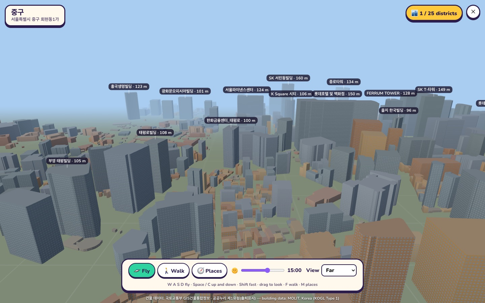
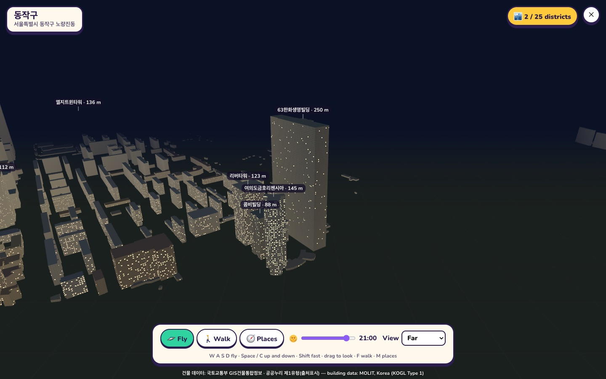
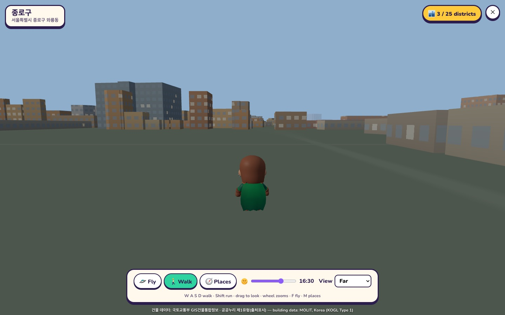
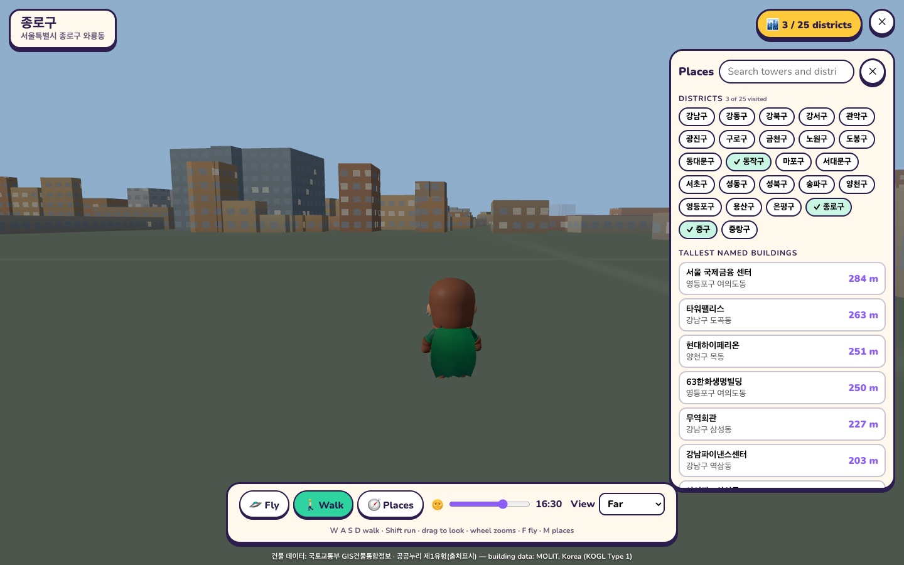

# Seoul, for real

[← Back to the README](../README.md)

Fly over the real Seoul, or walk its streets: every building in the city — 684,317 of them — at its
true place and height, streamed as you move. Visit all 25 districts, jump to the tallest towers, and
slide the clock to see the windows light up at night.

  
  

  
  

## The data, and what you may do with it

The buildings come from **국토교통부 GIS건물통합정보** (the Ministry of Land, Infrastructure and
Transport's national building register, [data.go.kr 15083092](https://www.data.go.kr/data/15083092/fileData.do)),
the file for 서울특별시 (`AL_D010_11_<date>`). Its licence is **공공누리 제1유형 (KOGL type 1)**: free to use,
including commercially, **with attribution** — the game shows the credit on screen at all times.

- **Nothing from the register is in this repository.** You download the file yourself and convert
  it; the tiles live in `data/geo/seoul/tiles/` (git-ignored).
- The register says its values are "for reference". Heights are missing for about half the
  buildings (then the number of floors is used, at 3.3 m each; with neither, 4 m), and a height far
  too tall for its floor count is treated as a typing slip.
- **The ground is flat.** No terrain or elevation data is used or shown, and the game never shows
  coordinates. There is no river, road, park or subway data either: the Han is simply where there
  are no buildings.

## Setting it up

1. Download the 서울특별시 file from the page above (it is about 1.4 GB unzipped) and put its
   `.shp`, `.dbf` and `.prj` in `library/Seoul_Map.zip/`, `library/` or `data/geo/seoul/`.
2. `npm run geo:seoul` — a few seconds. It writes 2,285 tiles (23 MB) and an index.
3. Open **Seoul, for real** from the home page. Without the tiles, the game says how to install them.

For a newer register file, repeat both steps. On a deployed server the tiles go in
`DATA_DIR/geo/seoul/tiles/`; they are served at `/geo/seoul/*`.

## How it plays

- **Fly** (the start): **W A S D** to move, **Space / C** up and down, **Shift** fast, drag to look,
  the wheel changes height. The higher you are, the farther you see and the faster you go.
- **Walk** (**F**, or the button): a traveller on the street, **Shift** to run, the wheel zooms.
  Buildings are solid.
- **Places** (**M**): the 25 districts and the 400 tallest named buildings, with a search; a click
  takes you there. Names and heights float over the tall buildings in view.
- **Districts visited** are counted (out of 25) and kept on your device.
- **Time of day**: a slider from midnight to midnight moves the sun, colours the sky, and lights a
  share of every building's windows after dark.
- **View**: near, far or farthest — how many tiles are kept around you (800 m to 2 km, more when
  flying high).

## How it works

- **The converter** (`scripts/geo/seoul-build.mjs`) reads the shapefile and its table side by side,
  keeps each building's largest ring, thins its points (to within 0.4 m), works out a height and a
  broad use, and files it under the 500 m tile its centre is in. It also writes the districts'
  centres and the tallest named buildings.
- **A tile** (`src/city/tiles.js`) is a small binary file: per building a footprint in decimetres
  from the tile's corner, a height and a use, then the names. The same code writes and reads it.
- **The game** (`src/city/SeoulGame.js`) loads the tiles around you nearest first, builds one mesh
  per tile (walls, flat roofs, a colour by use), and drops tiles you leave behind. Windows are drawn
  by the shader from each wall's length and height, so no textures are downloaded.
- The world is the register's own grid in metres (EPSG:5186), moved so that City Hall is the origin.
- **Tests**: `tests/unit/city.test.mjs` (the tile format, point thinning, heights and uses).

## Next

- The Han river, roads and parks (other public datasets), and terrain where the law allows.
- Subway lines to ride between districts; quests ("find the three tallest towers in Gangnam").
- Other players in the same city.
