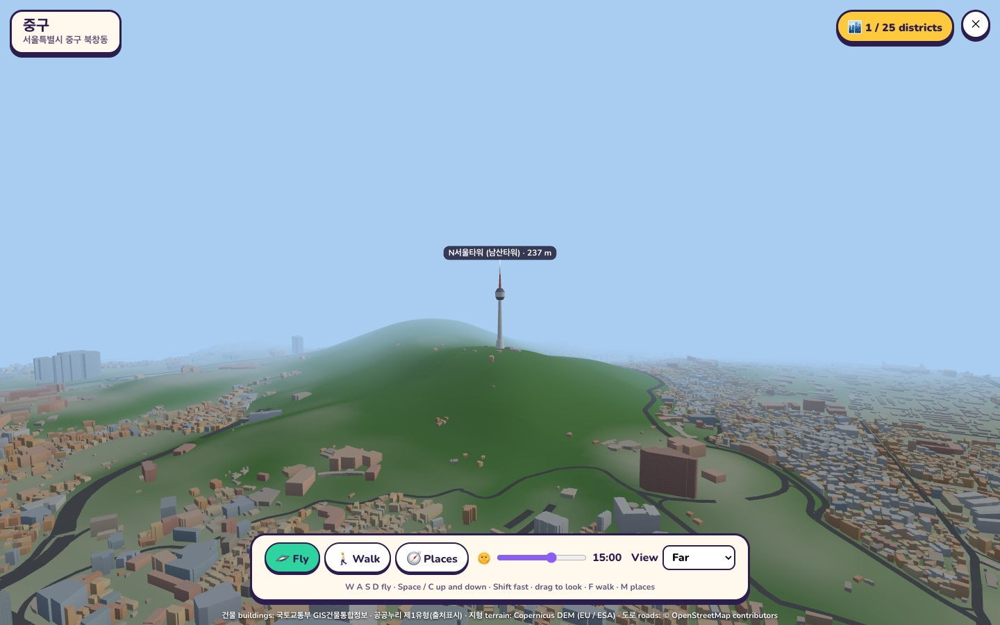
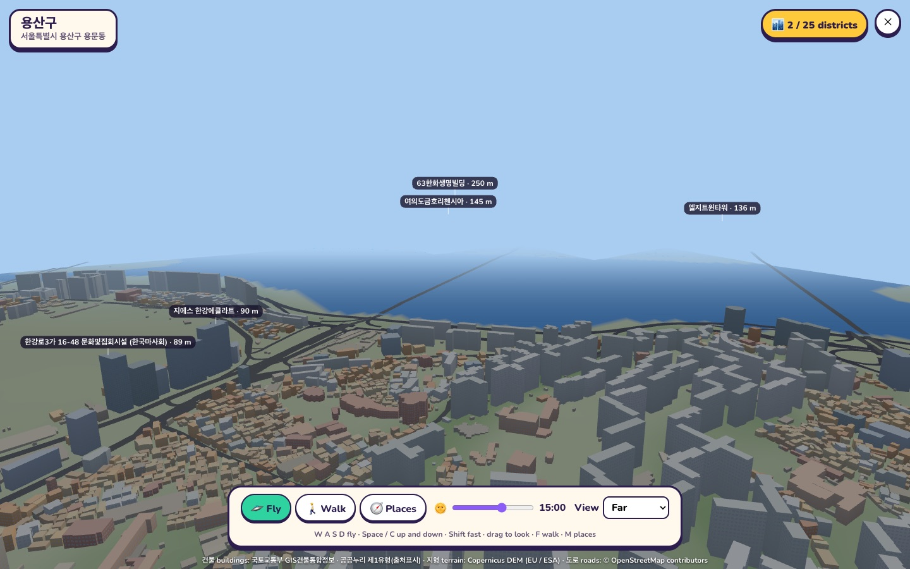

# Seoul, for real

[← Back to the README](../README.md)

Fly over the real Seoul, or walk its streets: every building in the city — 684,317 of them — at its
true place and height, on the real land: **Namsan with its tower, Bukhansan, the Han and its
bridges**, and the main roads. Visit all 25 districts, jump to the tallest towers, and slide the
clock to see the windows light up at night.

  
  

  
  

  
  

## The data, and what you may do with it

The buildings come from **국토교통부 GIS건물통합정보** (the Ministry of Land, Infrastructure and
Transport's national building register, [data.go.kr 15083092](https://www.data.go.kr/data/15083092/fileData.do)),
the file for 서울특별시 (`AL_D010_11_<date>`). Its licence is **공공누리 제1유형 (KOGL type 1)**: free to use,
including commercially, **with attribution** — the game shows the credit on screen at all times.

- **Nothing from the register is in this repository.** You download the file yourself and convert
  it; the tiles live in `data/geo/seoul/tiles/` (git-ignored).
- The register says its values are "for reference". Heights are missing for about half the
  buildings (then the number of floors is used, at 3.3 m each; with neither, 4 m), and a height far
  too tall for its floor count is treated as a typing slip.
- **The land** is from the **Copernicus DEM GLO-30** (© DLR e.V. 2010–2014 and © Airbus Defence and
  Space GmbH 2014–2018, provided under COPERNICUS by the European Union and ESA; free to use with
  that credit). It is a model of the surface, so bumps narrower than a city block (buildings) are
  smoothed away and the hills kept. **Water is found from it**: where the model is low and
  perfectly level, it is the Han, a stream or a lake.
- **The main roads** (motorways down to tertiary roads; tunnels left out) are from **OpenStreetMap**
  (© OpenStreetMap contributors, [ODbL](https://www.openstreetmap.org/copyright)). Roads over water
  are lifted onto a deck: the bridges. Smaller streets are simply the gaps between buildings.
- **N Seoul Tower** is in the register as a single point, so the game draws its own plain tower
  there, to the real height. No other building is modelled by hand.
- Heights only shape the ground: **no elevation figure and no coordinate is ever shown.** Parks,
  subway lines and small streets are not in the map yet.
- All three credits are on screen while you play (in short), and in full in the Places panel.

## Setting it up

1. Download the 서울특별시 file from the page above (it is about 1.4 GB unzipped) and put its
   `.shp`, `.dbf` and `.prj` in `library/Seoul_Map.zip/`, `library/` or `data/geo/seoul/`.
2. `npm run geo:seoul` — under a minute the first time. It downloads the land (two elevation tiles,
   about 80 MB) and the roads (about 20 MB) into `data/geo/seoul/src/` once, then writes 2,285
   building tiles (23 MB), `terrain.bin` (7 MB), `roads.bin` (1 MB) and an index. `--offline` skips
   the downloads; without them the ground is flat and there are no roads.
3. Open **Seoul, for real** from the home page. Without the tiles, the game says how to install them.

For a newer register file, repeat both steps. On a deployed server the tiles go in
`DATA_DIR/geo/seoul/tiles/`; they are served at `/geo/seoul/*`.

## How it plays

- **Fly** (the start): **W A S D** to move, **Space / C** up and down, **Shift** fast, drag to look,
  the wheel changes height. The higher you are, the farther you see and the faster you go. You
  stay above the ground, hills included.
- **Walk** (**F**, or the button): a traveller on the street, **Shift** to run, the wheel zooms.
  Buildings are solid, you climb the hills you walk up, and you stand on the roads — walk onto a
  bridge from its end and you cross the river on it; from the bank you pass underneath.
- **Places** (**M**): the 25 districts and the 400 tallest named buildings, with a search; a click
  takes you there. Names and heights float over the tall buildings in view.
- **Districts visited** are counted (out of 25) and kept on your device.
- **Time of day**: a slider from midnight to midnight moves the sun, colours the sky, and lights a
  share of every building's windows after dark.
- **View**: near, far or farthest — how many tiles are kept around you (800 m to 2 km, more when
  flying high).

## How it works

- **The converter** (`scripts/geo/seoul-build.mjs`) reads the shapefile and its table side by side,
  keeps each building's largest ring, thins its points (to within 0.4 m), works out a height and a
  broad use, and files it under the 500 m tile its centre is in. It also writes the districts'
  centres and the tallest named buildings.
- **A tile** (`src/city/tiles.js`) is a small binary file: per building a footprint in decimetres
  from the tile's corner, a height and a use, then the names. The same code writes and reads it.
- **The game** (`src/city/SeoulGame.js`) loads the tiles around you nearest first, builds one mesh
  per tile (walls, flat roofs, a colour by use), and drops tiles you leave behind. Windows are drawn
  by the shader from each wall's length and height, so no textures are downloaded.
- **The land** (`scripts/geo/seoul-extras.mjs`): the elevation tiles are read with a small reader of
  our own (`tiff.mjs`), sampled onto a 25 m grid in the register's projection (`tm.mjs`), cleaned
  of buildings and written with a water mask. The game draws the ground of every tile in view —
  town, wooded hillside, bare rock, water — stands each building on it, and lays the roads over it
  as ribbons.
- The world is the register's own grid in metres (EPSG:5186), moved so that City Hall is the origin.
- **Tests**: `tests/unit/city.test.mjs` (the tile format, point thinning, heights and uses, and the
  projection there and back).

## Next

- Parks, small streets and subway lines; water that looks like water; trees on the hills.
- Subway lines to ride between districts; quests ("find the three tallest towers in Gangnam").
- Other players in the same city.
