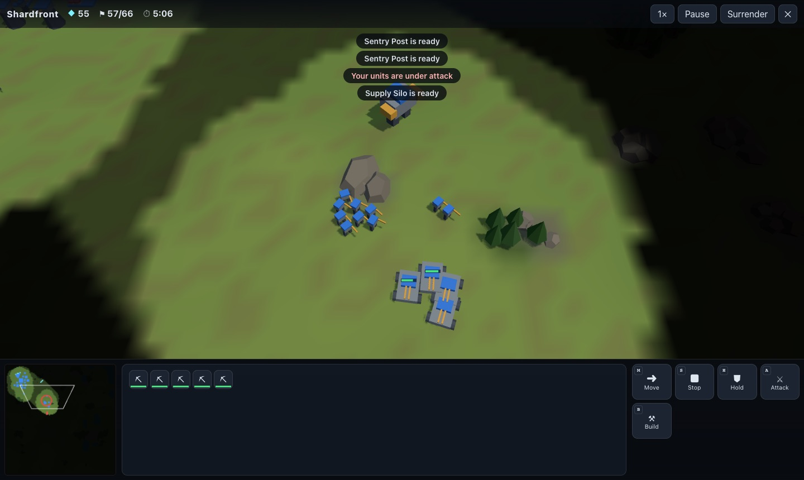
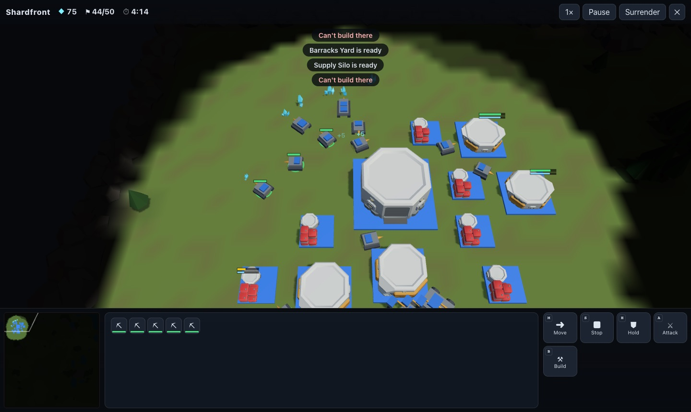
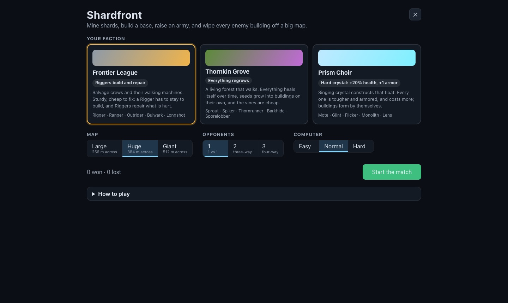

# Shardfront

[← Back to the README](../README.md)

Real-time strategy on big maps. Pick one of three factions, mine shards, build a base, train an
army and destroy every enemy building — against one to three computer players, through a fog of
war. Everything in it (factions, units, buildings, names, looks) is our own design.

<p>
  
</p>
<p>
  
  
</p>

## How it plays

- **Set-up.** Pick a faction, a map (**Large** 256 m, **Huge** 384 m or **Giant** 512 m across),
  one to three computer opponents (Easy, Normal or Hard) and, with two or more, whether they team up
  against you. Wins and losses are kept on this device.
- **Start.** A base (your *core*) and five workers by a field of shard crystals.
- **Economy.** Workers mine 5 shards a trip and carry them to the nearest core. Each crystal holds
  900; when a field runs dry, build a new core at another field (the map has several, between the
  starts and around the middle).
- **Supply.** Every unit takes supply; cores give 10, supply buildings 8, up to 120.
- **Buildings.** Core → supply, barracks (light units, raiders) → workshop (heavies, siege) and a
  defence tower.
- **Units.** Five roles for every faction: worker; *light* (cheap, long reach); *raider* (fast);
  *heavy* (armored, up close); *siege* (very long reach, splash, can't fire up close).
- **Winning.** A player whose last building falls is out; the last team standing wins.

### The factions

| | Frontier League | Thornkin Grove | Prism Choir |
|---|---|---|---|
| Who | Salvage crews and walking machines | A living forest that walks | Singing crystal constructs that float |
| Passive | A worker stays to build; workers repair | Everything heals itself; seeds grow alone | +20% health, +1 armor, +15% cost; buildings form alone |
| Units | Rigger, Ranger, Outrider, Bulwark, Longshot | Sprout, Spiker, Thornrunner, Barkhide, Sporelobber | Mote, Glint, Flicker, Monolith, Lens |
| Buildings | Command Hub, Supply Silo, Barracks Yard, Mech Works, Sentry Post | Heartroot, Seedpod, Thicket, Deep Grove, Thorn Spire | Prism Spire, Resonator, Facet Hall, Crystal Forge, Glare Tower |

The numbers are in `src/rts/rules.js` (one table for all three, with each faction's tweaks).

## Controls

| | |
|---|---|
| Select | Click; drag a box; **Shift** adds; double-click picks every one of that kind on screen |
| Orders | Right-click: move, attack an enemy, mine a crystal, repair (League), set a building's rally point |
| Command card | **M** move · **S** stop · **H** hold · **A** attack-move · **B** build (then **C D B W T**) · a building's **Q W** train, **Y** rally, **X** cancel |
| Camera | Arrow keys, the screen's edge, middle-drag, the minimap; the wheel zooms; **Space** jumps home or to the last alert |
| Groups | **Ctrl+1…9** saves, **1…9** picks (twice: look at it); **.** finds an idle worker |
| Game | **P** pauses; the speed button: 1× 1.5× 2× 3×; Surrender; ✕ leaves (a loss) |

## How it's made

- `src/rts/sim.js` — the match, with no drawing: 20 steps a second from a seed, changed only by
  commands (`sim.command(seat, { type: 'move' | 'amove' | 'attack' | 'gather' | 'build' | 'train' | … })`,
  applied at the next step). The same seed and commands give the same match, which is what a shared
  (lockstep) match will need; the test suite checks it.
- `src/rts/map.js` — maps from a seed: hills, rock, forest and lakes; the starts and base sites; and a
  check that every site can be walked to (a path is cut where one can't).
- `src/rts/flow.js` — flow fields: one search per goal, shared by every unit going there.
- `src/rts/ai.js` — the computer players. They send the same commands a person's clicks do: workers
  to the crystals, supply in time, buildings, an army, a new base (saving for it) when the crystals run
  low, waves of attack that grow, and the army home when the base is hit.
- `src/rts/view.js` and `models.js` — the 3D view (Three.js): terrain, instanced units (one draw
  for every faction and type), the fog of war as a texture over everything, shots and blasts; and
  `RtsGame.js` — the screen, the HUD, the minimap and the controls.
- The game opens from its card (`official:shardfront`, engine `rts`) over the home page; the platform's
  own 3D drawing stops while it's open.

## Your own models

Any unit or building can wear a 3D model of your own. Put the GLB (or glTF) under
`library/my-models/` (git-ignored, like the rest of the library) and list it in
`library/my-models/shardfront.json`:

```json
{
  "slots": {
    "league:heavy": { "file": "my-models/walker/walker.glb", "credit": "Walker by Someone (CC BY 4.0)", "turn": 180 },
    "thornkin:core": { "file": "my-models/tree-house.glb", "credit": "Tree house by Someone (CC0)" }
  }
}
```

- A slot is `<faction>:<type>` — `league`, `thornkin` or `prism`, and `worker`, `light`, `raider`,
  `heavy`, `siege`, `core`, `depot`, `barracks`, `workshop` or `tower`.
- The model is fitted to the unit's size (or the building's footprint) and stood on the ground;
  `turn` (degrees) turns it to face forward, `scale` makes it bigger or smaller. Units keep a ring in
  the player's colour under them; buildings a band round their foot. Static meshes are used (no
  animation yet).
- `credit` is shown on the set-up screen.
- **Only models you may use**: CC0, or CC BY (credit the author) — not *NonCommercial* licences,
  which don't allow use on the platform — and never a copy or fan model of another game's,
  film's or show's characters or units, whatever its licence says (the uploader can't license
  someone else's design).

Without a list, the built-in looks are used: the Frontier League's buildings come from
[KayKit Space Base Bits](https://github.com/KayKit-Game-Assets/KayKit-Space-Base-Bits-1.0) by Kay
Lousberg (CC0) when the asset library is downloaded, and everything else is drawn from simple shapes.

## Next

- Shared matches with friends (lockstep over the party server) and a ranked ladder.
- A short campaign, more maps and a map picker.
- Upgrades, abilities and flying units.
