# Spells

[← Back to the README](../README.md)

Ten spells, on the keys **1–9** of the action bar alongside your potions. Each class has its own **skill tree**; spells are
learned and ranked up with **skill books** (see [Skill trees and skill books](classes-and-skills.md#skill-trees-and-skill-books)).
There are two ways to aim them. Seven are **line casts**: press the key to
arm, a MOBA-style arrow appears on the ground and swings with the mouse, right-click to fire. The
other three are **far casts**: the arrow is replaced by a circle with a deliberately thick boundary
that follows the cursor and answers the only question a ground-targeted AoE has to answer before you
commit — how much space is this going to take.

  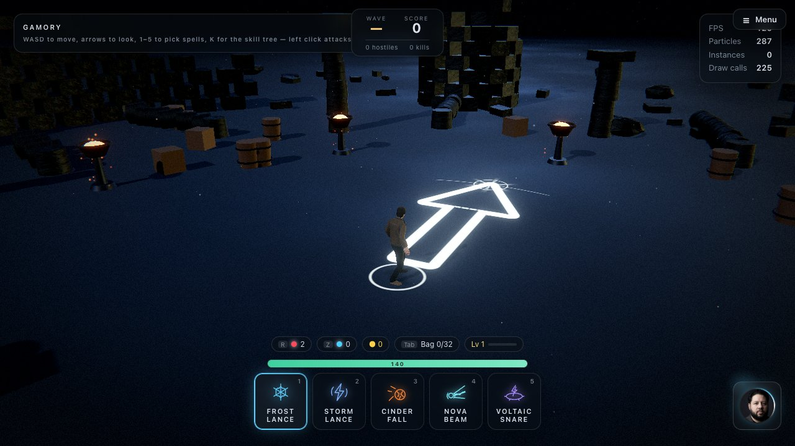
  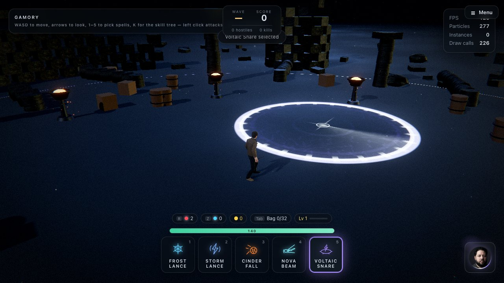

**1 — Frost Lance.** A fracture front races out along the line while a field of ice crystals
tears up out of the floor behind it — small and dense at your feet, opening into a wall of blades
at the far end, with a cluster thrown up around the impact point.

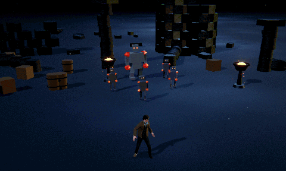

**2 — Storm Lance.** A bolt leaves the caster's hand and a bundle of lightning filaments is drawn
out behind the strike front, holds while it gutters and re-strikes, then blows out. Sparks come
off it the whole way, the floor underneath takes a branching electric burn and a dark scorch, and
the far end gets a shell of ionised air.

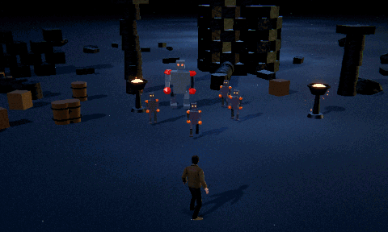

**3 — Cinder Fall.** A burning rock is lobbed downrange on an arc, trailing a raymarched wake of
burning gas and heating up the whole way: the lava seams splitting its surface prise wider and
brighter as it comes in. It detonates on arrival, throws its own shattered chunks across the floor, and tears the
ground open into a network of molten cracks that keep glowing while the crater burns out.

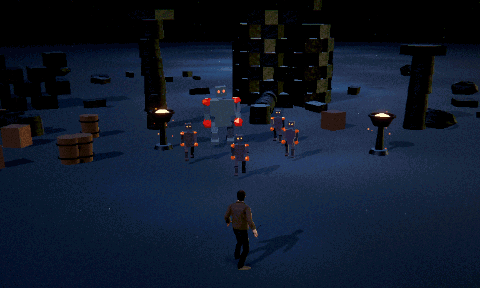

**4 — Nova Beam.** The caster winds a ball of light up in both hands, pulling motes in out of the
air, then lets a column of it out along the line — white-hot core, cyan sheath, gold ribbons
spiralling around it and shock discs racing down it. It *holds* there, burning into the floor and
throwing spray back up the beam, before collapsing to a thread and blinking out. The only cast in
the sandbox that is still happening a second after it landed.

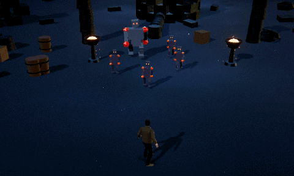

**5 — Voltaic Snare.** The far cast. A leash of current is whipped out across the floor, and where
it lands the ring snaps open past its own radius and pulls back onto it: a violet column tears up
out of the middle, tendrils crawl outward to the boundary, arcs run around the rim and the whole
disc burns. It holds there re-striking and hauling the air up into the pillar, then collapses to a
thread. The circle you measured out before the click is exactly the circle you get.

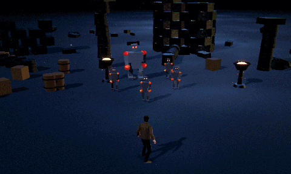

**6 — Glacial Crown.** The second far cast, and the snare's opposite answer to the same circle. A
cold front races across the floor to the point, the disc freezes out to the boundary, and a ring of
crystal blades tears up out of the ground around it — the blade nearest the caster first, the wave
running round both sides to close behind — with a skirt of wreckage banked against their feet. The
middle stays open: the read is a wall you are looking into. It stands there glinting and breathing
cold off its rim, then shatters plate by plate and sinks back into the floor.

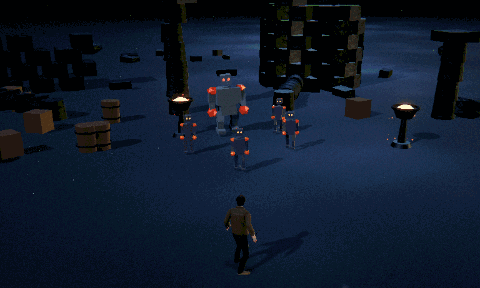

**7 — Arc Chain.** A bolt leaves the hand, finds the first monster in the line and leaps from it
to the nearest one it has not hit yet — up to four leaps, each a little weaker (34 → 29 → 25 → …),
with a short stun on every body it passes through. Strong against a crowd, weak against one target.

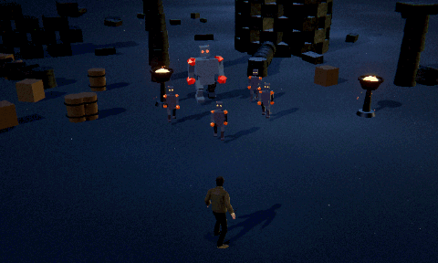

**8 — Void Orb.** A slow violet orb drifts down the line. Every third of a second it lashes out
with arcs at the two closest monsters within reach, slowing them, and when it reaches the end it
collapses into a burst that throws everything nearby back. Cast it through a crowd and walk away.

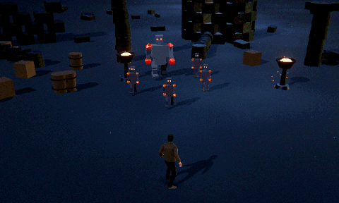

**9 — Hailstorm.** The third far cast. A cloud gathers over the circle and hammers it with hail
for four seconds — every monster inside takes a hit about twice a second and is chilled, the
floor frosts over and big stones shatter now and then. The answer to a choke point.

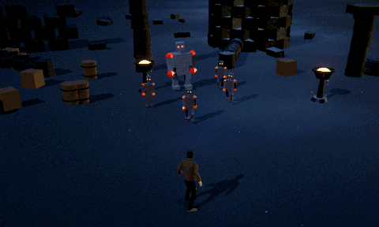

**0 — Blink Strike.** You vanish and reappear down the line, up to 12 m, and a blade of light
races along the path behind you, hitting everything you passed. A burst where you land throws the
nearest monsters back. It stops short of walls and rocks, so it is an escape as much as an attack.

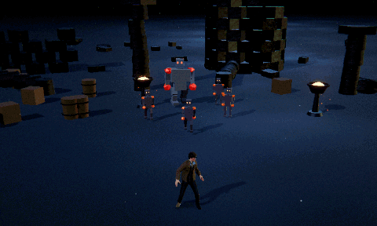

Spells 7–0 are original takes on classic action-RPG and MOBA spell types (chain lightning, a
roaming orb, a damage-over-time storm, a dash). Unlike the first six they have no bespoke shader:
each is a short file (`src/abilities/ChainAbility.js`, `OrbAbility.js`, `HailAbility.js`,
`BlinkAbility.js`) assembled from the game's shared particles, burst spheres, ground decals and
lights through `src/abilities/SpellFx.js` — the pattern to copy for a new spell. Their damage
rules (`kind: 'chain' | 'orb' | 'storm'`) live in `settings.combat` and `src/game/Combat.js`, and
their main dials are in the **G** editor under each spell's name.

> The clips are recorded in the browser straight from the game canvas (`docs/spells/*.gif`).

Everything you can see in the first six is generated. There are no textures, no sprite sheets and no meshes on
disk except the character: the crystals are procedural geometry, the bolt is a strip of ribbon
placed entirely by a vertex shader, the meteor is an icosphere cratered and sliced by fracture
planes on the CPU, the beam is a parametric tube drawn three times at three radii, the snare's
whole cage is that same ribbon strip threaded along four different parametric paths, the arrow, the
targeting circle, the rime, the burns and the molten cracks are signed-distance and noise shaders,
and the mist, sparks, chips and glitter are GPU particles.

**Every parameter is a live slider** — 938 of them — and they stay live while the simulation is
paused. That is the point of the project: freeze a frame mid-eruption, mid-strike or mid-burn with
**P**, then reshape the silhouette, the palette and the timing against a still image.

References for the look: `icecast.jpg`, `thundercast.jpg`, `superbeam.jpg` and
`electricalboost.jpg`.
