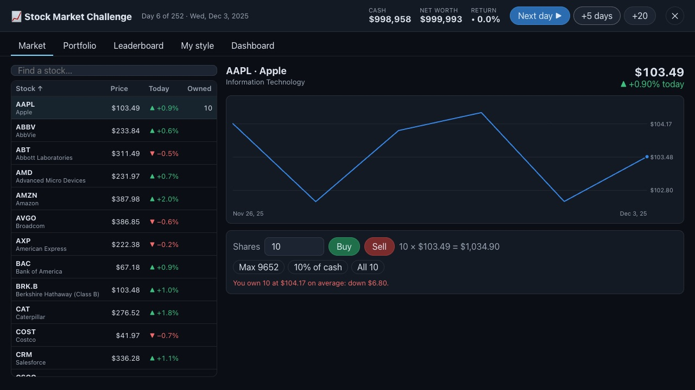
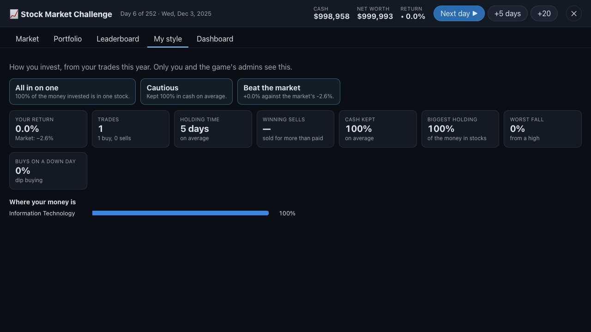
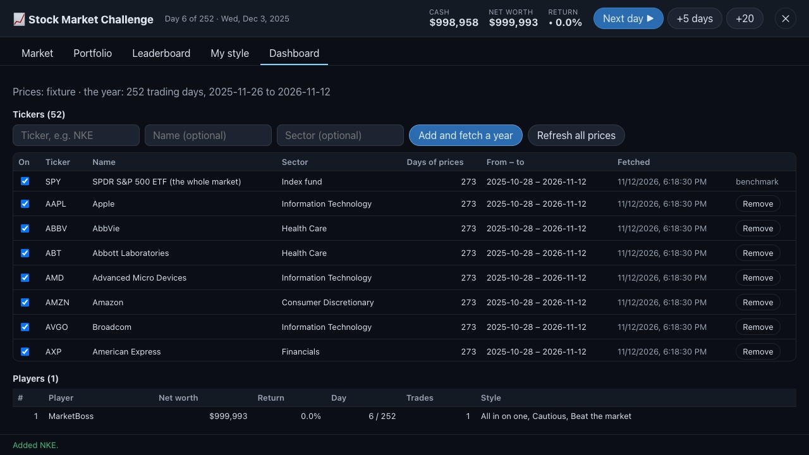

# Stock Market Challenge

[← Back to the README](../README.md)

A million in game money and a year of real stock prices, one trading day at a time. Players buy and
sell at each day's closing price, press **Next day**, and after a year see how they did against the
market — and what kind of investor they are. No real money, ever.

  

  
  

*The screenshots come from the test suite, which runs on made-up prices: the numbers are not real.*

## How it plays

- **Your own run, at your own pace.** Each player starts on the first trading day of the last year
  (252 trading days, the market's — SPY's — calendar) with $1,000,000. **Next day**, **+5 days** and
  **+20** move on; on the last day the button says **Finish the year**. **Start a new year** begins
  again from a million (the old run is kept, marked abandoned).
- **Trades at the day's close**, in whole shares, priced by the server from its own data. You cannot
  spend more cash than you have or sell what you do not own. A stock that did not trade that day
  cannot be traded.
- **Nobody sees tomorrow.** The server only ever sends a player prices up to their own day, so the
  charts cannot leak what happens next.
- **Tabs:** *Market* (every stock, sortable and searchable; a stock's chart and the order box),
  *Portfolio* (your net worth against the market — SPY, indexed to the same million — what you own
  and your trades), *Leaderboard* (each player's latest year by net worth, with their day), *My style*
  (your pattern, below) and, for admins, *Dashboard*.

## Your pattern ("My style")

From a run's trades and its net worth at each day's close (`src/market/patterns.js`):

| Measure | What it is |
| --- | --- |
| Return, and the market's | your net worth against the start; SPY over the same days |
| Holding time | how long shares were held, first in first out (open ones count to today) |
| Winning sells | sells for more than those shares cost |
| Cash kept | the share of your money in cash, on average |
| Biggest holding, concentration | your top stock's share of what is invested; the Herfindahl index |
| Worst fall | the deepest drop from a high (max drawdown) |
| Dip buying, momentum | buys on a day the stock fell; buys after a 3%+ climb in a week |
| Sectors | where the invested money is |

…and plain-word tags with the reason for each: *Day trader*, *Patient holder*, *Dip buyer*, *Momentum
chaser*, *Diversified*, *All in on one*, *Cautious*, *Fully invested*, *Very active*, *&lt;sector&gt; fan*,
*Beat the market*, *Behind the market*, *Bumpy ride*.

**Who sees it:** the player (their own) and the accounts in `ADMIN_ACCOUNTS`. Every trade and every
day's net worth and holdings are kept in the database (`market_trades`, `market_snapshots`) with the
account; nothing else about the player is collected. On a platform children use, keep the admin list
short, and tell families what is kept.

## Setting it up

1. **Price data — Alpaca.** Make an account at [alpaca.markets](https://alpaca.markets), create API
   keys, and add them to `.env` (see `.env.example`):

       ALPACA_API_KEY=…
       ALPACA_SECRET_KEY=…

   The free IEX feed is the default (`ALPACA_FEED=sip` for the paid all-exchange feed). Prices are
   adjusted for splits and dividends. The keys stay on the server.
2. **An admin.** `ADMIN_ACCOUNTS=YourName` (comma-separated account names) shows the **Dashboard** tab.
3. **Restart the server.** On start it seeds the ticker list — 50 of the largest S&P 500 companies and
   SPY (`src/market/tickers.js`) — and fetches about 13 months of daily bars for each, then refreshes
   any ticker older than 20 hours every 6 hours. Without keys, the game says the data is not set up.

## The Dashboard (admins)

- **Add a ticker** (`NKE`, `BRK.B`…): it is fetched at once; its name comes from Alpaca if you leave it
  empty.
- **Switch a ticker off** (it leaves the market list; holdings keep their value) or **Remove** it (and
  its prices). The benchmark, SPY, stays.
- **Refresh all prices**, and see each ticker's days of prices, range and last fetch (or its error).
- **Every player**: net worth, return, day, trades and style tags; click one for their holdings,
  pattern and trades.

## Data licensing

Alpaca's market data terms limit showing their data to the public. That is fine for your own and
your family's use; a public launch needs a data plan (Alpaca or another provider) that allows display
to users. The provider is one file (`server/market/providers.js`), so changing it is small.

## For developers

- Server: `server/market/index.js` (routes and rules), `server/market/providers.js` (Alpaca; a
  made-up `fixture` provider only with `MARKET_PROVIDER=fixture`, for the tests), migration
  `005-market` (`server/db/migrations.js`). Money is integer cents; writes go one at a time.
- Client: `src/market/` — `MarketGame.js` (the screen), `lineChart.js` (SVG chart with a crosshair and
  tooltip), `marketClient.js`, `patterns.js`, `tickers.js`. Loaded only when the game is opened.
- The game is listed with the official games (`ENGINE_GAMES` in `server/gamesStore.js`, engine
  `market`, genre `market-sim`); Play opens it instead of the 3D lobby (`App#openMarket`).
- Tests: `tests/unit/market.test.mjs` (runs, trades, no peeking, the end of the year, the leaderboard,
  admin only, the pattern) and `tests/e2e/market.mjs` (the whole game by mouse, on made-up prices).
