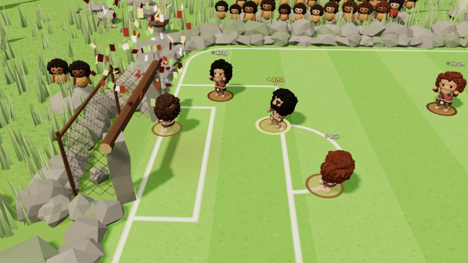

# Stoneball

[← Back to the README](../README.md)

Caveman soccer, three a side, with a ball of stone. Each tribe wears its own leather; every
caveman has a thick mop of hair, many a beard. The stone is heavy: it rolls, bounces low and
spins, the boulder wall bounces it back in (no throw-ins), and a hard shot knocks a man over.

## Playing

| Key | |
| --- | --- |
| **W A S D** / arrows | Run (you play the caveman of yours nearest the ball) |
| **Shift** | Sprint (uses stamina) |
| **Space** | Hold to charge a shot, let go to kick; near an opponent without the ball, a shove |
| **C** | Sliding tackle: feet first along the grass, further than a shove; a clean one takes the stone and floors the carrier (head-on works best; a miss leaves you down a moment) |
| **E** · **F** · **Q** | Pass · shove · switch player |
| **Esc** · **M** | Pause · sound on/off |

Pick your tribe's leather (Tan Hide, Red Ochre, Woad Blue, Moss Green), the computer's skill
(easy, normal, hard) and the match length (2, 3 or 5 minutes). Each side has a keeper, a defender
and a forward; keepers read the shot and dive. A goal counts only fully over the line, between
the standing stones and under the log. A draw goes to golden goal for a minute.

## For developers

| Part | File |
| --- | --- |
| The match (no three.js, no DOM; fixed tick, seeded — it runs headless) | `src/stoneball/rules.js` |
| The screen, input, loop | `src/stoneball/StoneballGame.js` |
| Cavemen (KayKit Barbarian repainted, procedural hair and beards; a fallback figure) | `src/stoneball/cavemen.js` |
| Pitch, crowd, ball, camera, labels, effects · HUD · sound | `src/stoneball/view.js`, `ui.js`, `sound.js`, `stoneball.css` |
| Tests | `tests/unit/stoneball.test.mjs` |
