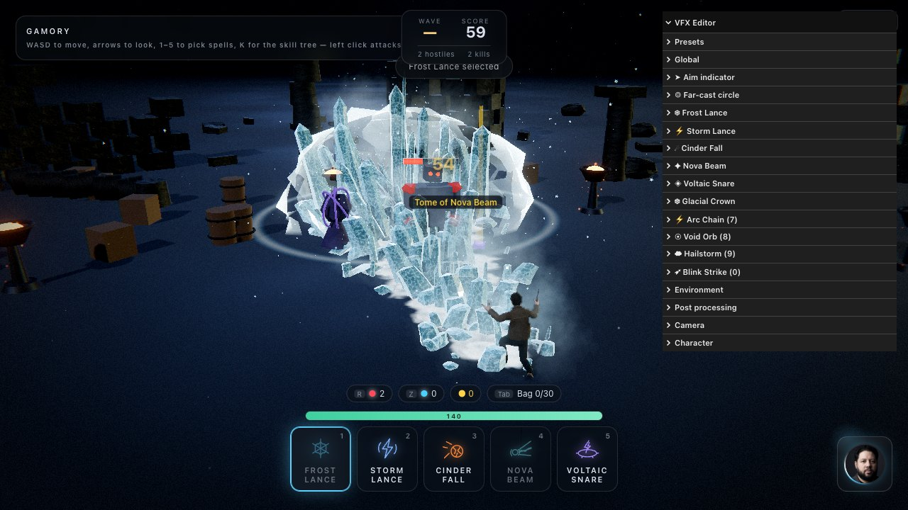

# Tuning editor and presets

[← Back to the README](../README.md)

## Editor and presets

Press **G** for the panel. Folders: Presets, Global, Aim indicator, Far-cast circle, Frost Lance,
Storm Lance, Cinder Fall, Nova Beam, Voltaic Snare, Environment, Post processing, Camera,
Character. Every folder starts collapsed — there are enough controls here that one open section
pushes the rest off the screen.

- **Global** multipliers scale everything at once (speed, glow, noise, particles, lights, impact
  intensity, camera shake, time scale…).
- **Aim indicator** — the arrow's silhouette in metres, its outline and fill, the chevrons and
  frost, and the rings and rosette.
- **Far-cast circle** (40 controls) — the boundary band, the interior, the ticks, sweep and
  reticle, the reach ring, and the snap-out. Shared by every far cast, so it is filed with the
  targeting rather than with any one ability.
- **Frost Lance** (113 controls, 25 of them colours) — the cast, the footprint, the silhouette,
  the crystal itself, the eruption timing, the ice material, the frost on the ground,
  mist/chips/glitter, the impact and the dynamic light.
- **Storm Lance** (123 controls, 34 of them colours) — the cast, where the bolt leaves the hand,
  the bundle, one filament, the ribbon, flicker and restrike, the bolt's colour, the burns on the
  ground, sparks/motes/smoke/debris, the muzzle and impact, and the dynamic light.
- **Nova Beam** (176 controls) — the cast, where it leaves the hands, the column, the core/sheath/
  halo stack, the surface and its flow, the beam's colour, the coils, the shock discs, the charge
  and its intake, what the floor does, sparks/motes/steam/debris, release/impact/burn, and the two
  dynamic lights.
- **Voltaic Snare** (174 controls, 33 of them colours) — the cast and its footprint, the leash, the
  column, the tendrils, the rim arcs, the shared filament shape and flicker, the ribbon and its
  colour, the field on the floor, the burns, sparks/updraft/smoke/debris, throw/snap/hold, and the
  dynamic light.
- **Presets** save to `localStorage`, and can be duplicated, deleted, exported to JSON, imported
  from JSON, or reset to the shipped defaults.

Every ability exposes **every** colour it draws with, and none is derived from another: the crystal
palette, the bolt palette, the beam's four layers and its coils and discs, the ground marks, the
impact shells, the shockwave rings, the screen flashes, and a four-stop lifetime gradient
(`birth → early → late → death`) for each particle system. Tinting the fog without touching the ice,
or cooling the sparks to orange while the filaments stay blue, is a picker away.

Presets are plain snapshots of the settings tree, so an exported file is readable and editable by
hand.

Knobs worth knowing about, because they reshape their ability the most:

- `ice.heightCurve` — how late the ramp climbs; raise it and the field stays low until it explodes
  at the target. `ice.frontBias` below 1 crowds the crystals toward the impact point.
- `thunder.jitter` and `thunder.jitterScale` — how violently the bolt kinks, and how often.
  `thunder.strands` and `thunder.spread` set how wide the bundle reads, and `thunder.restrike`
  how hard it strobes. Those five carry the character of the effect.
- `beam.radius` and `beam.flare` — how heavy the column reads and how hard it opens out where it
  lands. `beam.charge` and `beam.lifetime` are the wind-up and the hold, which are what make this
  ability feel unlike the other three, and `beam.coreWidth` / `beam.coreFill` decide whether the
  layers stay separable or blow out to white.
- `snare.zoneRadius` — the one number the whole far cast is built on. It resizes the targeting
  circle, the tendrils, the rim arcs, the burnt field and the pillar's throat together, live.
  After that, `snare.snapTime` and `snare.height` carry the moment it opens, and `snare.tendrils` /
  `snare.rimArcs` / `snare.strands` decide how much of that footprint is actually lit.
- `zone.boundary` and `zone.snap` — how thick the far-cast circle's edge reads, and how hard it
  overshoots on the way out. Between them they decide whether the indicator feels like a UI overlay
  or like something the caster is doing.
