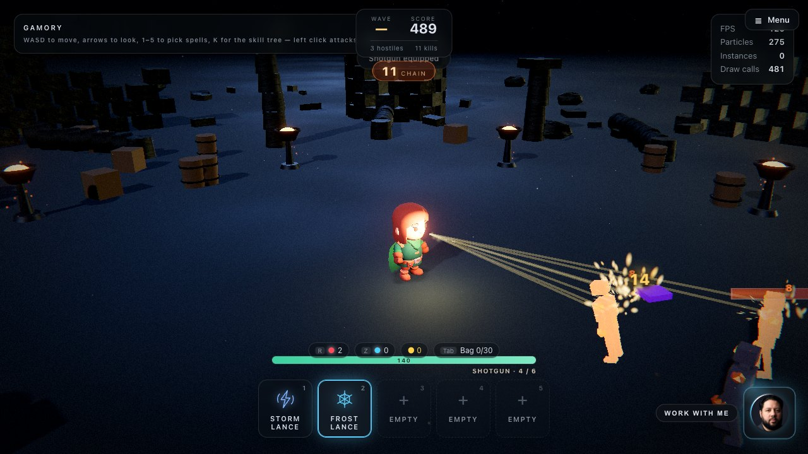
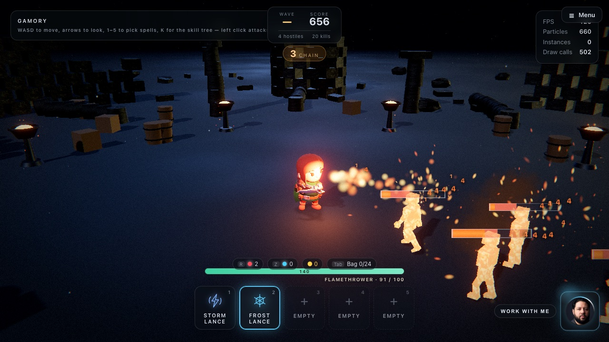
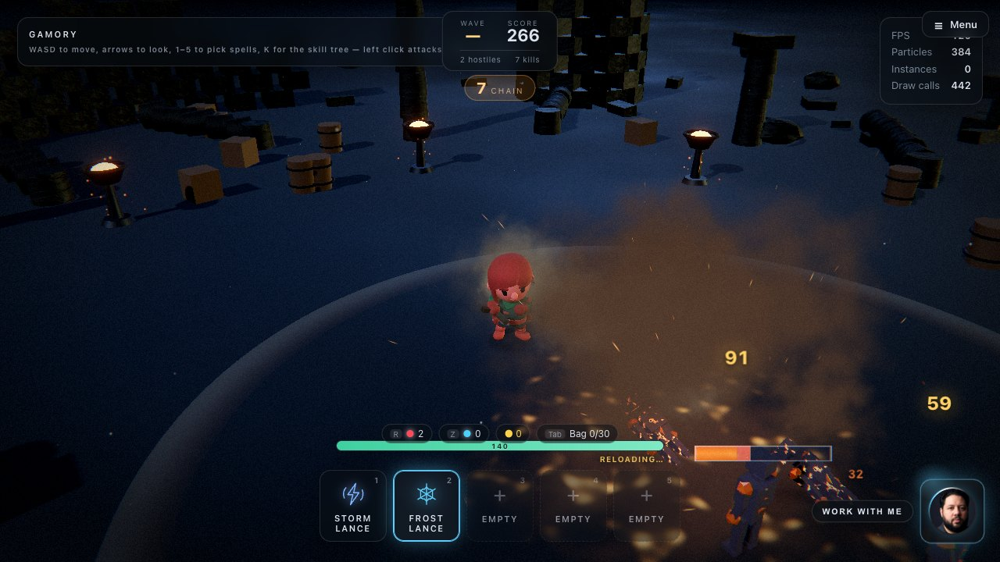
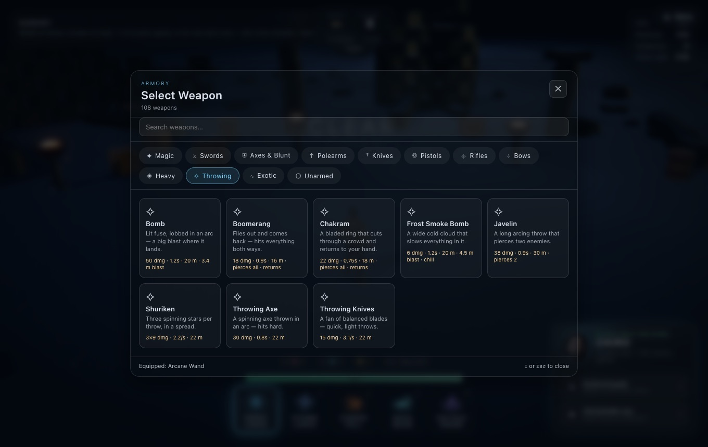
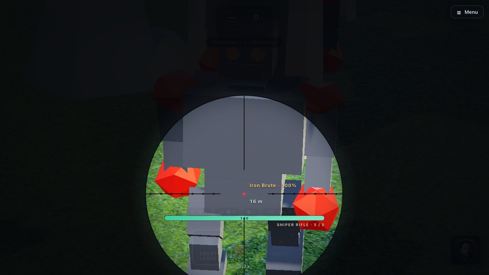

# Weapons

[← Back to the README](../README.md)

  
  

  
  

**108 weapons in twelve kinds.** Press **I** for the armory; any class can use any weapon. Weapons
found as loot work the same way.

**Every weapon fights like itself.** Left click swings a melee weapon (with your class's moves), and
fires everything else:

| Kind | Left click |
| --- | --- |
| **Pistols, rifles** | Bullets — instant, with tracers and muzzle flash. Automatics keep firing while you **hold** the button; burst rifles fire three per pull; shotguns fire a spread of pellets; a sniper round goes through several enemies. |
| **Energy guns** | Plasma bolts that fly, or lasers and railgun slugs that pierce everything in a line. |
| **Bows, crossbows, sling** | Arrows, bolts and stones that fly in an arc to where you aim. |
| **Heavy** | Rockets and grenades that explode, a minigun's spray, a flamethrower's burning cone. |
| **Throwing** | Knives, shuriken, javelins, axes and bombs thrown in an arc; a boomerang and a chakram fly out and come back, hitting both ways. |
| **Melee** (swords, axes, polearms, knives, exotic, unarmed) | Your class's swings. |

**Ammo.** Guns have a magazine (shown under your health bar) and reload by themselves when empty, or
with **X**. Energy weapons, bows and throwing weapons never reload. Bombs and grenades land where
the cursor is.

**Scopes.** Long-range weapons have a scope: hold **V** to look through it. The view zooms onto the
spot under the cursor, the screen darkens around a round sight with a crosshair, and the sight shows
the range, the zoom, and the name and health of whatever is under the crosshair. Through the scope,
shots go exactly where the crosshair is (no spread) and land on the body you are pointing at. You
move at half speed while scoped. Push the cursor toward the edge of the sight to pan; let go of V to
look up.

| Weapon | Zoom |
| --- | --- |
| Sniper rifle | 3.2× |
| Railgun | 2.6× |
| Ion cannon | 2.4× |
| DMR | 2.2× |
| Lever rifle, laser rifle | 2× |
| Musket, heavy crossbow | 1.8× |
| Longbow | 1.6× |

  

Damage counts as weapon damage: *+% weapon damage* gear and critical chance apply, statuses (burn,
root, slow, stun) and knockback work as for spells, and the Barbarian gains a little Rage per hit.

## Every weapon

### ✦ Magic (15)

Arcane Wand · Crystal Wand · Ember Wand · Frost Wand · Shadow Wand · Holy Wand · Arcane Staff · Druid Staff · Necromancer Staff · Battle Staff · Royal Scepter · Crystal Orb · Void Orb · Grimoire · Spell Tome

### ⚔ Swords (12)

Shortsword · Longsword · Broadsword · Greatsword · Zweihander · Katana · Rapier · Scimitar · Cutlass · Claymore · Falchion · Energy Blade

### ⛨ Axes & Blunt (9)

Hand Axe · Battle Axe · War Axe · Pickaxe · Mace · War Hammer · Maul · Flail · Spiked Club

### ↑ Polearms (8)

Spear · Pike · Halberd · Glaive · Naginata · Trident · Scythe · Lance

### † Knives (9)

Combat Knife · Tanto · Stiletto · Kukri · Bowie Knife · Switchblade · Cleaver · Twin Daggers · Dual Wakizashi

### ◎ Pistols (8)

| Weapon | How it fights | |
| --- | --- | --- |
| **Sidearm** | 14 dmg · 3.3/s · 24 m · 12 rounds | Semi-auto sidearm — quick, accurate, twelve rounds. |
| **Revolver** | 24 dmg · 2.0/s · 24 m · 6 rounds | Six heavy rounds, slow and hard-hitting. |
| **Hand Cannon** | 32 dmg · 0.75s · 24 m · 7 rounds | Oversized pistol — big damage, big kick. |
| **SMG** | 7 dmg · 12/s · auto · 20 m · 30 rounds | Compact automatic — hold to spray at close range. |
| **Machine Pistol** | 6 dmg · 14/s · auto · 18 m · 20 rounds | Tiny automatic — the fastest fire rate, least accurate. |
| **Dual Pistols** | 12 dmg · 5.9/s · 24 m · 24 rounds | A pistol in each hand — rapid alternating fire. |
| **Plasma Pistol** | 18 dmg · 3.1/s · 24 m · shock | Fires glowing plasma bolts that jolt what they hit. Never needs reloading. |
| **Flintlock Pistol** | 34 dmg · 2.5/s · 24 m | One powerful ball, then a long reload. |

### ⌖ Rifles (16)

| Weapon | How it fights | |
| --- | --- | --- |
| **Assault Rifle** | 10 dmg · 9.1/s · auto · 32 m · 30 rounds | Automatic rifle — hold to fire, thirty rounds. |
| **Carbine** | 11 dmg · 7.7/s · auto · 32 m · 25 rounds | Short automatic rifle — a little stronger per shot. |
| **Burst Rifle** | 12 dmg · 2.2/s · 3-round burst · 32 m · 30 rounds | Three rounds per pull — tight and deliberate. |
| **DMR** | 28 dmg · 2.4/s · 40 m · pierces 1 · 10 rounds | Precise semi-auto rifle — each round goes through one target. |
| **Sniper Rifle** | 75 dmg · 1.25s · 52 m · pierces 3 · 5 rounds | One slow, devastating shot that pierces three enemies. |
| **Shotgun** | 7×8 dmg · 0.8s · 13 m · 6 rounds | Pump action — seven pellets in a wide spread. Close range. |
| **Combat Shotgun** | 6×7 dmg · 2.6/s · auto · 12 m · 8 rounds | Automatic shotgun — hold to clear a room. |
| **LMG** | 9 dmg · 12/s · auto · 32 m · 80 rounds | Heavy machine gun — eighty rounds, long reload. |
| **Plasma Rifle** | 14 dmg · 7.7/s · auto · 32 m · 40 rounds | Rapid plasma bolts — automatic, travels fast. |
| **Laser Rifle** | 20 dmg · 3.6/s · 36 m · pierces 2 · 20 rounds | An instant beam that cuts through two enemies. |
| **Pulse Carbine** | 10 dmg · 2.5/s · 3-round burst · 32 m · 30 rounds | Three-bolt energy bursts. |
| **Musket** | 48 dmg · 2.0/s · 36 m · pierces 1 | A single heavy ball that pierces one enemy. Slow to reload. |
| **Lever Rifle** | 26 dmg · 2.0/s · 38 m · 8 rounds | Eight accurate rounds — steady frontier rifle. |
| **Blunderbuss** | 10×7 dmg · 0.6s · 9 m | A flared barrel of shot — enormous spread, huge knockback. |
| **Harpoon Gun** | 42 dmg · 0.6s · 32 m · pierces 2 · root | A harpoon that pierces two enemies and pins them in place. |
| **Blowgun** | 8 dmg · 2.0/s · 32 m · burn | Silent poison darts — small hits, then they burn. |

### ⊹ Bows (8)

| Weapon | How it fights | |
| --- | --- | --- |
| **Shortbow** | 16 dmg · 2.4/s · 30 m | Quick arrows — light damage, fast draw. |
| **Longbow** | 30 dmg · 0.75s · 42 m · pierces 1 | Long range — slow draw, arrows pierce one enemy. |
| **Recurve Bow** | 22 dmg · 0.55s · 34 m | Balanced bow — a good all-rounder. |
| **Compound Bow** | 26 dmg · 0.6s · 34 m · pierces 1 | Fast, flat arrows that pierce one enemy. |
| **Crossbow** | 34 dmg · 0.9s · 34 m | Heavy bolts — slow to reload, hits hard. |
| **Heavy Crossbow** | 52 dmg · 1.3s · 34 m · pierces 2 | Massive bolts that pierce two enemies and knock them back. |
| **Hand Crossbow** | 18 dmg · 2.2/s · 34 m · 5 rounds | One-handed crossbow — five quick bolts. |
| **Sling** | 12 dmg · 2.0/s · 34 m · shock | Whirls a stone in a high arc — a dizzying knock. |

### ◈ Heavy (6)

| Weapon | How it fights | |
| --- | --- | --- |
| **Rocket Launcher** | 55 dmg · 1.6s · 34 m · 3.2 m blast | Rockets that explode on impact. One shot, then reload. |
| **Grenade Launcher** | 45 dmg · 1s · 26 m · 3 m blast · 6 rounds | Lobs bouncing-arc grenades that burst on landing. |
| **Minigun** | 6 dmg · 20/s · auto · 28 m · 200 rounds | Spins up a storm of bullets — two hundred rounds. |
| **Railgun** | 65 dmg · 1.8s · 48 m · pierces all | An instant slug that pierces everything in its line. |
| **Flamethrower** | 4 dmg · 13/s · auto · 7.5 m · burn · 100 rounds | A cone of fire — hold to burn everything in front of you. |
| **Ion Cannon** | 85 dmg · 2.4s · 44 m · pierces all | A charged beam through everything — the slowest, strongest shot. |

### ✧ Throwing (8)

| Weapon | How it fights | |
| --- | --- | --- |
| **Throwing Axe** | 30 dmg · 0.8s · 22 m | A spinning axe thrown in an arc — hits hard. |
| **Throwing Knives** | 15 dmg · 3.1/s · 22 m | A fan of balanced blades — quick, light throws. |
| **Shuriken** | 3×9 dmg · 2.2/s · 22 m | Three spinning stars per throw, in a spread. |
| **Javelin** | 38 dmg · 0.9s · 30 m · pierces 2 | A long arcing throw that pierces two enemies. |
| **Boomerang** | 18 dmg · 0.9s · 16 m · pierces all · returns | Flies out and comes back — hits everything both ways. |
| **Chakram** | 22 dmg · 0.75s · 18 m · pierces all · returns | A bladed ring that cuts through a crowd and returns to your hand. |
| **Bomb** | 50 dmg · 1.2s · 20 m · 3.4 m blast | Lit fuse, lobbed in an arc — a big blast where it lands. |
| **Frost Smoke Bomb** | 6 dmg · 1.2s · 20 m · 4.5 m blast · chill | A wide cold cloud that slows everything in it. |

### ∿ Exotic (5)

Whip · Nunchaku · War Fan · Sai · Chain Sickle

### ○ Unarmed (4)

Unarmed · Iron Fists · Combat Gauntlets · Retractable Claws

## Adding a weapon

1. Add a row to `src/platform/weapon/arsenal.js` (id, label, category, `visual`, weight, description).
2. If it needs a new look, add a model recipe to `RECIPES` in `src/entities/WeaponVisual.js`.
3. For a ranged weapon, give it a fire profile in `src/platform/weapon/fire.js` — mode (hitscan,
   projectile, beam, cone), damage, range, cooldown, and any of: auto, burst, pellets, spread, pierce,
   explode, returns, gravity, speed, mag, reload, status. It appears in the armory with its stats.
