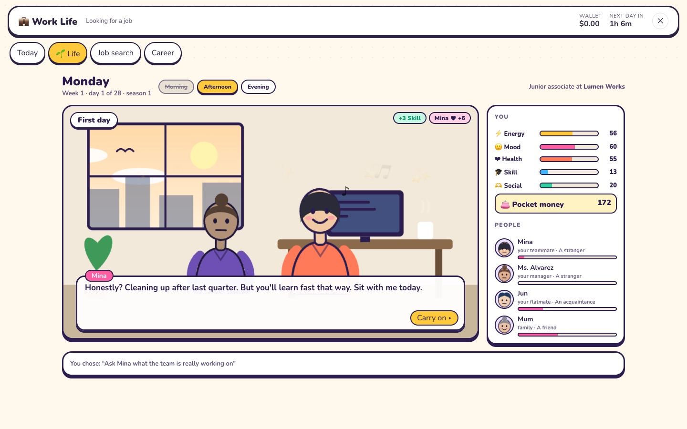
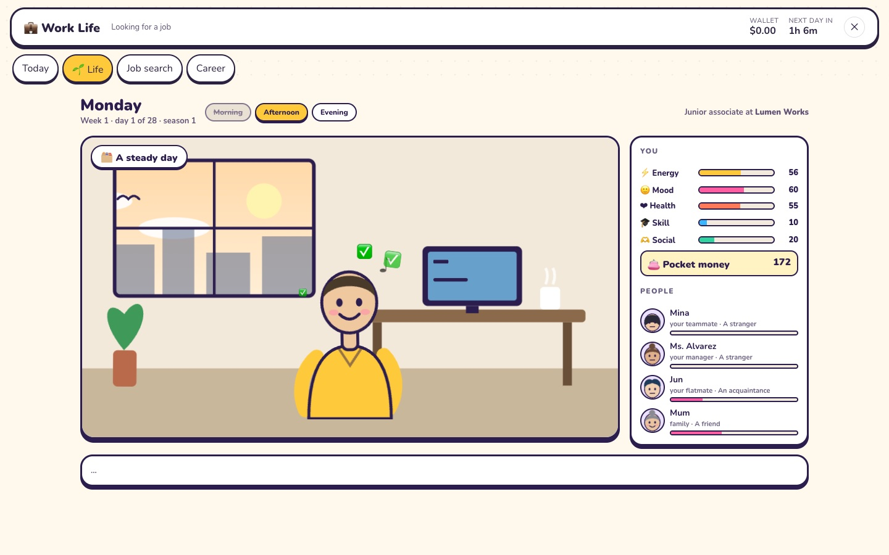
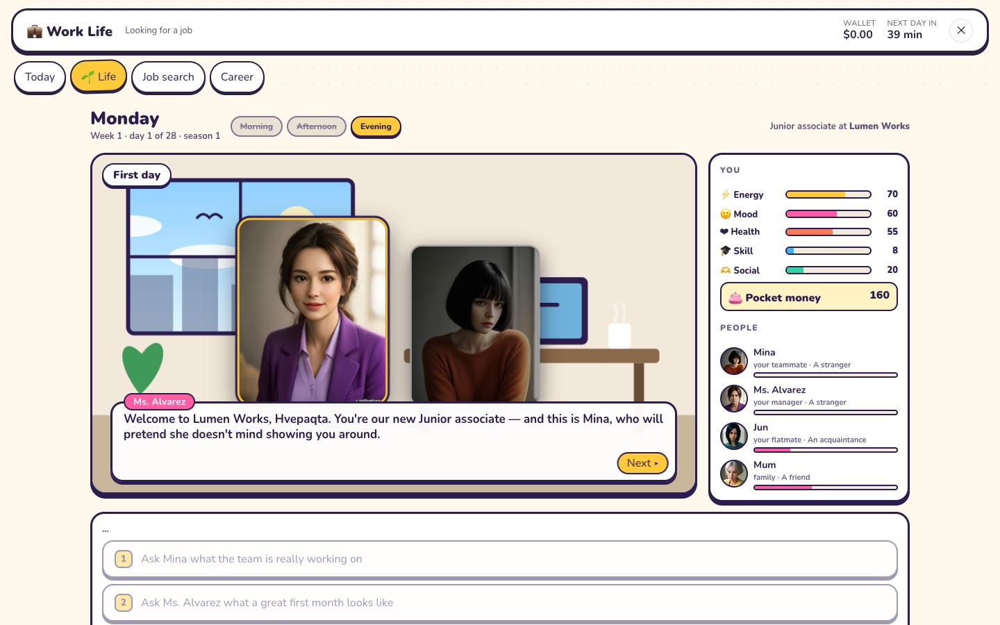
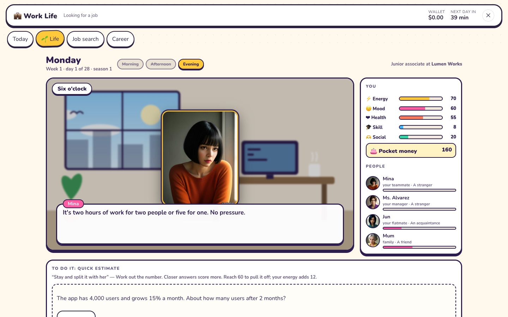

# Work Life

[← Back to the README](../README.md)

A job at one of 500 real companies, in real time. Every day, real news about your company becomes
your work: decisions, mini-games and notes to write. You are paid for each day you work, earn
bonuses when the company does well, get a review every game year — and layoff news can reach you.
Game money only.

  

  

  
  

*The screenshots come from the test suite, which runs on made-up news.*

## Life: the days around the job

The **🌱 Life** tab is a life you raise — like a raising or life simulation, about an ordinary
working life. (The stories, people and places are our own.)

  
  

- **It keeps the game's time, like real life.** A day in Life is a game day (2 hours 24 minutes of
  real time at the usual speed), in three parts — morning, afternoon, evening — of 48 minutes each.
  **One thing each part**, and then the next part has to come round: nothing can be skipped or
  hurried, and the night comes on its own (a part you left empty was rest). Come back after a while
  and the days in between have been lived.
- **What you do** with a part: deep work, a steady day, helping a teammate, learning from a senior;
  in the evenings and at weekends rest, exercise, study, friends, an hour at the café, a call home,
  chores, a side project or overtime. Each moves what you are — **energy, mood, health, skill, how
  sociable you are**, and pocket money. Worn out, you get less from the same hours; what you are
  already good at grows more slowly; fitness and friendships slip a little every day.
- **Scenes happen** — after something you do, when a new part of the day begins, and **when you
  finish a task on Today** (a work task or an odd job can set the next scene going, so the story
  moves on days when you are busy). A scene is a place and the people in it, their words typed out
  a line at a time, their faces showing how they feel.
- **Hard choices are done, not picked.** An easy answer just happens. A hard one — stay and fix
  the bug with Mina, speak up in the meeting, present it your own way — is **a small task to play**
  (put jobs in order, find the rows that don't add up, work out a number), and **how well you do
  it decides how the scene turns out**: 60 to pull it off, with what you are counting too (half a
  point for every point of energy, skill or health above or below what the moment asks, up to 20).
  Where an answer turns on money or on how close you are to someone, it is simply so or not.
- **What happened decides what can happen.** Help Mina and she owes you a lunch, where she tells
  you something; hide a mistake and it comes back on Friday; talk to the stranger at your café
  table and there is a rainy doorway a week later.
- **Thirteen people, by where they stand.** Your teammate Mina, Dev the senior who might mentor
  you, your manager Ms. Alvarez, Tom Becker who manages the team next door (and tries to poach
  you), Marcus Hale the vice-president who wants a straight answer in ten minutes, **Victoria Lang
  the chief executive** who asks you one question in a lift — and may remember the answer at the
  all-hands — and **two interns, Ana and Leo**, who are told to find you. At home your flatmate Jun
  and your mum; at the café, Sora. Each is as close to you as you have made them, and you only
  "know" someone once you have met.
- **A part-time job.** Any evening or weekend you can take **a shift at the corner shop** for real
  pocket money and sore feet. The shop has its own stories: Mrs. Okoye, who has run it for
  twenty-two years; **Kai, nineteen**, who films a "day in my life" in the middle of the Friday
  rush and plans to quit by simply not turning up; a ten-year-old who tries to pay with a game's
  gift card and is always twenty short; teenagers asking for "the viral one" in words you don't
  know; a twelve-year-old with a chocolate bar up her sleeve. How you treat people on the other
  side of the till — younger, older, in a hurry — is the game there.
- **A first go at managing.** From the fifth day you can spend work hours **coaching the
  interns**. That has scenes too: Leo's report with the wrong totals (find them with him, say
  "tighten it up", or fix it yourself after he leaves), Ana asking for a real piece of work, Ana
  never getting a word in at meetings, Leo wiping the wrong database — and, if you turn out to be
  good at it, Ms. Alvarez puts you forward for the new-manager course, where the vice-president
  sets the first exercise.
- **A season is 28 days**, and ends with a name for how you lived it — *The Rising Star*, *The One
  Everyone Calls*, *A Life in Balance*, *The Quiet Expert*, *Running on Empty*, *Just Getting By* —
  which you can share. Sundays the rent goes out. Life has its own pocket money: it never touches
  the wallet.
- Keys: **Space** or **Enter** for the next line, **1–3** to answer.
- If you have a job in Work Life, the scenes speak of that company and your title; otherwise of a
  small studio called Lumen Works.

**The pictures.** People and places are **photographs made once by an image-generating AI** and
kept with the game in `public/work-scenes/` (thirteen people in three moods, six places by day and
by night); nothing is generated while you play. They were made with `npm run work:images -- --free
--people`, which uses pollinations.ai's free service at its allowed pace (one picture every 45
seconds; its small mark is left on each picture and it is credited on screen). The people and
places are invented — no real person is shown. With your own image service
(`IMAGE_API_KEY`, `IMAGE_API_BASE_URL`, `IMAGE_MODEL`) the same command makes a fuller set (four
lights a place); `--force` makes them again. Without any pictures the game draws its own.

The rules are in `src/work/life.js`, the story in `src/work/lifeStory.js`, the drawn fallback in
`src/work/lifeArt.js`; the server keeps each life (`work_life`) and decides every step.

## How it plays

- **Find a job.** *Job search* lists the S&P 500 (one entry per company; `src/work/companies.json`,
  from Wikipedia's list), searchable and by sector. Pick a company and a role — software engineer,
  data analyst, marketing, sales, customer support, operations, finance, people & HR — and answer
  three interview questions. A strong interview starts you as an **Associate**, a good one as a
  **Junior**, a fair one as an **Intern**; otherwise the company says no for today. A company with
  layoffs in the news is **not hiring** for a week. One job at a time; *Career → Quit* to move on.
- **Odd jobs — money for anyone.** On *Today*, with or without a job, there are five quick paid
  puzzles a game day (the same mini-games as below), paying up to $120 each by how well you do —
  less in a day than an intern earns, but it is something while you look.
- **Offers arrive.** Good work gets noticed: after an odd job done well (more often if you have no
  job), and now and then after a day's work, **a company writes with an offer** — a role and the
  pay that company gives its own people for it (for someone already working: your level, within a
  tenth of your pay either way). No interview; take it or leave it within two game days. Taking one
  while employed means leaving your job.
- **The clock runs ten times faster than life.** A game day is 2 hours 24 minutes of real time
  (`WORK_SPEED`, 10 by default; 1 makes game days calendar days), so a quarter is under 17 hours
  and a game year under three days. The bar shows when the next day begins. Real news still arrives
  at its own pace, so some game days are routine work.
- **Share it.** Getting hired, taking an offer, your career page and a season's end each have a
  **Share** button: a picture card and the words to post, with LinkedIn and Facebook buttons (they
  open with the game's address; the words are copied for you to paste). The words always say it is
  a game — these are real companies' names, and nobody should take it for a real job.
- **Every day** (game days; at `WORK_SPEED=1` they count in `WORK_TZ`, UTC by default) brings up to three tasks:
  - **Decisions** from the company's real news: a short situation and four answers, from best to
    clearly wrong (dishonest, unsafe, rude). With the AI on, the server writes them from the headline
    (`LLM_MODEL2`); one is written per story and role and shared by everyone in that role there.
    Without it, a template for that kind of news (`src/work/scenarios.js`).
  - **A mini-game** for your role (`src/work/minigames.js`): *Triage* (order five tasks by urgency =
    people affected ÷ hours left), *Spot the error* (rows whose total does not add up), *Quick estimate*
    (growth, a budget, boxes packed). Made from a seed and scored on the server.
  - **A note to write** (with the AI on; at most one a day): 40–120 words to your team about a story.
    The AI grades it on a rubric — addresses the news (40), clear and kind (30), honest (20), length (10)
    — and says what was good and what to improve. Plus accounts are graded by the premium model.
  - Tasks are due within a day and a half (game time); missed ones count as zero.
- **Pay.** The first task you finish on a day pays that day's salary (the yearly salary ÷ 28) into
  your **wallet**.
- **The company's news** (`src/work/news.js`): stories are sorted into kinds — strong or weak results,
  layoffs, launches, deals, partners, leadership, legal, recalls, analyst upgrades and downgrades,
  dividends, growth. A strong quarter or a dividend pays everyone there a **bonus** (by performance).
  **Layoffs** reach each person with a chance between 3% and 50%: lower with better work and more
  years. Laid off, you get **severance** (ten days' pay, plus two per year) and can apply elsewhere.
- **The game year** is 28 game days, with a check-in each quarter (7 days). The **evaluation**
  (70% your task scores, 30% tasks done): *Exceeds* — a raise of 8% and a 10% bonus, and a
  **promotion** after two in a row; *Meets* — 3% and 3%; *Needs improvement* or *Unsatisfactory* — a
  warning, and two warnings in a row mean being let go. Titles go Intern → Junior → Associate →
  Senior → Lead → Manager → Director.
- **The wallet** is shared: Work Life pays into it, and the
  [Stock Market Challenge](stock-market.md) can invest it (*Portfolio → Add to this run*; money added
  counts as money put in, so returns stay fair).

## News and the AI

- News comes from **Alpaca's news API** (Benzinga's feed), with the same keys as the stock game.
  The server asks for the companies people work at every 30 minutes, and keeps only short text and
  the link. A story counts for a company when it is tagged and few companies are, or the headline
  names it.
- **Family-safe:** stories about politics, violence, crime, adult topics, drugs, gambling or weapons
  are kept out of tasks. Headlines are data: the AI is told never to follow instructions in them, its
  answers must fit a strict JSON schema, and the four answers must be one of each quality.
- Showing headlines to the public is subject to the news provider's terms (as with prices — see
  [Data licensing](stock-market.md#data-licensing)).

## The admin API

For the platform's admin site, with the same id and password as the stock game's (HTTP Basic,
`ADMIN_ACCOUNTS` + `ADMIN_PASSWORD`):

| Call | What it does |
| --- | --- |
| `GET /api/work/admin` | every career (company, title, salary, status, reviews, warnings, this year's performance, wallet), the latest 300 career events, and whether news and the AI are on |
| `GET /api/work/admin/missions?after=<id>&limit=<n>` | every task and its score, oldest first, up to 5,000 a page (`next` for the next page) |

## For developers

- Server: `server/work/index.js` (routes, rules, news, the AI), `server/work/newsProvider.js`
  (Alpaca; made-up news only with `WORK_NEWS_PROVIDER=fixture`), `server/wallet.js`,
  `server/api/llm.js` (the server's own model calls), `server/api/adminAuth.js`; migration `006-work`.
- Client: `src/work/` — `WorkGame.js` (the screen), `roles.js` (roles, ladder, pay, reviews,
  layoffs), `news.js`, `scenarios.js`, `minigames.js`, `companies.json`. Loaded only when opened.
- `WORK_AI=off` turns the AI off for this game (the tests do).
- Tests: `tests/unit/work.test.mjs` (news reading, mini-games, reviews, a whole career with pay, a
  review and a layoff story, the wallet into the stock game) and `tests/e2e/work.mjs` (by mouse).
