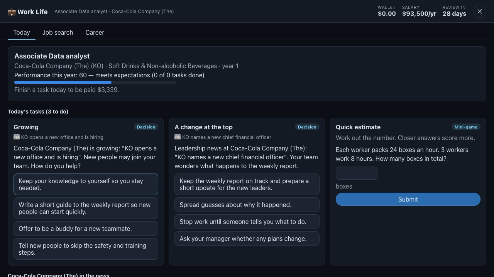
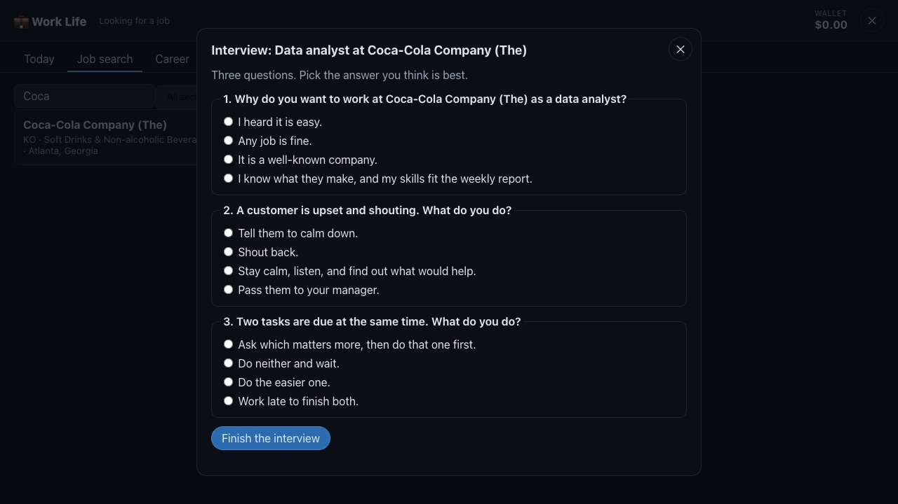

# Work Life

[← Back to the README](../README.md)

A job at one of 500 real companies, in real time. Every day, real news about your company becomes
your work: decisions, mini-games and notes to write. You are paid for each day you work, earn
bonuses when the company does well, get a review every game year — and layoff news can reach you.
Game money only.

  

  

*The screenshots come from the test suite, which runs on made-up news.*

## How it plays

- **Find a job.** *Job search* lists the S&P 500 (one entry per company; `src/work/companies.json`,
  from Wikipedia's list), searchable and by sector. Pick a company and a role — software engineer,
  data analyst, marketing, sales, customer support, operations, finance, people & HR — and answer
  three interview questions. A strong interview starts you as an **Associate**, a good one as a
  **Junior**, a fair one as an **Intern**; otherwise the company says no for today. A company with
  layoffs in the news is **not hiring** for a week. One job at a time; *Career → Quit* to move on.
- **Every day** (days count in `WORK_TZ`, UTC by default) brings up to three tasks:
  - **Decisions** from the company's real news: a short situation and four answers, from best to
    clearly wrong (dishonest, unsafe, rude). With the AI on, the server writes them from the headline
    (`LLM_MODEL2`); one is written per story and role and shared by everyone in that role there.
    Without it, a template for that kind of news (`src/work/scenarios.js`).
  - **A mini-game** for your role (`src/work/minigames.js`): *Triage* (order five tasks by urgency =
    people affected ÷ hours left), *Spot the error* (rows whose total does not add up), *Quick estimate*
    (growth, a budget, boxes packed). Made from a seed and scored on the server.
  - **A note to write** (with the AI on; at most one a day): 40–120 words to your team about a story.
    The AI grades it on a rubric — addresses the news (40), clear and kind (30), honest (20), length (10)
    — and says what was good and what to improve. Plus accounts are graded by the premium model.
  - Tasks are due within 36 hours; missed ones count as zero.
- **Pay.** The first task you finish on a day pays that day's salary (the yearly salary ÷ 28) into
  your **wallet**.
- **The company's news** (`src/work/news.js`): stories are sorted into kinds — strong or weak results,
  layoffs, launches, deals, partners, leadership, legal, recalls, analyst upgrades and downgrades,
  dividends, growth. A strong quarter or a dividend pays everyone there a **bonus** (by performance).
  **Layoffs** reach each person with a chance between 3% and 50%: lower with better work and more
  years. Laid off, you get **severance** (ten days' pay, plus two per year) and can apply elsewhere.
- **The game year** is 28 real days, with a check-in each quarter (7 days). The **evaluation**
  (70% your task scores, 30% tasks done): *Exceeds* — a raise of 8% and a 10% bonus, and a
  **promotion** after two in a row; *Meets* — 3% and 3%; *Needs improvement* or *Unsatisfactory* — a
  warning, and two warnings in a row mean being let go. Titles go Intern → Junior → Associate →
  Senior → Lead → Manager → Director.
- **The wallet** is shared: Work Life pays into it, and the
  [Stock Market Challenge](stock-market.md) can invest it (*Portfolio → Add to this run*; money added
  counts as money put in, so returns stay fair).

## News and the AI

- News comes from **Alpaca's news API** (Benzinga's feed), with the same keys as the stock game.
  The server asks for the companies people work at every 30 minutes, and keeps only short text and
  the link. A story counts for a company when it is tagged and few companies are, or the headline
  names it.
- **Family-safe:** stories about politics, violence, crime, adult topics, drugs, gambling or weapons
  are kept out of tasks. Headlines are data: the AI is told never to follow instructions in them, its
  answers must fit a strict JSON schema, and the four answers must be one of each quality.
- Showing headlines to the public is subject to the news provider's terms (as with prices — see
  [Data licensing](stock-market.md#data-licensing)).

## The admin API

For the platform's admin site, with the same id and password as the stock game's (HTTP Basic,
`ADMIN_ACCOUNTS` + `ADMIN_PASSWORD`):

| Call | What it does |
| --- | --- |
| `GET /api/work/admin` | every career (company, title, salary, status, reviews, warnings, this year's performance, wallet), the latest 300 career events, and whether news and the AI are on |
| `GET /api/work/admin/missions?after=<id>&limit=<n>` | every task and its score, oldest first, up to 5,000 a page (`next` for the next page) |

## For developers

- Server: `server/work/index.js` (routes, rules, news, the AI), `server/work/newsProvider.js`
  (Alpaca; made-up news only with `WORK_NEWS_PROVIDER=fixture`), `server/wallet.js`,
  `server/api/llm.js` (the server's own model calls), `server/api/adminAuth.js`; migration `006-work`.
- Client: `src/work/` — `WorkGame.js` (the screen), `roles.js` (roles, ladder, pay, reviews,
  layoffs), `news.js`, `scenarios.js`, `minigames.js`, `companies.json`. Loaded only when opened.
- `WORK_AI=off` turns the AI off for this game (the tests do).
- Tests: `tests/unit/work.test.mjs` (news reading, mini-games, reviews, a whole career with pay, a
  review and a layoff story, the wallet into the stock game) and `tests/e2e/work.mjs` (by mouse).
