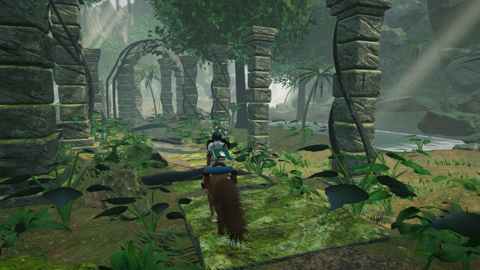

# Wyldhunt

[← Back to the README](../README.md)

The first hunting ground of a monster-hunting game. There is no story and no quest chain yet:
choose a hunter, ride up the gorge, gather what grows, follow the tracks to the Gnarlhorn and
bring it down — then carve it.

**Mistfall Gorge** is a jungle canyon nearly a kilometre long, walled by stepped, mossy cliffs a
hundred metres high and closed at both ends. It is played as **three zones** ([zones.md](zones.md)),
one built at a time:

- **Lantern Camp**, the guild's base camp, a hub of its own behind a palisade of sharpened stakes;
- **Veilfall Reach**, the lower gorge, through the **Hunters' Gate**: the Green Cleft, the Drowned
  Colonnade, the ford, Veilfall and the Root Gate, with the **forward camp** at its mouth;
- **the Hollow Heights**, above the **Stair of Roots**: Velvet Meadow, Ropewalk Gorge, Fernspill,
  Old Throne Hollow and the Grand Fall, with **Kestrel Lookout**, a hunters' watch-platform of
  lashed bamboo, at the stair's head.

The Reach and the Heights are joined where the roots of the giants above spill down the step in the
canyon's floor from wall to wall: the old stone stair climbs through **the Root Stair**, an arch of
two twisted roots with the gorge's mist swirling in it. A second trail south of the camp, **the
Southern Trail**, waits for the next hunting ground (coming soon). Every camp is a safe hub: a map
board or the map table (the World tab), the hunt board, a stash (its lid swings open while you use
it), a stand with your double in your armour and the hunter's sheet, the provisioner (coins for what
you gather and carve; draughts, rations, a refill), the tent or a bedroll by a fire, and a waystone
(dim until you reach it, then its runes glow). The Gnarlhorn won't follow you inside; if you faint,
your companions carry you to the last camp you rested at. The field bag, coins and the stash are
kept between sessions now. Burrow and your companions come through every gate with you — ride
through and you arrive in the saddle — and the music carries on unless the new zone's rule changes
it.

**The Gnarlhorn lives in the Hollow Heights**: its den and every haunt (the basin, the meadow, the
shallows below its den, Fernspill) are above the stair. Below it, its old prints lie up the path;
read three in Veilfall Reach and it is tracked: the scout flies lead up the path to the Stair of
Roots (from Lantern Camp, to the Hunters' Gate), and the map marks the way. Tracking carries through the gates, and so does the hunt:
leave the Heights and come back, and its wounds, its broken horns and a severed club where it fell
are as you left them (it will have calmed down, and wandered off if it was by the stair). A slain
Gnarlhorn is gone the next time you climb the stair; another has taken its place.

- **Lantern Camp** at its mouth: a ridge tent of patched canvas on its guy ropes, a tarp over the
  map table, the supply box (it restocks your potions), a cooking fire, the guild's banner, a
  hitching post.
- **The Green Cleft** and **the Drowned Colonnade**: an avenue of square pillars along the old paved
  road, some broken and tumbled, roots coiling down them; an arch over the road.
- **The ford**, with stepping stones, and **Ropewalk Gorge**, where the river runs in a slot five
  metres deep under a rope bridge.
- **The Stair of Roots**, an old stair up a step in the canyon floor, the river tumbling beside it
  under the roots, past **the Root Gate** and up through the Root Stair's arch into the Heights.
- **Velvet Meadow**, where the herds graze; **Fernspill** and **Veilfall**, falls off the walls;
  **Old Throne Hollow**, the Gnarlhorn's den, bones in a bay of the west wall.
- **The Grand Fall**, a hundred and twenty metres high, and the colossi — stepped towers sixty
  metres tall — standing in its plunge pool's mist.

The weather turns every few minutes: hazy sun with shafts of light slanting through the mist,
clouding over, a shower (everything goes wet and dark and glossy, rain rings on the water), then
clearing.

## Playing

| Key | |
| --- | --- |
| **W A S D** · **Shift** | Move (the way the camera looks) · sprint (uses stamina) |
| **Space** | Dodge roll (a moment where nothing touches you) · jump, when riding |
| **Left mouse** | Greatblade: a three-swing combo · Bow: a shot (hold to draw through three charge levels) |
| **Right mouse** | Greatblade: a heavy overhead (hold to charge three levels, release to swing) · Bow: hold to aim over the shoulder |
| **Tab** · **F** | Swap greatblade and bow · sheathe or draw |
| **E** | Gather, carve, mount and dismount, take from the supply box · in a camp: the map, the hunt board, stash, gear stand, provisioner, rest, waystone |
| **X** | Whistle for Burrow, your Shagmane |
| **Hold R** (riding) | Burrow follows the path on its own, either way along it; **Shift** gallops |
| **1 – 4** | Healing draught, greater draught, whetstone, trail ration — no cooldown: use them as often as you carry them |
| **B** · **V** · **H** · **Esc** | Field bag · mouse-look · controls · menu (sound, credits, leave) |

The mouse points: attacks and shots go toward the pointer (snapped to the beast near it).
Middle-button drag turns the camera; the wheel zooms.

**The hunter** wears one of three armour sets — Ironbark (heavy plate), Mosscale (bronze
brigandine), Fernstalker (leather and a hood) — and carries both weapons. The greatblade dulls
as it bites (white, blue, green, yellow, orange, red); below green it bounces off the plates on
the beast's back; a whetstone brings the edge back. Health and stamina are the bars top left;
the party is listed under them; the weapon and its sharpness or charge are bottom right; the item
bar is in the middle; the circular minimap, always on, is bottom left (the camp, gathering
spots, your companions, Burrow, unread tracks, and the Gnarlhorn once tracked).

**Burrow** comes running when whistled, rears as it arrives, and can be ridden at a walk, a trot
or a gallop. It leans into turns, climbs gentle slopes (not cliffs), splashes through the ford,
jumps, and runs the path by itself while R is held. The herds bolt from it as they do from you.

**Gathering**: sunleaf and dewcap, ore seams, bug logs and bone piles glimmer when you are near;
each gives a few times and grows back later. What you gather and carve goes in the field bag.

**Tracking**: the Gnarlhorn leaves three-toed prints where it walks; some are already on the path
up the gorge. Walk over three and it is tracked — the scout flies, a stream of green motes, lead
to it from then on, and it shows on the minimap.

**The Gnarlhorn** roams between its haunts (the basin, the meadow, the shallows, Fernspill, its den),
lingers, notices you, turns and roars — a roar that makes you cover your ears — and fights:
bites, tail sweeps, charges, each wound up first. There is no health bar: it shows its wear (scars,
a duller coat), its eyes burn and its breath steams when it is enraged, it limps when it is weak
and goes to ground in its den to sleep, and wakes roaring if you strike first. Its horns break off
(stumps stay; the horn is yours) and its tail club can be severed (the club lies where it fell,
and can be carved). Defeated, it can be carved three times. Two companions come along: **Yara**,
with a bow, keeps her distance and shoots; **Doran**, with a spear, closes in and jabs. Both roll
clear of its blows and call out what is happening (subtitled). Thornskitters guard their nests;
velvetbucks graze in herds and bolt.

The game picks a quality level from the graphics card and then adjusts it to keep frames quick
(low, medium, high, ultra: render scale, shadows, ground cover, plants, fur layers, rain, mist,
the water's refraction, ambient occlusion, light shafts). `?quality=low|medium|high|ultra` fixes
it; `?debug` shows frame time, draw calls and triangles; `?rain=1` holds the shower.

## How it looks the way it does

| | |
| --- | --- |
| After the render | Gloamreach's chain — ambient occlusion from depth, light shafts toward the sun, height fog lit by the sun it faces, bloom on the brightest, ACES with a split tone, SMAA — plus a *wet pass*: once the solid world is drawn, the frame and its depth are copied, and the water, the falls, the mist and the rain are drawn over it reading those copies. And mist volumes: spheres of spray round each plunge pool, thick low and thin high, integrated along every view ray, so the colossi fade into it |
| Ground | One height function; the walls stepped into ledges; eight photographed materials blended by a splat map; rock projected three ways on the walls, mossy rock on every ledge (by slope, height and damp), streaks down the faces; wet and glossy by the water, in the falls' spray and in the rain, with puddles on the mud |
| Water | A ribbon down the river, discs for the pools: ripples carried by the current (two layers crossfaded, faster in the gorge and the rapids), what lies under bent and darkened by its depth, foam at the banks, over the rapids and where the falls land, the sky and the walls mirrored, the sun's glint, rain rings |
| Falls | Sheets that hug the cliff from lip to pool, torn into strands that race down; a looser veil before them; soft against the rock |
| Mist and light | Big soft cards boiling off each pool and rising, fading where they touch anything; spray in arcs; long shafts of sunlight leaning through the haze |
| Plants | Palms, tree ferns, taro, wild bananas and vines grown here with painted leaves, folded fronds and wind weights; Gloamreach's tree grower with a buttressed jungle species; photographed ferns, shrubs, mossy rocks and cliff faces; roots arching over the path; GPU ground cover pushed aside by the hunter and the mount |
| Creatures | Mesh2Motion's horse, T-Rex and spider re-coated through their own texture's light and shade, reshaped bone by bone, given fur shells (one draw for all layers, strands from two turned lattices, darker at the root, drooping and tossed by motion), and sculpted parts on their bones |
| People | polyfork bodies with Gloamreach's material upgrade, armour on their bones and Mesh2Motion's clips retargeted on |

## For developers

| Part | File |
| --- | --- |
| The map as data · the land's height, water, bridge and surface · quality tiers · the cast · credits · the hunt's numbers (weapons, sharpness, hide, breaks, items, bag, gathering, carving, the weather's cycle) · the minds (monster, tracker, mount) — all pure, tested | `map.js` · `heights.js` · `quality.js` · `cast.js` · `credits.js` · `rules.js` · `brains.js` |
| The zones (data, what belongs where, the provisioner's prices, the save and its upgrade from the single gorge) · the palisade and the Hunters' Gate · the root wall and the Root Stair · Kestrel Lookout | `zones.js` · `palisade.js` · `rootwall.js` · `lookout.js` (framework: `src/shared/zones/`) |
| The game: screens, loop, input, riding, interacting | `WyldhuntGame.js` |
| Scene assembly · terrain · sky and light · water, falls, mist and shafts · plants · the jungle placed · ground cover · ruins · camp · rain | `world.js` · `terrain.js` · `sky.js` · `water.js` · `plants.js` · `flora.js` · `cover.js` · `ruins.js` · `camp.js` · `weather.js` |
| Creature bodies, coats and fur · the mount · the Gnarlhorn · herds and thornskitters · companions | `beasts.js` · `mount.js` · `monster.js` · `wildlife.js` · `companions.js` |
| The hunter (looks, weapons, motion) · the fight · gathering spots, tracks, scout flies | `hunter.js` · `combat.js` · `nodes.js` |
| Post-processing · sound · screens, HUD, minimap, bag, credits | `post.js` · `audio.js` · `ui.js`, `wyldhunt.css` |
| Tests | `tests/unit/wyldhunt.test.mjs` |

All in `src/wyldhunt/`. It reuses Gloamreach's modules unchanged where they fit (textures,
noise, shader patches, the tree grower, the prop library and kit, collision, characters and
retargeting, fighter, armour, effects, sound effects, the follow camera, the quality governor) and
Lanternwood's aim maths. The models and materials come from the asset library (fetched on
`npm run dev` / `npm run build`; the polyfork bodies and the ambientCG sets it needs are in the
library's extras list).

Credits for everything third-party, with links and licences, are in the game's Credits panel
(start screen and Esc menu) and in [third-party.md](third-party.md).
